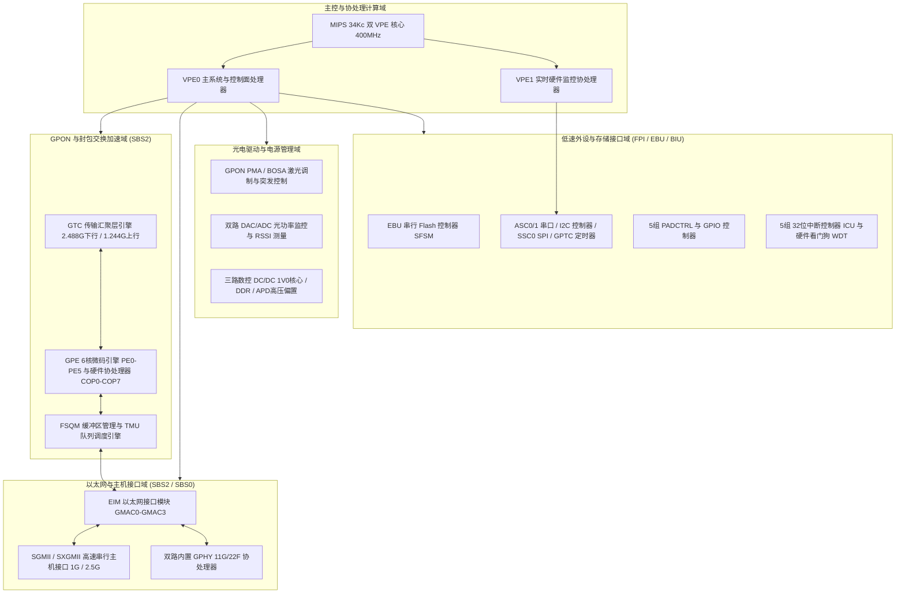

# 1.1 芯片定位与产品形态

Lantiq Falcon（硬件代号 GPON-SOC，主型号 PEB 98035 / PEF 98035）是面向千兆无源光网络（ITU-T G.984 GPON）客户端设备（ONT / ONU / SFU / SFP Stick）的单芯片系统级芯片（SoC）。芯片在单一硅片内集成 MIPS32 34Kc 双虚拟处理单元（VPE）主处理器、GPON 传输汇聚层（GTC）硬件引擎、6 核可编程封包处理引擎（GPE）、共享缓冲区段管理单元（FSQM）、流量管理单元（TMU）、多端口以太网交换与 PHY 子系统（EIM / GPHY / SGMII）、模拟激光驱动与监控前端（Optic BOSA/OMU 接口）以及三路数字控制片上 DC/DC 转换器。

---

## 1.1 芯片型号与 eFuse 变体标识

Falcon 家族包含多个封装与外设裁剪变体，通过片上 `STATUS` 模块（物理基址 `0x1E802000`）中的 `CHIPID`、`FUSE0` 与 `CONFIG` 寄存器在硬件上唯一标识：

* **芯片标识寄存器 `STATUS_CHIPID`（`0x1E80200C`）**：
  * `VERSION`（位 `[31:28]`）：4 位主硬件版本掩码。
  * `PARTNR`（位 `[27:12]`）：16 位芯片部件号（Part Number，典型值 `0x01B8` / `0x016B`）。
  * `MANID`（位 `[11:1]`）：11 位 JEDEC 制造商标识（`0x041`，Infineon / Lantiq）。
  * `CONST1`（位 `[0]`）：恒定为 `1`。
* **熔丝配置寄存器 `STATUS_FUSE0`（`0x1E802038`）**：
  * `F0`（位 `[29:26]`）：4 位设备封装与功能变体字段（Device Type），硬件通过生产阶段烧录的 eFuse 区分以下四类子型号：

| `FUSE0.F0` (`[29:26]`) | 芯片子型号标识 | 目标产品形态 | 关键外设配置特征 |
| :--- | :--- | :--- | :--- |
| `0` (`0000b`) | **Falcon-D** | 桌面型 / 网关型 ONT | 完整引出双路内置千兆铜缆 PHY（GPHY0/GPHY1）、xMII、PCM 语音总线及多路 GPIO |
| `1` (`0001b`) | **Falcon-V** | 语音增强型网关 ONT | 启用语音协处理子系统（MPS / DFEV0）与 PCM 通道，支持模拟电话接口（FXS） |
| `2` (`0010b`) | **Falcon-M** | 多端口桥接型 MDU / SFU | 面向多端口以太网接入，启用 SGMII 与多路 GMAC 交换接口 |
| `3` (`0011b`) | **Falcon-S** | 小型可插拔光模块 (GPON SFP Stick) | 缩减封装尺寸与外围引脚，聚焦单路高速 SGMII/SERDES 主机接口、片上 BOSA 光电驱动及双地址 I2C 从机监控接口 |

* **硬件配置与子版本寄存器 `STATUS_CONFIG`（`0x1E802040`）**：
  * `SUBVERS`（位 `[25:22]`）：4 位硅片步进子版本（`0` = `Av1`，`1` = `Av2`，`2` = `Av3`，`3` = `Av4`，`4` = `Bv1`）。当位 `[24]`（即 `SUBVERS & 4`）置位时代表 B 系列硅片步进（如 `B11`、`B12`），未置位时代表 A 系列硅片步进（如 `A11`、`A12`）。
  * `SHA1EN`（位 `[27]`）/ `AESEN`（位 `[26]`）：指示片上 SHA1 与 AES 加密硬件加速单元在当前芯片型号中是否使能。
  * `GPEFREQ`（位 `[11:10]`）：指示 GPON 封包处理引擎（GPE）的基础工作频率配置。

---

## 1.2 核心功能子系统概览

Falcon SoC 的内部硬件逻辑划分为五大功能域：

### 1. 主控与多线程处理器域（MIPS 34Kc MT）
* 采用主频 400 MHz（支持分频至 200 MHz）的大端序（Big-Endian）MIPS32 Release 2 **34Kc** 核心，支持 MIPS16e 代码压缩扩展、DSP ASE 及多线程扩展（MT ASE）。
* 单一物理核心提供 2 个硬件虚拟处理单元（**VPE0** 与 **VPE1**）和最多 5 个硬件线程上下文（**TC0–TC4**），共享 32 KiB 4 路组相联指令缓存（I-Cache）与 16 KiB 4 路组相联写回式数据缓存（D-Cache）。
* **VPE0** 执行主控协议栈（如 OMCI 管理控制面、GPE 表项维护与光链路校准任务）；**VPE1** 可独立绑定专用硬件线程（TC1）运行裸机固件，响应毫微秒级外设中断（如 SFP 双地址 I2C 从机事务），不受 VPE0 中断屏蔽或缓存未命中的阻塞。

### 2. GPON 传输汇聚与线速封包处理域（GTC + GPE + TMU + FSQM）
* **GTC（GPON Transmission Convergence，`0x1DC00000`）**：硬件实现 ITU-T G.984.3 下行 2.48832 Gbps 帧同步、PloamD 解提取、AES-128 计数器模式解密、BCH 纠错以及 GEM 帧定界；上行方向支持 1.24416 Gbps 动态带宽分配（DBA）授权解析（BWMAP）、微秒级突发激光开启/关闭时序控制、PloamU/DBRu 插入与 GEM 帧封装。
* **GPE（GPON Packet Engine）**：由输入控制单元（`ICTRLG` / `ICTRLL0–3` / `ICTRLC0–1`）、输入队列管理器（`IQM`）、分配器（`DISP`）、6 颗对称可编程微码引擎（`PE0–PE5`，每核独立 16 KiB 指令 RAM 与 12 KiB 数据 RAM）、8 个硬件表项协处理器（`COP0–COP7`，负责 L2/L3/VLAN/组播查找与计量染色）、合并器（`MERGE`）、流量管理单元（`TMU`）与输出控制单元（`OCTRLG` / `OCTRLL0–3` / `OCTRLC`）组成，提供全线速桥接、VLAN 转换、QoS 优先级映射与流量整形能力。
* **FSQM（Free Segment Queue Manager，`0x1D500000`）**：管理片上共享封包缓冲区（Packet Buffer RAM），将帧载荷切分为固定长度的逻辑段（Segment，由逻辑段地址 LSA 索引），通过硬件空闲段链表（IFSQ / OFSQ）实现零拷贝帧缓冲分配与回收。

### 3. 以太网交换与主机接口域（EIM + SGMII + GPHY）
* **EIM（Ethernet Interface Module，`0x1D800000`）**：包含 4 个千兆以太网 MAC 通道（`GMAC0`–`GMAC3`）与统一 MDIO 主控制器（支持 IEEE 802.3 Clause 22 与 Clause 45 寄存器访问）。
* **SGMII / SXGMII PCS（`0x1D808800` / `0x1D808C00`）**：提供串行千兆媒质独立接口，支持 1000BASE-X、标准 SGMII（10/100/1000 Mbps 自协商）以及 2.5 Gbps 超频 SGMII（Turbo SGMII / HiSGMII）模式，在 SFP 光模块形态下直接连接外部交换机或路由器主机端口。
* **内置双路 GPHY（GPHY0 / GPHY1）**：片上集成两套支持 10/100/1000BASE-T（11G）或双速百兆（22F）的以太网物理层收发器，其内部 8051 协处理器通过 `SBS0CTRL`（`0x1F080000`）重映射机制从片上 `SBS0RAM` 加载控制固件。

### 4. 光电前端与片上电源域（Optic PMA + DCDC）
* **光电前端（Optic Subsystem）**：直接驱动 BOSA（Bi-directional Optical Sub-Assembly）组件，硬件集成突发模式激光驱动器（Laser Driver）偏置（Bias）与调制（Modulation）电流 DAC、背光监测二极管（MPD）双通道 TIA/DAC 闭环自动功率控制（APC）、14 位 GPADC（用于采集供电电压、片内/激光器温度及接收光功率 RSSI 电流）以及 Rogue ONU 异常长发光硬件检测与关断电路。
* **三路数字 DC/DC 转换器**：芯片内置 3 个独立时钟门控与 PWM 环路控制的数字 DC/DC 控制器：
  * `DCDC1V0`：生成芯片数字核心 1.0 V 供电电压。
  * `DCDCDDR`：生成 DDR2 SDRAM 接口供电电压。
  * `DCDCAPD`：生成雪崩光电二极管（APD）所需的高压反向偏置电压（最高支持约 30 V–40 V 升压调节与温度补偿跟随）。

### 5. 存储、外设与中断控制域
* **外部内存与闪存控制**：集成 16 位 DDR2 SDRAM 控制器（映射于物理地址 `0x00000000`）以及外部总线单元（`EBU`，`0x18000000`）；`EBU` 内置串行闪存状态机（`SFSM`），支持将 SPI NOR Flash 直接映射至物理地址 `0x10000000`–`0x13FFFFFF` 供 CPU 执行就地取指（XIP）启动。
* **片上 SRAM（`SBS0RAM`，`0x1F200000`）**：提供 `0x130000` 字节（1,216 KiB）低延迟片上静态 RAM，用于存放第二阶段引导向量、VPE0/VPE1 跨核邮箱与共享内存、MPS 语音邮箱及 GPHY 协处理器固件镜像。
* **FPI 与 BIU 低速外设**：包括双路异步串口（`ASC0` / `ASC1`）、全双工同步串行 SPI 主控制器（`SSC0`）、带 8 字深硬件 FIFO 的多模式 I2C 控制器（`0x1E200000`）、通用定时器/计数器单元（`GPTC`，`0x1E100E00`）、5 组引脚复用与 GPIO 控制器（`PADCTRL0–4` / `GPIO0–4`）、5 组共 160 线中断控制单元（`ICU`，`0x1F880200`）以及两阶段密码锁保护的硬件看门狗定时器（`WDT`，`0x1F8803F0`）。
