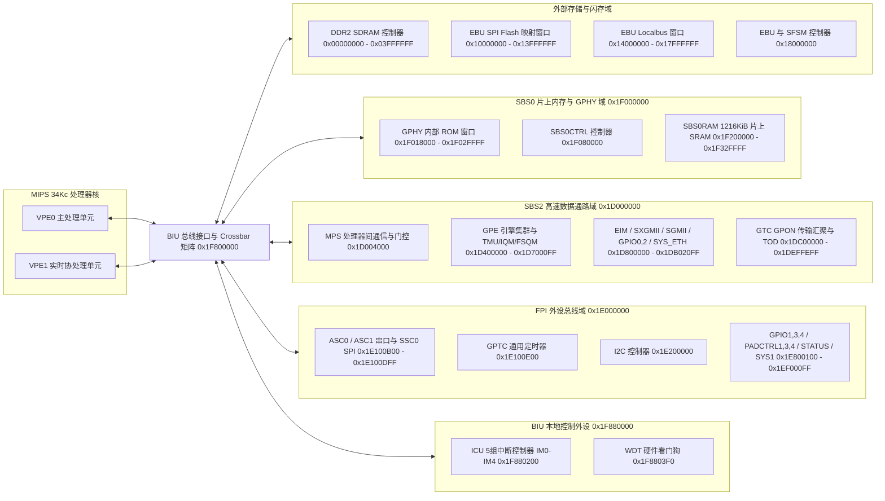
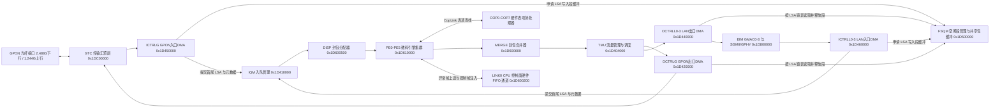

# 1.2 顶层架构与处理子系统

Lantiq Falcon（PEB/PEF 98035）采用控制平面与数据平面物理分离的片上异构多处理器架构。片上通过多层级系统总线矩阵（BIU、SBS0、SBS2、FPI、EBU）将双虚拟处理单元 MIPS 34Kc 核心、6 核 GPON 封包处理引擎（GPE）、8 个专用硬件表项协处理器（COP0–COP7）、内置千兆以太网 PHY 协处理器（GPHY）以及固定功能线速状态机（GTC、FSQM、TMU）互连。

---

## 2.1 片上异构处理单元矩阵

芯片内部共包含四类可编程处理单元与两类固定功能硬件状态机：

| 处理单元 / 硬件模块 | 核心架构与数量 | 工作时钟频率 | 专用存储资源 | 硬件职能分工 |
| :--- | :--- | :--- | :--- | :--- |
| **MIPS 34Kc VPE0** | MIPS32r2 + MT ASE（绑定 TC0） | 400 MHz（可配置 `SYS1_CPU0CC.CPUDIV=1` 降至 200 MHz） | 共享 32 KiB I-Cache、16 KiB D-Cache；访问 DDR2 与 `SBS0RAM` | 系统启动、外设初始化、OMCI 控制面协议栈、GPE 转发表项维护、光功率与温度校准闭环控制 |
| **MIPS 34Kc VPE1** | MIPS32r2 + MT ASE（绑定 TC1） | 400 MHz（与 VPE0 同源） | 共享缓存；常驻 DDR2 尾部保留区或 `SBS0RAM` | 实时外设协处理，如 SFP SFF-8472 双地址（`0x50`/`0x51`）I2C 从机中断响应与光模块寄存器状态同步 |
| **GPE 微码阵列 (PE0–PE5)** | 6 个 PE；指令和存储字宽为 64 位，ALU 与各寄存器的位宽另行规定 | 由 `STATUS_CONFIG.GPEFREQ` 与 `SYS1_INFRAC` 配置 | 每核独立 16 KiB Code RAM + 12 KiB Data RAM（基址 `0x1D610000`–`0x1D660000`） | 逐包帧头解析、VLAN 标签压入/弹出/替换、PPPoE/IPv4/IPv6 头部改写、安全过滤与异常报文上送 |
| **GPE 表项协处理器 (COP0–COP7)** | 8 个专用硬件状态机 / 微引擎 | 与 GPE 主时钟同步 | 挂载于 GPE 内部 CopLink 总线，拥有独立 Table RAM | 并行执行 FID 哈希查找、MAC 地址学习、L3 路由匹配、ACL 规则搜索、流量计量（Metering）与统计计数 |
| **GPHY 内部控制器 (GPHY0/1)** | 2 颗内置 8051 架构微控制器 | 25 MHz / 内部 PLL 衍生时钟 | 通过 `SBS0CTRL` 窗口重映射 `SBS0RAM`（物理地址 `0x1F204000`）或内置 ROM | 控制片上 10/100/1000BASE-T 或 22F PHY 的 DSP 自适应均衡、自动协商状态机及 EEE 节能链路管理 |
| **GTC / FSQM / TMU** | 纯硬件线速流水线 | GPON 线路时钟（2.488G / 1.244G）及 GPE 时钟 | `FSQM` 管理片上共享 Packet Buffer RAM 与 `PPL` 链表 | GTC 负责 GPON 成帧/解帧与 DBA 突发控制；FSQM 负责逻辑段（LSA）分配与释放；TMU 负责多队列 WFQ/SP 调度与令牌桶整形 |

---

## 2.2 片上总线拓扑与地址空间桥接

Falcon SoC 以 **BIU（Bus Interface Unit，总线接口单元）** 为中心，向外辐射出五条功能隔离的物理总线域。各总线域的物理地址范围、时钟属性及挂载模块如下：

1. **DDR2 与 EBU 存储总线域（`0x00000000`–`0x180000FF`）**
   * `0x00000000`–`0x03FFFFFF`（64 MiB）：外部 16 位 DDR2 SDRAM 物理地址窗口，直接挂载于 BIU 高速内存端口，运行于 200 MHz（DDR2-400）。
   * `0x10000000`–`0x13FFFFFF`（64 MiB）：`EBU` 串行闪存（Serial Flash）直接读取映射窗口。CPU 对该区间的读事务由 `EBU` 内部的串行闪存状态机（SFSM）自动转化为 SPI NOR Flash 读命令序列。
   * `0x14000000`–`0x17FFFFFF`（64 MiB）：`EBU` 并行本地总线（Localbus）扩展窗口。
   * `0x18000000`–`0x180000FF`（256 B）：`EBU` 与 `SFSM` 控制寄存器组，工作时钟由 `SYS1_EBUCC.EBUDIV` 选择为 50 MHz 或 100 MHz。

2. **SBS2 高速交换与 GPON 总线域（`0x1D000000`–`0x1DFFFFFF`，16 MiB）**
   * 承载芯片全部高速数据平面模块，包括语音/跨核通信模块 `MPS`（`0x1D004000`）、GPE 内部 TDM 仲裁器 `GPEARB`（`0x1D400100`）、流量管理单元 `TMU`（`0x1D404000`）、入队管理器 `IQM`（`0x1D410000`）、出入口控制器 `OCTRLG`/`OCTRLL0–3`/`OCTRLC`/`ICTRLG`/`ICTRLL0–3`/`ICTRLC0–1`（`0x1D420000`–`0x1D4611FF`）、空闲段队列管理器 `FSQM`（`0x1D500000`）、封包处理控制与调度链路 `PCTRL`/`LINK0–2`/`DISP`/`MERGE`/`TBM`（`0x1D600000`–`0x1D6007FF`）、6 颗微码处理器 `PE0–PE5`（`0x1D610000`–`0x1D66FFFF`）、`SYS_GPE` 时钟复位控制器（`0x1D700000`）、以太网接口模块 `EIM`/`SXGMII`/`SGMII`（`0x1D800000`–`0x1D808CFF`）、以太网域引脚与 GPIO 模块 `GPIO0`/`GPIO2`/`SYS_ETH`/`PADCTRL0`/`PADCTRL2`（`0x1D810000`–`0x1DB020FF`）、GPON 传输汇聚层 `GTC`（`0x1DC00000`）以及时间同步模块 `TOD`（`0x1DEFFE00`）。

3. **FPI 灵活外设互连总线域（`0x1E000000`–`0x1EFFFFFF`，16 MiB）**
   * 运行于 100 MHz 固定外设时钟，连接低速控制外设：`ASC1`（`0x1E100B00`）、`ASC0`（`0x1E100C00`）、`SSC0` SPI 控制器（`0x1E100D00`）、`GPTC` 通用定时器（`0x1E100E00`）、`I2C` 控制器（`0x1E200000`）、`GPIO1`/`GPIO3`/`GPIO4`（`0x1E800100`–`0x1E8003FF`）、`PADCTRL1`/`PADCTRL3`/`PADCTRL4`（`0x1E800400`–`0x1E8006FF`）、芯片状态与熔丝块 `STATUS`（`0x1E802000`）以及主系统控制块 `SYS1`（`0x1EF00000`）。

4. **SBS0 片上内存与 GPHY 子系统总线域（`0x1F000000`–`0x1F3FFFFF`，4 MiB）**
   * 包含 GPHY 内置掩膜 ROM 窗口（`0x1F018000`–`0x1F02FFFF`）、`SBS0CTRL` 总线桥与地址重映射控制器（`0x1F080000`）以及 `0x130000` 字节（1,216 KiB）的片上静态内存 `SBS0RAM`（`0x1F200000`–`0x1F32FFFF`）。
   * `SBS0CTRL` 提供 `GPHY0IMG`（`0x1F080010`）与 `GPHY1IMG`（`0x1F080018`）重映射寄存器，将 `SBS0RAM` 内按 16 KiB 对齐的物理页映射为内置 GPHY 8051 协处理器的代码空间。

5. **BIU 本地控制寄存器域（`0x1F800000`–`0x1FFFFFFF`，8 MiB）**
   * 直接集成于处理器总线接口单元内部，包含 5 组 32 位中断控制单元 `ICU`（`0x1F880200`–`0x1F8802C7`）与硬件看门狗定时器 `WDT`（`0x1F8803F0`–`0x1F8803FF`），保证中断采样、屏蔽响应与看门狗计数具备最低总线访问延迟。

---

## 2.3 全硬件零拷贝封包数据通路与 CPU 交互机制

在 GPON 正常转发状态下，下行（OLT 至以太网主机端口）与上行（以太网主机端口至 OLT）以太网帧全程在 `SBS2` 总线域内的硬件模块间流转，无需 MIPS 34Kc CPU 参与字节搬运：

1. **帧接收与逻辑段（LSA）链式存储**
   * 当 `GTC` 收到下行 GEM 帧或 `EIM`（`GMAC0–3`）收到上行以太网帧时，对应的入口控制器（`ICTRLG` 或 `ICTRLL0–3`）向 `FSQM`（`0x1D500000`）硬件申请空闲逻辑段地址（Logical Segment Address, **LSA**）。
   * 帧数据按 64 字节粒度写入由 LSA 索引的片上共享封包缓冲区（Packet Buffer RAM），多段报文通过 `FSQM` 内部逻辑段链表寄存器自动串联成单向链表。
   * 接收完成后，入口控制器仅将包含首段 LSA（Head LSA）、尾段 LSA（Tail LSA）、报文字节长度及入端口号的固定长度描述符压入输入队列管理器 `IQM`（`0x1D410000`）。

2. **微码分类与硬件协处理器查找**
   * 分配器 `DISP`（`0x1D600500`）从 `IQM` 取出报文描述符及报文头部前若干字节（Header Segment），按负载均衡策略分发至 `PE0`–`PE5` 中处于空闲状态的微码核心。
   * 微码核心在本地 Data RAM 中解析二层/三层帧头，并通过硬件通道（`LINK1`/`LINK2` 与 CopLink）向 `COP0`–`COP7` 发起硬件加速查找指令（如桥接 FID/MAC 查找、VLAN 过滤转换表查询、DSCP/PCP 映射及双速三色令牌桶计量）。
   * 查找与帧头修改完成后，`MERGE`（`0x1D600600`）将修改后的报文头写回 `FSQM` 共享缓冲区，维持同一输入流的数据包先后顺序，随后将出队请求提交至 `TMU`（`0x1D404000`）。

3. **队列调度与报文发送回收**
   * `TMU` 根据目标出口（GPON T-CONT/GEM Port 或以太网 LAN 端口）与优先级将数据包挂入对应的出口队列（Egress Queue），执行固定优先级（SP）、加权公平队列（WFQ）与速率整形调度。
   * 当调度器允许发送时，出口控制器（`OCTRLG` 或 `OCTRLL0–3`）依据描述符中的 Head LSA 遍历 `FSQM` 链表，将分段数据读出并送往 `GTC` 或 `EIM`，同时通知 `FSQM` 将已发送完毕的 LSA 节点立即归还至空闲段队列（OFSQ/IFSQ）。

4. **CPU 控制面报文交互通道（`LINK0` / `ICTRLC` / `OCTRLC`）**
   * 仅当数据包命中异常上送规则（如 OMCI 管控帧、IGMP/MLD 侦听报文、802.1X 认证帧、未知源 MAC 学习报文或 TTL 超时报文）时，GPE 才将该报文路由至 CPU 专用队列。
   * MIPS 34Kc CPU 通过映射于 `0x1D600200` 的 `LINK0` 硬件 FIFO 接口（以及 `ICTRLC0–1` / `OCTRLC` 控制器）以 32 位字为单位读写控制面报文及向 `COP0–COP7` 表项下发配置命令，实现控制面与线速转发面的硬件解耦。
