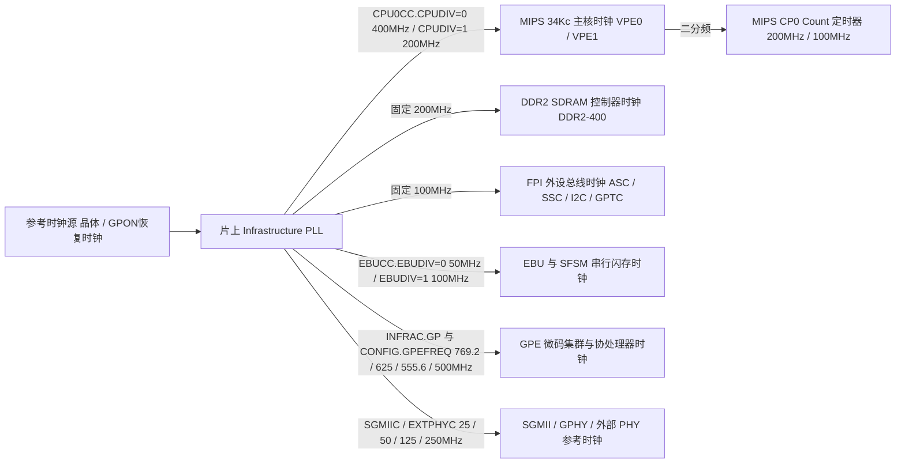
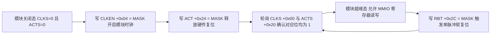

# 2.3 时钟树、电源门控与复位

Lantiq Falcon（PEB/PEF 98035）通过片上基础设施锁相环（Infrastructure PLL）生成各总线与处理单元的工作时钟，并由 `SYS1`（`0x1EF00000`）、`SYS_ETH`（`0x1DB00000`）和 `SYS_GPE`（`0x1D700000`）三个硬件控制块分别管理主系统域、以太网域与 GPON 封包处理引擎域的时钟门控、模块复位释放、单脉冲软复位及电源门控状态。

---

## 3.1 片上时钟树与分频控制

各时钟域的硬件频率配置寄存器如下：

| 时钟域名称 | 标称频率范围 | 硬件控制寄存器与位域 | 分频与选通规则 |
| :--- | :--- | :--- | :--- |
| **CPU 主时钟 (`f_CPU`)** | 400 MHz / 200 MHz | `SYS1_CPU0CC`（`0x1EF00040`）位 `[0]` `CPUDIV` | `0` = 400 MHz（全速）；`1` = 200 MHz（二分频） |
| **MIPS CP0 计数器时钟** | 200 MHz / 100 MHz | 硬件固定为 `f_CPU / 2` | 当 `f_CPU = 400 MHz` 时为 200 MHz（每周期 5 ns） |
| **DDR2 控制器时钟 (`f_DDR`)** | 200 MHz | 内部固定分频 | 驱动 16 位 DDR2-400 SDRAM 接口 |
| **FPI 外设总线时钟 (`f_FPI`)** | 100 MHz | 内部固定分频 | 作为 `ASC0/1`、`SSC0`、`I2C`、`GPTC` 与 `WDT` 的输入基准时钟 |
| **EBU 总线时钟 (`f_EBU`)** | 50 MHz / 100 MHz | `SYS1_EBUCC`（`0x1EF000C4`）位 `[0]` `EBUDIV` | `0` = 50 MHz；`1` = 100 MHz |
| **GPE 引擎时钟 (`f_GPE`)** | 769.2 / 625 / 555.6 / 500 MHz | `STATUS_CONFIG`（`0x1E802040`）位 `[11:10]` `GPEFREQ` `SYS1_INFRAC`（`0x1EF000BC`）位 `[28:24]` `GP` | `INFRAC` 位 `[25]` 开启 GPE 主时钟源；位 `[27:26]` 与 `GPEFREQ` 选择频率：`00` = 769.2 MHz，`01` = 625 MHz，`10` = 555.6 MHz，`11` = 500 MHz |
| **SGMII 参考时钟** | 125 MHz / 250 MHz | `SYS_ETH_SGMIIC`（`0x1DB000C4`）位 `[1:0]` `CLKSEL` | `00` = 125 MHz 内部 PLL，`01` = 125 MHz 外部差分引脚，`10` = 250 MHz 内部 PLL，`11` = 250 MHz 外部差分引脚 |
| **外部 PHY 输出时钟** | 25 / 50 / 125 MHz | `SYS_ETH_EXTPHYC`（`0x1DB000B0`）位 `[3:0]` | 位 `[3]` `CLKOEN` 使能引脚输出；位 `[2:0]` `CLKSEL`：`001`=25 MHz，`010`=50 MHz，`101`=125 MHz |

---

## 3.2 三域时钟门控、模块激活与软复位位图

每个控制域（`SYS1`、`SYS_ETH`、`SYS_GPE`）均通过统一的 32 位位图控制所属外设模块的时钟门控（`CLKS` `+0x00` / `CLKEN` `+0x04` / `CLKCLR` `+0x08`）、复位释放与激活（`ACTS` `+0x20` / `ACT` `+0x24` / `DEACT` `+0x28`）以及单次硬件复位脉冲（`RBT` `+0x2C`）。

### 1. `SYS1` 主系统与 FPI 外设域位图（`0x1EF00000`）

| 位号 | 位掩码 | 模块简称 | 受控硬件子模块说明 |
| :--- | :--- | :--- | :--- |
| `31` | `0x80000000` | `STATUS` | 芯片标识与 eFuse 熔丝状态块（`0x1E802000`） |
| `30` | `0x40000000` | `SHA1` | 片上 SHA1 硬件哈希加速单元 |
| `29` | `0x20000000` | `AES` | 片上 AES 硬件加解密加速单元 |
| `28` | `0x10000000` | `PCM` | PCM / TDM 数字语音总线控制器 |
| `27` | `0x08000000` | `FSCT` | 8 kHz 帧同步计数器（Frame Sync Counter Timer） |
| `26` | `0x04000000` | `GPTC` | 通用定时器/计数器单元（`0x1E100E00`） |
| `25` | `0x02000000` | `MPS` | 多处理器通信与语音邮箱子系统（`0x1D004000`） |
| `24` | `0x01000000` | `DFEV0` | 数字前端语音通道 0（Digital Front-End Voice 0） |
| `22` | `0x00400000` | `PADCTRL4` | 端口组 4 引脚复用控制器（`0x1E800600`） |
| `21` | `0x00200000` | `PADCTRL3` | 端口组 3 引脚复用控制器（`0x1E800500`） |
| `20` | `0x00100000` | `PADCTRL1` | 端口组 1 引脚复用控制器（`0x1E800400`） |
| `18` | `0x00040000` | `P4` | 端口组 4 GPIO 控制器 `GPIO4`（`0x1E800300`） |
| `17` | `0x00020000` | `P3` | 端口组 3 GPIO 控制器 `GPIO3`（`0x1E800200`） |
| `16` | `0x00010000` | `P1` | 端口组 1 GPIO 控制器 `GPIO1`（`0x1E800100`） |
| `15` | `0x00008000` | `HOST` | 主机接口控制逻辑 |
| `14` | `0x00004000` | `I2C` | 主/从双模 I2C 控制器（`0x1E200000`） |
| `13` | `0x00002000` | `SSC0` | 同步串行 SPI 控制器 0（`0x1E100D00`） |
| `12` | `0x00001000` | `ASC0` | 异步串行 UART 控制器 0（`0x1E100C00`） |
| `11` | `0x00000800` | `ASC1` | 异步串行 UART 控制器 1（`0x1E100B00`） |
| `10` | `0x00000400` | `DCDCAPD` | APD 雪崩光电二极管高压数字 DC/DC 转换器 |
| `9` | `0x00000200` | `DCDCDDR` | DDR2 接口供电数字 DC/DC 转换器 |
| `8` | `0x00000100` | `DCDC1V0` | 1.0 V 核心供电数字 DC/DC 转换器 |
| `6` | `0x00000040` | `TRC2MEM` | 片上硬件跟踪写内存模块（Trace-to-Memory） |
| `5` | `0x00000020` | `DDR` | DDR2 SDRAM 内存控制器 |
| `4` | `0x00000010` | `EBU` | 外部总线与串行闪存控制器（`0x18000000`） |
| `1` | `0x00000002` | `XBAR` | 仅在 `SYS1_RBT`（`+0x2C`）有效：触发片上 Crossbar 互连总线全局软复位 |
| `0` | `0x00000001` | `CPU` | 仅在 `SYS1_RBT`（`+0x2C`）有效：触发 MIPS 34Kc 处理器核心软复位 |

### 2. `SYS_ETH` 以太网与 SBS2 引脚域位图（`0x1DB00000`）

| 位号 | 位掩码 | 模块简称 | 受控硬件子模块说明 |
| :--- | :--- | :--- | :--- |
| `25` | `0x02000000` | `GPHY1MII2` | 内置 GPHY1 第二 MII 接口逻辑 |
| `24` | `0x01000000` | `GPHY0MII2` | 内置 GPHY0 第二 MII 接口逻辑 |
| `21` | `0x00200000` | `PADCTRL2` | 端口组 2 引脚复用控制器（`0x1DB02000`） |
| `20` | `0x00100000` | `PADCTRL0` | 端口组 0 引脚复用控制器（`0x1DB01000`） |
| `17` | `0x00020000` | `P2` | 端口组 2 GPIO 控制器 `GPIO2`（`0x1D810100`） |
| `16` | `0x00010000` | `P0` | 端口组 0 GPIO 控制器 `GPIO0`（`0x1D810000`） |
| `11` | `0x00000800` | `xMII` | 外部 RGMII / RMII / MII 并行接口单元 |
| `10` | `0x00000400` | `SGMII` | SGMII / SXGMII 高速串行以太网 PCS 与 SerDes 接口（`0x1D808800` / `0x1D808C00`） |
| `9` | `0x00000200` | `GPHY1` | 内置千兆/百兆以太网物理层收发器 1 |
| `8` | `0x00000100` | `GPHY0` | 内置千兆/百兆以太网物理层收发器 0 |
| `7` | `0x00000080` | `MDIO` | EIM MDIO 管理数据输入/输出主控制器 |
| `3` | `0x00000008` | `GMAC3` | 以太网千兆媒体访问控制器通道 3 |
| `2` | `0x00000004` | `GMAC2` | 以太网千兆媒体访问控制器通道 2 |
| `1` | `0x00000002` | `GMAC1` | 以太网千兆媒体访问控制器通道 1 |
| `0` | `0x00000001` | `GMAC0` | 以太网千兆媒体访问控制器通道 0 |

### 3. `SYS_GPE` 封包处理引擎域位图（`0x1D700000`）

| 位号 | 位掩码 | 模块简称 | 受控硬件子模块说明 |
| :--- | :--- | :--- | :--- |
| `31:24` | `0xFF000000` | `COP7`–`COP0` | GPE 硬件表项协处理器 7 至 0（位 `24 + n` 对应 `COPn`） |
| `21:16` | `0x003F0000` | `PE5`–`PE0` | GPE 微码处理器核心 5 至 0（位 `16 + n` 对应 `PEn`，基址 `0x1D610000 + n * 0x10000`） |
| `13` | `0x00002000` | `ARB` | GPE 共享内存 TDM 仲裁器 `GPEARB`（`0x1D400100`） |
| `12` | `0x00001000` | `FSQM` | 空闲段队列管理器 `FSQM`（`0x1D500000`） |
| `11` | `0x00000800` | `TMU` | 流量管理单元 `TMU`（`0x1D404000`） |
| `10` | `0x00000400` | `MRG` | 封包头部合并器 `MERGE`（`0x1D600600`） |
| `9` | `0x00000200` | `DISP` | 封包头部分配器 `DISP`（`0x1D600500`） |
| `8` | `0x00000100` | `IQM` | 入口队列管理器 `IQM`（`0x1D410000`） |
| `7` | `0x00000080` | `CPUE` | CPU 出口路径控制模块 `OCTRLC`（`0x1D441000`） |
| `6` | `0x00000040` | `CPUI` | CPU 入口注入路径控制模块 `ICTRLC0` / `ICTRLC1`（`0x1D461000`） |
| `5` | `0x00000020` | `GPONE` | GPON 出口 DMA 控制模块 `OCTRLG`（`0x1D420000`） |
| `4` | `0x00000010` | `GPONI` | GPON 入口 DMA 控制模块 `ICTRLG`（`0x1D450000`） |
| `3:0` | `0x0000000F` | `LAN3`–`LAN0` | 以太网 LAN 端口 3 至 0 出入口 DMA 控制模块（`ICTRLL0–3` / `OCTRLL0–3`） |

---

## 3.3 硬件外设使能、复位与全片重启状态机

### 1. 外设子模块硬件上电激活与复位时序

对任一挂载于 `SYS1`、`SYS_ETH` 或 `SYS_GPE` 的硬件子模块（位掩码设为 `MASK`），访问其内部寄存器前必须按以下硬件顺序开启时钟并释放复位：

* **模块激活（Enable & Activate）**：先向 `CLKEN`（`+0x04`）写入 `MASK` 开启模块时钟树分支，再向 `ACT`（`+0x24`）写入 `MASK` 撤销模块内部复位信号；随后读取 `CLKS`（`+0x00`）与 `ACTS`（`+0x20`），直到两寄存器中的 `MASK` 位均返回 `1`。
* **GPE 子域特殊上电要求**：在操作 `SYS_GPE`（`0x1D700000`）任何寄存器之前，必须先将 `SYS1_INFRAC`（`0x1EF000BC`）的位 `[25]`（`0x02000000`）置 `1` 以开启 GPE 主时钟源；对于 `COP7–0` 与 `PE5–0` 等带电源开关的子模块，还需向 `SYS_GPE_SDCLR`（`0x1D7000C8`）写入对应掩码以闭合电源门控开关。
* **模块关断（Deactivate & Clock Clear）**：先向 `DEACT`（`+0x28`）写入 `MASK` 将模块置入复位态以停止其总线事务，再向 `CLKCLR`（`+0x08`）写入 `MASK` 门控其时钟。

### 2. 全芯片软复位与 Boot ROM 向量重定位机制

当需要执行全芯片级重启时，硬件支持两条触发路径：
1. **系统控制器软复位**：向 `SYS1` 的 `BOOT_PW1_REG`（`0xBF200020`）写入 `0x4C545100`（`'LTQ\0'`）、向 `BOOT_PW2_REG`（`0xBF200024`）写入 `0x0051544C`（`'\0QTL'`），将 `BOOT_RVEC`（`0xBF200000`）清零，然后向 `SYS1_RBT`（`0xBEF0002C`）写入 `0x00000003`（同时置位位 `[1]` `XBAR` 与位 `[0]` `CPU`）或 `0x00000001`（`CPU` 复位）。
2. **硬件看门狗超时复位**：通过 `WDT_CR`（`0xBF8803F0`）解锁两阶段密码（依次写入 `0x000000F0` 与 `0x000000F5`）并写入极短超时计数值，等待看门狗计数器归零触发全芯片硬件复位（此时 `SYS1_CPU0RS.HWRS` 记录为 `2`）。

复位释放后，MIPS 34Kc 处理器从 `0xBFC00000`（Boot ROM）开始取指。Boot ROM 检查 `0xBF200020` 与 `0xBF200024` 的两枚魔数：若匹配且 `0xBF200000`（`BOOT_RVEC`）非零，则直接跳转至 `BOOT_RVEC` 指向的次级引导地址；若魔数不匹配或 `BOOT_RVEC` 为 `0`，则根据 `SYS1_BMC`（`0x1EF000A0`）锁存的启动模式从 EBU SPI NOR Flash（`0xB0000000`）或 ASC0 串口执行冷启动引导流程。
