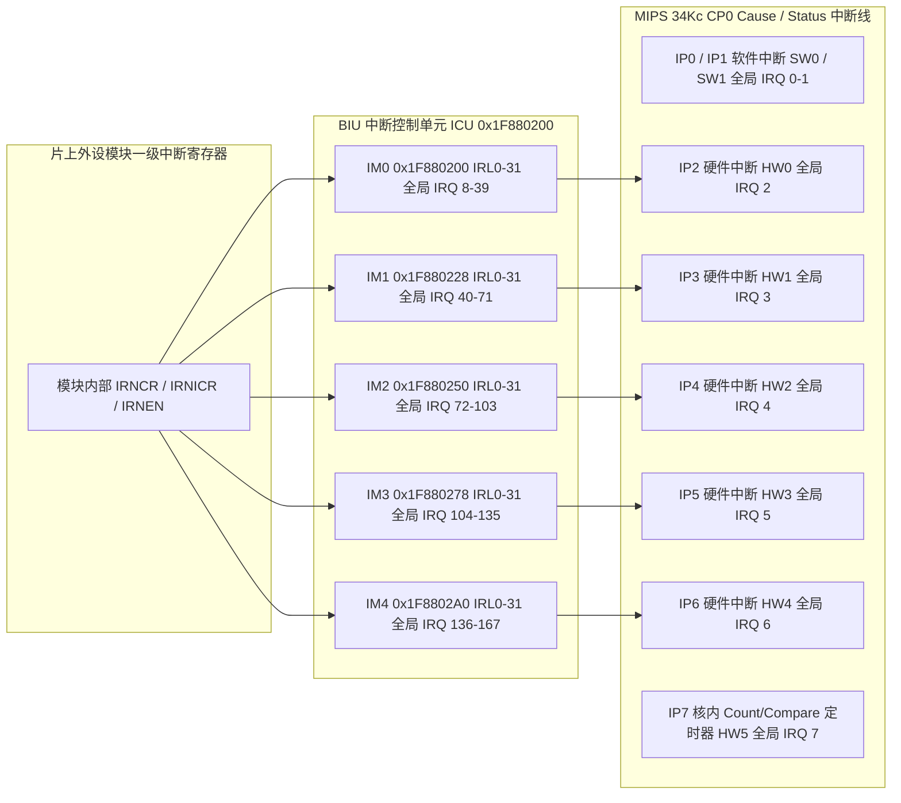

# 2.4 中断控制器与向量表

Lantiq Falcon（PEB/PEF 98035）在总线接口单元（BIU）内部集成一个 5 组 32 位级联中断控制单元（Interrupt Control Unit, **ICU**，物理基址 `0x1F880200`，KSEG1 `0xBF880200`）。ICU 汇总片上最多 160 条外设中断线（分为 `IM0`–`IM4` 共 5 组，每组 32 条中断输入线 `IRL0`–`IRL31`），并将其分别收敛至 MIPS 34Kc 处理器的 5 根外部硬件中断引脚 `HW0`–`HW4`（对应 CP0 `Status` / `Cause` 寄存器的 `IP2`–`IP6` 位）。

---

## 4.1两级中断汇聚拓扑与 MIPS CP0 接口

### 1. MIPS CP0 顶层中断源分配（全局 IRQ 0–7）

| CP0 `Status`/`Cause` 位 | 硬件中断名 | 顶层 IRQ 号 | 中断源描述 |
| :--- | :--- | :--- | :--- |
| `IP0`（位 `[8]`） | `SW0` | `0` | 软件中断 0（可用于 VPE0 与 VPE1 跨核处理器间中断 IPI） |
| `IP1`（位 `[9]`） | `SW1` | `1` | 软件中断 1（可用于 VPE0 与 VPE1 跨核处理器间中断 IPI） |
| `IP2`（位 `[10]`） | `HW0` | `2` | 级联输入：连接 `ICU` 第 0 组（`IM0`，覆盖外设 IRQ `8`–`39`） |
| `IP3`（位 `[11]`） | `HW1` | `3` | 级联输入：连接 `ICU` 第 1 组（`IM1`，覆盖外设 IRQ `40`–`71`） |
| `IP4`（位 `[12]`） | `HW2` | `4` | 级联输入：连接 `ICU` 第 2 组（`IM2`，覆盖外设 IRQ `72`–`103`） |
| `IP5`（位 `[13]`） | `HW3` | `5` | 级联输入：连接 `ICU` 第 3 组（`IM3`，覆盖外设 IRQ `104`–`135`） |
| `IP6`（位 `[14]`） | `HW4` | `6` | 级联输入：连接 `ICU` 第 4 组（`IM4`，覆盖外设 IRQ `136`–`167`） |
| `IP7`（位 `[15]`） | `HW5` | `7` | MIPS 34Kc 核内 CP0 `Count`（Reg 9）与 `Compare`（Reg 11）匹配定时器中断 |

---

## 4.2 ICU 寄存器组布局（`0x1F880200`–`0x1F8802C7`）

ICU 共包含 5 个结构相同的寄存器块 `IM0`–`IM4`，每个寄存器块占用 `0x28`（40）字节。对于第 `k` 组（`k = 0..4`），其物理基址为 `0x1F880200 + k * 0x28`：

| 组名 | 物理基址 | KSEG1 基址 | 对应 CP0 引脚 | 管理的全局 IRQ 范围 | 位 `b`（`0..31`）与全局 IRQ 换算公式 |
| :--- | :--- | :--- | :--- | :--- | :--- |
| `IM0` | `0x1F880200` | `0xBF880200` | `IP2` (`HW0`) | `8`–`39` | `IRQ = 8 + b` |
| `IM1` | `0x1F880228` | `0xBF880228` | `IP3` (`HW1`) | `40`–`71` | `IRQ = 40 + b` |
| `IM2` | `0x1F880250` | `0xBF880250` | `IP4` (`HW2`) | `72`–`103` | `IRQ = 72 + b` |
| `IM3` | `0x1F880278` | `0xBF880278` | `IP5` (`HW3`) | `104`–`135` | `IRQ = 104 + b` |
| `IM4` | `0x1F8802A0` | `0xBF8802A0` | `IP6` (`HW4`) | `136`–`167` | `IRQ = 136 + b` |

每组 `IMk` 内部包含以下 5 个 32 位寄存器（位 `[31:0]` 对应组内中断请求线 `IRL31`–`IRL0`）：

| 组内偏移 | 寄存器名称 | 读写属性 | 硬件功能说明 |
| :--- | :--- | :--- | :--- |
| `+0x00` | `IMk_ISR` | R / W1C | **中断状态寄存器（Interrupt Status Register）**：读取返回锁存的中断请求状态；向位 `b` 写 `1` 清除该中断锁存状态（Write-1-to-Clear）。 |
| `+0x08` | `IMk_IER` | RW | **中断使能寄存器（Interrupt Enable Register）**：位 `b` 设为 `1` 允许 `IRLb` 参与向 CPU 触发中断，设为 `0` 屏蔽该中断线。 |
| `+0x10` | `IMk_IOSR` | RO | **中断输出状态寄存器（Interrupt Output Status Register）**：等于 `IMk_ISR & IMk_IER`。只要 `IMk_IOSR != 0`，对应的 `CP0 Cause.IP(k+2)` 引脚即保持有效电平。 |
| `+0x18` | `IMk_IRSR` | RO | **中断原始状态寄存器（Interrupt Raw Status Register）**：反映未经锁存与屏蔽的外设原始中断线实时电平。 |
| `+0x20` | `IMk_IMR` | RW | **中断模式寄存器（Interrupt Mode Register）**：配置组内各中断线的触发采样模式。 |

### 硬件中断分派与应答顺序

1. 当外设模块内部事件置位（`IRNCR & IRNEN != 0`）时，外设拉高对应的 `IRLb` 信号线，`IMk_ISR` 的位 `b` 被置 `1`。
2. 若 `IMk_IER` 的位 `b` 为 `1`，则 `IMk_IOSR` 的位 `b` 变为 `1`，并拉高 MIPS CP0 的 `IP(k+2)`。
3. 处理器进入异常向量后，读取 `CP0 Cause & CP0 Status` 确定触发的组号 `k`，随后读取 `IMk_IOSR`（`+0x10`），通过前导零计数指令（`clz`）定位最高优先级有效位 `b = 31 - clz(IOSR)`，计算全局中断号 `IRQ = 8 + 32 * k + b`。
4. 响应与屏蔽：将 `IMk_IER`（`+0x08`）的位 `b` 清零以屏蔽当前线，向 `IMk_ISR`（`+0x00`）写入 `1 << b` 清除 ICU 锁存位，并在外设模块内部清除源状态寄存器（如向 `IRNCR` 写 `1`），处理完毕后再将 `IMk_IER` 的位 `b` 重新置 `1`。

---

## 4.3 全芯片中断向量映射表（`IM0`–`IM4`）

### 1. `IM0` 组（基址 `0x1F880200`，CP0 `IP2`，全局 IRQ `8`–`39`）

| 全局 IRQ | 组内位 (`IRLb`) | 组内掩码 | 中断源模块与事件名称 | 外设基址 | 事件说明 |
| :--- | :--- | :--- | :--- | :--- | :--- |
| `9` | `IRL1` | `0x00000002` | `SYS1` (`sys1_irq`) | `0x1EF00000` | 系统控制器 1 事件（Dying Gasp 掉电告警、PLL 失锁、外部 NMI 引脚中断） |
| `18` | `IRL10` | `0x00000400` | `I2C_LB` (`i2c lb`) | `0x1E200000` | I2C 控制器最后一次突发传输请求中断（Last Burst Request） |
| `19` | `IRL11` | `0x00000800` | `I2C_B` (`i2c b`) | `0x1E200000` | I2C 控制器突发传输请求中断（Burst Request） |
| `20` | `IRL12` | `0x00001000` | `I2C_ERR` (`i2c err`) | `0x1E200000` | I2C 控制器 FIFO 下溢/上溢错误中断（Error Interrupt） |
| `21` | `IRL13` | `0x00002000` | `I2C_P` (`i2c p`) | `0x1E200000` | I2C 控制器协议事件中断（地址匹配、NACK、仲裁丢失、传输结束 `TX_END`） |
| `22` | `IRL14` | `0x00004000` | `SSC0_TX` (`spi_tx`) | `0x1E100D00` | SSC0 SPI 发送 FIFO 阈值请求中断 |
| `23` | `IRL15` | `0x00008000` | `SSC0_RX` (`spi_rx`) | `0x1E100D00` | SSC0 SPI 接收 FIFO 阈值请求中断 |
| `24` | `IRL16` | `0x00010000` | `SSC0_ERR` (`spi_err`) | `0x1E100D00` | SSC0 SPI 传输错误中断 |
| `30` | `IRL22` | `0x00400000` | `SHA1` | — | 片上 SHA1 哈希计算完成中断 |
| `31` | `IRL23` | `0x00800000` | `AES` | — | 片上 AES 加解密运算完成中断 |
| `32` | `IRL24` | `0x01000000` | `PCM` | — | PCM 语音接口中断 |
| `38` | `IRL30` | `0x40000000` | `EBU` / `SFSM` | `0x18000000` | EBU 总线及串行闪存状态机异常中断 |

### 2. `IM1` 组（基址 `0x1F880228`，CP0 `IP3`，全局 IRQ `40`–`71`）

| 全局 IRQ | 组内位 (`IRLb`) | 组内掩码 | 中断源模块与事件名称 | 外设基址 | 事件说明 |
| :--- | :--- | :--- | :--- | :--- | :--- |
| `40` | `IRL0` | `0x00000001` | `EIM` | `0x1D800000` | 以太网接口模块（GMAC0–3 状态变化与 MDIO 读写完成中断） |
| `41` | `IRL1` | `0x00000002` | `GPHY0` | — | 内置千兆以太网 PHY 0 链路与自协商中断 |
| `42` | `IRL2` | `0x00000004` | `GPHY1` | — | 内置千兆以太网 PHY 1 链路与自协商中断 |
| `44` | `IRL4` | `0x00000010` | `GPIO0` (`gpio_p0`) | `0x1D810000` | 端口组 0（引脚 0–31）外部边沿/电平汇总中断 |
| `45` | `IRL5` | `0x00000020` | `GPIO1` (`gpio_p1`) | `0x1E800100` | 端口组 1（引脚 32–63）外部边沿/电平汇总中断 |
| `46` | `IRL6` | `0x00000040` | `GPIO2` (`gpio_p2`) | `0x1D810100` | 端口组 2（引脚 64–95）外部边沿/电平汇总中断 |
| `47` | `IRL7` | `0x00000080` | `GPIO3` (`gpio_p3`) | `0x1E800200` | 端口组 3（引脚 96–127）外部边沿/电平汇总中断 |
| `48` | `IRL8` | `0x00000100` | `GPIO4` (`gpio_p4`) | `0x1E800300` | 端口组 4（引脚 128–159）外部边沿/电平汇总中断 |
| `54` | `IRL14` | `0x00004000` | `LINK0` / `ICTRLC` | `0x1D600200` | GPE CPU 控制面通道 0 接收数据就绪中断 |
| `55` | `IRL15` | `0x00008000` | `LINK1` / `OCTRLC` | `0x1D600300` | GPE CPU 控制面通道 1 与出口完成中断 |
| `56` | `IRL16` | `0x00010000` | `ICTRLL0`–`ICTRLL3` | `0x1D460000` | LAN 端口 0–3 入口控制器异常与丢包统计中断 |
| `57` | `IRL17` | `0x00020000` | `OCTRLL0`–`OCTRLL3` | `0x1D440000` | LAN 端口 0–3 出口控制器异常中断 |
| `58` | `IRL18` | `0x00040000` | `ICTRLG` | `0x1D450000` | GPON 入口 DMA 控制器中断 |
| `59` | `IRL19` | `0x00080000` | `OCTRLG` | `0x1D420000` | GPON 出口 DMA 控制器中断 |
| `60` | `IRL20` | `0x00100000` | `IQM` | `0x1D410000` | 入口队列管理器队列满/阈值告警中断 |
| `61` | `IRL21` | `0x00200000` | `TMU` | `0x1D404000` | 流量管理单元（含 CPU 队列非空通知与丢包水位中断） |
| `62` | `IRL22` | `0x00400000` | `FSQM` | `0x1D500000` | 空闲段队列管理器（空闲 LSA 耗尽或链表越界告警中断） |

### 3. `IM2` 组（基址 `0x1F880250`，CP0 `IP4`，全局 IRQ `72`–`103`）

| 全局 IRQ | 组内位 (`IRLb`) | 组内掩码 | 中断源模块与事件名称 | 外设基址 | 事件说明 |
| :--- | :--- | :--- | :--- | :--- | :--- |
| `72` | `IRL0` | `0x00000001` | `GTC_DS` | `0x1DC00000` | GPON 传输汇聚层下行事件中断（LOS、LOF、PLOAMd 接收、BIP 错误、密钥切换） |
| `73` | `IRL1` | `0x00000002` | `GTC_US` | `0x1DC00000` | GPON 传输汇聚层上行事件中断（突发时序错误、Ranging 测距更新、PLOAMu 完成） |
| `74` | `IRL2` | `0x00000004` | `TOD` | `0x1DEFFE00` | 时间同步模块（1PPS 秒脉冲到达与超帧比较匹配中断） |
| `75` | `IRL3` | `0x00000008` | `DISP` / `MERGE` | `0x1D600500` | GPE 封包分配器与合并器异常中断 |
| `76`–`81` | `IRL4`–`IRL9` | `0x000003F0` | `PE0`–`PE5` | `0x1D610000` | GPE 微码处理器核心 0 至 5 断点/异常/软件触发中断 |
| `88` | `IRL16` | `0x00010000` | `OPTIC_OMP` | — | 光电模拟前端（MPD 闭环监控、光功率越界、Rogue ONU 突发发光异常告警） |
| `89` | `IRL17` | `0x00020000` | `OPTIC_DCDC` | — | 片上三路数字 DC/DC（1V0 / DDR / APD）过流或稳压环路告警中断 |

### 4. `IM3` 组（基址 `0x1F880278`，CP0 `IP5`，全局 IRQ `104`–`135`）

| 全局 IRQ | 组内位 (`IRLb`) | 组内掩码 | 中断源模块与事件名称 | 外设基址 | 事件说明 |
| :--- | :--- | :--- | :--- | :--- | :--- |
| `104` | `IRL0` | `0x00000001` | `ASC0_TX` (`asc0_tx`) | `0x1E100C00` | 异步串口 0 发送 FIFO 空/水线中断 |
| `105` | `IRL1` | `0x00000002` | `ASC0_RX` (`asc0_rx`) | `0x1E100C00` | 异步串口 0 接收 FIFO 数据到达中断 |
| `106` | `IRL2` | `0x00000004` | `ASC0_ERR` (`asc0_err`) | `0x1E100C00` | 异步串口 0 帧错误/奇偶校验错误/溢出中断 |
| `112` | `IRL8` | `0x00000100` | `ASC1_TX` (`asc1_tx`) | `0x1E100B00` | 异步串口 1 发送 FIFO 空/水线中断 |
| `113` | `IRL9` | `0x00000200` | `ASC1_RX` (`asc1_rx`) | `0x1E100B00` | 异步串口 1 接收 FIFO 数据到达中断 |
| `114` | `IRL10` | `0x00000400` | `ASC1_ERR` (`asc1_err`) | `0x1E100B00` | 异步串口 1 帧错误/奇偶校验错误/溢出中断 |
| `126` | `IRL22` | `0x00400000` | `GPTC_TC1A` | `0x1E100E00` | 通用定时器单元 Timer 1A 计数溢出/匹配中断 |
| `127` | `IRL23` | `0x00800000` | `GPTC_TC1B` | `0x1E100E00` | 通用定时器单元 Timer 1B 计数溢出/匹配中断 |
| `128` | `IRL24` | `0x01000000` | `GPTC_TC2A` | `0x1E100E00` | 通用定时器单元 Timer 2A 计数溢出/匹配中断 |
| `129` | `IRL25` | `0x02000000` | `GPTC_TC2B` | `0x1E100E00` | 通用定时器单元 Timer 2B 计数溢出/匹配中断 |
| `130` | `IRL26` | `0x04000000` | `GPTC_TC3A` | `0x1E100E00` | 通用定时器单元 Timer 3A 计数溢出/匹配中断 |
| `131` | `IRL27` | `0x08000000` | `GPTC_TC3B` | `0x1E100E00` | 通用定时器单元 Timer 3B 计数溢出/匹配中断 |

### 5. `IM4` 组（基址 `0x1F8802A0`，CP0 `IP6`，全局 IRQ `136`–`167`）

| 全局 IRQ | 组内位 (`IRLb`) | 组内掩码 | 中断源模块与事件名称 | 外设基址 | 事件说明 |
| :--- | :--- | :--- | :--- | :--- | :--- |
| `154` | `IRL18` | `0x00040000` | `MPS_MBX0` | `0x1D004000` | 多处理器通信单元（MPS）邮箱通道 0 中断 |
| `155` | `IRL19` | `0x00080000` | `MPS_MBX1` | `0x1D004000` | 多处理器通信单元（MPS）邮箱通道 1 中断 |
| `158` | `IRL22` | `0x00400000` | `DFEV0_0` | — | 数字语音前端通道 0 事件中断 0 |
| `159` | `IRL23` | `0x00800000` | `DFEV0_1` | — | 数字语音前端通道 0 事件中断 1 |

---

## 4.4 外设模块内部标准中断寄存器三元组（`IRNCR` / `IRNICR` / `IRNEN`）

在 Falcon 的 `SYS1`、`SYS_GPE`、`GPIO0–4`、`GPTC`、`GTC`、`IQM`、`TMU`、`FSQM`、`EIM` 等片上外设模块内部，均采用统一的三寄存器中断控制结构生成向 `ICU` 输出的汇总中断信号：

| 寄存器通称 | 读写属性 | 硬件行为规范 |
| :--- | :--- | :--- |
| `IRNCR` (Interrupt Node Capture Register) | R / W1C | **事件锁存状态寄存器**：硬件检测到子事件发生且对应 `IRNEN` 位为 `1`（或无条件锁存，视具体模块而定）时将对应位置 `1`；CPU 向该位写 `1` 清除锁存状态。 |
| `IRNICR` (Interrupt Node Interrupt Control Register) | R / W1S | **原始输入与软件注入寄存器**：读取时返回当前未经锁存的实时事件信号；向某位写 `1` 可由软件强制触发一次对应位的中断锁存（用于硬件自检或软件模拟触发）。 |
| `IRNEN` (Interrupt Node Enable Register) | RW | **模块级中断使能寄存器**：位掩码控制哪些内部事件允许拉高通往 `BIU ICU` 的中断请求线（`1` = 使能，`0` = 禁用）。 |
