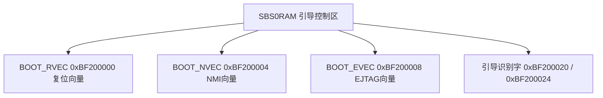

# 3.1 MIPS 34Kc 核心架构与 VPE0 配置

Lantiq Falcon（PEB/PEF 98035）集成一颗大端序（Big-Endian）MIPS32 Release 2 **34Kc** 处理器核心作为主控与实时管理计算中枢。该核心通过硬件多线程扩展（MIPS MT ASE）在单一物理流水线上实例化两个虚拟处理单元（**VPE0** 与 **VPE1**）和五个硬件线程上下文（**TC0**–**TC4**）。上电复位后，硬件默认仅激活绑定于 **TC0** 的 **VPE0** 作为主系统处理器，负责引导加载、全芯片时钟/外设初始化以及 GPON/以太网控制面运行。

---

## 1.1 MIPS 34Kc 核心硬件规格

| 硬件特性维度 | 硬件规格参数 | 相关 CP0 / 系统控制寄存器 |
| :--- | :--- | :--- |
| **指令集架构 (ISA)** | MIPS32 Release 2，32 位大端序（Big-Endian） | `CP0 Config0`（Reg 16, Sel 0）位 `[15]` `BE = 1` |
| **指令集扩展 (ASE)** | MIPS16e 16 位代码压缩、MIPS DSP ASE Rev 1、MIPS MT ASE | `CP0 Config3`（Reg 16, Sel 3）：`MT`（位 `[2]`）、`DSPP`（位 `[10]`）、`CA` |
| **浮点单元 (FPU)** | 无硬件 FPU（`CP0 Config1.FP = 0`） | `CP0 Config1`（Reg 16, Sel 1）位 `[0]` `FP = 0` |
| **虚拟处理单元 (VPE)** | 2 个独立 VPE（`VPE0` 与 `VPE1`），各自拥有独立 CP0 异常与 MMU 上下文 | `CP0 MVPConf0`（Reg 0, Sel 2）位 `[13:10]` `PVPE = 1`（代表 `1 + 1 = 2` 个 VPE） |
| **硬件线程上下文 (TC)** | 5 个硬件线程（`TC0`–`TC4`），每个 TC 拥有独立 32 个通用寄存器、PC 与 `TCStatus` | `CP0 MVPConf0`（Reg 0, Sel 2）位 `[7:0]` `PTC = 4`（代表 `4 + 1 = 5` 个 TC） |
| **影子寄存器组 (SRS)** | 支持外部中断快速上下文切换影子寄存器组 | `CP0 SRSConf0`（Reg 6, Sel 1）与 `CP0 SRSCtl`（Reg 12, Sel 2） |
| **核心工作频率 (`f_CPU`)** | 标称 400 MHz，可通过分频器切换为 200 MHz | `SYS1_CPU0CC`（`0x1EF00040`）位 `[0]` `CPUDIV`（`0`=400 MHz，`1`=200 MHz） |
| **核内定时器 (`Count`)** | 32 位递增计数器，运行于 `f_CPU / 2`（200 MHz 或 100 MHz） | `CP0 Count`（Reg 9, Sel 0）与 `CP0 Compare`（Reg 11, Sel 0），触发 `IP7`（IRQ 7） |
| **L1 指令缓存 (I-Cache)** | 32 KiB，4 路组相联，缓存行 32 B，每路 256 组（VIPT） | `CP0 Config1` 位 `[24:22]` `IS = 2`、位 `[21:19]` `IL = 4`、位 `[18:16]` `IA = 3` |
| **L1 数据缓存 (D-Cache)** | 16 KiB，4 路组相联，缓存行 32 B，每路 128 组，写回式（Write-Back） | `CP0 Config1` 位 `[15:13]` `DS = 1`、位 `[12:10]` `DL = 4`、位 `[9:7]` `DA = 3` |
| **内存管理单元 (MMU)** | 16 项双页联合快表（Dual-Page JTLB，支持 4 KiB–16 MiB 可变页大小） | `CP0 Config1` 位 `[30:25]` `MMUSize-1 = 15`；支持跨 VPE 共享或静态分区 |

---

## 1.2 L1 缓存组织与跨 VPE 缓存路隔离机制

MIPS 34Kc 的 32 KiB I-Cache 与 16 KiB D-Cache 由 `VPE0` 与 `VPE1` 共同访问。为防止两个 VPE 在并发执行时互相驱逐对方的关键指令或实时数据缓存行，核心在每个 VPE 的 `CP0 VPEOpt`（Reg 1, Sel 7）寄存器中提供了硬件级按路（Per-Way）分配掩码：

| `CP0 VPEOpt` 位域 | 字段名 | 掩码 | 硬件缓存路隔离行为 |
| :--- | :--- | :--- | :--- |
| `[11:8]` | `IWX3`–`IWX0` | `0x00000F00` | **I-Cache 路排除掩码（Instruction Cache Way Exclusion）**：位 `8 + w`（`w = 0..3`）设为 `1` 时，当前 VPE 发生指令缓存未命中回填时**禁止**替换 I-Cache 第 `w` 路（仍可命中有权访问的已缓存行）。 |
| `[3:0]` | `DWX3`–`DWX0` | `0x0000000F` | **D-Cache 路排除掩码（Data Cache Way Exclusion）**：位 `w`（`w = 0..3`）设为 `1` 时，当前 VPE 发生数据缓存未命中回填时**禁止**替换 D-Cache 第 `w` 路。 |

例如，当 `VPE1` 的 `CP0 VPEOpt` 被配置为 `0x00000800`（即 `IWX3 = 1`）时，`VPE1` 发生指令缓存缺失时仅使用第 0、1、2 路，保留 I-Cache 第 3 路（8 KiB）不被 `VPE1` 替换。

---

## 1.3 硬件复位源、启动模式与 `SBS0RAM` 二级引导向量

### 1. 硬件复位源记录与休眠控制

`SYS1` 控制块（物理基址 `0x1EF00000`）提供针对 MIPS 34Kc 核心的复位源追踪、启动模式覆写及低功耗门控寄存器：

* **复位源状态寄存器 `SYS1_CPU0RS`（`0x1EF00060`）**：
  * `SWRRO`（位 `[2]`）：软复位请求已发生标志（写 `0` 清零）。
  * `HWRS`（位 `[1:0]`）：记录最近一次全芯片硬件复位的物理触发源：
    * `00`（`0`）：上电复位（Power-On Reset, POR）。
    * `01`（`1`）：外部硬件复位引脚（`HRST_N`）拉低触发。
    * `10`（`2`）：BIU 硬件看门狗定时器（`WDT`，`0x1F8803F0`）超时触发。
* **启动模式控制寄存器 `SYS1_BMC`（`0x1EF000A0`）**：
  * `BMSW`（位 `[31]`）：设为 `0` 时使用芯片复位释放瞬间从外部配置引脚锁存的启动模式；设为 `1` 时使用位 `[6:0]` `BM` 写入的软件启动模式值（在下次软复位时生效）。
* **休眠时钟门控寄存器 `SYS1_SCFG`（`0x1EF000B0`）与唤醒掩码 `SYS1_CPU0WCFG`（`0x1EF00080`）**：
  * 当 `SYS1_SCFG.CPU0CG`（位 `[8]`）置 `1` 且 `VPE0` / `VPE1` 执行 MIPS `WAIT` 指令进入空闲态时，硬件自动门控处理器核心时钟；一旦 `SYS1_CPU0WCFG.WUP`（位 `[31:0]`）所使能的中断源有效，硬件立即恢复核心时钟并进入中断向量。

### 2. Boot ROM 与 `SBS0RAM`（`0xBF200000`）二级向量

处理器复位入口为 `0xBFC00000`，NMI 与 EJTAG 各有独立的异常入口。`SBS0RAM` 起始区域（`0xBF200000`）保存复位、NMI 与 EJTAG 的二级向量指针。以下图表示这些向量与引导控制字的关系；Boot ROM 内部的完整检查顺序和上下文保存过程尚未确认，不在本节规定范围内：

* **`BOOT_RVEC`（`0xBF200000`）**：软复位重定向入口地址。系统执行全局软复位（写 `SYS1_RBT`）前，若需走完整冷启动流程，需将 `0xBF200000` 显式写 `0`。
* **`BOOT_NVEC`（`0xBF200004`）**：NMI 二级向量指针，关联 Dying Gasp、PLL 与外部 NMI 源；ROM 内部的上下文保存及跳转细节尚未确认。
* **`BOOT_EVEC`（`0xBF200008`）**：EJTAG 调试异常入口地址。
* **`BOOT_PW1_REG`（`0xBF200020`）与 `BOOT_PW2_REG`（`0xBF200024`）**：双 32 位引导识别字，配置值分别为 `0x4C545100`（ASCII `'LTQ\0'`）和 `0x0051544C`（ASCII `'\0QTL'`，即前者的字节逆序）。ROM 对识别字及各向量的完整判定顺序尚未确认。

### 3. NMI 源状态与跨 VPE 路由控制（`0x1EF000D0`–`0x1EF000E0`）

Falcon 支持三路独立 NMI 源，可通过 `SYS1_NMIVPE1C`（`0x1EF000E0`）单独配置每路 NMI 触发时是投递至 `VPE0` 还是 `VPE1`：

| 偏移量 | 寄存器名 | 位 `[2]` (`DGASP`) | 位 `[1]` (`PLL`) | 位 `[0]` (`PIN`) | 寄存器功能描述 |
| :--- | :--- | :--- | :--- | :--- | :--- |
| `+0xD0` | `SYS1_NMIS` | Dying Gasp 掉电告警状态 | 主锁相环失锁状态 | 外部 NMI 引脚状态 | 只读：当前处于激活态的 NMI 源 |
| `+0xD4` | `SYS1_NMISET` | 写 `1` 强制触发 `DGASP` | 写 `1` 强制触发 `PLL` | 写 `1` 强制触发 `PIN` | 写 1 置位：软件模拟触发 NMI |
| `+0xD8` | `SYS1_NMICLR` | 写 `1` 清除 `DGASP` 锁存 | 写 `1` 清除 `PLL` 锁存 | 写 `1` 清除 `PIN` 锁存 | 写 1 清零：NMI 处理程序中清除请求 |
| `+0xDC` | `SYS1_NMITCFG` | 保留 | 保留 | `0`=上升沿，`1`=下降沿 | 配置外部 NMI 引脚边沿极性 |
| `+0xE0` | `SYS1_NMIVPE1C` | `0`=投递 VPE0，`1`=投递 VPE1 | `0`=投递 VPE0，`1`=投递 VPE1 | `0`=投递 VPE0，`1`=投递 VPE1 | 选择各路 NMI 源的目标虚拟处理单元 |

---

## 1.4 异常向量偏移与中断分派架构

当系统完成早期引导并将 `CP0 Status.BEV` 清零（切换至 RAM 异常向量模式）后，MIPS 34Kc 核心根据 `CP0 EBase`（Reg 15, Sel 1，位 `[29:12]` 指定 4 KiB 对齐异常基址，`VPE0` 默认为 `0x80000000`）定位异常入口：

| 异常基址相对偏移 | 触发条件 | 硬件异常类型说明 |
| :--- | :--- | :--- |
| `EBase + 0x000` | `Status.EXL = 0` 且发生 TLB Refill | JTLB 快速重填异常入口 |
| `EBase + 0x100` | 执行缓存错误异常（跳至 KSEG1 `EBase \| 0xA0000100`） | L1 I-Cache / D-Cache 奇偶校验或总线错误入口 |
| `EBase + 0x180` | 通用异常，或 `Cause.IV = 0` 时的外部中断 | 系统调用（`SYSCALL`）、断点（`BP`）、保留指令、TLB 修改/无效异常入口 |
| `EBase + 0x200` | `Cause.IV = 1`、`Status.EXL = 0` 且外部中断挂起 | 专用中断向量入口（Vectored Interrupt / `Cause.IV = 1` 快速中断入口） |

在 `EBase + 0x200` 中断入口处，处理器读取 `CP0 Cause` 与 `CP0 Status` 的位 `[15:8]`（`IP7:IP0`）：
* 若 `IP7`（位 `[15]`）置位，表明核内 200 MHz `CP0 Count/Compare` 周期时钟中断触发（全局 IRQ `7`）。
* 若 `IP2`–`IP6`（位 `[10:14]`）置位，表明 BIU `ICU` 的第 `0`–`4` 组（`IM0`–`IM4`，基址 `0xBF880200`–`0xBF8802A0`）存在已使能的挂起外设中断；处理器读取对应组的 `IMk_IOSR`（`+0x10`）寄存器并根据 `clz` 指令译码出具体外设 IRQ 号（`8`–`167`）。
* 若 `IP0`–`IP1`（位 `[8:9]`）置位，表明收到软件中断 `SW0` / `SW1`（全局 IRQ `0`–`1`）；是否作为 IPI 使用取决于内核配置，不能据此推断 SFP 裸机 VPE1 的通信机制。
