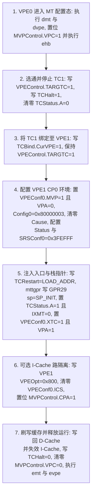

# 3.2 MT ASE 硬件多线程、VPE1 启动与共享内存

Falcon 的 MIPS 34Kc 核心通过虚拟处理单元（VPE）和硬件线程上下文（TC）执行多线程程序。VPE 具有独立的 CP0 状态与异常上下文，共享处理器流水线、缓存和物理内存。`MVPConf0` 报告实现的 VPE 和 TC 数量；MIPS MT ASE 指令用于配置 TC 绑定、入口地址、缓存分区和运行状态。

---

## 2.1 MIPS MT ASE 核心控制寄存器与跨线程指令

MIPS 34Kc 通过 CP0 多线程控制寄存器及跨线程访问指令（`mftc0` / `mttc0` / `mftgpr` / `mttgpr` / `dmt` / `emt` / `dvpe` / `evpe`），由 `VPE0` 配置目标 VPE 与 TC：

### 1. 关键 CP0 MT 控制寄存器列表

| CP0 寄存器名 | Reg, Sel | 作用域 | 关键位域与硬件功能定义 |
| :--- | :--- | :--- | :--- |
| `MVPControl` | `0, 1` | 全核共享 | • `CPA`（位 `[3]`，`0x08`）：缓存分区激活（Cache Partitioning Active）。 • `STLB`（位 `[2]`，`0x04`）：跨 VPE 共享 JTLB。 • `VPC`（位 `[1]`，`0x02`）：VPE 配置模式使能（置 `1` 时允许修改 `VPEConf0`、`TCBind` 等结构寄存器）。 • `EVP`（位 `[0]`，`0x01`）：多虚拟处理器全局并发执行使能（由 `evpe` 置 `1`、`dvpe` 清 `0`）。 |
| `MVPConf0` | `0, 2` | 全核只读 | • `PCP`（位 `[27]`）：支持可编程缓存路分区（Programmable Cache Partitioning）。 • `TCA`（位 `[15]`）：TC 可动态分配。 • `PVPE`（位 `[13:10]`）：最大 VPE 索引号，VPE 数量为 `PVPE + 1`。 • `PTC`（位 `[7:0]`）：最大 TC 索引号，TC 数量为 `PTC + 1`。 |
| `VPEControl` | `1, 1` | 每 VPE 独立 | • `TE`（位 `[15]`，`0x8000`）：当前 VPE 多线程并发调度使能（由 `emt` 置 `1`、`dmt` 清 `0`）。 • `TARGTC`（位 `[7:0]`）：指定后续 `mftc0` / `mttc0` / `mftgpr` / `mttgpr` 指令所访问的目标硬件线程号（如设为 `1` 指向 `TC1`）。 |
| `VPEConf0` | `1, 2` | 每 VPE 独立 | • `XTC`（位 `[28:21]`）：当该 VPE 仅激活单个运行线程时，记录其独占绑定的 TC 编号（`VPE1` 设为 `1 << 21`）。 • `TCS` / `SCS` / `DSC` / `ICS`（位 `[19:16]`）：控制二级/数据/指令缓存行共享或抑制属性（位 `[16]` `ICS = 0x10000`）。 • `MVP`（位 `[1]`，`0x02`）：Master VPE 权限位（允许该 VPE 配置其他 VPE/TC）。 • `VPA`（位 `[0]`，`0x01`）：VPE 激活位（Virtual Processor Activated）。 |
| `VPEOpt` | `1, 7` | 每 VPE 独立 | • `IWX3`–`IWX0`（位 `[11:8]`）：指令缓存第 3–0 路回填排除掩码（`0x0800` 代表排除 I-Cache 第 3 路）。 • `DWX3`–`DWX0`（位 `[3:0]`）：数据缓存第 3–0 路回填排除掩码。 |
| `TCStatus` | `2, 1` | 每 TC 独立 | • `DA`（位 `[15]`，`0x8000`）：允许 `fork`/`yield` 动态分配。 • `A`（位 `[13]`，`0x2000`）：硬件线程激活位（Thread Activated）。 • `TKSU`（位 `[12:11]`）：线程特权级（`00` = Kernel 模式）。 • `IXMT`（位 `[10]`，`0x0400`）：中断豁免位（`0` = 允许该 TC 响应所属 VPE 的硬件中断，`1` = 屏蔽该 TC 的中断响应）。 • `TASID`（位 `[7:0]`）：线程地址空间标识。 |
| `TCBind` | `2, 2` | 每 TC 独立 | • `CurTC`（位 `[28:21]`）：当前 TC 索引号（只读）。 • `CurVPE`（位 `[3:0]`）：将当前 TC 绑定至指定的 VPE（`0` = `VPE0`，`1` = `VPE1`）。 |
| `TCRestart` | `2, 3` | 每 TC 独立 | 目标硬件线程的程序计数器（PC）重启地址。向 `TCRestart` 写入入口地址即设定该 TC 解除暂停后的首条取指地址。 |
| `TCHalt` | `2, 4` | 每 TC 独立 | • `H`（位 `[0]`）：线程暂停控制位（`1` = 强制暂停该 TC 流水线取指，`0` = 允许该 TC 运行）。 |
| `TCContext` | `2, 5` | 每 TC 独立 | 32 位线程上下文存储字（初始化时清零）。 |
| `SRSConf0` | `6, 1` | 每 VPE 独立 | 影子寄存器组映射配置寄存器（`VPE1` 初始化时写入 `0x003FEFFF`）。 |

---

## 2.2 VPE 共享内存与地址映射

VPE0 与 VPE1 共享物理内存地址空间。程序入口 `LOAD_ADDR` 与初始栈顶 `SP_INIT` 位于 DDR 或片上 SRAM，分别写入 `TCRestart` 与通用寄存器 `$29`。

KSEG0 虚拟地址为 `PHYS_ADDR | 0x80000000`，KSEG1 虚拟地址为 `PHYS_ADDR | 0xA0000000`。共享缓冲区的地址、长度和字段布局由运行在两个 VPE 上的程序约定；缓存属性与内存屏障决定写入何时对另一处理单元可见。

---

## 2.3 VPE1 与 TC1 硬件激活状态机

以下配置示例由 `VPE0` 将 `TC1` 绑定至 `VPE1`，设置入口、栈和 CP0 上下文后释放执行：

各步骤对应的 CP0 寄存器配置值如下：

1. **进入全局 MT 配置态**
   * 执行 `dmt`（清除 `VPE0` 的 `VPEControl.TE`）与 `dvpe`（清除全局 `MVPControl.EVP`）。
   * 将 `CP0 MVPControl` 的 `VPC` 位（位 `[1]`，`0x02`）置 `1`，随后执行 `ehb`（Execution Hazard Barrier）消除流水线控制冒险。

2. **暂停 `TC1` 并解绑激活态**
   * 将 `VPEControl.TARGTC`（位 `[7:0]`）设为 `1`（指向 `TC1`），执行 `ehb`。
   * 通过 `mttc0` 向 `TC1` 的 `TCHalt` 写入 `1`（暂停 `TC1`），读取 `TC1` 的 `TCStatus` 并清除位 `[13]`（`A = 0`）。

3. **将 `TC1` 划归 `VPE1` 管辖**
   * 读取 `TC1` 的 `TCBind`，将 `CurVPE`（位 `[3:0]`）修改为 `1` 后写回，使 `TC1` 后续的 `mftc0`/`mttc0` 操作直接作用于 `VPE1` 的独立 CP0 寄存器组。

4. **初始化 `VPE1` 的 CP0 异常、缓存属性与状态寄存器**
   * 在 `VPE1` 的 `VPEConf0` 中清零 `VPA`（位 `[0]`）并置位 `MVP`（位 `[1]`，`0x02`）。
   * 清零 `VPE1` 的 `VPEControl.TE`（位 `[15]`）与 `MVPControl.CPA`（位 `[3]`）。
   * 向 `VPE1` 的 `CP0 Config0`（Reg 16, Sel 0）写入 `0x80000003`（开启 `KSEG0` 写回式缓存 `K0 = 3`）。
   * 向 `VPE1` 的 `CP0 Cause`（Reg 13, Sel 0）写入 `0`，向 `TCContext`（Reg 2, Sel 5）写入 `0`，向 `SRSConf0`（Reg 6, Sel 1）写入 `0x003FEFFF`。
   * 将 `VPE0` 当前的 `CP0 Status`（Reg 12, Sel 0）按掩码 `(status & ~0x10400017) | 0x10000000` 修正后写入 `VPE1` 的 `CP0 Status`（即清除 `BEV`、`TS`、`ERL`、`EXL`、`IE`，保持内核态 `KSU = 00` 并开启 `CU0` 协处理器访问权限）。

5. **装填 `TC1` 入口 PC、栈指针并激活 `VPE1`**
   * 向 `TC1` 的 `TCRestart`（Reg 2, Sel 3）写入固件入口虚拟地址 `LOAD_ADDR`。
   * 使用 `mttgpr` 指令向 `TC1` 的通用寄存器 `$29`（`$sp`）写入栈顶地址 `SP_INIT`。
   * 修改 `TC1` 的 `TCStatus`：清除位 `[10]` `IXMT`（`~0x0400`，允许 `TC1` 响应中断）并置位位 `[13]` `A`（`| 0x2000`，激活 `TC1`）。
   * 修改 `VPE1` 的 `VPEConf0`：将 `XTC`（位 `[28:21]`）设为 `1`（`1 << 21`），同时将位 `[0]` `VPA` 置 `1`（激活 `VPE1`）。

6. **配置 I-Cache 路隔离与释放执行**
   * 若启用指令缓存路隔离，向 `VPE1` 的 `VPEOpt`（Reg 1, Sel 7）写入 `0x00000800`（置位 `IWX3`，禁止 `VPE1` 回填替换 I-Cache 第 3 路），清除 `VPE1` 的 `VPEConf0.ICS`（`~0x10000`），并置位 `MVPControl.CPA`（`| 0x08`）。
   * 对 `[LOAD_ADDR, LOAD_ADDR + fw_size)` 地址区间执行 D-Cache 写回（Writeback）与 I-Cache 失效（Invalidate），确保重定位后的指令写入物理内存并对 I-Cache 可见。
   * 向 `TC1` 的 `TCHalt` 写入 `0`，清除 `MVPControl.VPC`（`~0x02`），依次执行 `emt` 与 `evpe` 指令。此时 `VPE1`（`TC1`）立即从 `LOAD_ADDR` 开始并行取指运行。
