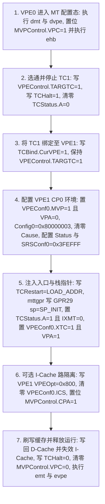

# 3.2 MT ASE 硬件多线程、VPE1 启动与共享内存

Lantiq Falcon（PEB/PEF 98035）利用 MIPS 34Kc 核心的多线程扩展（MIPS MT ASE），将第二个虚拟处理单元（**VPE1**）与硬件线程上下文 1（**TC1**）配置为专用实时外设协处理器。在 GPON SFP 光模块应用场景中，`VPE1` 运行常驻裸机固件，独占处理挂载于 FPI 总线的双地址 I2C 从机控制器（`0x1E200000`），实时响应外部主机对 SFF-8472 `0x50`（A0h）与 `0x51`（A2h）地址空间的读写时序，并通过片上 `SBS0RAM`（物理地址 `0x1F200200`）与运行在 `VPE0` 上的主控系统交换寄存器镜像与写事件通知。

---

## 2.1 MIPS MT ASE 核心控制寄存器与跨线程指令

MIPS 34Kc 通过一组专用的 CP0 多线程控制寄存器及跨线程访问指令（`mftc0` / `mttc0` / `mftgpr` / `mttgpr` / `dmt` / `emt` / `dvpe` / `evpe`）实现由主核 `VPE0` 对协处理核 `VPE1`（及 `TC1`–`TC4`）的硬件配置：

### 1. 关键 CP0 MT 控制寄存器列表

| CP0 寄存器名 | Reg, Sel | 作用域 | 关键位域与硬件功能定义 |
| :--- | :--- | :--- | :--- |
| `MVPControl` | `0, 1` | 全核共享 | • `CPA`（位 `[3]`，`0x08`）：缓存分区激活（Cache Partitioning Active）。 • `STLB`（位 `[2]`，`0x04`）：跨 VPE 共享 JTLB。 • `VPC`（位 `[1]`，`0x02`）：VPE 配置模式使能（置 `1` 时允许修改 `VPEConf0`、`TCBind` 等结构寄存器）。 • `EVP`（位 `[0]`，`0x01`）：多虚拟处理器全局并发执行使能（由 `evpe` 置 `1`、`dvpe` 清 `0`）。 |
| `MVPConf0` | `0, 2` | 全核只读 | • `PCP`（位 `[27]`）：支持可编程缓存路分区（Programmable Cache Partitioning）。 • `TCA`（位 `[15]`）：TC 可动态分配。 • `PVPE`（位 `[13:10]`）：最大 VPE 索引号（Falcon 为 `1`，代表 `VPE0`–`VPE1`）。 • `PTC`（位 `[7:0]`）：最大 TC 索引号（Falcon 为 `4`，代表 `TC0`–`TC4`）。 |
| `VPEControl` | `1, 1` | 每 VPE 独立 | • `TE`（位 `[15]`，`0x8000`）：当前 VPE 多线程并发调度使能（由 `emt` 置 `1`、`dmt` 清 `0`）。 • `TARGTC`（位 `[7:0]`）：指定后续 `mftc0` / `mttc0` / `mftgpr` / `mttgpr` 指令所访问的目标硬件线程号（如设为 `1` 指向 `TC1`）。 |
| `VPEConf0` | `1, 2` | 每 VPE 独立 | • `XTC`（位 `[28:21]`）：当该 VPE 仅激活单个运行线程时，记录其独占绑定的 TC 编号（`VPE1` 设为 `1 << 21`）。 • `TCS` / `SCS` / `DSC` / `ICS`（位 `[19:16]`）：控制二级/数据/指令缓存行共享或抑制属性（位 `[16]` `ICS = 0x10000`）。 • `MVP`（位 `[1]`，`0x02`）：Master VPE 权限位（允许该 VPE 配置其他 VPE/TC）。 • `VPA`（位 `[0]`，`0x01`）：VPE 激活位（Virtual Processor Activated）。 |
| `VPEOpt` | `1, 7` | 每 VPE 独立 | • `IWX3`–`IWX0`（位 `[11:8]`）：指令缓存第 3–0 路回填排除掩码（`0x0800` 代表排除 I-Cache 第 3 路）。 • `DWX3`–`DWX0`（位 `[3:0]`）：数据缓存第 3–0 路回填排除掩码。 |
| `TCStatus` | `2, 1` | 每 TC 独立 | • `DA`（位 `[15]`，`0x8000`）：允许 `fork`/`yield` 动态分配。 • `A`（位 `[13]`，`0x2000`）：硬件线程激活位（Thread Activated）。 • `TKSU`（位 `[12:11]`）：线程特权级（`00` = Kernel 模式）。 • `IXMT`（位 `[10]`，`0x0400`）：中断豁免位（`0` = 允许该 TC 响应所属 VPE 的硬件中断，`1` = 屏蔽该 TC 的中断响应）。 • `TASID`（位 `[7:0]`）：线程地址空间标识。 |
| `TCBind` | `2, 2` | 每 TC 独立 | • `CurTC`（位 `[28:21]`）：当前 TC 索引号（只读）。 • `CurVPE`（位 `[3:0]`）：将当前 TC 绑定至指定的 VPE（`0` = `VPE0`，`1` = `VPE1`）。 |
| `TCRestart` | `2, 3` | 每 TC 独立 | 目标硬件线程的程序计数器（PC）重启地址。向 `TCRestart` 写入入口地址即设定该 TC 解除暂停后的首条取指地址。 |
| `TCHalt` | `2, 4` | 每 TC 独立 | • `H`（位 `[0]`）：线程暂停控制位（`1` = 强制暂停该 TC 流水线取指，`0` = 允许该 TC 运行）。 |
| `TCContext` | `2, 5` | 每 TC 独立 | 32 位线程上下文存储字（初始化时清零）。 |
| `SRSConf0` | `6, 1` | 每 VPE 独立 | 影子寄存器组映射配置寄存器（`VPE1` 初始化时写入 `0x003FEFFF`）。 |

---

## 2.2 VPE1 内存驻留窗口与 `0xC0DAFEED` 重定位表格式

### 1. DDR2 尾部保留内存计算

MA5671A 的出厂参数使用 `mem=63M`、`vpe1_load_addr=0x83f00000` 和 `vpe1_mem=1M`，将 64 MiB DDR 尾部 1 MiB 留给裸机固件，通过 KSEG0 取指。下式描述这个板级约定，不是所有 Falcon 系统都自动按 RAM 容量计算出的硬件固定地址：

* 设系统 DDR2 总容量为 `RAM_SIZE`（64 MiB 即 `0x04000000`），为 `VPE1` 保留的尾部空间大小为 1 MiB（`0x00100000`）：
  * 物理加载基址：`PHYS_LOAD = RAM_SIZE - 0x00100000`（在 64 MiB 系统中为 `0x03F00000`）。
  * `KSEG0` 运行基址：`LOAD_ADDR = PHYS_LOAD | 0x80000000`（在 64 MiB 系统中为 `0x83F00000`）。
  * `TC1` 初始栈顶指针（`$sp` / `$29`）：设置在保留区顶端向内偏移 16 KiB（`0x4000`）处，即 `SP_INIT = (RAM_SIZE - 0x4000) | 0x80000000`（在 64 MiB 系统中为 `0x83FFC000`）。

VPE1 的加载地址、可用容量与主系统的内存分配必须一致。采用保留内存描述时，应确保窗口位于实际 DDR 内、地址按页对齐，并使加载请求落在该窗口内；加载容量不得超过窗口边界。

### 2. 固件内置 `0xC0DAFEED` 重定位描述符结构

为支持在不同 DDR2 容量下加载到对应的 `LOAD_ADDR`，`VPE1` 固件镜像内部包含一个以 32 位魔数 `0xC0DAFEED` 标识的重定位描述符与偏移表。在将固件拷贝至 `LOAD_ADDR` 后、解除 `TC1` 暂停前，需按大端序 32 位字扫描镜像并执行原地地址修正：

| 位置与索引 | 修正前原始值 | 修正后运行时值 | 字段含义说明 |
| :--- | :--- | :--- | :--- |
| 描述符字 `p[0]` | `0xC0DAFEED` | `LOAD_ADDR + p[2]`（即 `&tbl[0]`） | 魔数标记；修正后直接存放重定位表 `tbl` 在内存中的绝对起始地址 |
| 描述符字 `p[1]` | `count` | 保持 `count` 不变 | 重定位表 `tbl` 包含的 32 位条目总数 |
| 描述符字 `p[2]` | `table_offset` | 保持 `table_offset` 不变 | 重定位表 `tbl` 相对于固件镜像起始处的字节偏移量（`tbl = (u32 *)(LOAD_ADDR + p[2])`） |
| 表项 `tbl[0]`、`tbl[1]` | 头部保留项 | 保持不变 | 前两项（索引 `0` 与 `1`）不执行基址累加 |
| 表项 `tbl[i]`（`2 <= i < count`） | 相对固件基址偏移 `offset_i` | `LOAD_ADDR + offset_i` | 从索引 `2` 至 `count - 1`，每项加上运行时基址 `LOAD_ADDR`，转化为 `KSEG0` 绝对地址 |

---

## 2.3 VPE1 与 TC1 硬件激活状态机

主核 `VPE0` 启动或热重载 `VPE1` 时，必须按以下硬件寄存器操作顺序完成 `TC1` 绑定、`VPE1` 上下文初始化、缓存路分区及流水线唤醒：

各步骤对应的 CP0 寄存器配置值如下：

1. **进入全局 MT 配置态**
   * 执行 `dmt`（清除 `VPE0` 的 `VPEControl.TE`）与 `dvpe`（清除全局 `MVPControl.EVP`）。
   * 将 `CP0 MVPControl` 的 `VPC` 位（位 `[1]`，`0x02`）置 `1`，随后执行 `ehb`（Execution Hazard Barrier）消除流水线控制冒险。

2. **暂停 `TC1` 并解绑激活态**
   * 将 `VPEControl.TARGTC`（位 `[7:0]`）设为 `1`（指向 `TC1`），执行 `ehb`。
   * 通过 `mttc0` 向 `TC1` 的 `TCHalt` 写入 `1`（暂停 `TC1`），读取 `TC1` 的 `TCStatus` 并清除位 `[13]`（`A = 0`）。

3. **将 `TC1` 划归 `VPE1` 管辖**
   * 读取 `TC1` 的 `TCBind`，将 `CurVPE`（位 `[3:0]`）修改为 `1` 后写回，使 `TC1` 后续的 `mftc0`/`mttc0` 操作直接作用于 `VPE1` 的独立 CP0 寄存器组。

4. **初始化 `VPE1` 的 CP0 异常、缓存属性与状态寄存器**
   * 在 `VPE1` 的 `VPEConf0` 中清零 `VPA`（位 `[0]`）并置位 `MVP`（位 `[1]`，`0x02`）。
   * 清零 `VPE1` 的 `VPEControl.TE`（位 `[15]`）与 `MVPControl.CPA`（位 `[3]`）。
   * 向 `VPE1` 的 `CP0 Config0`（Reg 16, Sel 0）写入 `0x80000003`（开启 `KSEG0` 写回式缓存 `K0 = 3`）。
   * 向 `VPE1` 的 `CP0 Cause`（Reg 13, Sel 0）写入 `0`，向 `TCContext`（Reg 2, Sel 5）写入 `0`，向 `SRSConf0`（Reg 6, Sel 1）写入 `0x003FEFFF`。
   * 将 `VPE0` 当前的 `CP0 Status`（Reg 12, Sel 0）按掩码 `(status & ~0x10400017) | 0x10000000` 修正后写入 `VPE1` 的 `CP0 Status`（即清除 `BEV`、`TS`、`ERL`、`EXL`、`IE`，保持内核态 `KSU = 00` 并开启 `CU0` 协处理器访问权限）。

5. **装填 `TC1` 入口 PC、栈指针并激活 `VPE1`**
   * 向 `TC1` 的 `TCRestart`（Reg 2, Sel 3）写入固件入口虚拟地址 `LOAD_ADDR`（如 `0x83F00000`）。
   * 使用 `mttgpr` 指令向 `TC1` 的通用寄存器 `$29`（`$sp`）写入栈顶地址 `SP_INIT`（如 `0x83FFC000`）。
   * 修改 `TC1` 的 `TCStatus`：清除位 `[10]` `IXMT`（`~0x0400`，允许 `TC1` 响应中断）并置位位 `[13]` `A`（`| 0x2000`，激活 `TC1`）。
   * 修改 `VPE1` 的 `VPEConf0`：将 `XTC`（位 `[28:21]`）设为 `1`（`1 << 21`），同时将位 `[0]` `VPA` 置 `1`（激活 `VPE1`）。

6. **配置 I-Cache 路隔离与释放执行**
   * 若启用指令缓存路隔离，向 `VPE1` 的 `VPEOpt`（Reg 1, Sel 7）写入 `0x00000800`（置位 `IWX3`，禁止 `VPE1` 回填替换 I-Cache 第 3 路），清除 `VPE1` 的 `VPEConf0.ICS`（`~0x10000`），并置位 `MVPControl.CPA`（`| 0x08`）。
   * 对 `[LOAD_ADDR, LOAD_ADDR + fw_size)` 地址区间执行 D-Cache 写回（Writeback）与 I-Cache 失效（Invalidate），确保重定位后的指令写入物理内存并对 I-Cache 可见。
   * 向 `TC1` 的 `TCHalt` 写入 `0`，清除 `MVPControl.VPC`（`~0x02`），依次执行 `emt` 与 `evpe` 指令。此时 `VPE1`（`TC1`）立即从 `LOAD_ADDR` 开始并行取指运行。

---

## 2.4 `SBS0RAM` 跨 VPE 共享监控内存布局（`0x1F200200`）

SFP 设备服务约定使用物理地址 `0x1F200200`（KSEG0 `0x9F200200` / KSEG1 `0xBF200200`）起始的 `0x7AC` 字节共享区，包含两个 `0x3D0` 字节银行及 12 字节全局尾部。这是主系统与 VPE1 服务间的数据布局，不是 SoC 固定寄存器组；其他设备服务可以采用不同的共享内存协议。

### 1. 共享内存顶层地址分布（基址 `0x1F200200`）

| 相对偏移 | 物理地址范围 | KSEG0 虚拟地址 | 长度 (Bytes) | 区域名称与硬件功能 |
| :--- | :--- | :--- | :--- | :--- |
| `+0x000`–`+0x3CF` | `0x1F200200`–`0x1F2005CF` | `0x9F200200` | `0x3D0` (976 B) | **Bank 0（Slave 1 描述符块）**：对应 SFP 标准 EEPROM 页（7 位从地址 `0x50`，8 位读写地址 `0xA0`/`0xA1`） |
| `+0x3D0`–`+0x79F` | `0x1F2005D0`–`0x1F20099F` | `0x9F2005D0` | `0x3D0` (976 B) | **Bank 1（Slave 2 描述符块）**：对应 SFP 数字诊断监控 DDM 页（7 位从地址 `0x51`，8 位读写地址 `0xA2`/`0xA3`） |
| `+0x7A0`–`+0x7A3` | `0x1F2009A0`–`0x1F2009A3` | `0x9F2009A0` | 4 B | SDA 引脚编号：缺省 GPIO39 |
| `+0x7A4`–`+0x7A7` | `0x1F2009A4`–`0x1F2009A7` | `0x9F2009A4` | 4 B | SCL 引脚编号：缺省 GPIO40 |
| `+0x7A8`–`+0x7AB` | `0x1F2009A8`–`0x1F2009AB` | `0x9F2009A8` | 4 B | 从机事务处理使能 |

### 2. 单个从机描述符块（`Bank 0` / `Bank 1`，各 `0x3D0` 字节）内部字段偏移表

| 块内偏移 | 字段 | 长度 | 含义 |
|---|---|---|---|
| `0x000` | 地址游标 | 1 B | 当前 I2C 字节偏移 |
| `0x001` | EEPROM 数据区 | 640 B | EEPROM 镜像及扩展数据 |
| `0x281` | 写保护区 | 256 B | 逐字节写保护掩码 |
| `0x381` | 写事件位图 | 32 B | 256 位写事件 |
| `0x3A1` | 读事件位图 | 32 B | 256 位读事件 |
| `0x3C1`、`0x3C2`、`0x3C3` | 状态、从地址、通知使能 | 各 1 B | 服务状态与地址配置 |
| `0x3C4` | 访问码 | 4 B | 访问授权参数 |
| `0x3C8` | 保留字 | 4 B | 保留 |
| `0x3CC` | 访问模式 | 4 B | 服务访问模式 |

Bank 1 的全局偏移为上表偏移加 `0x3D0`。读写事件以位图表示，由主系统读取并清除，不是事务日志或递增计数器。7 位总线地址 `0x50`/`0x51` 与 8 位写地址 A0h/A2h 的表示法须区分。完整设备服务协议见[控制接口](../09_control_flow/03_driver_ioctl_interfaces.md)。
