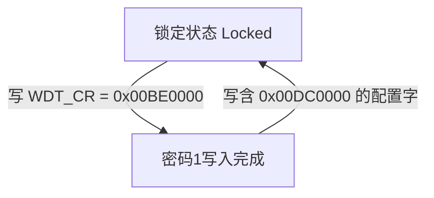

# 4.3 通用定时器 (GPTC) 与硬件看门狗 (WDT)

Lantiq Falcon（PEB/PEF 98035）提供三级独立硬件计时与故障恢复单元：
1. **MIPS 34Kc 核内定时器（CP0 `Count` / `Compare`）**：运行于 `f_CPU / 2`（200 MHz），提供纳秒级高精度时间基准与周期性系统节拍中断（`IRQ 7`）。
2. **FPI 通用定时器/计数器单元（`GPTC`，物理基址 `0x1E100E00`）**：包含可拆分/级联的定时器与事件计数通道；该 dump DT 未提供可核对的 GPTC 通道中断列表，不能把推测的 126–131 当作已证实编号。
3. **BIU 硬件看门狗定时器（`WDT`，物理基址 `0x1F8803F0`）**：集成在总线接口单元内部，采用两次带密码字段的控制寄存器写入，超时后触发硬件复位。

---

## 3.1 MIPS 34Kc 核内 CP0 周期定时器

MIPS 34Kc 处理器内部包含两个 32 位协处理器 0（CP0）计时寄存器，在双 VPE 架构下每個 VPE 拥有独立的 `Compare` 寄存器并共享或独立映射 `Count` 基准：

| CP0 寄存器 | Reg, Sel | 读写属性 | 硬件计时与中断行为 |
| :--- | :--- | :--- | :--- |
| `CP0 Count` | `9, 0` | RW | **32 位自由运行递增计数器**：以处理器核心频率的一半（`f_Count = f_CPU / 2`）持续自增。当 `SYS1_CPU0CC.CPUDIV = 0`（`f_CPU = 400 MHz`）时，`f_Count = 200 MHz`（每计数值对应 `5 ns`，约 `21.47 秒` 回绕一次）。 |
| `CP0 Compare` | `11, 0` | RW | **32 位比较匹配与中断清除寄存器**：当 `CP0 Count == CP0 Compare` 时，硬件自动置位 `CP0 Cause.TI`（位 `[30]`）并拉高核内中断线 `IP7`（对应全局 `IRQ 7`）。向 `CP0 Compare` 写入新比较值的操作由硬件自动清除 `Cause.TI` 与 `IP7` 中断请求。 |

---

## 3.2 通用定时器/计数器单元（`GPTC` `0x1E100E00`）

本节的通道布局是待确认的 GPTC 对照资料，不是本固件已使用这些通道的证明。Linux 3.10 树中的 `arch/mips/lantiq/xway/gptu.c` 及参考归档的 Danube/VR9 IRQ 头属于其他 Lantiq 平台，不能用它们直接证明 Falcon 的通道数、复位读数或 IRQ 接线。下面的详细模式与位域仍需 Falcon 专属资料或原寄存器访问验证；尤其 `ID.CFG=3` 不应当作本板实测值。

`GPTC`（General Purpose Timer/Counter Unit，物理基址 `0x1E100E00`，KSEG1 `0xBE100E00`）挂载于 100 MHz `FPI` 外设总线，其模块时钟与复位受控于 `SYS1`（`0x1EF00000`）的位 `[26]`（`0x04000000`）。

### 1. 硬件模块结构与 16/32 位组合模式

`GPTC` 内部包含 3 个结构相同的定时器块（`Block 1`、`Block 2`、`Block 3`，由 `GPTC_ID.CFG = 3` 标识）。每个块包含 `Timer A`（子索引 `X = 0`）和 `Timer B`（子索引 `X = 1`）两个 16 位计数单元，通过 `CON(n, A)` 寄存器的位 `[4]`（`EXT`）控制块内组合形态：
* **独立双 16 位模式（`CON(n, A).EXT = 0`）**：`Timer nA` 与 `Timer nB` 作为两个完全独立的 16 位定时器/计数器运行，拥有各自的控制、运行、重载、计数值寄存器及独立中断输出。
* **级联 32 位模式（`CON(n, A).EXT = 1`）**：`Timer nA`（低 16 位）与 `Timer nB`（高 16 位）在硬件内部串联为一个完整的 32 位定时器/计数器，统一通过 `Timer nA` 的寄存器（`CON(n, 0)`、`RUN(n, 0)`、`RELOAD(n, 0)`、`COUNT(n, 0)`）及 `Timer nA` 的中断线进行控制。

### 2. `GPTC` 寄存器映射表（基址 `0x1E100E00`）

对于第 `n` 个定时器块（`n = 1, 2, 3`）及其内部子通道 `X`（`X = 0` 对应通道 `A`，`X = 1` 对应通道 `B`），通道寄存器偏移按公式 `Base + Offset + (n - 1) * 0x20 + X * 4` 编址：

| 偏移量 / 公式 | 寄存器名称 | 读写属性 | 关键位域与硬件功能说明 |
| :--- | :--- | :--- | :--- |
| `+0x00` | `GPTC_CLC` | RW | **时钟控制寄存器**：`SMC`（位 `[23:16]`，慢速时钟分频）、`RMC`（位 `[15:8]`，运行分频系数，设为 `1` 时工作频率为 `100 MHz`）、`FSOE`（位 `[5]`）、`SBWE`（位 `[4]`）、`EDIS`（位 `[3]`）、`SPEN`（位 `[2]`）、`DISS`（位 `[1]`）、`DISR`（位 `[0]`）。 |
| `+0x08` | `GPTC_ID` | RO | **模块标识寄存器**：`ID`（位 `[15:8]`）、`CFG`（位 `[7:5]`，32 位定时器块数量，值为 `3`）、`REV`（位 `[4:0]`）。 |
| `+0x10 + (n-1)*0x20 + X*4` | `GPTC_CON(n, X)` | RW | **通道控制寄存器**： • `SRC_EG`（位 `[10]`）：外部门控模式选择。 • `SRC_EXT`（位 `[9]`）：计数时钟源选择（`0` = 内部 FPI 分频时钟，`1` = 外部引脚输入）。 • `SYNC`（位 `[8]`）：外部输入信号同步采样使能。 • `EDGE`（位 `[7:6]`）：外部输入有效边沿（`00`=无，`01`=上升沿，`10`=下降沿，`11`=双边沿）。 • `INV`（位 `[5]`）：输入极性反转。 • `EXT`（位 `[4]`，仅 `X=0` 通道 A 有效）：`0` = 拆分为两个 16 位定时器，`1` = 合并 A+B 为单个 32 位定时器。 • `STP`（位 `[3]`）：停止模式（`0` = 周期自动重载 Cyclic，`1` = 单次触发到期自动停止 One-Shot）。 • `CNT`（位 `[2]`）：工作模式（`0` = 定时器模式，`1` = 脉冲计数器模式）。 • `DIR`（位 `[1]`）：计数方向（`0` = 递减计数 Count Down，`1` = 递增计数 Count Up）。 • `EN`（位 `[0]`，只读）：通道当前运行状态标志（`1` = 正在计数，`0` = 已停止）。 |
| `+0x18 + (n-1)*0x20 + X*4` | `GPTC_RUN(n, X)` | WO | **通道启停与重载命令寄存器**： • `RL`（位 `[2]`，`0x04`）：写 `1` 立即将 `RELOAD(n, X)` 的值装入 `COUNT(n, X)`。 • `CEN`（位 `[1]`，`0x02`）：写 `1` 停止计数器运行（清零 `CON.EN`）。 • `SEN`（位 `[0]`，`0x01`）：写 `1` 启动计数器运行（置位 `CON.EN`）。 |
| `+0x20 + (n-1)*0x20 + X*4` | `GPTC_RELOAD(n, X)` | RW | **重载初值寄存器**：存放 16 位（`EXT=0`）或 32 位（`EXT=1`）周期重载值或比较阈值。 |
| `+0x28 + (n-1)*0x20 + X*4` | `GPTC_COUNT(n, X)` | RO | **当前计数值寄存器**：实时读取当前 16 位或 32 位计数值。 |
| `+0xF4` | `GPTC_IRNEN` | RW | **中断使能寄存器**：位 `[5:0]` 依次对应 `TC3B`、`TC3A`、`TC2B`、`TC2A`、`TC1B`、`TC1A`。 |
| `+0xF8` | `GPTC_IRNICR` | R / W1S | **中断原始捕获与强制触发寄存器**：位定义同 `GPTC_IRNEN`。 |
| `+0xFC` | `GPTC_IRNCR` | R / W1C | **中断锁存状态寄存器**：位定义同 `GPTC_IRNEN`，向位 `2*(n-1) + X` 写 `1` 清除对应通道的中断挂起标志。 |

### 3. 6 路定时器通道寄存器偏移

| 通道名称 | 块号 `n`, 子通道 `X` | `CON` 偏移 | `RUN` 偏移 | `RELOAD` 偏移 | `COUNT` 偏移 | `IRN` 位号 | 全局 IRQ 号 (`IM3`) |
| :--- | :---: | :---: | :---: | :---: | :---: | :---: | :--- |
| `Timer 1A` | `n=1, X=0` | `+0x10` | `+0x18` | `+0x20` | `+0x28` | 位 `[0]` (`0x01`) | 待核实 |
| `Timer 1B` | `n=1, X=1` | `+0x14` | `+0x1C` | `+0x24` | `+0x2C` | 位 `[1]` (`0x02`) | 待核实 |
| `Timer 2A` | `n=2, X=0` | `+0x30` | `+0x38` | `+0x40` | `+0x48` | 位 `[2]` (`0x04`) | 待核实 |
| `Timer 2B` | `n=2, X=1` | `+0x34` | `+0x3C` | `+0x44` | `+0x4C` | 位 `[3]` (`0x08`) | 待核实 |
| `Timer 3A` | `n=3, X=0` | `+0x50` | `+0x58` | `+0x60` | `+0x68` | 位 `[4]` (`0x10`) | 待核实 |
| `Timer 3B` | `n=3, X=1` | `+0x54` | `+0x5C` | `+0x64` | `+0x6C` | 位 `[5]` (`0x20`) | 待核实 |

---

## 3.3 BIU 硬件看门狗定时器（`WDT` `0x1F8803F0`）

硬件看门狗定时器（`WDT`）位于 `BIU` 内部控制空间（物理基址 `0x1F8803F0`，KSEG1 `0xBF8803F0`）。原固件的 `ltq_wdt_probe`（`kernel.elf:0x80154420`）调用 `clk_get_io()` 获取输入时钟；dump 的设备树将 `io` 时钟定义为 **200 MHz**，与 100 MHz 的 `fpi` 时钟分开。复位原因值 `2` 被驱动报告为看门狗复位。

### 1. `WDT` 寄存器与位域定义（基址 `0x1F8803F0`）

| 偏移量 | 物理地址 | 寄存器名 | 位域范围 | 字段名称 | 读写属性与硬件功能说明 |
| :--- | :--- | :--- | :--- | :--- | :--- |
| `+0x00` | `0x1F8803F0` | `WDT_CR` | `[31]` | `GEN` | **看门狗总使能位**（`0x80000000`）：`1` = 启动倒计时，`0` = 停用看门狗。 |
| `+0x00` | `0x1F8803F0` | `WDT_CR` | `[30]` | `DSEN` | **EJTAG 调试挂起使能**：`1` = 当 CPU 进入 EJTAG 调试断点态时暂停倒计时。 |
| `+0x00` | `0x1F8803F0` | `WDT_CR` | `[29]` | `LPEN` | **低功耗休眠挂起使能**：`1` = 当 CPU 进入低功耗休眠态时暂停倒计时。 |
| `+0x00` | `0x1F8803F0` | `WDT_CR` | `[27:26]` | `PWL` | **预警水位阈值（Pre-warning Limit）**：配置触发预警标志 `WDT_SR.PRW` 的剩余时间比例（`11b` 对应掩码 `0x0C000000`）。 |
| `+0x00` | `0x1F8803F0` | `WDT_CR` | `[25:24]` | `CLKDIV` | **时钟预分频系数（Clock Divider）**： • `00`：`DIV = 1`（`2^0`） • `01`：`DIV = 64` (`2^6`) • `10`：`DIV = 4096` (`2^12`) • `11`：`DIV = 262144` (`2^18`，对应掩码 `0x03000000`)。 |
| `+0x00` | `0x1F8803F0` | `WDT_CR` | `[23:16]` | `PW` | **写入密码字段**：先写 `0xBE`（`0x00BE0000`），再写含 `0xDC`（`0x00DC0000`）的配置字。 |
| `+0x00` | `0x1F8803F0` | `WDT_CR` | `[15:0]` | `RELOAD` | **16 位计数器重载值**（`0x0000`–`0xFFFF`）。 |
| `+0x08` | `0x1F8803F8` | `WDT_SR` | `[31]` | `EN` | **只读状态位**：`1` = 看门狗当前正在运行。 |
| `+0x08` | `0x1F8803F8` | `WDT_SR` | `[30]` | `AE` | **访问错误标志（Access Error）**：当写入 `WDT_CR` 的密码序列错误时由硬件置 `1`，并忽略该次非法写操作。 |
| `+0x08` | `0x1F8803F8` | `WDT_SR` | `[29]` | `PRW` | **预警状态标志（Pre-warning）**：计数值低于 `PWL` 设定阈值时置 `1`。 |
| `+0x08` | `0x1F8803F8` | `WDT_SR` | `[15:0]` | `VALUE` | **当前剩余计数值（只读）**：实时反映 16 位递减计数器的当前值。 |

### 2. 两次写入的密码与喂狗序列

原固件 `ltq_wdt_open`（`0x8015439C`）和 `ltq_wdt_release`（`0x80154520`）明确执行以下两次 32 位写入。Linux 3.10.49 分支的 `drivers/watchdog/lantiq_wdt.c` 与此序列一致：

1. **第一拍（写入密码 1）**：向 `WDT_CR` 写入 `0x00BE0000`。
2. **第二拍（写入密码 2、控制字与重载值）**：
   * **启动或喂狗**：向 `WDT_CR` 写入 `0x80000000 | (0x3 << 26) | (0x3 << 24) | (0xDC << 16) | reload_val`（即 `0x8FDC0000 | (reload_val & 0xFFFF)`）。
   * **停用看门狗**：向 `WDT_CR` 写入 `0x00DC0000`（`GEN = 0` 且密码字段 `[23:16] = 0xDC`）。

### 3. 超时时间与重载值计算公式

原固件 `ltq_wdt_open:0x801543D0` 先将 `io_rate` 右移 18 位，乘以超时秒数，再**加上** `0x1000`，最后饱和到 `0xFFFF`。因此驱动的实际写入公式为：

* `RELOAD = min(T * floor(io_rate / 262144) + 4096, 65535)`。
* 在设备树给出的 `io_rate = 200000000` 下，整数商为 `762`；默认 `T = 30` 时写入 `26956`（`0x694C`），控制字为 `0x8FDC694C`。
* 该公式中的偏置不能改写为减法；超过 16 位上限的请求被截断。这里记录驱动计算，不将其换算结果当作实际超时的硬件测量值。

核对材料：`extracted/images/falcon-sfp.dts` 的 `clocks/io` 和 `watchdog@803F0`；`kernel.elf` 上述三个函数；`kernel` 仓库 `linux-3.10.49:drivers/watchdog/lantiq_wdt.c`。7.3 驱动实现应单独阅读，不能替代原固件的喂狗序列证据。
