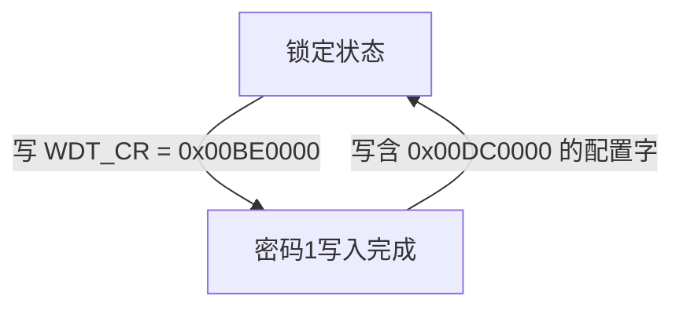

# 4.3 通用定时器 (GPTC) 与硬件看门狗 (WDT)

Falcon 提供三个层次的计时与故障恢复功能：核内 CP0 Count/Compare 用于处理器时间基准，FPI 域 GPTC 提供通用计时与事件计数，BIU 域 WDT 在超时后触发硬件复位。三者的时钟域和中断路径分别配置。

## 3.1 MIPS 34Kc 核内 CP0 周期定时器

CP0 Count 与 Compare 均为 32 位寄存器。Count 以核心频率的一半递增；400 MHz 核心对应 200 MHz 计数时钟，每计数为 5 ns，约 21.47 秒回绕一次。该计数粒度不等于软件可保证的中断响应延迟。

| 寄存器 | Reg, Sel | 功能 |
|---|---|---|
| Count | `9, 0` | 自由运行计数器，可读写 |
| Compare | `11, 0` | 比较值；匹配时产生计时中断，写入新值清除挂起状态 |

计时中断使用 CP0 IP7 输入。双 VPE 的 Compare 上下文分别管理；处理单元间的时间同步还需考虑各自的计时配置。

## 3.2 通用定时器/计数器单元（GPTC）

GPTC 物理基址为 `0x1E100E00`，KSEG1 地址为 `0xBE100E00`，位于 100 MHz FPI 域。SYS1 时钟和复位位图的位 26（`0x04000000`）控制该模块。

GPTC 用于通用计时和外部事件计数。其 Falcon 实例的通道数量、16/32 位组合模式、完整寄存器布局及各通道到 ICU 的接线尚未确认，本节不规定相应偏移、复位读数或中断编号。GPTC 与核内 Count/Compare 是不同的计时资源，不应共用对方的时钟或中断配置。

## 3.3 BIU 硬件看门狗定时器（WDT）

WDT 物理基址为 `0x1F8803F0`，KSEG1 地址为 `0xBF8803F0`。输入基准为 200 MHz IO 时钟，独立于 100 MHz FPI 时钟。看门狗复位后，`SYS1_CPU0RS.HWRS` 的值为 `2`。

### 1. 控制与状态寄存器

| 偏移 | 寄存器 | 位域 | 功能 |
|---|---|---|---|
| `0x00` | WDT_CR | GEN `[31]` | 1=启动，0=停用 |
| `0x00` | WDT_CR | DSEN `[30]` | 调试挂起时暂停计数 |
| `0x00` | WDT_CR | LPEN `[29]` | 低功耗休眠时暂停计数 |
| `0x00` | WDT_CR | PWL `[27:26]` | 预警水位选择 |
| `0x00` | WDT_CR | CLKDIV `[25:24]` | 输入分频选择，见下表 |
| `0x00` | WDT_CR | PW `[23:16]` | 写入保护密码 |
| `0x00` | WDT_CR | RELOAD `[15:0]` | 16 位重载值 |
| `0x08` | WDT_SR | EN `[31]` | 当前使能状态 |
| `0x08` | WDT_SR | AE `[30]` | 密码序列访问错误 |
| `0x08` | WDT_SR | PRW `[29]` | 预警状态 |
| `0x08` | WDT_SR | VALUE `[15:0]` | 当前计数值 |

| CLKDIV | 分频比 |
|---|---|
| `00` | 1 |
| `01` | 64 |
| `10` | 4096 |
| `11` | 262144 |

### 2. 密码与喂狗序列

启停或重载 WDT 使用连续两次 32 位控制寄存器写入：先写密码 1，再写带密码 2 的配置字。

1. 向 WDT_CR 写入 `0x00BE0000`。
2. 启动或喂狗时，写入使能、预警、分频、密码 2 和重载值；采用最大分频及 PWL=`11` 时，控制字为 `0x8FDC0000 | (RELOAD & 0xFFFF)`。停用时，第二次写入 `0x00DC0000`，使 GEN 为 0。

密码字段位于 `[23:16]`，重载字段位于 `[15:0]`，两者不能混用。错误的密码序列会产生访问错误状态。

### 3. MA5671A 重载参数约定

MA5671A 的设备服务将以秒为单位的请求值 `T` 编码为以下重载值，采用分频比 262144：

* `RELOAD = min(T * floor(io_rate / 262144) + 4096, 65535)`。
* 当 `io_rate = 200000000` 时，整数商为 762；`T = 30` 对应 `RELOAD = 26956`（`0x694C`），控制字为 `0x8FDC694C`。
* 该约定包含整数除法和 16 位饱和；超过上限后，继续增大请求值不再增加重载值。

这是设备服务的参数编码约定，不是看门狗硬件对任意频率和工作模式的通用超时公式。精确到期时间、预警到复位的间隔及计数偏置的硬件解释尚未规定。
