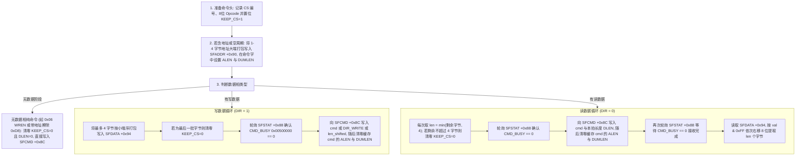

# 4.4 外部总线单元 (EBU) 与串行闪存状态机 (SFSM)

Lantiq Falcon（PEB/PEF 98035）通过**外部总线单元（External Bus Unit, EBU，物理基址 `0x18000000`）**及其内置的**串行闪存状态机（Serial Flash State Machine, SFSM）**管理片外 SPI NOR Flash 与并行本地总线（Localbus）外设。`EBU` 支持两种硬件访问模式：
1. **直接内存映射读取模式（Direct Memory-Mapped Read / XIP）**：将外部 SPI NOR Flash 直接映射到物理地址窗口 `0x10000000`–`0x13FFFFFF`（64 MiB，对应 `KSEG0` `0x90000000` / `KSEG1` `0xB0000000`），供 MIPS 34Kc 处理器在冷启动时直接取指（Execute-In-Place）或以普通内存读指令访问。
2. **命令状态机受控读写模式（SFSM Command-Driven Mode）**：通过编程 `SFCMD`、`SFADDR`、`SFDATA` 等寄存器，按「命令码（Opcode）→ 地址相（0–4 B）→ 空周期相（0–15 B）→ 数据相（每次 0–4 B，支持保持片选跨拍续传）」的硬件状态机序列执行 JEDEC ID 读取、状态寄存器轮询、扇区擦除与页编程操作。

---

## 4.1 EBU 地址窗口、时钟配置与硬件互斥门控

### 1. 物理地址空间分配

| 物理地址范围 | KSEG0 虚拟地址 | KSEG1 虚拟地址 | 窗口大小 | 硬件功能描述 |
| :--- | :--- | :--- | :--- | :--- |
| `0x10000000`–`0x13FFFFFF` | `0x90000000`–`0x93FFFFFF` | `0xB0000000`–`0xB3FFFFFF` | 64 MiB | **EBU Region 0（Serial Flash 直接映射窗口）**：受 `ADDRSEL0`（`0x18000020`）与 `BUSRCON0`（`0x18000010`）控制 |
| `0x14000000`–`0x17FFFFFF` | `0x94000000`–`0x97FFFFFF` | `0xB4000000`–`0xB7FFFFFF` | 64 MiB | **EBU Region 2（并行 Localbus 映射窗口）**：受 `ADDRSEL2`（`0x18000028`）控制 |
| `0x18000000`–`0x180000FF` | `0x98000000`–`0x980000FF` | `0xB8000000`–`0xB80000FF` | 256 B | **EBU 与 SFSM 控制寄存器组** |
| `0x1D004104`–`0x1D004107` | `0x9D004104`–`0x9D004107` | `0xBD004104`–`0xBD004107` | 4 B | **`SFLASH_EBU_GATE` 硬件互斥门控寄存器**（位于 `MPS` 模块内） |

### 2. 时钟源与 SPI 串行时钟分频计算

* **EBU 模块时钟使能与复位**：位于 `SYS1`（`0x1EF00000`）的位 `[4]`（`EBU`，掩码 `0x00000010`）。
* **EBU 基准时钟频率（`f_EBU`）**：由 `SYS1_EBUCC`（`0x1EF000C4`）位 `[0]` `EBUDIV` 选择：
  * `EBUDIV = 0`：`f_EBU = 50 MHz`。
  * `EBUDIV = 1`：`f_EBU = 100 MHz`。
* **SFSM 串行时钟（`SCK`）分频**：由 `SFTIME`（`0x18000084`）中的周期字段与上升/下降沿位置字段控制。对于整数分频因子 `i`（`i = 1..6`），输出 SPI 时钟频率为 `f_SCK = f_EBU / i`（最高支持 50 MHz 或 100 MHz），配置时将 `SCKR_POS`（位 `[11:8]`）设为 `i`，并将 `SCK_PER`（位 `[3:0]`）设为 `2 * i`（即 `i << 1`）。

### 3. `SFLASH_EBU_GATE`（`0x1D004104`）硬件互斥门控机制

为防止多处理器单元（如 `VPE0`、`VPE1` 或片上其他主设备）同时发起 EBU 寄存器读写与直接窗口取指造成状态机冲突，`MPS` 模块在物理地址 `0x1D004104`（KSEG1 `0xBD004104`）提供了一个硬件测试并置位（Test-and-Set）门控寄存器：
* **加锁（Acquire Gate）**：循环读取 `0xBD004104`，当读回值为 `0` 时表示成功获取 EBU 访问权（硬件在读出 `0` 的同时自动将该锁存器置为非零占用态）；若读回值非 `0`，则继续轮询等待。
* **解锁（Release Gate）**：完成单次 EBU 寄存器读写后，向 `0xBD004104` 写入 `0x00000000` 释放门控锁。

---

## 4.2 EBU 与 SFSM 寄存器映射表（基址 `0x18000000`）

| 偏移量 | 物理地址 | 寄存器名称 | 读写属性 | 关键位域与硬件功能说明 |
| :--- | :--- | :--- | :--- | :--- |
| `+0x00` | `0x18000000` | `EBU_CLC` | RW | **EBU 时钟控制寄存器**：控制模块休眠与时钟门控状态。 |
| `+0x08` | `0x18000008` | `EBU_ID` | RO | **EBU 模块标识与版本寄存器**。 |
| `+0x10` | `0x18000010` | `BUSRCON0` | RW | **区域 0 总线读配置寄存器**： • `AGEN`（位 `[31:28]`）：地址生成/外设类型选择，写入 `0xF`（`0xF0000000`）选通为 **Serial Flash 状态机模式**。 • `PORTW`（位 `[1:0]`）：端口位宽，`00` = 8 位复用串行接口。 |
| `+0x18` | `0x18000018` | `BUSWCON0` | RW | **区域 0 总线写配置寄存器**：`AGEN`（位 `[31:28]`）同样写入 `0xF`（`0xF0000000`）。 |
| `+0x20` | `0x18000020` | `ADDRSEL0` | RW | **区域 0 地址窗口选择寄存器**：定义 `0x10000000` 串行闪存直接映射窗口的基址（位 `[31:12]`）、掩码（位 `[7:4]`）、镜像使能 `MRME`（位 `[1]`）与区域使能 `REGEN`（位 `[0]`）。 |
| `+0x28` | `0x18000028` | `ADDRSEL2` | RW | **区域 2 地址窗口选择寄存器**：定义 `0x14000000` Localbus 窗口的基址、掩码与使能。 |
| `+0x80` | `0x18000080` | `SFCON` | RW | **串行闪存全局配置寄存器**：`DEV_SIZE`（位 `[27:24]`，掩码 `0x0F000000`）设定最大可寻址闪存容量指数（配置为 `0x0B000000`）。 |
| `+0x84` | `0x18000084` | `SFTIME` | RW | **串行闪存时序寄存器**： • `RD_POS`（位 `[19:16]`，掩码 `0x000F0000`）：读数据采样延迟周期位置。 • `SCKF_POS`（位 `[15:12]`，掩码 `0x0000F000`）：`SCK` 下降沿位置。 • `SCKR_POS`（位 `[11:8]`，掩码 `0x00000F00`）：`SCK` 上升沿位置。 • `SCK_PER`（位 `[3:0]`，掩码 `0x0000000F`）：`SCK` 时钟周期总长度。 |
| `+0x88` | `0x18000088` | `SFSTAT` | R / W1C | **串行闪存状态寄存器**： • `CMD_ERR`（位 `[29]`，`0x20000000`）：命令执行冲突或非法访问错误标志（向该位写 `1` 清除）。 • `CMD_PEND`（位 `[22]`，`0x00400000`）：命令挂起等待执行。 • `BUSY`（位 `[20]`，`0x00100000`）：SFSM 移位状态机正在传输数据。 注：判断状态机空闲需轮询 `(SFSTAT & 0x00500000) == 0`。 |
| `+0x8C` | `0x1800008C` | `SFCMD` | RW | **串行闪存命令触发寄存器**：写入该寄存器立即启动一次 SFSM 硬件传输（详细位域见下表）。 |
| `+0x90` | `0x18000090` | `SFADDR` | RW | **串行闪存地址寄存器**：存放待发送的 1–4 字节闪存目标地址（大端字节序，按最高有效字节优先移出）。 |
| `+0x94` | `0x18000094` | `SFDATA` | RW | **串行闪存数据寄存器**：存放单拍待发送或刚接收的 1–4 字节数据（按小端字节序打包：第 1 字节在位 `[7:0]`，第 2 字节在 `[15:8]`，第 3 字节在 `[23:16]`，第 4 字节在 `[31:24]`）。 |
| `+0x98` | `0x18000098` | `SFIO` | RW | **串行闪存引脚电平控制寄存器**：`UNUSED_WD`（位 `[3:0]`，掩码 `0x0000000F`）控制未使用的四线 SPI 数据线静态电平；在标准单线 SPI 模式下写入 `0x0C`（置位位 `[3]` 与位 `[2]`），将 `WP_N` 与 `HOLD_N` 引脚强制驱动为高电平。 |

---

## 4.3 `SFCMD`（`0x1800008C`）命令寄存器位域规范

向 `SFCMD` 写入 32 位控制字会立即触发 `SFSM` 状态机按照指定阶段（Opcode、Address、Dummy、Data）驱动 SPI 总线：

| 位域范围 | 字段名称 | 位掩码 | 硬件功能与状态机行为说明 |
| :--- | :--- | :--- | :--- |
| `[31:27]` | `RES` | `0xF8000000` | 保留位，写 `0`。 |
| `[26:24]` | `CS` | `0x07000000` | **片选通道选择（Chip Select）**：指定本次事务拉低的片选引脚编号（默认主闪存为 `CS = 0`）。 |
| `[23]` | `RES` | `0x00800000` | 保留位，写 `0`。 |
| `[22:20]` | `ALEN` | `0x00700000` | **地址相字节长度（Address Length）**：取值 `0`–`4`。若 `ALEN > 0`，状态机在发送完 `OPC` 后自动从 `SFADDR`（`0x18000090`）移出 `ALEN` 个地址字节；若 `ALEN = 0`，跳过地址相。 |
| `[19:16]` | `DUMLEN` | `0x000F0000` | **空周期相字节长度（Dummy Length）**：取值 `0`–`15`。指定在地址相之后、数据相之前插入的 Dummy 空字节数（如 Fast Read `0x0B` 命令需 `DUMLEN = 1`）。 |
| `[15]` | `KEEP_CS` | `0x00008000` | **片选保持控制位（Keep Chip Select）**： • `1`（`0x8000`）：本次 `SFCMD` 拍次传输完毕后**保持 `CS_N` 引脚为低电平**，允许后续继续通过写入 `SFCMD`（令 `ALEN=0, DUMLEN=0`）分批读写任意长度的数据流。 • `0`（`0x0000`）：本次 `SFCMD` 拍次传输完毕后**立即释放 `CS_N` 引脚回高电平**，结束整条 SPI 帧事务。 |
| `[14:13]` | `RES` | `0x00006000` | 保留位，写 `0`。 |
| `[12:9]` | `DLEN` | `0x00001E00` | **本拍数据相字节长度（Data Length）**：取值 `0`–`4`（偏移为位 `9`）。指定本次触发需要通过 `SFDATA`（`0x18000094`）发送或接收的字节数。 |
| `[8]` | `DIR` | `0x00000100` | **数据方向控制位（Direction）**：`0` = 从 SPI 闪存读取 `DLEN` 字节存入 `SFDATA`；`1` = 将 `SFDATA` 中的 `DLEN` 字节写入 SPI 闪存。 |
| `[7:0]` | `OPC` | `0x000000FF` | **8 位 SPI 命令操作码（Opcode）**：如 `0x06`（Write Enable）、`0x05`（Read Status）、`0x9F`（Read JEDEC ID）、`0x03`（Read）、`0x0B`（Fast Read）、`0x02`（Page Program）、`0xD8`（Sector Erase）。当 `KEEP_CS` 处于保持选中状态且继续传输后续数据拍（`ALEN=0, DUMLEN=0`）时，硬件仅移位数据相而不重复发送 `OPC`。 |

---

## 4.4 SFSM 硬件传输状态机流程

通过 `SFCMD` 执行一条完整 SPI 闪存命令（带可选地址、空周期与多字节读写载荷）的硬件交互流程如下：

### 关键硬件行为约束
1. **首拍与续拍的 `ALEN`/`DUMLEN` 切换**：在一个多字节读或写事务中，仅在**第一拍**写入 `SFCMD` 时携带非零的 `ALEN` 与 `DUMLEN`（硬件在该拍连续发出 `OPC`、`ALEN` 个地址字节、`DUMLEN` 个空字节以及首批 `1`–`4` 个数据字节，并因 `KEEP_CS = 1` 保持 `CS_N` 为低）；从**第二拍**起，必须将写入 `SFCMD` 的 `ALEN` 与 `DUMLEN` 清零，仅保留 `OPC`、`DIR`、`KEEP_CS` 与当前拍的 `DLEN`（`1`–`4`），直到最后一拍（剩余字节 `<= 4`）将 `KEEP_CS` 清零以释放片选。
2. **字节序差异（`SFADDR` vs `SFDATA`）**：
   * **`SFADDR`（`0x18000090`）采用大端序移位**：例如 3 字节地址 `A2 A1 A0` 组装为 `(A2 << 16) | (A1 << 8) | A0` 写入 `SFADDR`。
   * **`SFDATA`（`0x18000094`）采用小端序打包**：总线上传输的第 0、1、2、3 字节依次对应 `SFDATA` 的位 `[7:0]`、`[15:8]`、`[23:16]`、`[31:24]`。
