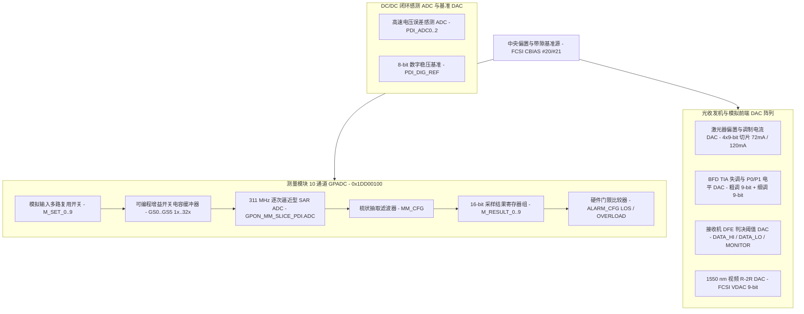

# 4.5 模数与数模转换器（ADC 与 DAC）

Falcon SoC 在光模拟前端（`PMA` / `FCSI`）、电源管理模块（`DCDC`）以及千兆以太网物理层（`GPHY`）中集成了多组专用模数转换器（ADC）与数模转换器（DAC），涵盖 10 通道通用测量 GPADC、激光器偏置与调制电流 DAC、背光监测跨阻放大器（TIA）偏置/判决电平 DAC、接收机判决反馈均衡（DFE）阈值 DAC、1550 nm 视频 R-2R DAC 以及开关电源误差感测 ADC。

---

## 全芯片 ADC 与 DAC 硬件资源总览

| 转换器类别 | 硬件子模块 | 寄存器基址 / 访问接口 | 通道数与位宽 | 核心硬件功能 |
| :--- | :--- | :--- | :--- | :--- |
| **通用测量 ADC（GPADC）** | `GPON_MM_SLICE_PDI` + `FCSI MM` (`#14`) | `0x1DD00100`–`0x1DD00160` + `FCSI 0x0E` | 10 路 TDM 通道，16-bit 有符号输出 | 芯片内部电压（`VDD/2`）、双极型晶体管结温（`VBE1`/`VBE2`）、外部热敏电阻（`TS_TR`）、外置激光器 PN 结温（`TS_PN`）、1490 nm / 1550 nm 接收光功率（`RSSI`）及 `DCDC_APD` 高压监测 |
| **激光器偏置电流 DAC** | `GPON_BFD_SLICE_PDI` + `FCSI TXBOSA` | `0x1DD0018C`–`0x1DD001F4` + `FCSI 0x02..0x03` | 11-bit 等效（4 切片 × 9-bit），满量程 `72 mA`（`4 × 18 mA`） | 驱动 BOSA 激光二极管直流偏置电流（`I_bias`），支持硬件双闭环步进调节与省电模式保持 |
| **激光器调制电流 DAC** | `GPON_BFD_SLICE_PDI` + `FCSI TXBOSA` | `0x1DD0018C`–`0x1DD001E4` + `FCSI 0x00..0x01` | 11-bit 等效（4 切片 × 9-bit），满量程 `120 mA`（`4 × 30 mA`） | 驱动 BOSA 激光二极管高频调制电流（`I_mod`），支持硬件双闭环步进调节与眼图预失真 |
| **BFD 监测 TIA 失调与电平 DAC** | `GPON_BFD_SLICE_PDI` + `FCSI BFD` (`#16..#18`) | `0x1DD001A8`–`0x1DD001B0` + `FCSI 0x10..0x12` | 3 路（`TIAOFFSET`、`P0LEVEL`、`P1LEVEL`），每路 9-bit 粗调 + 9-bit 细调 | 补偿背光监测光电二极管（MPD）跨阻放大器直流失调（粗调 `±192 mV`、细调 `±32 mV`），并设定 `0` 电平（`P0`）与 `1` 电平（`P1`）高速比较器基准 |
| **RX AFE 判决阈值 DAC** | `GPON_RX_SLICE_PDI` + `FCSI RXBOSA` (`#11`) | `0x1DD000A8`–`0x1DD000B0` + `FCSI 0x0B` | 3 路（`DATA_HI`、`DATA_LO`、`MONITOR`），17-bit 控制字 | 设定 2.488 Gbps 下行光接收机高低判决反馈均衡（DFE）比较器阈值与眼图监测通道阈值 |
| **1550 nm 视频 R-2R DAC** | `FCSI VDAC` (`#15`) | `FCSI 0x0F`（经 `0x1DD00600` 访问） | 1 路，9-bit R-2R 网络 | 控制 1550 nm 射频视频叠加（RF Video Overlay）光接收前端的模拟偏置与增益基准 |
| **DC/DC 误差感测 ADC 与基准 DAC** | `DCDC_CORE` / `DCDC_DDR` / `DCDC_APD` | `0x1E803000` / `0x1E804000` / `0x1E805000` | 3 组独立 7-bit 有符号误差 ADC + 8-bit 数字基准 | 每个 PWM 周期对输出电压误差进行高速采样，送入二阶数字 PID 闭环调节器 |
| **GPHY 线路侧混合信号子 ADC** | `GPHY0` / `GPHY1` (`LSADS` / `ASPV_ADC`) | GPHY 内部 `XDATA 0xFFE3`–`0xFFE7` | 双端口四对线混合信号 ADC | 千兆以太网铜缆前端基线漂移跟踪、回波抵消及 TDR 线缆长度诊断 |

---

## 测量模块（MM）10 通道通用 ADC（`0x1DD00100`）

测量模块（Measurement Module，`MM`）位于 `PMA` 地址空间的 `GPON_MM_SLICE_PDI` 切片（物理基址 `0x1DD00100`），配合 `FCSI` 从设备 `#14`（`FCSI_MM_CTRL`，地址 `0x0E`）构成 10 通道时分复用（TDM）模数采集系统，承担 SFF-8472 数字诊断监控（DDMI）所需的温度、供电电压与收发光功率测量。

### 1. 信号链路与时钟结构

- **开关电容（SC）可编程增益缓冲器**：输入多路复用开关选通差分或单端模拟信号后，首先进入开关电容缓冲器，支持 6 档二进制增益选择（`GAIN` 位域 `0..5`，对应 `GS0 = 1x`、`GS1 = 2x`、`GS2 = 4x`、`GS3 = 8x`、`GS4 = 16x`、`GS5 = 32x`）。SC 缓冲器的采样时钟由 `MM_CFG.MM_CLKCFG` 分频产生（初始化配置为 `0x0C`）。
- **311 MHz SAR ADC 核心**：模数转换核心为电荷重分配逐次逼近型（SAR）ADC，迭代时钟直接由 2.5 GHz 主 PLL 八分频提供（`2.48832 GHz / 8 = 311.04 MHz`）。
- **梳状抽取滤波器（Comb Filter）与时隙轮询**：SAR ADC 的高速位流经过 `MM_CFG.MM_DECCFG` 配置的梳状滤波器抽取积分。硬件状态机按 `M_TIME_CONFIG.MEAS_TIME` 设定的驻留时间（以 `31.1 MHz` 周期为单位，初始化值 `0x7918 = 31000` 周期，即每通道驻留 `1 ms`）依次轮询通道 `0` 至通道 `9`，并将 16-bit 测量结果锁存至 `M_RESULT_0`–`M_RESULT_9`。

### 2. `GPON_MM_SLICE_PDI` 寄存器映射（`0x1DD00100`–`0x1DD00160`）

| 偏移 | 寄存器名称 | 复位/初始化值 | 位域定义与硬件说明 |
| :--- | :--- | :--- | :--- |
| `0x100` | `ADC` | `0x004C9262` | **SAR ADC 模拟与时序配置**：`SET_REFBUF_CURR [25:23]`（基准缓冲电流）、`SET_START [22:19]`（每次转换周期数减 1）、`SET_ROM_START [18:15]`（迭代最高 ROM 地址）、`SET_SCR_STATE [14:13]`（扰码状态）、`SET_COMP_CURR [12:10]`（比较器偏置电流 `12.5 µA × N`）、`SET_OFFSET_CAL_EN [9]`（比较器失调校准使能）、`SET_RESETARITH [8]`、`SET_ROM_SEL [7:6]`、`SET_COMP2ARRAY [5:3]`、`SET_COMP2ARITH [2:0]` |
| `0x104` | `MMADC_CLK` | `0x00000000` | **ADC 时钟控制**：`DATA_READY_INV [1]`（采样就绪信号极性反转）、`DIV_RESET [0]`（`311 MHz` 分频器同步复位脉冲） |
| `0x108` | `M_TIME_CONFIG` | `0x00007918` | **单通道测量驻留时间**：`MEAS_TIME [15:0]`，以 `31.1 MHz` 时钟周期为单位（`31000` 周期对应 `1 ms` 积分窗口） |
| `0x10C`–`0x130` | `M_RESULT[0..9]` | 只读 | **通道 0..9 转换结果寄存器**（步长 `0x04`）：`M_RESULT_R [15:0]` 为当前通道最近一次完成的 16-bit 有符号转换结果 |
| `0x134`–`0x158` | `M_SET[0..9]` | `0x00000000` | **通道 0..9 模拟多路复用与增益配置**（步长 `0x04`）：定义每个 TDM 时隙接入的模拟源、参考源及 SC 缓冲器增益档位 |
| `0x15C` | `ALARM_CFG` | `0xFFFF0000` | **通道 9 硬件光功率告警门限**：硬件自动将通道 9 结果 `M_RESULT[9]` 与该寄存器比对；高于 `OVERLOAD_CFG [31:16]` 触发接收光过载中断，低于 `LOS_CFG [15:0]` 触发信号丢失（LOS）中断 |
| `0x160` | `MM_CFG` | `0x0000000C` | **滤波器与采样时钟分频配置**：`MM_DECCFG [10:8]`（梳状滤波器抽取率）、`MM_CLKCFG [7:0]`（SC 缓冲器采样时钟分频比） |

### 3. `M_SET[0..9]` 模拟通道输入矩阵位域详解

每个 `M_SET[i]`（`i = 0..9`）独立控制该时隙的开关矩阵连接方式：

| 位域 | 掩码 | 符号名 | 硬件开关功能说明 |
| :--- | :--- | :--- | :--- |
| `bit 21` | `0x00200000` | `LOCK` | 锁定当前测量通道，停止 TDM 多路复用状态机自动轮询 |
| `bits [20:19]` | `0x00180000` | `TS` | 片上温度与供电传感器选择：`01b` = `VDD/2`（内核半电压），`10b` = `VBE1`（晶体管基极-发射极电压 1），`11b` = `VBE2`（晶体管基极-发射极电压 2，用于差分 ΔVbe 绝对温度推算） |
| `bits [18:16]` | `0x00070000` | `GAIN` | 开关电容（SC）缓冲器增益档位：`0` = `GS0 (1x)`，`1` = `GS1 (2x)`，`2` = `GS2 (4x)`，`3` = `GS3 (8x)`，`4` = `GS4 (16x)`，`5` = `GS5 (32x)` |
| `bits [15:14]` | `0x0000C000` | `VREF_VAL` | 负端（N 端）参考电压分档选择 |
| `bit 13` | `0x00002000` | `PN_SHORT` | 将 SC 缓冲器正负输入端（P 与 N）内部短接，用于测量各级增益档位（`GS0..GS5`）的零点失调（Offset Calibration） |
| `bit 12` | `0x00001000` | `DCDCAPD` | 正端（P）接入 `GP_ADC_APD`（`DCDC_APD` 高压升压输出分压监测点） |
| `bit 11` | `0x00000800` | `ROP1490N` | 负端（N）接入带内部分压器的 `GP_ADC_ROP1490`（1490 nm 下行接收光功率 RSSI 低量程通道） |
| `bit 10` | `0x00000400` | `ROP1490P` | 正端（P）直接接入 `GP_ADC_ROP1490`（1490 nm 下行接收光功率 RSSI 高灵敏度通道） |
| `bit 9` | `0x00000200` | `TSTRN1` | 将内部二极管接入 `GP_ADC_TS_TR` 输入端 |
| `bit 8` | `0x00000100` | `TSTRN` | 负端（N）接入外部热敏电阻引脚 `GP_ADC_TS_TR` |
| `bit 7` | `0x00000080` | `TSTRP` | 正端（P）接入外部热敏电阻引脚 `GP_ADC_TS_TR`（常用于 DDMI 外部电压或 NTC 温度测量） |
| `bit 6` | `0x00000040` | `RF1550` | 接入 `GP_ADC_RF1550`（1550 nm 射频视频功率监测引脚） |
| `bit 5` | `0x00000020` | `ROP1550` | 接入 `GP_ADC_ROP1550`（1550 nm 接收光功率 RSSI 监测引脚） |
| `bit 4` | `0x00000010` | `TSPN` | 接入 `GP_ADC_TS_PN`（外置激光器监测二极管 PN 结压降温度测量引脚） |
| `bit 3` | `0x00000008` | `IREFVAL` | 内部校准参考电流档位切换（配合 `IREF` 进行增益校准） |
| `bit 2` | `0x00000004` | `IREF` | 接入内部参考电流源 |
| `bit 1` | `0x00000002` | `VREF` | 接入经缓冲的内部 `1.0 V` 基准电压源 |
| `bit 0` | `0x00000001` | `VREFR` | 接入未经缓冲的带隙基准源（Bandgap）用于出厂修调 |

同时，`FCSI` 从设备 `#14` 的 `FCSI_MM_CTRL`（`0x0E`）寄存器提供模拟前端辅助配置：`CINV (bit 7)` 控制 SC 缓冲器采样时钟反相，`OPBIAS (bit 6)` 切换运放偏置电流，`REFEN (bit 5)` 使能 `1.0 V` 基准源，`FBSEL (bit 4)` 选择反馈点（焊盘或运放输出），`RVS (bits [3:2])` 选择外接热敏电阻基准电压（`00b = 0.93 V`、`01b = 0.99 V`、`10b = 1.05 V`、`11b = 1.175 V`）。

---

## 光收发机（BOSA / PMD）数模转换器阵列

在 `GPON_BFD_SLICE_PDI`（`0x1DD00180`）、`GPON_RX_SLICE_PDI`（`0x1DD00080`）以及 `FCSI` 总线中集成了全套光收发机控制 DAC。所有模拟 DAC 的基准电流与带隙电压均由 `FCSI CBIAS`（从设备 `#20`/`#21`，寄存器 `0x14`/`0x15`）统一提供并支持修调。

### 1. 激光器偏置（Bias）与调制（Modulation）电流 DAC

发射机集成了两路大电流高速电流舵 DAC，直接驱动外部 BOSA 激光二极管：

- **偏置电流 DAC（Bias DAC）**：由 4 个独立的 `9-bit / 18 mA` 电流切片并联相加构成，等效分辨率为 **11-bit（`0..2047`）**，总满量程输出电流为 **`72 mA`（`4 × 18 mA`）**。
- **调制电流 DAC（Modulation DAC）**：由 4 个独立的 `9-bit / 30 mA` 电流切片并联相加构成，等效分辨率为 **11-bit（`0..2047`）**，总满量程输出电流为 **`120 mA`（`4 × 30 mA`）**。

相关控制与状态寄存器（基址 `0x1DD00000`）：

| 偏移 | 寄存器名称 | 位域 | 功能说明 |
| :--- | :--- | :--- | :--- |
| `0x180` | `THRESHOLD_CTRL` | `BIAS_THR [22:12]`, `MODULATION_THR [11:1]`, `THRESHOLD_OVR [0]` | **激光器安全过流门限**：分别监控偏置与调制 DAC 控制字，超限触发硬件激光安全关断告警 |
| `0x184` | `THRESHOLD_SUMCTRL` | `SUM_THR [19:1]`, `THRESHOLD_OVR [0]` | **偏置+调制总电流安全门限**：按加权和 `limit_mod × 122 mA + limit_bias × 72 mA` 监控激光器总注入电流 |
| `0x18C` | `SATURATION` | `MODULATION_SAT [21:11]`, `BIAS_SAT [10:0]` | **DAC 硬件饱和上限**：限制双闭环调节器可输出的最高调制电流与最高偏置电流码值 |
| `0x190` | `DUAL_LOOP_MOD_INIT` | `INIT_MODULATION [10:0]` | **调制 DAC 突发初始码值**：在上行 T-CONT 突发开启前预加载的 11-bit 调制电流码值 |
| `0x194` | `DUAL_LOOP_BIAS_INIT` | `INIT_BIAS [10:0]` | **偏置 DAC 突发初始码值**：在上行突发开启前预加载的 11-bit 偏置电流码值 |
| `0x198` | `DUAL_LOOP_MOD_STATUS` | `ACTUAL_MODULATION [10:0]` | **调制 DAC 实时码值回读**：反映硬件自动闭环调节后的当前 11-bit 调制 DAC 输出字 |
| `0x19C` | `DUAL_LOOP_BIAS_STATUS` | `ACTUAL_BIAS [10:0]` | **偏置 DAC 实时码值回读**：反映硬件自动闭环调节后的当前 11-bit 偏置 DAC 输出字 |
| `0x1A0` | `LOOP_REGULATION_BIAS` | `FASTON [31]`, `MOD_COMP [30]`, `C_INT [29:26]`, `C_SAT [25:17]`, `C_ALPHA [16:11]`, `C_FAST [10:2]`, `CONTROL_TYPE [1:0]` | **偏置电流硬件双闭环步进参数**：配置积分系数、步长饱和值、连续误差切换阈值及调制电流耦合补偿 |
| `0x1A4` | `LOOP_REGULATION_MODULATION` | `FASTON [31]`, `C_INT [29:26]`, `C_SAT [25:17]`, `C_ALPHA [16:11]`, `C_FAST [10:2]`, `CONTROL_TYPE [1:0]` | **调制电流硬件双闭环步进参数** |
| `0x1D4` | `POWERSAVE` | `BIAS_PD [23:13]`, `MODULATION_PD [12:2]`, `POWER_UP_OVR [1]`, `POWER_UP_EN [0]` | **突发间隙省电模式 DAC 码值**：定义非突发期间维持的 11-bit 偏置与调制预热电流值 |
| `0x1E4` | `DAC_CTRL` | `BIAS_DAC_MODE [5]`, `BIAS_EN [4:3]`, `MODULATION_DAC_MODE [2]`, `MODULATION_EN [1:0]` | **DAC 切片使能与分辨率模式**：控制 4 个电流切片的激活数量与 9-bit/11-bit 映射模式 |
| `0x1F0` | `BIASLOWSAT_CTRL` | `BIASLOW_SAT [10:0]` | **偏置电流低限饱和值**：防止闭环调节将激光器偏置电流降入阈值以下导致开启延迟劣化 |
| `0x1F4` | `BIASLOWTHRESHOLD_CTRL` | `BIASLOW_THR [10:0]` | **低偏置电流告警中断门限** |

### 2. 背光监测（BFD）TIA 失调与 `P0` / `P1` 判决电平 DAC

背光监测光电二极管（Monitor Photodiode，MPD）接收激光器背向出光并经三级跨阻放大器（TIA）转换为电压信号。硬件通过三组 **粗调（9-bit Coarse）+ 细调（9-bit Fine）** 双级 DAC 实现直流失调消除与 `0`/`1` 光功率电平闭环判决：

| 偏移 | 寄存器名称 | 粗调 DAC 位域（`bits [8:0]`） | 细调 DAC 位域（`bits [17:9]`） | 模拟量程与功能说明 |
| :--- | :--- | :--- | :--- | :--- |
| `0x1A8` | `TIAOFFSET` | `OFFSETCOARSE [8:0]` | `OFFSETFINE [17:9]` | **TIA 直流失调补偿 DAC**：粗调注入于第 1 与第 2 级增益级之间（量程 `±192 mV`），细调注入于第 3 级增益级之后（量程 `±32 mV`） |
| `0x1AC` | `P0LEVEL` | `LEVELCOARSE [8:0]` | `LEVELFINE [17:9]` | **`P0`（光逻辑 `0` 电平）比较器阈值 DAC**：设定背光监测 `0` 电平目标值（粗调满量程 `640 µA × 600 Ω = 384 mV`，细调满量程 `32 µA × 600 Ω = 19.2 mV`），比较结果驱动偏置电流闭环 |
| `0x1B0` | `P1LEVEL` | `LEVELCOARSE [8:0]` | `LEVELFINE [17:9]` | **`P1`（光逻辑 `1` 电平）比较器阈值 DAC**：设定背光监测 `1` 电平目标值（粗调满量程 `384 mV`，细调满量程 `19.2 mV`），比较结果驱动调制电流闭环 |

通过配置 `FCSI_BFD_CTRL1.TDSEL`（从设备 `#18`，`bits [2:0]`），可将 `P0LEVEL`、`P1LEVEL`、`OFFSETFINE` 或 `OFFSETCOARSE` 的模拟输出电压内部路由至测量模块 `MM` 的 GPADC 进行自校准。

### 3. 下行接收机（RX AFE）DFE 判决阈值 DAC 与 1550 nm 视频 DAC

- **RX AFE 判决反馈均衡（DFE）阈值 DAC（`0x1DD000A8`–`0x1DD000B0`）**：
  2.488 Gbps 下行接收通道包含高低双阈值比较器与独立眼图监测比较器。三个寄存器 `DATA_HI`（`0x0A8`）、`DATA_LO`（`0x0AC`）与 `MONITOR`（`0x0B0`）的 `bits [27:11]` 分别提供 **17-bit 控制字**（其中 `bit 16` 为符号位）驱动内部高阈值 DAC（`DAC_HI`）、低阈值 DAC（`DAC_LO`）与监测阈值 DAC（`DAC_MONITOR`）。通过 `FCSI_RXBOSA_CTRL.TDS`（从设备 `#11`，`bits [10:8]`）可将这三路 DAC 或零电平 DAC 内部接入 `MM` GPADC 校准。
- **1550 nm 视频 R-2R DAC（`FCSI_VDAC_CTRL`，从设备 `#15`，地址 `0x0F`）**：
  用于三网融合 CATV 1550 nm 光接收控制：`VWD [8:0]` 为 **9-bit R-2R 梯形电阻网络数字码字**，`LREN (bit 9)` 切换低量程输出范围，`OM (bit 10)` 控制模块上电或掉电，参考电流由 `FCSI_CBIAS_CTRL0.IDAC1550`（标称 `50 µA`，支持 `80% / 90% / 100% / 110%` 微调）提供。

---

## DC/DC 闭环误差感测 ADC 与数字基准（`0x1E803000`–`0x1E805000`）

三组片上开关电源控制器（`DCDC_CORE` `0x1E803000`、`DCDC_DDR` `0x1E804000`、`DCDC_APD` `0x1E805000`）各自内置一套高速电压误差感测 ADC 与 8-bit 数字参考基准：

- **数字稳压基准（`PDI_DIG_REF`，偏移 `0x02C`）**：8-bit 寄存器 `VREF_DIG [7:0]` 设定闭环目标电压。对于 `DCDC_APD`，软件根据 `MM` GPADC 测得的实时温度动态调整 `VREF_DIG`，实现雪崩光电二极管偏置电压（通常 `25 V`–`50 V`）的温度随动控制。
- **高速误差感测 ADC（`PDI_ADC0..2`，偏移 `0x034`–`0x03C`）**：在每个 PWM 开关周期内对反馈分压节点采样。`PDI_ADC0` 配置 5-bit 失调修正 `OS_CORR [7:3]` 与增益校准 `GAIN_CAL [2]`；`PDI_ADC1` 配置偏置电流 `CURR [7:4]` 与采样保持初值 `SH_INIT [3:0]`；`PDI_ADC2` 配置采样时序 `ADC_TIMING [6:0]`。实时 7-bit 有符号采样结果可通过 `PDI_DCDC_STATUS.READ_ADC [6:0]`（偏移 `0x050`）读取，闭环误差可通过 `PDI_ERROR_READ [7:0]`（偏移 `0x078`）读取。
