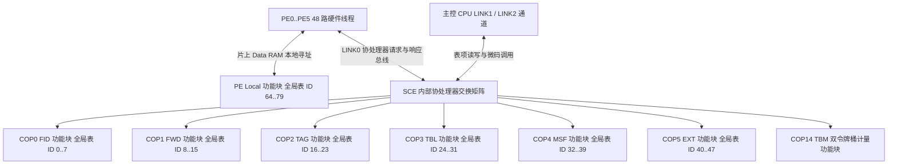

# 5.5 SCE 硬件功能块详解（FID、FWD、TAG、TBL、MSF、EXT、TBM 与 PE 局部表）

共享分类引擎（SCE / GPE）的硬件查表、流分类、二层学习、流量监管与统计计数能力按职责划分为 8 个硬件功能块（Function Block）：6 个可编程表搜索协处理器功能块（`COP0 = FID`、`COP1 = FWD`、`COP2 = TAG`、`COP3 = TBL`、`COP4 = MSF`、`COP5 = EXT`）、1 个硬件双令牌桶计量功能块（`COP14 = TBM`），以及驻留在 6 颗包处理引擎（`PE0`–`PE5`）片上数据 RAM 中的局部表功能块（`PE Local Tables`）。

---

## 1. 全局表编号空间与功能块映射

SCE 将全部硬件表统一编址在 7 位全局表编号（`Global Table ID`，范围 `0`–`79`）空间内，按存储位置与访问总线划分为两个硬件域：

| 硬件功能块域 | 全局表 ID 范围 | 硬件译码公式 | 物理存储介质与访问总线 |
| --- | --- | --- | --- |
| **COP 协处理器功能块** | `0`–`63` | `COP_ID = Global_ID >> 3` `Table_ID = Global_ID & 0x7` | 位于 `COP0`–`COP5` 各自的专用表 SRAM；不能假定每个 COP 都只有 8 KiB（例如本页 COP1 表池已超过此大小）。通过 `LINK` 总线发送 `LINKC1` 命令帧访问；`Table_ID = 0` 固定映射为该 COP 的内部控制寄存器空间（`TABLE10`–`TABLE72`、`GLOBAL`、`CRAM`、`CUSTOM0`–`CUSTOM7`） |
| **PE 局部表功能块** | `64`–`79` | `PE_Table_ID = Global_ID - 64` | 镜像存储在 `PE0`–`PE5` 各自的片上 Data RAM 中。报文处理期间由 PE 硬件线程直接寻址读取；主控配置时通过 `PE` 的 `HOST[1]`–`HOST[9]` 邮箱寄存器配合 `PCTRL.ISIG` 信号广播写入全部 6 颗 PE |

8 个 SCE 硬件功能块的职责划分与资源汇总如下：

| 功能块名称 | 硬件单元 / `COP_ID` | 全局表 ID 范围 | 装载微码映像 | 物理表数量 | 硬件职责说明 |
| --- | --- | --- | --- | --- | --- |
| **`FID`** | `COP0` (`0`) | `0`–`7` | `tse0.bin`（40 条指令） | 5 张（`TABLE1`–`TABLE5`） | VLAN 桥接转发域（FID）哈希查找与单播自动创建、二层 EtherType 过滤表搜索、4 通道并行 ACL 查找的第 4 通道（Lane 3） |
| **`FWD`** | `COP1` (`1`) | `8`–`15` | `tse1.bin`（85 条指令） | 4 张（`TABLE1`–`TABLE4`） | 二层单播/组播 MAC 与 IPv4 单播/组播短转发、源 MAC 自动学习与端口迁移检测、每桥接端口 MAC 学习数量限制、硬件时间戳老化扫描与冲突链断链回收 |
| **`TAG`** | `COP2` (`2`) | `16`–`23` | `tse2.bin`（24 条指令） | 5 张（`TABLE1`–`TABLE5`） | 出入向 VLAN 标签过滤（配合专用指令 `tag` 与 TCI 掩码列表搜索）、二层源/目的 MAC 地址过滤、4 通道并行 ACL 查找的第 2 通道（Lane 1） |
| **`TBL`** | `COP3` (`3`) | `24`–`31` | `tse3.bin`（18 条指令） | 5 张（`TABLE1`–`TABLE5`） | 下行 GEM Port 属性索引查表（`GPIX` 直接寻址）、128 位 IPv6 地址到 9 位短索引（`0`–`399`）的哈希压缩映射、4 通道并行 ACL 查找的第 3 通道（Lane 2） |
| **`MSF`** | `COP4` (`4`) | `32`–`39` | `tse4.bin`（0 条指令，纯硬件表） | 4 张（`TABLE1`–`TABLE4`） | 上行 GEM Port 属性查表、下行 IGMPv3/MLDv2 组播源 IP 过滤列表搜索、704 项 32 位报文/丢包计数器原子累加、基于 VLAN 的计量器绑定查找 |
| **`EXT`** | `COP5` (`5`) | `40`–`47` | `tse5.bin`（18 条指令） | 6 张（`TABLE1`–`TABLE6`） | Extended VLAN 三表级联规则匹配与标签增删改动作合成（配合 `CUSTOM0`–`CUSTOM7` 与专用指令 `treat`）、四层 TCP/UDP 端口号过滤、4 通道并行 ACL 查找的第 1 通道（Lane 0） |
| **`TBM`** | `COP14` (`14`) | 无表编号（计量器 ID `0`–`511`） | 硬连线状态机 | 512 个单桶寄存器 | 256 对双令牌桶（CIR/CBS + PIR/PBS）硬件流量监管，支持 RFC 2698 与 MEF 10.1 色盲/色敏计量 |
| **`PE Local`** | `PE0`–`PE5` (`255`) | `64`–`79` | `falcon_gpe_fw.bin` | 15 张（PE Table `0`–`15`） | 全局常量表、桥接端口表、802.1p P-Mapper 表、UNI 端口表、入队表、PCP/DSCP 编解码表、重定向表、VLAN 段起始指针表、网桥实例表、状态表与异常捕获表 |

---

## 2. 功能块 0：`FID`（`COP0` / `TSE0`，全局表 ID `0`–`7`）

`FID` 功能块位于 `COP0`，负责将入向报文的内外层 VLAN 标签组合映射为 8 位转发域标识符 `FID`（Forwarding Identifier），同时承担二层 EtherType 协议过滤和 ACL 第 4 通道（Lane 3）的三态匹配。

### 2.1 `FID` 物理表存储器布局

`COP0` 的 2048 字（8 KiB）表 SRAM 共划分出 5 张物理表（总占用 `1728` 个 32 位字，`0x0000`–`0x06BF`）：

| 物理表号 | 全局表 ID | 表名称 | 表类型 (`TYPE`) | 匹配模式 (`MODE`) | 基址 (`BASE`) | 项数 (`SIZE`) | 键宽 (`KEYLEN`) | 项宽 (`ENTRYLEN`) | 占用 32 位字数 |
| --- | --- | --- | --- | --- | --- | --- | --- | --- | --- |
| `Table 1` | `1` / `6` | `FID_ASSIGNMENT_TABLE` / `FID_ASSIGNMENT_TABLE_MASKED` | `LLIST` (`3`) | `GENERIC` (`0`) / `MASK` (`2`) | `0x0000` (0) | 256 | 32 b | 64 b | 512 (`0x0000`–`0x01FF`) |
| `Table 2` | `2` | `FID_HASH_TABLE` | `HASH` (`4`) | `GENERIC` (`0`) | `0x0200` (512) | 128 | 32 b | 32 b | 128 (`0x0200`–`0x027F`) |
| `Table 3` | `3` | `ETHERTYPE_FILTER_TABLE` | `LIST` (`2`) | `GENERIC` (`0`) | `0x0280` (640) | 64 | 16 b | 32 b | 64 (`0x0280`–`0x02BF`) |
| `Table 4` | `4` | `ACL_FILTER_TABLE_LANE3` | `LIST` (`2`) | `GENERIC` (`0`) | `0x02C0` (704) | 128 | 128 b | 256 b | 1024 (`0x02C0`–`0x06BF`) |
| `Table 5` | `5` | `ACL_FILTER_TABLE_LANE3_TERNARY` | `LIST` (`2`) | `TERNARY` (`2`) | `0x02C0` (704) | 128 | 128 b | 256 b | 与 `Table 4` 共享物理区间 |

- **双逻辑 ID 共享物理表 1**：全局表 ID `1`（`FID_ASSIGNMENT_TABLE`）与全局表 ID `6`（`FID_ASSIGNMENT_TABLE_MASKED`）指向同一张物理表 `Table 1`（`BASE = 0x0000`）。当使用精确键值或哈希冲突链遍历（`IF_FID_LOOKUP_MC`、`IF_FID_LOOKUP_UC`）时按 `GENERIC` 模式访问；当需要带掩码检索时按 ID `6` 访问。
- **双表描述符共享 ACL 内存**：`Table 4`（`MODE = GENERIC`）与 `Table 5`（`MODE = TERNARY`）共享基址 `0x02C0`。微码在 `IF_ACL_SEARCH_3` 中先通过 `read 4, 0, 256` 从 `Table 4` 读取 128 位全局掩码装入 `%key_mask` 与 `%data2`，再通过 `searchr 5, 0, 128` 在 `Table 5` 上启动硬件三态匹配。

### 2.2 `FID_HASH_TABLE` 表项位域（全局表 ID 2，32-bit）

`FID_HASH_TABLE` 包含 128 个哈希桶（索引 `0`–`127`），由硬件对 32 位内外层 VLAN 键执行 CRC 折叠得到 7 位桶索引：

| 32 位字 | 位域范围 | 字段名称 | 硬件功能说明 |
| --- | --- | --- | --- |
| `Word 0` | `[31]` | `valid` | 哈希桶有效标志：`1` = 该桶存在至少一个 `FID_ASSIGNMENT_TABLE` 链表节点；`0` = 空桶 |
| `Word 0` | `[30]` | `unused1` | 保留位，填 `0` |
| `Word 0` | `[29:16]` | `fwd_id_assignent_table_pointer` | 冲突链首节点在 `FID_ASSIGNMENT_TABLE`（`Table 1`）中的项索引（`0`–`255`） |
| `Word 0` | `[15:0]` | `unused2` | 保留位，填 `0` |

### 2.3 `FID_ASSIGNMENT_TABLE` 表项位域（全局表 ID 1 / 6，64-bit）

每条表项占 64 位（2 个 32 位字）：`Word 0` 为 32 位匹配键，`Word 1` 为链表控制头与 8 位 `FID` 载荷：

| 32 位字 | 位域范围 | 字段名称 | 硬件功能说明 |
| --- | --- | --- | --- |
| `Word 0` (Key) | `[31:29]` | `prio_inner` | 入向帧内层 VLAN 802.1p 优先级（3 位） |
| `Word 0` (Key) | `[28]` | `unused1` | 保留位（填 `0`） |
| `Word 0` (Key) | `[27:16]` | `vid_inner` | 入向帧内层 12 位 VLAN ID（`0`–`4095`） |
| `Word 0` (Key) | `[15:13]` | `prio_outer` | 入向帧外层 VLAN 802.1p 优先级（3 位） |
| `Word 0` (Key) | `[12]` | `unused2` | 保留位（填 `0`） |
| `Word 0` (Key) | `[11:0]` | `vid_outer` | 入向帧外层 12 位 VLAN ID（`0`–`4095`） |
| `Word 1` (Data) | `[31]` | `valid` | 链表节点有效位：`1` = 节点有效；`0` = 空闲槽位 |
| `Word 1` (Data) | `[30]` | `end` | 冲突链尾标志：`1` = 当前节点为冲突链末项；`0` = 后续仍有节点 |
| `Word 1` (Data) | `[29:16]` | `next_entry` | 冲突链下一节点在 `FID_ASSIGNMENT_TABLE` 中的索引（`end == 0` 时有效） |
| `Word 1` (Data) | `[15:9]` | `unused3` | 保留位 |
| `Word 1` (Data) | `[8]` | `cross_connect` | 点对点交叉连接指示位：`1` = Cross-Connect 流；`0` = 二层桥接流 |
| `Word 1` (Data) | `[7:0]` | `fid` | 分配给该流的 8 位桥接转发域标识符 `FID` |

### 2.4 `ETHERTYPE_FILTER_TABLE` 表项位域（全局表 ID 3，32-bit）

`ETHERTYPE_FILTER_TABLE` 包含 64 个表项，按端口划分为多个以 `end = 1` 结尾的线性子表（`LIST`），供微码 `IF_ETHFILT_SEARCHW` 顺序比对 16 位以太网协议号：

| 32 位字 | 位域范围 | 字段名称 | 硬件功能说明 |
| --- | --- | --- | --- |
| `Word 0` | `[31]` | `valid` | 表项有效标志 |
| `Word 0` | `[30]` | `end` | 当前端口 EtherType 过滤列表末尾标志 |
| `Word 0` | `[29:16]` | `unused` | 控制与统计标志位（命中时由 `searchw 3, 0, 32` 更新） |
| `Word 0` | `[15:0]` | `ethertype` | 16 位以太网协议类型匹配值（如 `0x0800`、`0x8863`、`0x86DD`） |

---

## 3. 功能块 1：`FWD`（`COP1` / `TSE1`，全局表 ID `8`–`15`）

`FWD` 功能块位于 `COP1`，是二层桥接与三层短转发的核心查表引擎，支持单播 MAC 转发、组播 MAC 端口位图转发、IPv4 单播转发、IPv4 组播转发、源 MAC 动态学习、端口迁移检测、每桥接端口学习上限控制以及硬件时间戳老化。

### 3.1 `FWD` 物理表存储器布局

`COP1` 的 2048 字表 SRAM 全部被 4 张物理表占满（总占用 `4736` 个 32 位逻辑字，其中 `Table 2` 与 `Table 4` 共享物理区间 `0x0200`–`0x11FF`，实际物理消耗 `128 + 4096 + 128` 项对应 `512 + 4096 + 128` 字空间）：

| 物理表号 | 全局表 ID | 表名称 | 表类型 (`TYPE`) | 匹配模式 (`MODE`) | 基址 (`BASE`) | 项数 (`SIZE`) | 键宽 (`KEYLEN`) | 项宽 (`ENTRYLEN`) | 物理地址范围（32 位字） |
| --- | --- | --- | --- | --- | --- | --- | --- | --- | --- |
| `Table 1` | `9` | `SHORT_FWD_HASH_TABLE` | `HASH` (`4`) | `GENERIC` (`0`) | `0x0000` (0) | 512 | 64 b | 32 b | `0x0000`–`0x01FF` (512 字) |
| `Table 2` | `10` | `SHORT_FWD_TABLE` (`MAC` / `MAC_MC` / `IPV4` / `IPV4_MC`) | `LLIST` (`3`) | `GENERIC` (`0`) | `0x0200` (512) | 1024 | 64 b | 128 b | `0x0200`–`0x11FF` (4096 字) |
| `Table 3` | `11` | `LEARNING_LIMITATION_TABLE` | `ARRAY` (`0`) | `GENERIC` (`0`) | `0x1200` (4608) | 128 | 0 b | 32 b | `0x1200`–`0x127F` (128 字) |
| `Table 4` | `12` | `SHORT_FWD_TABLE_MAC_ALTERNATE` | `VARRAY` (`4`) | `GENERIC` (`0`) | `0x0200` (512) | 1024 | 0 b | 128 b | 与 `Table 2` 完全重叠 (`0x0200`–`0x11FF`) |

- **`Table 2` (`LLIST`) 与 `Table 4` (`VARRAY`) 双视角重叠设计**：
  - 在报文转发（`IF_FWD_FORWARD`）、重学习（`IF_FWD_RELEARN`）、新增（`IF_FWD_ADD`）与删除（`IF_FWD_REMOVE`）时，微码通过 `Table 1`（`HASH`）计算 64 位键的 9 位哈希值获取桶头指针，再通过 `Table 2`（`LLIST`）遍历单向冲突链。
  - 在硬件周期老化（`IF_FWD_AGE`）时，调用方僅传入 10 位线性槽位号 `%index`（`0`–`1023`），不携带 64 位 MAC 键。微码切换至 `Table 4`（`VARRAY`），直接按 `%index` 读出 `0x0200 + (%index × 4)` 处的 128 位表项，将其低 64 位装入 `%key` 寄存器；一旦 `[aged]` 条件成立，微码直接跳转至 `IF_FWD_REMOVE`（`PC = 0x39`），利用刚刚装入的 `%key` 在 `Table 1`（`HASH`）和 `Table 2`（`LLIST`）中完成标准哈希查找与冲突链断链。

### 3.2 `SHORT_FWD_HASH_TABLE` 表项位域（全局表 ID 9，32-bit）

| 32 位字 | 位域范围 | 字段名称 | 硬件功能说明 |
| --- | --- | --- | --- |
| `Word 0` | `[31]` | `valid` | 哈希桶有效位：`1` = 冲突链非空；`0` = 空桶 |
| `Word 0` | `[30]` | `unused1` | 保留位 |
| `Word 0` | `[29:16]` | `short_forwarding_table_pointer` | 冲突链首节点在 `SHORT_FWD_TABLE`（`Table 2`）中的 10 位索引（`0`–`1023`） |
| `Word 0` | `[15:0]` | `unused2` | 保留位 |

### 3.3 `SHORT_FWD_TABLE` 表项位域（全局表 ID 10 / 12，128-bit）

`SHORT_FWD_TABLE` 每项占 128 位（4 个 32 位字）。低 64 位（`Word 0`–`Word 1`）为 64 位搜索键，由 `Word 1 [31:28]` 的 4 位 `key_code` 区分二层 MAC 与 IPv4 地址格式；高 64 位（`Word 2`–`Word 3`）为转发目标、端口学习控制、链表指针与老化时间戳：

#### （1）低 64 位键区（`Word 0`–`Word 1`）的两种格式

| 键类型 | 32 位字 | 位域范围 | 字段名称 | 硬件功能说明 |
| --- | --- | --- | --- | --- |
| **MAC 单播 / 组播** | `Word 0` | `[31:0]` | `mac_address_low` | 48 位 MAC 地址低 32 位（`MAC[31:0]`） |
| **MAC 单播 / 组播** | `Word 1` | `[31:28]` | `key_code` | 键类型编码（区分二层 MAC、IPv4 或压缩 IPv6） |
| **MAC 单播 / 组播** | `Word 1` | `[27:24]` | `unused` | 保留位，填 `0` |
| **MAC 单播 / 组播** | `Word 1` | `[23:16]` | `fid` | 8 位桥接转发域标识符 `FID` |
| **MAC 单播 / 组播** | `Word 1` | `[15:0]` | `mac_address_high` | 48 位 MAC 地址高 16 位（`MAC[47:32]`） |
| **IPv4 单播 / 组播** | `Word 0` | `[31:0]` | `ip_address` | 32 位 IPv4 目的地址 |
| **IPv4 单播 / 组播** | `Word 1` | `[31:28]` | `key_code` | 键类型编码 |
| **IPv4 单播 / 组播** | `Word 1` | `[27:24]` | `unused1` | 保留位 |
| **IPv4 单播 / 组播** | `Word 1` | `[23:16]` | `fid` | 8 位转发域标识符 `FID` |
| **IPv4 单播 / 组播** | `Word 1` | `[15:0]` | `unused2` | 保留位，填 `0` |

#### （2）高 64 位载荷与控制区（`Word 2`–`Word 3`，对应 `searchr 2, 64, 64` 读出的 `%data1`）

当微码执行 `searchr 2, 64, 64`（从位偏移 64 读取 64 位）时，`Word 2` 装入 `%data1[31:0]`，`Word 3` 装入 `%data1[63:32]`：

| 32 位字 | `%data1` 位号 | 位域范围 | 字段名称 | 硬件功能说明 |
| --- | --- | --- | --- | --- |
| `Word 2` | `%data1[31]` | `[31]` | `igmp_entry` | `1` = IGMP/MLD 协议控制动态创建的组播表项；`0` = 普通表项 |
| `Word 2` | `%data1[30]` | `[30]` | `priority_override_enable` | `1` = 使用本表项的 `priority` 覆盖报文队列优先级 |
| `Word 2` | `%data1[29:27]` | `[29:27]` | `unused1` | 保留位 |
| `Word 2` | `%data1[26:24]` | `[26:24]` | `priority` | 3 位覆盖优先级值（`0`–`7`） |
| `Word 2` | `%data1[23]` | `[23]` | `port_map_indicator` | `0` = 单播目标（`[22:16]` 为 7 位 `bridge_port_index`）；`1` = 组播端口位图（`[22:16]` 为 `port_map_low[6:0]`，`Word 3 [15:0]` 为 `port_map_high[15:0]`） |
| `Word 2` | `%data1[22:16]` | `[22:16]` | `bridge_port_index` / `port_map_low` | 单播时为目标桥接端口索引（`0`–`87`）；组播时为出向端口位图低 7 位 |
| `Word 2` | `%data1[15:11]` | `[15:11]` | `unused2` | 保留位 |
| `Word 2` | `%data1[10]` | `[10]` | `dynamic_enable` | 动态老化使能位：`1` = 动态学习表项（参与 `IF_FWD_AGE` 老化检查 `[!data1.10]`）；`0` = 静态表项（永不老化） |
| `Word 2` | `%data1[9]` | `[9]` | `learning_limitation_enable` | 端口学习计数联动位：`1` = 增删该项时同步在 `Table 3` 上对 `source_port` 执行 `count 3, +1/-1`（微码测试条件 `[!data1.9]`） |
| `Word 2` | `%data1[8]` | `[8]` | `port_lock_ind` / `activity` | 端口锁定指示与转发命中活动标志位（`IF_FWD_FORWARD` 命中时执行 `mov %data1, 0x100` 与 `or %data1, %data2` 置位 bit 8） |
| `Word 2` | `%data1[7:0]` | `[7:0]` | `source_port` | 源桥接端口编号（`0`–`127`）：在 `IF_FWD_RELEARN` 中由硬件条件 `[eq8]` 比对入向源端口，在 `IF_FWD_ADD`/`REMOVE` 中由 `mov %index, %data1` 提取为 `Table 3` 的索引 |
| `Word 3` | `%data1[63]` | `[31]` | `valid` | 表项有效标志：`1` = 有效；`0` = 空闲 |
| `Word 3` | `%data1[62]` | `[30]` | `end` | 冲突链末尾标志：`1` = 链尾；`0` = 后续仍有节点 |
| `Word 3` | `%data1[61:48]` | `[29:16]` | `next_entry` | 冲突链下一节点在 `Table 2` 中的索引 |
| `Word 3` | `%data1[47:32]` | `[15:0]` | `timestamp` / `port_map_high` | 单播动态项存放硬件老化时间戳（由 `now` 指令写入，由 `[aged]` 条件与全局老化计数器比较）；组播项存放出向端口位图高 16 位 |

### 3.4 `LEARNING_LIMITATION_TABLE` 表项位域（全局表 ID 11，32-bit）

`Table 3` 为 128 项定长数组（`ARRAY`），直接以 7 位 `source_port`（桥接端口索引）寻址。当微码执行 `searchr 3, 0, 32` 时，硬件自动比较高 16 位与低 16 位并更新 `[lt16]` 条件标志：

| 32 位字 | 位域范围 | 字段名称 | 硬件功能说明 |
| --- | --- | --- | --- |
| `Word 0` | `[31:16]` | `learning_limit` | 该桥接端口允许动态学习的 MAC 地址数量上限 |
| `Word 0` | `[15:0]` | `association_count` | 该桥接端口当前已学习的动态 MAC 地址计数（支持 `count 3, +1` 与 `count 3, -1` 原子增减，当 `association_count < learning_limit` 时硬件置位 `lt16 = 1`） |

---

## 4. 功能块 2：`TAG`（`COP2` / `TSE2`，全局表 ID `16`–`23`）

`TAG` 功能块位于 `COP2`，负责出入向报文的 VLAN 标签过滤（VLAN Tagging Filter）、二层 MAC 地址黑白名单过滤以及 ACL 第 2 通道（Lane 1）的三态匹配。

### 4.1 `TAG` 物理表存储器布局

| 物理表号 | 全局表 ID | 表名称 | 表类型 (`TYPE`) | 匹配模式 (`MODE`) | 基址 (`BASE`) | 项数 (`SIZE`) | 键宽 (`KEYLEN`) | 项宽 (`ENTRYLEN`) | 物理地址范围（32 位字） |
| --- | --- | --- | --- | --- | --- | --- | --- | --- | --- |
| `Table 1` | `17` | `TAGGING_FILTER_TABLE` | `VARRAY` (`4`) | `GENERIC` (`0`) | `0x0000` (0) | 128 | 0 b | 64 b | `0x0000`–`0x00FF` (256 字) |
| `Table 2` | `18` | `VLAN_TABLE` | `LIST` (`2`) | `MASK` (`2`) | `0x0100` (256) | 1024 | 16 b | 32 b | `0x0100`–`0x04FF` (1024 字) |
| `Table 3` | `19` | `MAC_FILTER_TABLE` | `LLIST` (`3`) | `GENERIC` (`0`) | `0x0500` (1280) | 256 | 64 b | 64 b | `0x0500`–`0x06FF` (512 字) |
| `Table 4` | `20` | `ACL_FILTER_TABLE_LANE1` | `LIST` (`2`) | `GENERIC` (`0`) | `0x0700` (1792) | 128 | 128 b | 256 b | `0x0700`–`0x0AFF` (1024 字) |
| `Table 5` | `21` | `ACL_FILTER_TABLE_LANE1_TERNARY` | `LIST` (`2`) | `TERNARY` (`2`) | `0x0700` (1792) | 128 | 128 b | 256 b | 与 `Table 4` 共享物理区间 |

### 4.2 `TAGGING_FILTER_TABLE`（ID 17，64-bit）与 `VLAN_TABLE`（ID 18，32-bit）

`TAGGING_FILTER_TABLE`（`Table 1`）由桥接端口的 `tag_filter_idx` 索引，定义无标签帧与有标签帧的过滤极性、TCI 比较掩码以及关联的 `VLAN_TABLE` 子表起始指针：

| 表名称 | 32 位字 | `%data1` 位号 | 位域范围 | 字段名称 | 硬件功能说明 |
| --- | --- | --- | --- | --- | --- |
| `TAGGING_FILTER_TABLE` | `Word 0` | `%data1[31:20]` | `[31:20]` | `unused1` | 保留位 |
| `TAGGING_FILTER_TABLE` | `Word 0` | `%data1[19]` | `[19]` | `pass_on_match_enable` | 列表匹配极性位：`1` = 命中 `VLAN_TABLE` 列表时放行（白名单）；`0` = 命中列表时丢弃（黑名单）。微码通过 `xorn %res1, %data1.19` 计算最终放行标志 |
| `TAGGING_FILTER_TABLE` | `Word 0` | `%data1[18]` | `[18]` | `tagged_drop_enable` | 有标签帧直接丢弃使能（由专用指令 `tag` 评估） |
| `TAGGING_FILTER_TABLE` | `Word 0` | `%data1[17]` | `[17]` | `tagged_pass_enable` | 有标签帧免查表直接放行使能（由专用指令 `tag` 评估） |
| `TAGGING_FILTER_TABLE` | `Word 0` | `%data1[16]` | `[16]` | `untagged_drop_enable` | 无标签帧丢弃使能：`1` = 丢弃无标签帧；`0` = 放行无标签帧 |
| `TAGGING_FILTER_TABLE` | `Word 0` | `%data1[15:0]` | `[15:0]` | `tci_mask` | 16 位 TCI 比较掩码（微码通过 `mov %key_mask, %data1` 装入 `%key_mask`） |
| `TAGGING_FILTER_TABLE` | `Word 1` | `%data1[63]` | `[31]` | `valid` | 表项有效位 |
| `TAGGING_FILTER_TABLE` | `Word 1` | `%data1[62]` | `[30]` | `unused2` | 保留位 |
| `TAGGING_FILTER_TABLE` | `Word 1` | `%data1[61:48]` | `[29:16]` | `vlan_table_index` | 关联的 VID 列表在 `VLAN_TABLE`（`Table 2`）中的起始索引（微码通过 `mov %index, %data1.48` 装入 `%index`） |
| `TAGGING_FILTER_TABLE` | `Word 1` | `%data1[47:32]` | `[15:0]` | `unused3` | 保留位 |
| `VLAN_TABLE` | `Word 0` | — | `[31]` | `valid` | VID 列表项有效标志 |
| `VLAN_TABLE` | `Word 0` | — | `[30]` | `end` | 当前过滤段列表末尾标志（`search 2` 扫描至 `end == 1` 终止） |
| `VLAN_TABLE` | `Word 0` | — | `[29:16]` | `unused1` | 保留位 |
| `VLAN_TABLE` | `Word 0` | — | `[15:0]` | `tci` | 16 位标签控制信息匹配值（PCP 3 位 + DEI 1 位 + VID 12 位，按 `tci_mask` 掩码比对） |

### 4.3 `TAG` 功能块 `LINK` 输入/输出消息格式 (`IF_TAG_FILTER`)

PE 线程或主控通过 `LINK` 总线调用 `COP2` 的 `IF_TAG_FILTER`（入口 `PC = 0`）时，发送 64 位请求包并接收 32 位响应包：

| 消息方向 | 32 位字 | 位域范围 | 字段名称 | 映射的 COP 内部寄存器与硬件说明 |
| --- | --- | --- | --- | --- |
| **输入请求 (64-bit)** | `Word 0` | `[31:16]` | `index` | 装入 `%index`：指定 `TAGGING_FILTER_TABLE`（`Table 1`）的表项下标（`0`–`127`） |
| **输入请求 (64-bit)** | `Word 0` | `[15:0]` | `tci` | 装入 `%key[15:0]`：待过滤报文的 16 位 VLAN TCI 字段 |
| **输入请求 (64-bit)** | `Word 1` | `[31:1]` | `unused` | 保留位，填 `0` |
| **输入请求 (64-bit)** | `Word 1` | `[0]` | `tagged` | 装入 `%aux[0]`：报文带标签指示（`1` = Tagged 帧，`0` = Untagged 帧），供 `tag` 指令判断 |
| **输出响应 (32-bit)** | `Word 0` | `[31:1]` | `unused` | 保留位 |
| **输出响应 (32-bit)** | `Word 0` | `[0]` | `result` | 对应返回帧的 `%res1`：`1` = 报文通过过滤（Pass），`0` = 报文被过滤丢弃（Drop） |

### 4.4 `MAC_FILTER_TABLE` 表项位域（全局表 ID 19，64-bit）

| 32 位字 | 位域范围 | 字段名称 | 硬件功能说明 |
| --- | --- | --- | --- |
| `Word 0` | `[31:0]` | `mac_address_low` | 48 位过滤 MAC 地址低 32 位 |
| `Word 1` | `[31]` | `valid` | 表项有效标志 |
| `Word 1` | `[30]` | `end` | 链表末尾标志 |
| `Word 1` | `[29:16]` | `next_entry` | 下一表项索引 |
| `Word 1` | `[18:16]` | `key_code` | 匹配键类型标识（区分源 MAC 过滤与目的 MAC 过滤，与 `next_entry` 低位复用或按链表模式解释） |
| `Word 1` | `[15:0]` | `mac_address_high` | 48 位过滤 MAC 地址高 16 位 |

---

## 5. 功能块 3：`TBL`（`COP3` / `TSE3`，全局表 ID `24`–`31`）

`TBL` 功能块位于 `COP3`，承载下行 GEM Port 属性表、128 位 IPv6 地址哈希压缩表以及 ACL 第 3 通道（Lane 2）。

### 5.1 `TBL` 物理表存储器布局

| 物理表号 | 全局表 ID | 表名称 | 表类型 (`TYPE`) | 匹配模式 (`MODE`) | 基址 (`BASE`) | 项数 (`SIZE`) | 键宽 (`KEYLEN`) | 项宽 (`ENTRYLEN`) | 物理地址范围（32 位字） |
| --- | --- | --- | --- | --- | --- | --- | --- | --- | --- |
| `Table 1` | `25` | `DS_GEM_PORT_TABLE` | `VARRAY` (`4`) | `GENERIC` (`0`) | `0x0000` (0) | 256 | 0 b | 128 b | `0x0000`–`0x03FF` (1024 字) |
| `Table 2` | `26` | `IPV6_REDUCTION_HASH_TABLE` | `HASH` (`4`) | `GENERIC` (`0`) | `0x0400` (1024) | 256 | 128 b | 32 b | `0x0400`–`0x04FF` (256 字) |
| `Table 3` | `27` | `IPV6_REDUCTION_TABLE` | `LLIST` (`3`) | `GENERIC` (`0`) | `0x0500` (1280) | 400 | 128 b | 256 b | `0x0500`–`0x117F` (3200 字) |
| `Table 4` | `28` | `ACL_FILTER_TABLE_LANE2` | `LIST` (`2`) | `GENERIC` (`0`) | `0x1180` (4480) | 128 | 128 b | 256 b | `0x1180`–`0x157F` (1024 字) |
| `Table 5` | `29` | `ACL_FILTER_TABLE_LANE2_TERNARY` | `LIST` (`2`) | `TERNARY` (`2`) | `0x1180` (4480) | 128 | 128 b | 256 b | 与 `Table 4` 共享物理区间 |

### 5.2 `DS_GEM_PORT_TABLE` 表项位域（全局表 ID 25，128-bit）

下行 GTC 引擎将命中的 12 位 `GEM Port-ID` 转换为 8 位 `GPIX`（`0`–`255`）填入报文描述符。PE 入向线程以 `GPIX` 直接索引 `COP3` 的 `DS_GEM_PORT_TABLE`（`Table 1`）获取下行端口属性：

| 32 位字 | 位域范围 | 字段名称 | 硬件功能说明 |
| --- | --- | --- | --- |
| `Word 0` | `[26]` | `learning_limitation_enable` | 在该 GEM 端口上启用 MAC 学习上限控制 |
| `Word 0` | `[25]` | `operational_state` | 端口运行状态：`1` = 激活转发；`0` = 去激活丢弃 |
| `Word 0` | `[24:22]` | `color_marking_mode` | 3 位报文着色模式（No Marking、Internal、DEI、PCP 8P0D/7P1D/6P2D/5P3D、DSCP） |
| `Word 0` | `[18:16]` | `priority_queue_offset` | 出向优先级队列偏移量 |
| `Word 0` | `[14:8]` | `meter_id` | 关联的下行 `TBM` 令牌桶计量器编号 |
| `Word 0` | `[7]` | `meter_enable` | 下行流量计量使能位 |
| `Word 0` | `[6:4]` | `destination_indicator` | 报文目标指示（桥接端口、OMCI 通道、IP Host 等） |
| `Word 0` | `[2]` | `network_port_enable` | 网络侧端口标志 |
| `Word 0` | `[1]` | `multicast_enable` | 下行组播 GEM 端口标志（`1` = 组播 GEM，`0` = 单播 GEM） |
| `Word 0` | `[0]` | `valid_ind` | 软件配置有效位 |
| `Word 1` | `[31]` | `aes_enable` | 下行 AES-128 载荷解密标志 |
| `Word 1` | `[26:24]` | `dscp_decoding_table_offset` | 关联的 `DSCP_DECODING_TABLE`（ID 70）子表偏移 |
| `Word 1` | `[23:22]` | `dscp_to_pcp_enable` | DSCP 转 802.1p PCP 映射控制模式 |
| `Word 1` | `[18:16]` | `pcp_decoding_table_offset` | 关联的 `PCP_DECODING_TABLE`（ID 69）子表偏移 |
| `Word 1` | `[13:0]` | `max_frame_size` | 该 GEM 端口允许的最大帧长（字节） |
| `Word 2` | `[22:16]` | `bridge_port_index` | 关联的入向 `BRIDGE_PORT_TABLE`（ID 65）索引（`0`–`87`） |
| `Word 3` | `[31]` | `valid` | `VARRAY` 硬件表项有效位 |

### 5.3 IPv6 地址压缩表（`IPV6_REDUCTION_HASH_TABLE` ID 26 与 `IPV6_REDUCTION_TABLE` ID 27）

由于 `COP1`（`FWD`）的 `SHORT_FWD_TABLE` 仅接受 64 位搜索键，SCE 通过 `COP3` 的 `IF_IPV6_REDUCE` 微码将 128 位 IPv6 地址无损映射为一个 9 位表项下标 `%index`（范围 `0`–`399`），再将该 9 位下标嵌入 `COP1` 的 64 位键中完成转发查找：

| 表名称 | 32 位字 | 位域范围 | 字段名称 | 硬件功能说明 |
| --- | --- | --- | --- | --- |
| `IPV6_REDUCTION_HASH_TABLE` (32-bit) | `Word 0` | `[31]` | `valid` | 256 桶哈希头有效位 |
| `IPV6_REDUCTION_HASH_TABLE` (32-bit) | `Word 0` | `[29:16]` | `ipv6_reduction_table_pointer` | 冲突链首节点在 `IPV6_REDUCTION_TABLE`（`Table 3`）中的索引（`0`–`399`） |
| `IPV6_REDUCTION_TABLE` (256-bit) | `Word 0`–`Word 3` | `[127:0]` | `ip_address[0..3]` | 128 位完整 IPv6 地址（`Word 0` 为低 32 位，`Word 3` 为高 32 位，大端字序存储） |
| `IPV6_REDUCTION_TABLE` (256-bit) | `Word 4`–`Word 6` | `[223:128]` | `unused0`–`unused2` | 保留字，填 `0` |
| `IPV6_REDUCTION_TABLE` (256-bit) | `Word 7` | `[31]` | `valid` | 链表节点有效位 |
| `IPV6_REDUCTION_TABLE` (256-bit) | `Word 7` | `[30]` | `end` | 冲突链尾标志 |
| `IPV6_REDUCTION_TABLE` (256-bit) | `Word 7` | `[29:16]` | `next_entry` | 冲突链下一节点在 `Table 3` 中的索引（`0`–`399`） |

---

## 6. 功能块 4：`MSF`（`COP4` / `TSE4`，全局表 ID `32`–`39`）

`MSF`（Multicast Source Filter & Counters）功能块位于 `COP4`。该协处理器不运行微码指令（`tse4.bin` 代码段为空），完全依靠硬连线表引擎直接响应 `LINK` 总线上的 `SEARCHR`、`READ`、`WRITE` 与 `COUNT` 硬件命令。

### 6.1 `MSF` 物理表存储器布局

| 物理表号 | 全局表 ID | 表名称 | 表类型 (`TYPE`) | 匹配模式 (`MODE`) | 基址 (`BASE`) | 项数 (`SIZE`) | 键宽 (`KEYLEN`) | 项宽 (`ENTRYLEN`) | 物理地址范围（32 位字） |
| --- | --- | --- | --- | --- | --- | --- | --- | --- | --- |
| `Table 1` | `33` | `US_GEM_PORT_TABLE` | `VARRAY` (`4`) | `GENERIC` (`0`) | `0x0000` (0) | 256 | 0 b | 64 b | `0x0000`–`0x01FF` (512 字) |
| `Table 2` | `34` | `DS_MC_IP_SOURCE_FILTER_TABLE` | `LIST` (`2`) | `GENERIC` (`0`) | `0x0200` (512) | 512 | 64 b | 128 b | `0x0200`–`0x09FF` (2048 字) |
| `Table 3` | `35` | `COUNTER_TABLE` | `ARRAY` (`0`) | `GENERIC` (`0`) | `0x0A00` (2560) | 704 | 0 b | 32 b | `0x0A00`–`0x0CBF` (704 字) |
| `Table 4` | `36` | `VLAN_METERING_TABLE` | `LIST` (`2`) | `GENERIC` (`0`) | `0x0CC0` (3264) | 64 | 16 b | 32 b | `0x0CC0`–`0x0CFF` (64 字) |

### 6.2 `US_GEM_PORT_TABLE` 表项位域（全局表 ID 33，64-bit）

上行转发阶段，PE 线程以目标 8 位 `GPIX`（`0`–`255`）对 `COP4` `Table 1` 发起硬件 `SEARCHR` 命令，获取上行 12 位 `GEM Port-ID` 与出向 `TMU` 队列号：

| 32 位字 | 位域范围 | 字段名称 | 硬件功能说明 |
| --- | --- | --- | --- |
| `Word 0` | `[25]` | `operational_state` | 上行 GEM 端口激活标志：`1` = 允许发送；`0` = 丢弃 |
| `Word 0` | `[24]` | `encryption_enable` | 上行加密指示位 |
| `Word 0` | `[11:0]` | `gem_port_id` | 填入上行 GEM 帧头的 12 位 `GEM Port-ID`（`0`–`4095`） |
| `Word 1` | `[31]` | `valid` | `VARRAY` 表项有效标志 |
| `Word 1` | `[7:0]` | `egress_queue` | 绑定的 `TMU` 出向队列编号（`QID 0`–`255`） |

### 6.3 `DS_MC_IP_SOURCE_FILTER_TABLE` 表项位域（全局表 ID 34，128-bit）

用于下行 IGMPv3 / MLDv2 组播源地址过滤，以 64 位（源 IP + 组播组 IP 特征）作为匹配键：

| 32 位字 | 位域范围 | 字段名称 | 硬件功能说明 |
| --- | --- | --- | --- |
| `Word 0` (Key) | `[31:0]` | `source_ip_address` | 32 位 IPv4 组播源地址（或 IPv6 压缩源标识） |
| `Word 1` (Key) | `[31:0]` | `multicast_group_ip_address` | 32 位 IPv4 组播组地址（或 IPv6 压缩组标识） |
| `Word 2` (Data) | `[31:16]` | `port_map` | 允许接收该源流量或应用过滤的 16 位 UNI 端口位图 |
| `Word 2` (Data) | `[8]` | `exclude_enable` | 过滤模式：`1` = `EXCLUDE`（黑名单拒绝该源）；`0` = `INCLUDE`（白名单仅接收该源） |
| `Word 3` (Data) | `[31]` | `valid` | 表项有效标志 |
| `Word 3` | `[30]` | `end` | 源过滤列表末尾标志 |

### 6.4 `COUNTER_TABLE` 硬件统计计数器分区（全局表 ID 35，704 × 32-bit）

`COP4` `Table 3` 提供 704 个 32 位硬件计数器，PE 线程在转发或丢包时通过 `LINKC1 COUNT` 命令原子递增对应索引：

| 计数器索引范围 | 项数 | 索引计算公式 | 统计的硬件事件 |
| --- | --- | --- | --- |
| `0`–`63` | 64 | `0 + bridge_port_idx` | 桥接端口入向正常接收帧数（Bridge Port Good Rx Frames） |
| `64`–`127` | 64 | `64 + bridge_port_idx` | 桥接端口出向正常发送帧数（Bridge Port Good Tx Frames） |
| `128`–`191` | 64 | `128 + bridge_port_idx` | 桥接端口入向错误/过滤丢弃帧数（Bridge Port Bad Rx Frames） |
| `192`–`255` | 64 | `192 + bridge_port_idx` | 桥接端口出向过滤丢弃帧数（Bridge Port Discarded Tx Frames） |
| `256`–`511` | 256 | `256 + gpix` | 下行 GEM Port 接收帧计数器（GEM Port Rx Frames，`GPIX 0`–`255`） |
| `512`–`695` | 184 | `512 + gpix` | 上行 GEM Port 发送帧计数器（GEM Port Tx Frames，`GPIX 0`–`183`） |
| `696`–`703` | 8 | `696 + bridge_idx` | 虚拟网桥 MAC 学习失败/溢出丢弃计数器（Bridge Learning Discard，`Bridge 0`–`7`） |

### 6.5 `VLAN_METERING_TABLE` 表项位域（全局表 ID 36，32-bit）

| 32 位字 | 位域范围 | 字段名称 | 硬件功能说明 |
| --- | --- | --- | --- |
| `Word 0` | `[31]` | `valid` | 表项有效标志 |
| `Word 0` | `[30]` | `end` | 列表末尾标志 |
| `Word 0` | `[23]` | `us_meter_enable` | 上行 VLAN 计量器使能 |
| `Word 0` | `[22]` | `ds_meter_enable` | 下行 VLAN 计量器使能 |
| `Word 0` | `[21:16]` | `us_meter_pointer` | 关联的上行 `TBM` 计量器索引低 6 位 |
| `Word 0` | `[15:10]` | `ds_meter_pointer` | 关联的下行 `TBM` 计量器索引低 6 位 |
| `Word 0` | `[9:0]` | `vid` | 匹配的 VLAN ID 特征值 |

---

## 7. 功能块 5：`EXT`（`COP5` / `TSE5`，全局表 ID `40`–`47`）

`EXT` 功能块位于 `COP5`，实现 ITU-T G.988 Extended VLAN 标签转换引擎、四层 TCP/UDP 端口号过滤以及 ACL 第 1 通道（Lane 0）。

### 7.1 `EXT` 物理表存储器布局

| 物理表号 | 全局表 ID | 表名称 | 表类型 (`TYPE`) | 匹配模式 (`MODE`) | 基址 (`BASE`) | 项数 (`SIZE`) | 键宽 (`KEYLEN`) | 项宽 (`ENTRYLEN`) | 物理地址范围（32 位字） |
| --- | --- | --- | --- | --- | --- | --- | --- | --- | --- |
| `Table 1` | `41` | `EXTENDED_VLAN_TABLE` | `VARRAY` (`4`) | `GENERIC` (`0`) | `0x0000` (0) | 128 | 0 b | 64 b | `0x0000`–`0x00FF` (256 字) |
| `Table 2` | `42` | `VLAN_RULE_TABLE` | `LIST` (`2`) | `CUSTOM` (`3`) | `0x0100` (256) | 1024 | 96 b | 64 b | `0x0100`–`0x08FF` (2048 字) |
| `Table 3` | `43` | `VLAN_TREATMENT_TABLE` | `VARRAY` (`4`) | `GENERIC` (`0`) | `0x0900` (2304) | 1024 | 0 b | 64 b | `0x0900`–`0x10FF` (2048 字) |
| `Table 4` | `44` | `L4_FILTER_TABLE` | `LIST` (`2`) | `GENERIC` (`0`) | `0x1100` (4352) | 64 | 16 b | 32 b | `0x1100`–`0x113F` (64 字) |
| `Table 5` | `45` | `ACL_FILTER_TABLE_LANE0` | `LIST` (`2`) | `GENERIC` (`0`) | `0x1140` (4416) | 128 | 128 b | 256 b | `0x1140`–`0x153F` (1024 字) |
| `Table 6` | `46` | `ACL_FILTER_TABLE_LANE0_TERNARY` | `LIST` (`2`) | `TERNARY` (`2`) | `0x1140` (4416) | 128 | 128 b | 256 b | 与 `Table 5` 共享物理区间 |

### 7.2 Extended VLAN 三表位域结构（全局表 ID 41、42、43，各 64-bit）

| 表名称 | 32 位字 | 位域范围 | 字段名称 | 硬件功能说明 |
| --- | --- | --- | --- | --- |
| `EXTENDED_VLAN_TABLE` (ID 41) | `Word 0` | `[25:24]` | `max_tags_to_remove` | 允许剥离的最大 VLAN 标签层数（`0`–`3`） |
| `EXTENDED_VLAN_TABLE` (ID 41) | `Word 0` | `[23:16]` | `dscp_table_pointer` | DSCP-to-PCP 映射时使用的 `DSCP_DECODING_TABLE` 偏移 |
| `EXTENDED_VLAN_TABLE` (ID 41) | `Word 0` | `[15:0]` | `inner_tpid_2_value` | 端口可识别的第 2 种内层/自定义 TPID 值（如 `0x88A8`） |
| `EXTENDED_VLAN_TABLE` (ID 41) | `Word 1` | `[31]` | `valid` | 描述符有效标志 |
| `EXTENDED_VLAN_TABLE` (ID 41) | `Word 1` | `[29:16]` | `rule_table_pointer` | 关联规则段在 `VLAN_RULE_TABLE`（`Table 2`）中的起始下标（`%data1.48`） |
| `EXTENDED_VLAN_TABLE` (ID 41) | `Word 1` | `[15:0]` | `inner_tpid_1_value` | 端口可识别的第 1 种 TPID 值 |
| `VLAN_RULE_TABLE` (ID 42) | `Word 0` | `[31:16]` | `filter_inner_tci` | 内层 VLAN TCI 匹配值（PCP + DEI + VID） |
| `VLAN_RULE_TABLE` (ID 42) | `Word 0` | `[15:0]` | `filter_outer_tci` | 外层 VLAN TCI 匹配值（PCP + DEI + VID） |
| `VLAN_RULE_TABLE` (ID 42) | `Word 1` | `[31]` | `valid` | 规则项有效标志 |
| `VLAN_RULE_TABLE` (ID 42) | `Word 1` | `[30]` | `end` | 当前端口规则列表末尾标志 |
| `VLAN_RULE_TABLE` (ID 42) | `Word 1` | `[25]` | `is_default_rule` | 默认兜底规则标志（配合 `CUSTOM0.DEFRULE` 生效） |
| `VLAN_RULE_TABLE` (ID 42) | `Word 1` | `[24]` | `no_outer_tag_enable` | `1` = 要求入向帧无外层标签 |
| `VLAN_RULE_TABLE` (ID 42) | `Word 1` | `[23]` | `no_inner_tag_enable` | `1` = 要求入向帧无内层标签 |
| `VLAN_RULE_TABLE` (ID 42) | `Word 1` | `[22:20]` | `filter_outer_tpid_de` | 外层 TPID 与 DEI 匹配模式编码 |
| `VLAN_RULE_TABLE` (ID 42) | `Word 1` | `[19:17]` | `filter_inner_tpid_de` | 内层 TPID 与 DEI 匹配模式编码 |
| `VLAN_RULE_TABLE` (ID 42) | `Word 1` | `[16:13]` | `filter_ethertype` | EtherType 匹配编码（由硬件对照 `CUSTOM1`–`CUSTOM5` 中的 `ETY1`–`ETY5` 比较） |
| `VLAN_RULE_TABLE` (ID 42) | `Word 1` | `[11]` | `filter_outer_priority_enable` | `1` = 启用外层 3 位 PCP 比较；`0` = 通配忽略 |
| `VLAN_RULE_TABLE` (ID 42) | `Word 1` | `[10]` | `filter_outer_vid_enable` | `1` = 启用外层 12 位 VID 比较；`0` = 通配忽略 |
| `VLAN_RULE_TABLE` (ID 42) | `Word 1` | `[9]` | `filter_inner_priority_enable` | `1` = 启用内层 3 位 PCP 比较；`0` = 通配忽略 |
| `VLAN_RULE_TABLE` (ID 42) | `Word 1` | `[8]` | `filter_inner_vid_enable` | `1` = 启用内层 12 位 VID 比较；`0` = 通配忽略 |
| `VLAN_TREATMENT_TABLE` (ID 43) | `Word 0` | `[31:16]` | `treatment_inner_tci` | 待写入的新内层 TCI 模板值 |
| `VLAN_TREATMENT_TABLE` (ID 43) | `Word 0` | `[15:0]` | `treatment_outer_tci` | 待写入的新外层 TCI 模板值 |
| `VLAN_TREATMENT_TABLE` (ID 43) | `Word 1` | `[31]` | `valid` | 动作项有效标志 |
| `VLAN_TREATMENT_TABLE` (ID 43) | `Word 1` | `[17:16]` | `number_of_tags_to_remove` | 剥离标签数：`0` = 不剥离，`1` = 剥离 1 层，`2` = 剥离 2 层，`3` = 丢弃该帧 |
| `VLAN_TREATMENT_TABLE` (ID 43) | `Word 1` | `[14:12]` | `treatment_outer_tpid_de` | 新外层 TPID 与 DEI 生成方式 |
| `VLAN_TREATMENT_TABLE` (ID 43) | `Word 1` | `[10:8]` | `treatment_inner_tpid_de` | 新内层 TPID 与 DEI 生成方式 |
| `VLAN_TREATMENT_TABLE` (ID 43) | `Word 1` | `[7:4]` | `treatment_outer_priority` | 新外层 PCP 来源（立即数、复制内/外层 PCP、DSCP 映射或不插入外层标签） |
| `VLAN_TREATMENT_TABLE` (ID 43) | `Word 1` | `[3:0]` | `treatment_inner_priority` | 新内层 PCP 来源（立即数、复制内/外层 PCP、DSCP 映射或不插入内层标签） |

### 7.3 `EXT` 功能块 `LINK` 输入/输出消息格式 (`IF_VLAN_TRANSLATE`)

PE 线程向 `COP5` 发起 `IF_VLAN_TRANSLATE`（入口 `PC = 0`）调用时，传入 128 位（4 字）入向报文标签摘要，`COP5` 在命中规则并执行 `treat` 指令后返回 128 位（4 字）改写指令包：

| 消息方向 | 32 位字 | 位域范围 | 字段名称 | 硬件说明 |
| --- | --- | --- | --- | --- |
| **输入请求 (128-bit)** | `Word 0` | `[31:16]` | `index` | 装入 `%index`：`EXTENDED_VLAN_TABLE`（`Table 1`）入口索引（`0`–`127`） |
| **输入请求 (128-bit)** | `Word 0` | `[15:0]` | `outer_tci` | 装入 `%key[15:0]`：入向帧外层 16 位 TCI |
| **输入请求 (128-bit)** | `Word 1` | `[31:16]` | `ethertype` | 装入 `%key[47:32]`：入向帧 16 位 EtherType（供 `CUSTOM` 匹配器与 `ETY1`–`ETY5` 比较） |
| **输入请求 (128-bit)** | `Word 1` | `[15:0]` | `inner_tci` | 装入 `%key[31:16]`：入向帧内层 16 位 TCI |
| **输入请求 (128-bit)** | `Word 2` | `[31:16]` | `inner_tpid` | 装入 `%key[79:64]`：入向帧内层 16 位 TPID |
| **输入请求 (128-bit)** | `Word 2` | `[15:0]` | `outer_tpid` | 装入 `%key[63:48]`：入向帧外层 16 位 TPID |
| **输入请求 (128-bit)** | `Word 3` | `[31]` | `has_outer_tag` | 装入 `%key[95]`：`1` = 入向帧存在外层标签 |
| **输入请求 (128-bit)** | `Word 3` | `[30]` | `has_inner_tag` | 装入 `%key[94]`：`1` = 入向帧存在内层标签 |
| **输入请求 (128-bit)** | `Word 3` | `[18:16]` | `dscp_pcp` | 装入 `%aux`：根据入向 IP DSCP 预查表得到的 3 位候选 PCP 值（当 `treatment_*_priority == 10` 时由 `treat` 指令选用） |
| **输出响应 (128-bit)** | `Word 0` | `[31:16]` | `new_inner_tci` | `treat` 合成的新内层 16 位 TCI |
| **输出响应 (128-bit)** | `Word 0` | `[15:0]` | `new_outer_tci` | `treat` 合成的新外层 16 位 TCI |
| **输出响应 (128-bit)** | `Word 1` | `[31]` | `valid` | 转换结果有效标志 |
| **输出响应 (128-bit)** | `Word 1` | `[29]` | `discard` | `1` = 命中丢弃规则（`number_of_tags_to_remove == 3`），PE 直接丢弃该报文 |
| **输出响应 (128-bit)** | `Word 1` | `[27]` | `add_outer_tag` | `1` = 需在帧头压入新外层标签（`new_outer_tpid` + `new_outer_tci`） |
| **输出响应 (128-bit)** | `Word 1` | `[26]` | `add_inner_tag` | `1` = 需在帧头压入新内层标签（`new_inner_tpid` + `new_inner_tci`） |
| **输出响应 (128-bit)** | `Word 1` | `[25:24]` | `remove_tags` | 需从原帧头剥离的标签个数（`0`、`1` 或 `2`） |
| **输出响应 (128-bit)** | `Word 1` | `[15:0]` | `new_outer_tpid` | `treat` 选定的新外层 16 位 TPID |
| **输出响应 (128-bit)** | `Word 2` | `[15:0]` | `new_inner_tpid` | `treat` 选定的新内层 16 位 TPID |
| **输出响应 (128-bit)** | `Word 3` | `[31:0]` | `unused2` | 填充字 |

---

## 8. 跨功能块协同：4-Lane 并行 ACL 搜索架构

固件在四个 COP 中各配置 128 项、256-bit 的 ACL 表视图，形成 4 条查找通道；并非把总计 128 项简单均分为每通道 32 项。PE 如何组合通道结果及哪些项用于掩码，还需逐条微码确认。各通道（Lane 0–Lane 3），分布在 4 个独立的 COP 功能块中：

| ACL 通道号 | 承载的功能块与协处理器 | 通用表 ID (`MODE = GENERIC`) | 三态表 ID (`MODE = TERNARY`) | 物理表号 | 表 SRAM 基址 (`BASE`) | 微码导出函数名与入口 PC |
| --- | --- | --- | --- | --- | --- | --- |
| **Lane 0** | `EXT` (`COP5` / `TSE5`) | `45` | `46` | `Table 5` / `Table 6` | `0x1140` (4416) | `IF_ACL_SEARCH_0` (`PC = 10` / `0x0A`) |
| **Lane 1** | `TAG` (`COP2` / `TSE2`) | `20` | `21` | `Table 4` / `Table 5` | `0x0700` (1792) | `IF_ACL_SEARCH_1` (`PC = 16` / `0x10`) |
| **Lane 2** | `TBL` (`COP3` / `TSE3`) | `28` | `29` | `Table 4` / `Table 5` | `0x1180` (4480) | `IF_ACL_SEARCH_2` (`PC = 10` / `0x0A`) |
| **Lane 3** | `FID` (`COP0` / `TSE0`) | `4` | `5` | `Table 4` / `Table 5` | `0x02C0` (704) | `IF_ACL_SEARCH_3` (`PC = 32` / `0x20`) |

### 8.1 `ACL_FILTER_TABLE` 256-bit 表项位域（全局表 ID 4/5、20/21、28/29、45/46）

每条 ACL 表项占 256 位（8 个 32 位字 `Word 0`–`Word 7`）。在 `TERNARY` 模式下，每条有效规则由表中的掩码项与规则项配合，或由首槽位存放 128 位掩码、后续槽位存放 128 位匹配键值与 128 位控制载荷：

| 32 位字 | 位域范围 | 字段名称 | 硬件功能说明 |
| --- | --- | --- | --- |
| `Word 0`–`Word 3` | `[127:0]` | `key_or_mask[0..3]` | 128 位报文特征匹配键或 128 位比较掩码（由微码首条 `read` 指令装入 `%key_mask`） |
| `Word 4`–`Word 5` | `[191:128]` | `field_select_ctrl` | 二层/三层/四层字段选择掩码（指示当前规则比对 DMAC、SMAC、VID、IP、L4 Port 中的哪些字段） |
| `Word 6` | `[31]` | `DestPortEnable` | `1` = 强制覆盖目标桥接端口或 UNI 端口位图 |
| `Word 6` | `[30:27]` | `DestPortMap` | 覆盖的目标端口位图（4 位 UNI 掩码） |
| `Word 6` | `[26]` | `QueueOffsetEnable` | `1` = 启用出向优先级队列偏移覆盖 |
| `Word 6` | `[25:23]` | `QueueOffset` | 3 位队列优先级偏移值（`0`–`7`） |
| `Word 6` | `[22]` | `RedirectEnable` | `1` = 启用报文重定向 |
| `Word 6` | `[21]` | ` IngressFilterEnable` | 入向端口匹配使能 |
| `Word 6` | `[20:14]` | `MeterPointer` | 绑定的 7 位 `TBM` 计量器索引 |
| `Word 6` | `[13]` | `MeterEnable` | ACL 命中计量使能位 |
| `Word 6` | `[9:7]` | `Action` | 命中转发动作（放行、静默丢弃、捕获上送 CPU、镜像至调试端口） |
| `Word 6` | `[6:0]` | `IngressPort` | 入向桥接端口索引匹配值（`0`–`87`） |
| `Word 7` | `[31]` | `valid` | 表项有效标志 |
| `Word 7` | `[30]` | `end` | 当前 ACL 规则段末尾标志 |

---

## 9. 功能块 14：`TBM`（`COP14` 硬件双令牌桶计量功能块）

`TBM`（Token Bucket Meter）挂载在 `LINK` 总线的 `COP_ID = 14` 地址上，内部集成 512 个单桶，可按偶/奇索引组成 256 对双令牌桶（Committed Bucket `C` + Excess/Peak Bucket `E/P`）状态机：
- **并行计量请求**：PE 线程在处理开启了端口限速（`BRIDGE_PORT`）、GEM 端口限速（`DS_GEM_PORT`）、VLAN 限速（`VLAN_METERING`）、ACL 限速（`ACL_FILTER`）或 ANI 异常报文限速（`CONSTANTS`）的报文时，向 `COP14` 发送携带 9 位 `Meter ID`（`0`–`511`）、14 位报文字节长度与 2 位入向颜色的 `LINK` 请求。
- **颜色判定**：`COP14` 硬件根据该桶配置的算法模式（RFC 2698 trTCM 色盲/色敏、MEF 10.1 耦合/非耦合）原子扣减令牌余额，返回 2 位出向颜色（绿色 `0`、黄色 `1`、红色 `2`）。若返回红色，PE 线程立即终止后续查表并将该帧计入丢包统计。

---

## 10. PE 局部表功能块（`PE0`–`PE5` Data RAM，全局表 ID `64`–`79`）

高频访问的定长配置表驻留在 6 颗 `PE`（`PE0`–`PE5`）各自的 12 KiB 片上数据 RAM 中，统称为 `PE Local` 功能块（`COP_ID = 255 / NONE`，全局表 ID `64`–`79`）。

### 10.1 主控与 PE 局部表的 `HOST` 邮箱访问协议

主控 CPU 读写全局表 ID `64`–`79` 时不经过 `LINK` 总线，而是通过每颗 PE 寄存器窗口中的 `HOST[0]`–`HOST[9]` 邮箱寄存器与该 PE 的 `Thread 0`（`VMx0`）交互：

1. **写入数据寄存器（仅写操作）**：将待写入的 `1`–`8` 个 32 位字依次写入目标 PE 的 `HOST[2]`–`HOST[9]`。对于宽度小于 32 位的表（8 位或 16 位表项），先执行一次 32 位读-修改-写以保持同字内相邻表项不变。
2. **写入命令寄存器 `HOST[1]`**：向目标 PE 的 `HOST[1]` 写入邮箱命令字（位域如下表）。
3. **触发硬件唤醒信号 (`PCTRL.ISIG`)**：向 `PCTRL` 的 `ISIG0`（对应 `PE0`/`PE1`）、`ISIG1`（对应 `PE2`/`PE3`）或 `ISIG2`（对应 `PE4`/`PE5`）写入信号掩码（偶核 `0x00000001`，奇核 `0x00010000`；`PE2`–`PE5` 额外向 `ISIG0` 写 `0` 触发唤醒广播），唤醒目标 PE 的 `Thread 0`。
4. **轮询完成标志**：轮询 `HOST[1]` 的 bit 30（`CMD_RVAL`）直至置 `1`，检查 `HOST[0]` bit 0（`CMD_ERR`）确认无错；若为读操作，从 `HOST[2]`–`HOST[9]` 取回读出的数据。

`HOST[1]` 邮箱命令寄存器的 32 位编码格式如下：

| 位域范围 | 宏字段名 | 宽度 | 硬件功能说明 |
| --- | --- | --- | --- |
| `[31]` | `CMD_W` | 1 b | 读写方向：`1` = 主控写入 PE 局部表；`0` = 主控从 PE 局部表读取 |
| `[30]` | `CMD_RVAL` | 1 b | 响应就绪标志：主控发起命令时写 `0`；PE `Thread 0` 完成 Data RAM 读写后将该位置 `1` |
| `[29:25]` | `CMD_T_NUM` | 5 b | 局部表编号 `PE_Table_ID`（`0`–`15`，对应全局表 ID `64`–`79`） |
| `[24:21]` | `CMD_LENGTH` | 4 b | 传输 32 位字数减 1（`entry_width_words - 1`，范围 `0`–`7` 对应 `1`–`8` 个 32 位字） |
| `[20:2]` | `CMD_BYTE_OFFSET` | 19 b | 目标表项在局部表内的 32 位字偏移（`table_idx × entry_width_words`），左移 2 位后 `[20:0]` 直接构成表内字节偏移量 |
| `[1:0]` | `RESERVED` | 2 b | 恒为 `00b`（4 字节字对齐） |

### 10.2 15 张 PE 局部表清单（全局表 ID `64`–`79`）

| 全局表 ID | `PE_Table_ID` | 表名称 | 表类型 | 项数 (`SIZE`) | 项宽 (`ENTRYLEN`) | 硬件功能说明 |
| --- | --- | --- | --- | --- | --- | --- |
| `64` | `0` | `CONSTANTS_TABLE` | `ARRAY` | 51 | 32 b | SCE 全局协议常量、默认 TPID、老化时间步长、本机 MAC 与异常流量计量器配置 |
| `65` | `1` | `BRIDGE_PORT_TABLE` | `VARRAY` | 88 | 128 b | 88 个桥接端口（UNI、GEM、P-Mapper、IP Host）的入出向 VLAN、计量器、学习限制与泛洪控制字 |
| `66` | `2` | `PMAPPER_TABLE` | `VARRAY` | 32 | 96 b | 32 组 IEEE 802.1p P-Mapper 映射表（每组含 8 个 8 位 `GPIX` 槽位及默认 PCP） |
| `67` | `3` | `LAN_PORT_TABLE` | `VARRAY` | 8 | 256 b | UNI 以太网物理端口入向属性、颜色标记、DSCP/PCP 译码偏移与连接状态表 |
| `68` | `4` | `ENQUEUE_TABLE` | `ARRAY` | 8 | 32 b | 出向端口入队使能位图（256 位分成 8 × 32-bit 字，每位对应 1 个 `TMU` 队列 `QID 0`–`255`） |
| `69` | `5` | `PCP_DECODING_TABLE` | `ARRAY` | 32 | 8 b | 4 组 × 8 项 802.1p PCP 解码表（将 3 位入向 PCP 解码为内部 3 位流量优先级与 2 位丢弃优先级颜色） |
| `70` | `6` | `DSCP_DECODING_TABLE` | `ARRAY` | 512 | 8 b | 8 组 × 64 项 DSCP 解码表（将 6 位 IP DSCP 解码为内部 3 位优先级与 2 位颜色） |
| `71` | `7` | `PCP_ENCODING_TABLE` | `ARRAY` | 64 | 8 b | 4 组 × 16 项出向 802.1p PCP 编码表（将内部优先级 + 颜色重新编码为出向帧 PCP/DEI） |
| `72` | `8` | `DSCP_ENCODING_TABLE` | `ARRAY` | 32 | 8 b | 出向 DSCP 重标记编码表 |
| `73` | `9` | `REDIRECTION_TABLE` | `ARRAY` | 32 | 32 b | 端口重定向与镜像目标映射表 |
| `74` | `10` | `VLAN_START_ID_TABLE` | `ARRAY` | 12 | 16 b | VLAN 过滤段在 `COP2` `VLAN_TABLE` 中的起始槽位索引表 |
| `75` | `11` | `ACL_PARAM_TABLE` | `UNDEF` | — | — | 保留槽位（ACL 搜索窗口参数通过 `CONSTANTS_TABLE` Row 30–31 下发） |
| `76` | `12` | `BRIDGE_TABLE` | `ARRAY` | 8 | 256 b | 8 个虚拟网桥实例表（存放广播、未知单播、未知组播、IPv4/IPv6 组播及学习泛洪的 64 位端口位图） |
| `77` | `13` | `STATUS_TABLE` | `ARRAY` | 25 | 32 b | PE 运行期状态、包计数器与固件版本信息表 |
| `78` | `14` | `EXCEPTION_TABLE` | `ARRAY` | 8 | 64 b | 8 套异常与协议捕获模板（配置 IGMP、MLD、ARP、DHCP、PPPoE、802.1X、BPDU 的丢弃/转发/上送 CPU 动作掩码） |
| `79` | `15` | `ETHERTYPE_EXCEPTION_TABLE` | `ARRAY` | 8 | 16 b | 8 个可编程自定义异常捕获 EtherType 值 |

### 10.3 关键 PE 局部表位域定义

#### （1）`PMAPPER_TABLE`（全局表 ID 66，96-bit / 3 字）

每个 P-Mapper 实例占 96 位（3 个 32 位字），将入向帧解析出的 3 位 802.1p 优先级（`PCP 0`–`7`）直接映射为对应的上行 8 位 `GPIX`：

| 32 位字 | 位域范围 | 字段名称 | 硬件功能说明 |
| --- | --- | --- | --- |
| `Word 0` | `[31:24]` | `pcp_entry_0` | `PCP = 0` 映射的目标 8 位 `GPIX` |
| `Word 0` | `[23:16]` | `pcp_entry_1` | `PCP = 1` 映射的目标 8 位 `GPIX` |
| `Word 0` | `[15:8]` | `pcp_entry_2` | `PCP = 2` 映射的目标 8 位 `GPIX` |
| `Word 0` | `[7:0]` | `pcp_entry_3` | `PCP = 3` 映射的目标 8 位 `GPIX` |
| `Word 1` | `[31:24]` | `pcp_entry_4` | `PCP = 4` 映射的目标 8 位 `GPIX` |
| `Word 1` | `[23:16]` | `pcp_entry_5` | `PCP = 5` 映射的目标 8 位 `GPIX` |
| `Word 1` | `[15:8]` | `pcp_entry_6` | `PCP = 6` 映射的目标 8 位 `GPIX` |
| `Word 1` | `[7:0]` | `pcp_entry_7` | `PCP = 7` 映射的目标 8 位 `GPIX` |
| `Word 2` | `[31]` | `valid` | `VARRAY` 表项有效标志 |
| `Word 2` | `[18:16]` | `default_pcp` | 无标签帧进入该 P-Mapper 时使用的 3 位默认 PCP 值（`0`–`7`） |

#### （2）`BRIDGE_TABLE`（全局表 ID 76，256-bit / 8 字）

每个虚拟网桥实例占 256 位（8 个 32 位字），定义属于该网桥的 64 位桥接端口泛洪掩码（每位对应桥接端口 `0`–`63`）：

| 32 位字 | 位域范围 | 字段名称 | 硬件功能说明 |
| --- | --- | --- | --- |
| `Word 0`–`Word 1` | `[63:0]` | `broadcast_port_map` | 广播帧（`FF:FF:FF:FF:FF:FF`）泛洪目标桥接端口 64 位位图 |
| `Word 2`–`Word 3` | `[63:0]` | `unknown_uc_port_map` | 未知单播帧（`COP1` 未命中）泛洪目标桥接端口 64 位位图 |
| `Word 4`–`Word 5` | `[63:0]` | `unknown_mc_non_ip_port_map` | 未知非 IP 二层组播帧泛洪目标桥接端口 64 位位图 |
| `Word 6`–`Word 7` | `[63:0]` | `unknown_mc_ip_port_map` | 未注册 IPv4/IPv6 组播帧泛洪目标桥接端口 64 位位图 |

#### （3）`EXCEPTION_TABLE`（全局表 ID 78，64-bit / 2 字）

每个异常模板占 64 位。大端目标的 `gpe_exception_table` 明确把 Word 0 定义为 `egress_exception_flag_mask`，Word 1 为 `ingress_exception_flag_mask`；两者是方向掩码，不能解释为 forward/cpu 两个动作位图。

异常动作另由 `gpe_redirection_table`（表 ID 73）控制：`redirection_queue_index[7:0]` 选择队列（255 表示丢弃），`snooping_enable[8]` 使异常处理之外仍按原数据流复制/转发；另有 `remove_meta_data_header[9]` 与 `no_exception_policer[10]`。必须结合方向掩码、重定向项及端口配置判断镜像、捕获或丢弃，不能通过“两个掩码同时置 1”配置镜像。来源：`bsp/modules/onu/include/drv_onu_gpe_tables.h` 的上述两种结构。

## 本地依据与适用范围

`bsp/modules/onu/include/drv_onu_resource_gpe_tables.h`（ID/尺寸）、`drv_onu_gpe_tables.h`（大端表字段）及六份原始 `tse*.bin`。表编号保留不等于该固件已经配置该表，运行策略与表结构也应分开。

上述 `bsp/` 路径按本次审计的 `linux-3.10.49` 基线读取，属于源码/静态固件证据；不将 `linux-7.3` 移植结果或未上板验证的解释当作原固件运行事实。
