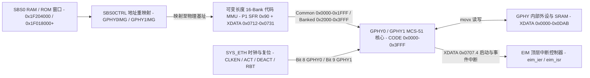

# 5.9 GPHY 8051 协处理器架构与中断

Lantiq Falcon 片上集成两路千兆以太网 PHY（GPHY0、GPHY1），每路 GPHY 内置一颗扩展型 MCS-51（8051）微控制器，独立管理物理层 R_CAL 阻抗校准、IEEE 802.3 Clause 28 自动协商、10BASE-T / 100BASE-TX / 1000BASE-T 链路训练、DSP 均衡器实时追踪、IEEE 802.3az EEE 节能控制、LED 状态指示以及 Clause 22 / Clause 45 MDIO 寄存器仿真。



---

## 1. 代码空间重映射与硬件复位引导序列

每颗 GPHY 内的 MCS-51 核心通过 `SBS0CTRL`（物理基址 `0x1F080000`）中的映像起始寄存器将 8051 代码空间重映射到 SBS0 总线（`0x1F000000`–`0x1F3FFFFF`）上的指定物理页：

| 寄存器 | 物理地址 | 位域 | 掩码 | 说明 |
| --- | --- | --- | --- | --- |
| `BAR0` | `0x1F080000` | `21:19` `BA0IH`、`18:15` `BA0V`、`14:0` `BA0IL` | `0x003FFFFF` | SBS0 RAM 主端口 1 边界地址 |
| `BAR1` | `0x1F080008` | `21:19` `BA1IH`、`18:15` `BA1V`、`14:0` `BA1IL` | `0x003FFFFF` | SBS0 RAM 主端口 2 边界地址 |
| `GPHY0IMG` | `0x1F080010` | `21:14` `ADDRV`、`13:0` `ADDRI` | `0x003FC000` / `0x00003FFF` | GPHY0 映像起始地址（16 KiB 对齐，`ADDRI` 写 0） |
| `GPHY1IMG` | `0x1F080018` | `21:14` `ADDRV`、`13:0` `ADDRI` | `0x003FC000` / `0x00003FFF` | GPHY1 映像起始地址（16 KiB 对齐，`ADDRI` 写 0） |
| `MCTRL` | `0x1F080020` | `0` `DSC` | `0x00000001` | 内存测试解扰控制 |

`GPHY0IMG` 与 `GPHY1IMG` 支持指向 SBS0 RAM 或片上掩膜 ROM 窗口：

| 代码源 | 芯片修订与工作模式 | 物理起始地址 | KSEG1 地址 | 写入 `GPHYnIMG` 的值 (`addr & 0x003FC000`) |
| --- | --- | --- | --- | --- |
| SBS0 RAM | `11G` / `22F` 外部 RAM 映像 | `0x1F204000` | `0xBF204000` | `0x00204000` |
| 片上 ROM | A11 `11G`（单口千兆） | `0x1F020000` | `0xBF020000` | `0x00020000` |
| 片上 ROM | A11 `22F`（双口百兆） | `0x1F028000` | `0xBF028000` | `0x00028000` |
| 片上 ROM | A12 `11G`（单口千兆） | `0x1F018000` | `0xBF018000` | `0x00018000` |
| 片上 ROM | A12 `22F`（双口百兆） | `0x1F024000` | `0xBF024000` | `0x00024000` |

GPHY 硬件复位与引导顺序如下：

1. **置入复位停用态**：向 `SYS_ETH.DEACT`（物理 `0x1DB00028`）写入 `0x00000100`（`GPHY0`，bit 8）与 `0x00000200`（`GPHY1`，bit 9），关断两路 GPHY 的 EIM 接口时钟并保持复位。
2. **装载代码映像**：若使用 RAM 引导，将 8051 代码映像写入 SBS0 RAM `0x1F204000`（`0x1F200000` 向上偏移 16 KiB，最大窗口 48 KiB）。
3. **配置映像重映射寄存器**：向 `SBS0CTRL.GPHY0IMG`（`0x1F080010`）和 `SBS0CTRL.GPHY1IMG`（`0x1F080018`）写入目标物理偏移（如 `0x00204000`），将对应物理页映射为 8051 的代码基址。
4. **激活时钟并触发硬件重启**：对目标 PHY 写 `SYS_ETH.CLKEN`（`0x1DB00004`）、`SYS_ETH.ACT`（`0x1DB00024`）及 `SYS_ETH.RBT`（`0x1DB0002C`）的 bit 8（GPHY0）或 bit 9（GPHY1）。8051 核脱离复位，从 `PC = 0x0000` 取指执行。
5. **启动完成中断握手**：8051 完成内部初始化后将 `XDATA[0x0707]` 的 bit 4（`0x10`）置 1，向 `EIM`（物理 `0x1D800000`）上报启动中断，对应 `top_pdi.eim_isr` 的 bit 0（GPHY0）或 bit 1（GPHY1）置 1。

---

## 2. 可变长度 16-Bank 代码分页 MMU (`P1` 与 `XDATA 0x0712`–`0x0731`)

GPHY 8051 固件包含 16 个逻辑代码段（`Bank 0`–`Bank 15`），但 SBS0 RAM 分配给 GPHY 映像的物理空间上限为 48 KiB（`0xC000` 字节，分页代码区到 `0xAEDF`，随后是版本标识帧）。为避免固定 8 KiB 分页所需的 128 KiB 存储开销，GPHY 硬件集成了**可变长度 16-Bank 代码分页 MMU**：

1. **逻辑代码窗口划分 (`PC 0x0000`–`0x3FFF`)**：
   - **公共代码区 (`Common Area`, `PC 0x0000`–`0x1FFF`)**：始终映射至固件映像起始位置（`Bank 0`，文件偏移 `0x0000`–`0x0FCF`），存放中断向量表、跨 Bank 切换跳板、数学库、中断服务例程（ISR）与 `printf` 格式化引擎。
   - **分页代码窗口 (`Banked Window`, `PC 0x2000`–`0x3FFF`，每 Bank 最大 8 KiB)**：由特殊功能寄存器 **`P1` (`SFR 0x90`) 的低 4 位 `P1[3:0]`** 选择当前激活的代码页（`Bank 0`–`Bank 15`）。
2. **可变长度 Bank 描述符表 (`XDATA 0x0712`–`0x0731`)**：
   - 硬件在 `XDATA 0x0712`–`0x0731` 维护 16 个大端 16 位描述符（`Bank k` 对应 `XDATA[0x0712 + 2*k .. 0x0713 + 2*k]`）。
   - 每个代码页在链接时于末尾放置一个标记函数（`marker`），启动代码调用 `0x0374` 计算 16 字节（Paragraph）向上取整后的尺寸减 1，计算公式为 `desc[k] = (((marker[k] + 0xE010) & 0xFFFF) & 0xFFF0) - 1`。
   - 对 `Bank 1`–`Bank 15`（`marker` 位于 `0x2000`–`0x3FFF`），`desc[k] = size[k] - 1`（即 `Bank k` 的字节长度 `size[k] = desc[k] + 1`）。对 `Bank 0`（`marker = 0x0FC0`），`desc[0] = 0xEFCF`，对应公共区长度 `size[0] = 0x0FD0` 字节。
   - 硬件 MMU 根据 `size[0] .. size[k-1]` 的累加和自动计算 `Bank k` 在 SBS0 RAM/ROM 中的紧缩物理起始偏移：`file_offset(k, PC) = sum(size[0 .. k-1]) + (PC - 0x2000)`。

### 2.1 16 个代码段 (`Bank 0`–`Bank 15`) 物理映射与功能表

| Bank | `P1[3:0]` | 描述符地址 | 末尾标记 (`marker`) | 描述符值 (`desc`) | 紧缩段长度 (`size`) | 映像文件偏移范围 | 逻辑 `PC` 范围 | 硬件模块与状态机职责 |
| --- | --- | --- | --- | --- | --- | --- | --- | --- |
| `Bank 0` | `0x0` | `0x0712` | `0x0FC0` | `0xEFCF` | `0x0FD0` (4,048 B) | `0x0000`–`0x0FCF` | `0x0000`–`0x0FCF` | `Common`：中断向量表、`L51_BANK` 跳板、16/32 位整数算术库、启动引导、全部 ISR、UART `printf` |
| `Bank 1` | `0x1` | `0x0714` | `0x231A` | `0x031F` | `0x0320` (800 B) | `0x0FD0`–`0x12EF` | `0x2000`–`0x231F` | `Init`：`R_CAL` 阻抗校准、Timer 0/1 与 UART 波特率初始化、硬件定时器 0/1 配置、`Bank 2..15` 描述符注册 |
| `Bank 2` | `0x2` | `0x0716` | `0x299F` | `0x099F` | `0x09A0` (2,464 B) | `0x12F0`–`0x1C8F` | `0x2000`–`0x299F` | `CAL`：`[MOCAR]`、`[LSADS]`、`ASPV_ADC1` 模拟前端偏置校准与片上 ADC 采样状态机 |
| `Bank 3` | `0x3` | `0x0718` | `0x22C2` | `0x02CF` | `0x02D0` (720 B) | `0x1C90`–`0x1F5F` | `0x2000`–`0x22CF` | `Main`：顶层物理层任务调度器（`Main`、`Init`、`Act 1`–`Act 3` 模式派发） |
| `Bank 4` | `0x4` | `0x071A` | `0x311D` | `0x111F` | `0x1120` (4,384 B) | `0x1F60`–`0x307F` | `0x2000`–`0x311F` | `ANEG`：IEEE 802.3 Clause 28 自动协商状态机（`AnegEn`、`Abil-D`、`ACK-D`、`C-ACK`、`NP-Wait`、`RXFSM`、`TXFSM`） |
| `Bank 5` | `0x5` | `0x071C` | `0x20F8` | `0x00FF` | `0x0100` (256 B) | `0x3080`–`0x317F` | `0x2000`–`0x20FF` | `PWDN`：PHY 掉电与上电恢复控制（`Powering Down`、`Powering Up`） |
| `Bank 6` | `0x6` | `0x071E` | `0x3004` | `0x100F` | `0x1010` (4,112 B) | `0x3180`–`0x418F` | `0x2000`–`0x300F` | `ASP`：模拟信号处理与自动增益控制（`ASP:%d`、`AGC:%d`） |
| `Bank 7` | `0x7` | `0x0720` | `0x2B38` | `0x0B3F` | `0x0B40` (2,880 B) | `0x4190`–`0x4CCF` | `0x2000`–`0x2B3F` | `TEST`：环回测试、TDR 线缆诊断与峰值检测（`CDPK-%x`、`Loop`） |
| `Bank 8` | `0x8` | `0x0722` | `0x280B` | `0x080F` | `0x0810` (2,064 B) | `0x4CD0`–`0x54DF` | `0x2000`–`0x280F` | `10BT`：10BASE-T 收发状态机与链路维护 |
| `Bank 9` | `0x9` | `0x0724` | `0x2E01` | `0x0E0F` | `0x0E10` (3,600 B) | `0x54E0`–`0x62EF` | `0x2000`–`0x2E0F` | `100bTX`：100BASE-TX 链路训练、MDLL 时钟恢复与 MDI/MDI-X 极性状态机 |
| `Bank 10` | `0xA` | `0x0726` | `0x3F00` | `0x1F0F` | `0x1F10` (7,952 B) | `0x62F0`–`0x81FF` | `0x2000`–`0x3F0F` | `GIGA`：1000BASE-T 主从协商、4 对线极性/偏斜校准与 `LOCK1`–`LOCK3` 训练 |
| `Bank 11` | `0xB` | `0x0728` | `0x3E68` | `0x1E6F` | `0x1E70` (7,792 B) | `0x8200`–`0xA06F` | `0x2000`–`0x3E6F` | `TRCK`：1000BASE-T 实时追踪、时序恢复与 IEEE 802.3az EEE 低功耗空闲（`LPI`）控制 |
| `Bank 12` | `0xC` | `0x072A` | `0x2E2E` | `0x0E2F` | `0x0E30` (3,632 B) | `0xA070`–`0xAE9F` | `0x2000`–`0x2E2F` | `Data`：稳态数据面监控、SNR 测量、频偏（ppm）统计与回波/串扰均衡器抽头（`TW`/`TQ`/`RW`/`RQ`）更新 |
| `Bank 13` | `0xD` | `0x072C` | `0x2000` | `0x000F` | `0x0010` (16 B) | `0xAEA0`–`0xAEAF` | `0x2000`–`0x200F` | 保留空段（单指令 `ret`） |
| `Bank 14` | `0xE` | `0x072E` | `0x2007` | `0x000F` | `0x0010` (16 B) | `0xAEB0`–`0xAEBF` | `0x2000`–`0x200F` | 诊断打印桩 |
| `Bank 15` | `0xF` | `0x0730` | `0x2017` | `0x001F` | `0x0020` (32 B) | `0xAEC0`–`0xAEDF` | `0x2000`–`0x201F` | `100BASE-T1 NS` 不支持提示桩（打印 `"\t100base-T1 NS\n"`） |

> [!NOTE]
> 本机映像 `0xAEE0`–`0xAF11` 是 `7E 81 7E` / `81 7E 81` 包围的版本帧，正文为 `PHY_1V6_11G_IP_AR10_A21_R8435_A134_T002C_6vB`；其后到 `0xBFFF` 是 `0xFF` 填充。不能替换成其他版本的字符串或零填充。

---

## 3. 固件涉及的特殊功能寄存器 (`SFR 0x80`–`0xFF`)

本节列出 GPHY 8051 在 `0x80`–`0xFF` 直接寻址空间使用的 23 个特殊功能寄存器（SFR），不覆盖全部保留或未定义地址。其中除标准 MCS-51 寄存器外，还包括**多数据指针选择寄存器 (`DPS 0xA2`)**、**代码页选择端口 (`P1 0x90`)** 以及 **8 路扩展中断使能与 4 级优先级控制器 (`IP 0xB8`/`IPH 0xB9`、`EIE 0xE8`、`EIP 0xF8`/`EIPH 0xF9`)**。

### 3.1 SFR 总表 (`0x80`–`0xFF`)

| SFR 地址 | 助记符 | 可位寻址 | 启动初始值 | 硬件功能与位域说明 |
| --- | --- | --- | --- | --- |
| `0x81` | `SP` | 否 | `0xA0` | 栈指针：复位后由 `0x033F` 初始化为 `0xA0`，使用高 96 字节内部 RAM（`IDATA 0xA0`–`0xFF`）作为硬件调用与中断栈 |
| `0x82` | `DPL` | 否 | `0x00` | 当前活动数据指针（由 `DPS 0xA2` 选择 `DPTR0`、`DPTR1` 或 `DPTR2`）低字节 |
| `0x83` | `DPH` | 否 | `0x00` | 当前活动数据指针高字节 |
| `0x87` | `PCON` | 否 | `0x01` | 电源控制寄存器：`bit 0` (`IDL`) 置 1 时关闭 CPU 取指时钟进入 Idle 休眠，由任意使能中断唤醒 |
| `0x88` | `TCON` | 是 (`0x88`–`0x8F`) | `0x50` | 定时器控制寄存器：`TCON.4` (`0x8C` = `TR0`) 启动 Timer 0；`TCON.6` (`0x8E` = `TR1`) 启动 Timer 1 |
| `0x89` | `TMOD` | 否 | `0x21` | 定时器模式寄存器：`bits 1:0 = 01b`（Timer 0 为 16 位定时器 Mode 1）；`bits 5:4 = 10b`（Timer 1 为 8 位自动重装 Mode 2） |
| `0x8A` | `TL0` | 否 | `0x00` | Timer 0 低字节计数器 |
| `0x8C` | `TH0` | 否 | `0x00` | Timer 0 高字节计数器 |
| `0x8D` | `TH1` | 否 | `0xDE` | Timer 1 自动重装值（`0xDE` = 222，分频系数 `256 - 222 = 34`，提供内部串口波特率时钟） |
| `0x90` | `P1` | 是 (`0x90`–`0x97`) | `0xFF` | 代码页切换端口：`bits 3:0` (`B_CURRENTBANK`) 选择 `PC 0x2000`–`0x3FFF` 映射的 Bank (`0`–`15`)；`bits 7:4` 保持 `1111b` |
| `0x98` | `SCON` | 是 (`0x98`–`0x9F`) | `0xC2` | 串口控制寄存器：`bits 7:6 = 11b`（Mode 3，9 位可变波特率 UART），`SCON.1` (`0x99` = `TI`) 为发送完成中断标志 |
| `0x99` | `SBUF` | 否 | — | 串口数据缓冲寄存器：写入即启动一帧 UART 调试字符发送 |
| `0xA2` | `DPS` | 否 | `0x00` | 多数据指针选择寄存器：`bits 1:0 = 00b` 选 `DPTR0`，`01b` 选 `DPTR1`，`10b` (`0x02`) 选快速中断专用 `DPTR2` |
| `0xA8` | `IE` | 是 (`0xA8`–`0xAF`) | `0x90` | 标准中断使能寄存器：`IE.7` (`0xAF` = `EA`) 全局中断使能；`IE.4` (`0xAC` = `ES`) 串口中断使能 |
| `0xB0` | `P3` | 是 (`0xB0`–`0xB7`) | `0xFF` | 端口 3 锁存器：复位时写入 `0xFF` 置为高阻输入/复用外设功能态 |
| `0xB8` | `IP` | 是 (`0xB8`–`0xBF`) | `0x10` | 标准中断优先级低位寄存器：`IP.4` (`PS`) = 1（与 `IPH.4 = 0` 组合将串口中断设为优先级 1） |
| `0xB9` | `IPH` | 否 | `0x00` | 标准中断优先级高位寄存器：与 `IP (0xB8)` 组成 2 位（0–3 级）标准中断优先级 |
| `0xD0` | `PSW` | 是 (`0xD0`–`0xD7`) | `0x00` | 程序状态字：`bits 4:3` (`RS1:RS0`) 选择工作寄存器组 `Bank 0`–`3`；`PSW.5` (`0xD5` = `F0`) 为用户标志；`PSW.2` (`0xD2` = `OV`) 为溢出标志 |
| `0xE0` | `ACC` | 是 (`0xE0`–`0xE7`) | `0x00` | 累加器 `A` |
| `0xE8` | `EIE` | 是 (`0xE8`–`0xEF`) | `0x07` | 扩展中断使能寄存器：位地址 `0xE8`–`0xEF` 分别独立使能扩展中断 `EINT0`–`EINT7`（对应向量 `0x0033`–`0x006B`） |
| `0xF0` | `B` | 是 (`0xF0`–`0xF7`) | `0x00` | 乘除法辅助寄存器 `B` |
| `0xF8` | `EIP` | 是 (`0xF8`–`0xFF`) | `0x09` | 扩展中断优先级低位寄存器：对应 `EINT0`–`EINT7` 优先级的 bit 0 |
| `0xF9` | `EIPH` | 否 | `0xF9` | 扩展中断优先级高位寄存器：对应 `EINT0`–`EINT7` 优先级的 bit 1（与 `EIP 0xF8` 组成 0–3 共 4 级硬件抢占优先级） |

### 3.2 多数据指针寄存器 (`DPS 0xA2`) 与零栈开销中断上下文切换

GPHY 8051 核的 `DPS`（`SFR 0xA2`）将 `DPL (0x82)` / `DPH (0x83)` 映射到至少 3 组独立的硬件 16 位数据指针寄存器（`DPTR0`、`DPTR1`、`DPTR2`）：

| `DPS (0xA2)` 值 | 当前映射的数据指针 | 配合使用的通用寄存器组 (`PSW[4:3]`) | 硬件上下文隔离机制 |
| --- | --- | --- | --- |
| `0x00` | `DPTR0` | `Register Bank 0` (`IDATA 0x00`–`0x07`) | 主程序与常规状态机默认使用的主数据指针 |
| `0x01` | `DPTR1` | `Register Bank 0` (`IDATA 0x00`–`0x07`) | 备用数据指针；常规 ISR（`0x047C`、`0x04D2`、`0x07F6`、`0x090E`、`0x0B8C`）在入口和出口通过两次 `xrl DPS, #0x01` 配合 `push/pop DPH, DPL` 将 `DPTR0` 与 `DPTR1` 压栈保存 |
| `0x02` | `DPTR2` | `Register Bank 1` (`IDATA 0x08`–`0x0F`) | 高频 DSP 实时追踪中断（`EINT4`–`EINT7`，入口 `0x0BD8`、`0x0C14`、`0x0C50`、`0x0C8C`）专用：入口直接执行 `push DPS; mov DPS, #0x02` 与 `push PSW; mov PSW, #0x08`，无需在栈上保存或恢复 `DPL`、`DPH` 及 `R0`–`R7`，消除 24 次栈操作开销 |

### 3.3 扩展中断使能与 4 级硬件优先级矩阵 (`IE`/`EIE`、`IP`/`IPH`、`EIP`/`EIPH`)

中断控制器支持 4 个硬件抢占优先级（Level 0 最低，Level 3 最高）。每个中断源的优先级由对应的高位寄存器（`IPH 0xB9` 或 `EIPH 0xF9`）与低位寄存器（`IP 0xB8` 或 `EIP 0xF8`）同位拼接而成：

```text
Priority_Level = 2 * Bit_High + Bit_Low   (取值范围: 0, 1, 2, 3)
```

复位初始化例程 `0x039E`–`0x03B8` 配置 `IPH = 0x00`、`IP = 0x10`、`EIPH = 0xF9`（`1111_1001b`）、`EIP = 0x09`（`0000_1001b`）：

| 中断源 | 向量地址 | 使能位 (`SFR.bit`) | 优先级高位 (`IPH`/`EIPH`) | 优先级低位 (`IP`/`EIP`) | 硬件优先级 | 动态调整与抢占关系 |
| --- | --- | --- | --- | --- | --- | --- |
| `RI` / `TI` (UART) | `0x0023` | `IE.4` (`0xAC`) | `IPH.4 = 0` | `IP.4 = 1` | **Level 1** | 高于后台状态机调度器（`EINT1` Level 0），确保调试日志在状态机运行期间实时排空 |
| `EINT0` (MDIO 拦截) | `0x0033` | `EIE.0` (`0xE8`) | `EIPH.0 = 1` (或 `0`) | `EIP.0 = 1` | **Level 3** (或 **1**) | 默认最高优先级（Level 3），确保外部主机 MDIO 读写请求即时响应；在 `Bank 11` 关键追踪阶段写 `EIPH = 0xF8` 临时降为 Level 1，退出时写 `EIPH = 0xF9` 恢复为 Level 3 |
| `EINT1` (状态机调度) | `0x003B` | `EIE.1` (`0xE9`) | `EIPH.1 = 0` | `EIP.1 = 0` | **Level 0** | 最低优先级后台调度周期中断，可被 UART（Level 1）、DSP 追踪（Level 2）与 MDIO（Level 3）抢占 |
| `EINT2` (LED 定时器) | `0x0043` | `EIE.2` (`0xEA`) | `EIPH.2 = 0` | `EIP.2 = 0` | **Level 0** | 最低优先级周期中断，驱动 4 通道 LED 闪烁状态机 |
| `EINT3` (硬件软复位) | `0x004B` | `EIE.3` (`0xEB`) | `EIPH.3 = 1` | `EIP.3 = 1` | **Level 3** | 最高优先级硬件复位事件中断 |
| `EINT4` (DSP 追踪 0) | `0x0053` | `EIE.4` (`0xEC`) | `EIPH.4 = 1` | `EIP.4 = 0` | **Level 2** | 实时 DSP 事件中断，抢占 `EINT1`（Level 0）与 UART（Level 1）；进入 ISR 后执行 `clr EIE.0` 临时屏蔽 `EINT0` 以保护共享状态 |
| `EINT5` (DSP 追踪 1) | `0x005B` | `EIE.5` (`0xED`) | `EIPH.5 = 1` | `EIP.5 = 0` | **Level 2** | 实时 DSP 事件中断，与 `EINT4` 同级 |
| `EINT6` (DSP 追踪 2) | `0x0063` | `EIE.6` (`0xEE`) | `EIPH.6 = 1` | `EIP.6 = 0` | **Level 2** | 实时 DSP 事件中断，与 `EINT4` 同级 |
| `EINT7` (DSP 追踪 3) | `0x006B` | `EIE.7` (`0xEF`) | `EIPH.7 = 1` | `EIP.7 = 0` | **Level 2** | 实时 DSP 事件中断，与 `EINT4` 同级 |

---

## 4. 16 槽硬件中断向量表 (`0x0000`–`0x0073`)

核心的中断向量表从 `0x0003` 延伸至 `0x0073`，每 8 字节一个槽位，连同 `0x0000` 复位向量共 16 个硬件入口：

| 向量地址 | 槽位 | 中断源 | 向量指令 | 目标入口 | 关联 `XDATA` 状态/掩码寄存器 | 硬件事件与处理职责 |
| --- | --- | --- | --- | --- | --- | --- |
| `0x0000` | Reset | 硬件复位入口 | `ljmp 0x033F` | `0x033F` | `0x0707`, `0x0712`–`0x0731` | 初始化 `SP = 0xA0`、构建 16-Bank MMU 表、执行 `Bank 1` 校准、开启中断并进入 `PCON.0` (`IDL`) 休眠 |
| `0x0003` | IRQ 0 | `INT0` (`IE0`) | `sjmp 0x0005` | `0x0005` (`reti`) | — | 未使用 |
| `0x000B` | IRQ 1 | `Timer 0` (`TF0`) | `sjmp 0x0006` | `0x0006` (`reti`) | — | 未使用（Timer 0 仅作为自由运行计数器，不触发中断） |
| `0x0013` | IRQ 2 | `INT1` (`IE1`) | `sjmp 0x0007` | `0x0007` (`reti`) | — | 未使用 |
| `0x001B` | IRQ 3 | `Timer 1` (`TF1`) | `sjmp 0x0008` | `0x0008` (`reti`) | — | 未使用（Timer 1 作为串口波特率发生器运行于 Mode 2） |
| `0x0023` | IRQ 4 | `UART` (`RI`/`TI`) | `ajmp 0x047C` | `0x047C` | `0x00AC`–`0x01AB` (TX 环) | 内部串口发送中断：当 `SCON.1` (`TI`) 置位时，从 256 B 环形缓冲区取下一字节写入 `SBUF (0x99)` |
| `0x002B` | IRQ 5 | `Timer 2` (`TF2`) | `sjmp 0x0009` | `0x0009` (`reti`) | — | 未使用 |
| `0x0033` | IRQ 6 | `EINT0` | `ajmp 0x04D2` | `0x04D2` | `0x0702`, `0x0600`–`0x063F` | MDIO 主机访问拦截：读取 `XDATA[0x0702]`（`bit 7` = R/W，`bits 6:0` = 寄存器号），处理 Clause 22 读写自清零与 Clause 45 `MMDCTRL`/`MMDDATA` (`0x0D`/`0x0E`) 间接寻址 |
| `0x003B` | IRQ 7 | `EINT1` | `ajmp 0x07F6` | `0x07F6` | `0x0766` (`bit 2 = 0x04`) | 硬件定时器通道 0 周期中断：写 `0x04` 清 `0x0766`，按分频比 `XDATA[0x01B1]` 通过函数指针 `IDATA[0x5A:0x5B]` 调度各代码 Bank 主状态机，并更新温度与误码计数 |
| `0x0043` | IRQ 8 | `EINT2` | `ljmp 0x090E` | `0x090E` | `0x0766` (`bit 3 = 0x08`) | 硬件定时器通道 1 周期中断：写 `0x08` 清 `0x0766`，每 50 次中断调用 `0x0977` 驱动 4 通道 LED 闪烁引擎并更新 `XDATA[0x0708]` |
| `0x004B` | IRQ 9 | `EINT3` | `ljmp 0x0B8C` | `0x0B8C` | `0x0766` (`bit 4 = 0x10`) | 硬件复位事件中断：检测 `0x0766` bit 4，置位 `BMCR.Reset` (`0x0600.7`) 与事件标志 `IDATA[0x20].0`，写 `0x10` 清 `0x0766` |
| `0x0053` | IRQ 10 | `EINT4` | `ljmp 0x0BD8` | `0x0BD8` | `0x0768` (状态), `0x0769` (掩码) | DSP/定时器快速事件 0：切换至 `DPTR2`、`Register Bank 1` 及 `P1 = IDATA[0x10]`，调用 `IDATA[0x11:0x12]`（当 `0x10 == 0x0B`）或 `IDATA[0x13:0x14]`（当 `0x10 == 0x0C`） |
| `0x005B` | IRQ 11 | `EINT5` | `ljmp 0x0C14` | `0x0C14` | `0x076A` (状态), `0x076B` (掩码) | DSP/定时器快速事件 1：切换至 `DPTR2`、`Register Bank 1` 及 `P1 = IDATA[0x10]`，分派逻辑同 `EINT4` |
| `0x0063` | IRQ 12 | `EINT6` | `ljmp 0x0C50` | `0x0C50` | `0x076C` (状态), `0x076D` (掩码) | DSP/定时器快速事件 2：切换至 `DPTR2`、`Register Bank 1` 及 `P1 = IDATA[0x10]`，始终调用 `IDATA[0x11:0x12]` |
| `0x006B` | IRQ 13 | `EINT7` | `ljmp 0x0C8C` | `0x0C8C` | `0x076E` (状态), `0x076F` (掩码) | DSP/定时器快速事件 3：切换至 `DPTR2`、`Register Bank 1` 及 `P1 = IDATA[0x10]`，仅在 `IDATA[0x10] == 0x0B` 时循环调用 `IDATA[0x11:0x12]` 直至 `IDATA[0x84] == 0` |
| `0x0073` | IRQ 14 | 保留扩展槽 8 | `sjmp 0x000A` | `0x000A` (`reti`) | — | 未使用 |

---

## 5. 内部 RAM (`IDATA`) 与外部数据空间 (`XDATA`) 映射

### 5.1 内部 RAM (`DATA` / `IDATA 0x00`–`0xFF`) 关键变量布局

| 内部 RAM 地址 | 访问方式 | 硬件与固件用途 |
| --- | --- | --- |
| `0x00`–`0x07` | `Register Bank 0` (`R0`–`R7`) | 主线程、常规状态机与 `EINT0`–`EINT3` / `UART` ISR 使用的默认工作寄存器组 |
| `0x08`–`0x0F` | `Register Bank 1` (`R0`–`R7`) | `EINT4`–`EINT7`（`0x0BD8`–`0x0CBE`）实时追踪 ISR 专用工作寄存器组（通过 `mov PSW, #0x08` 切换） |
| `0x10` | 直接寻址 `0x10` | `EINT4`–`EINT7` 实时回调所属的目标代码页号（`0x0B` = `Bank 11 TRCK`，`0x0C` = `Bank 12 Data`），ISR 入口执行 `mov P1, 0x10` |
| `0x11`–`0x12` | 直接寻址 `0x11:0x12` | `EINT4`–`EINT7` 实时回调函数指针 1（大端 16 位 `PC`） |
| `0x13`–`0x14` | 直接寻址 `0x13:0x14` | `EINT4`–`EINT5` 实时回调函数指针 2（当 `IDATA[0x10] != 0x0B` 时调用，大端 16 位 `PC`） |
| `0x19`–`0x1A` | 直接寻址 `0x19:0x1A` | 启动阶段 `0x0360`–`0x039D` 写入 `XDATA 0x0712`–`0x0731` 描述符表的递增写指针 |
| `0x1B` / `0x1C` | 直接寻址 `0x1B` / `0x1C` | 内部 UART 256 B 发送环形缓冲区（`XDATA 0x00AC`–`0x01AB`）的读索引（`0x1B`）与写索引（`0x1C`） |
| `0x1D`–`0x1E` | 直接寻址 `0x1D:0x1E` | IEEE 802.3 Clause 45 `MMDCTRL`/`MMDDATA` 当前锁存的 16 位目标寄存器地址 |
| `0x20` | 位寻址 `0x00`–`0x07` / 字节 | MDIO 事件标志字：`bit 0` = 软复位请求，`bit 1` = Power Down 变更，`bit 2` = 重启自协商，`bit 3` = Next Page 写入，`bit 4` = 1000BASE-T/双工速率变更，`bit 5` = 自协商使能变更 |
| `0x21` | 位寻址 `0x08`–`0x0F` | 系统状态位：`0x21.0` (`bit 0x08`) = 状态机首次进入标志；`0x21.2` (`bit 0x0A`) = UART 环形缓冲满；`0x21.3` (`bit 0x0B`) = UART 发送忙；`0x21.5` (`bit 0x0D`) = `printf` `%` 格式符转义态；`0x21.6` (`bit 0x0E`) = 自协商使能镜像 |
| `0x58`–`0x59` | 直接寻址 `0x58:0x59` | 上一激活的跨 Bank 顶层状态机跳板地址 |
| `0x5A`–`0x5B` | 直接寻址 `0x5A:0x5B` | 当前激活的跨 Bank 顶层状态机跳板地址（由 `EINT1 0x07F6` 通过 `lcall 0x0339` 周期调用） |
| `0x5C`–`0x5D` | 直接寻址 `0x5C:0x5D` | 当前 Bank 内部下一子状态函数指针（大端 16 位 `PC`） |
| `0x5E`–`0x5F` | 直接寻址 `0x5E:0x5F` | 待切换的下一跨 Bank 顶层状态机跳板地址（如 `0x021A`、`0x01C5`） |
| `0x60`–`0x61` | 直接寻址 `0x60:0x61` | 当前 Bank 内部正在执行的子状态函数指针 |
| `0x75` | 直接寻址 `0x75` | 顶层状态机切换触发标志（`1` = 状态刚发生迁移） |
| `0x84` | 间接寻址 `@R0` (`0x84`) | `EINT4`–`EINT7` 重入/连续迭代标志（在 `Bank 11` 回调中置位则循环重调 `0x11:0x12`） |
| `0xA0`–`0xFF` | `SP` 硬件栈 | 96 字节硬件调用与中断现场保存栈 |

### 5.2 已识别的外部数据空间 (`XDATA 0x0000`–`0x0DAB`)

8051 核心通过 `movx @DPTR` 访问的 `XDATA` 地址空间分布在 `0x0000`–`0x0DAB` 的 8 个功能页中：

| `XDATA` 地址范围 | 所属页/模块 | 硬件寄存器与数据结构说明 |
| --- | --- | --- |
| `0x0000`–`0x00AB` | `SRAM_VARS` | 物理层状态机全局工作变量、训练计数器与均衡器统计缓存 |
| `0x00AC`–`0x01AB` | `UART_RING` | 256 字节 UART 调试输出环形缓冲区（由 `0x0DB8` 写入、由 `UART ISR 0x047C` 读取发送） |
| `0x01AC`–`0x01FF` | `SYS_CFG_MMD` | 固件控制参数与 Clause 45 MMD 映射区：`0x01B1` = `EINT1` 调度周期阈值，`0x01B2` = `EINT1` 计数，`0x01B3` = `EINT2` LED 计数，`0x01D4`–`0x01DF` = MMD `DEVAD 3/7/30` 寄存器镜像，`0x01E0`–`0x01EF` = 4 通道 LED 闪烁配置表，`0x01F1` = 当前 `MMDCTRL` 锁存值 |
| `0x0600`–`0x063F` | `MII_REGS` | 32 个 IEEE 802.3 Clause 22 标准与厂商 MII 寄存器大端窗口（`Reg N` 映射于 `0x0600 + 2*N .. 0x0601 + 2*N`）：`0x0600` = `BMCR`，`0x0602` = `BMSR`，`0x0608` = `ADVERTISE`，`0x0612` = `CTRL1000`，`0x0614` = `STAT1000`，`0x061A` = `MMDCTRL (0x0D)`，`0x061C` = `MMDDATA (0x0E)`，`0x0622` = `PHYSTAT (0x11)`，`0x062A` = `ERRCNT (0x15)`，`0x0632` = `IMASK (0x19)`，`0x0634` = `ISTAT (0x1A)`，`0x0636` = `LED (0x1B)` |
| `0x0680` | `MII_SHDW` | 内部 BMCR 软复位状态镜像寄存器 |
| `0x0700`–`0x0706` | `MDIO_SLAVE` | MDIO 从机硬件控制区：`0x0702` 为 MDIO 访问拦截状态寄存器（`bit 7`：`0` = 写、`1` = 读；`bits 6:0` = 被访问的 MII 寄存器编号 `0x00`–`0x1F`） |
| `0x0707` | `HOST_INT` | 外部主机 EIM 中断输出控制：`bit 4` (`0x10`) 置 1 时向 SoC 顶层 `EIM` 触发 GPHY 中断（用于启动握手与 `MII 0x19/0x1A` MDINT 上报） |
| `0x0708` | `LED_GPIO` | GPHY 4 通道 LED 物理引脚输出与极性控制寄存器 |
| `0x070B`–`0x0710` | `TEMP_ADC` | 温度传感器与片上监控 ADC 数据寄存器 |
| `0x0712`–`0x0731` | `BANK_MMU` | 16-Bank 可变长度代码分页 MMU 描述符表（16 项 × 16 位大端段落边界值） |
| `0x0747`–`0x0760` | `HW_TIMERS` | 6 通道 16 位硬件定时器阵列：`0x0747` = 通道使能位图 (`bits 5:0`)，`0x0748` = 通道模式位图 (`bits 5:0`)，`0x0749`–`0x074C` = `Ch0` (驱动 `EINT1`)，`0x074D`–`0x0750` = `Ch1` (驱动 `EINT2`)，`0x0751`–`0x0754` = `Ch2`，`0x0755`–`0x0758` = `Ch3`，`0x0759`–`0x075C` = `Ch4`，`0x075D`–`0x0760` = `Ch5` |
| `0x0766`–`0x076F` | `EXT_INTC` | 扩展中断状态（写 1 清零）与掩码（低有效）寄存器组：`0x0766` = `EINT1`(`0x04`)/`EINT2`(`0x08`)/`EINT3`(`0x10`) 状态；`0x0768`/`0x0769` = `EINT4` 状态/掩码；`0x076A`/`0x076B` = `EINT5` 状态/掩码；`0x076C`/`0x076D` = `EINT6` 状态/掩码；`0x076E`/`0x076F` = `EINT7` 状态/掩码 |
| `0x0770`–`0x07FD` | `PCS_ANEG` | Clause 28 FLP 快速链路脉冲收发器、10/100M PCS 控制与 EEE LPI 硬件状态机寄存器 |
| `0x0800`–`0x0A0C` | `DSP_CORE` | 1000BASE-T 混合回波抵消（Echo/NEXT）、前馈/判决反馈均衡器（FFE/DFE）、载波与时序恢复（CDR）寄存器窗口 |
| `0x0D00`–`0x0DAB` | `AFE_PMA` | 模拟前端（AFE）、PGA 增益、ADC 多路复用及 `0x0DAB` `R_CAL` 阻抗校准状态/结果寄存器（`bit 0` = 校准完成，`bits 7:4` = 4 位校准码） |

---

## 6. 核心微码例程与指令行为 (`Bank 0` 与 `Bank 1`)

### 6.1 硬件中断向量表 (`0x0000`–`0x0074`)

| 文件偏移 | 逻辑 `PC` | 机器码 | 指令 | 逐行硬件行为详解 |
| --- | --- | --- | --- | --- |
| `0x0000` | `0x0000` | `02 03 3F` | `ljmp 0x033F` | 硬件复位入口：长跳转至 `Bank 0` 启动引导例程 `0x033F` |
| `0x0003` | `0x0003` | `80 00` | `sjmp 0x0005` | `IRQ 0` (`INT0`)：短跳至 `0x0005` 的 `reti` 指令直接返回 |
| `0x0005` | `0x0005` | `32` | `reti` | 未用中断槽 0 (`INT0`) 的共用中断返回指令 |
| `0x0006` | `0x0006` | `32` | `reti` | 未用中断槽 1 (`TF0`) 的中断返回指令 |
| `0x0007` | `0x0007` | `32` | `reti` | 未用中断槽 2 (`INT1`) 的中断返回指令 |
| `0x0008` | `0x0008` | `32` | `reti` | 未用中断槽 3 (`TF1`) 的中断返回指令 |
| `0x0009` | `0x0009` | `32` | `reti` | 未用中断槽 5 (`TF2`) 的中断返回指令 |
| `0x000A` | `0x000A` | `32` | `reti` | 未用中断槽 14 (`EINT8`) 的中断返回指令 |
| `0x000B` | `0x000B` | `80 F9` | `sjmp 0x0006` | `IRQ 1` (`TF0`)：跳至 `0x0006` (`reti`)，其余 `0x000D`–`0x0012` 为 `0xFF` 填充 |
| `0x0013` | `0x0013` | `80 F2` | `sjmp 0x0007` | `IRQ 2` (`INT1`)：跳至 `0x0007` (`reti`)，其余 `0x0015`–`0x001A` 为 `0xFF` 填充 |
| `0x001B` | `0x001B` | `80 EB` | `sjmp 0x0008` | `IRQ 3` (`TF1`)：跳至 `0x0008` (`reti`)，其余 `0x001D`–`0x0022` 为 `0xFF` 填充 |
| `0x0023` | `0x0023` | `81 7C` | `ajmp 0x047C` | `IRQ 4` (`UART RI/TI`)：跳至内部串口发送中断服务例程 `0x047C` |
| `0x002B` | `0x002B` | `80 DC` | `sjmp 0x0009` | `IRQ 5` (`TF2`)：跳至 `0x0009` (`reti`) |
| `0x0033` | `0x0033` | `81 D2` | `ajmp 0x04D2` | `IRQ 6` (`EINT0`)：跳至 MDIO 读写拦截与 Clause 45 仿真 ISR `0x04D2` |
| `0x003B` | `0x003B` | `E1 F6` | `ajmp 0x07F6` | `IRQ 7` (`EINT1`)：跳至硬件定时器 0 周期状态机调度器 ISR `0x07F6` |
| `0x0043` | `0x0043` | `02 09 0E` | `ljmp 0x090E` | `IRQ 8` (`EINT2`)：跳至硬件定时器 1 与 LED 闪烁控制 ISR `0x090E` |
| `0x004B` | `0x004B` | `02 0B 8C` | `ljmp 0x0B8C` | `IRQ 9` (`EINT3`)：跳至硬件软复位事件 ISR `0x0B8C` |
| `0x0053` | `0x0053` | `02 0B D8` | `ljmp 0x0BD8` | `IRQ 10` (`EINT4`)：跳至 DSP 实时追踪快速 ISR 0 (`0x0BD8`) |
| `0x005B` | `0x005B` | `02 0C 14` | `ljmp 0x0C14` | `IRQ 11` (`EINT5`)：跳至 DSP 实时追踪快速 ISR 1 (`0x0C14`) |
| `0x0063` | `0x0063` | `02 0C 50` | `ljmp 0x0C50` | `IRQ 12` (`EINT6`)：跳至 DSP 实时追踪快速 ISR 2 (`0x0C50`) |
| `0x006B` | `0x006B` | `02 0C 8C` | `ljmp 0x0C8C` | `IRQ 13` (`EINT7`)：跳至 DSP 实时追踪快速 ISR 3 (`0x0C8C`) |
| `0x0073` | `0x0073` | `80 95` | `sjmp 0x000A` | `IRQ 14` (`EINT8`)：跳至 `0x000A` (`reti`) |

### 6.2 复位启动、代码页描述符表注册与主休眠循环 (`0x033F`–`0x03B8` 与 `Bank 1 0x2226`–`0x2287`)

| 文件偏移 | 逻辑 `PC` | 机器码 | 指令 | 逐行硬件行为详解 |
| --- | --- | --- | --- | --- |
| `0x033F` | `0x033F` | `75 81 A0` | `mov SP(0x81), #0xA0` | 将硬件栈指针 `SP` 初始化为 `0xA0`（栈向高地址 `0xFF` 增长） |
| `0x0342` | `0x0342` | `02 03 45` | `ljmp 0x0345` | 跳入主初始化函数 `main` (`0x0345`) |
| `0x0345` | `0x0345` | `E4` | `clr A` | 清零累加器 `A = 0` |
| `0x0346` | `0x0346` | `60 03` | `jz 0x034B` | 恒成立跳转至 `0x034B`（下方 `lcall 0x0FC0` 仅用于在链接阶段保留各 Bank 末尾标记函数的引用链，避免被链接器优化剔除） |
| `0x0348` | `0x0348` | `12 0F C0` | `lcall 0x0FC0` | 链接器保留引用桩（运行时永不执行） |
| `0x034B` | `0x034B` | `75 B0 FF` | `mov P3(0xB0), #0xFF` | 将 `P3` 端口锁存器全置 1 |
| `0x034E` | `0x034E` | `71 60` | `acall 0x0360` | 调用 `0x0360` 初始化 `XDATA 0x0712`–`0x0731` 的 16-Bank 代码分页 MMU 描述符表 |
| `0x0350` | `0x0350` | `31 AC` | `acall 0x01AC` | 通过跳板 `0x01AC` 跨段调用 `Bank 1` `PC 0x2000`（执行 UART/Timer 初始化、`R_CAL` 校准及 `Bank 2` 模拟校准） |
| `0x0352` | `0x0352` | `71 9E` | `acall 0x039E` | 调用 `0x039E` 配置 `IE`、`EIE`、`EIPH`、`EIP`、`IPH`、`IP` 并开启全局中断 `EA` |
| `0x0354` | `0x0354` | `90 07 07` | `mov DPTR, #0x0707` | 指向外部主机中断控制寄存器 `XDATA 0x0707` |
| `0x0357` | `0x0357` | `E0` | `movx A, @DPTR` | 读取 `XDATA[0x0707]` 当前值 |
| `0x0358` | `0x0358` | `44 10` | `orl A, #0x10` | 置位 bit 4 (`0x10`)，向顶层 `EIM` 上报 GPHY 固件引导就绪中断 |
| `0x035A` | `0x035A` | `F0` | `movx @DPTR, A` | 写回 `XDATA[0x0707]` |
| `0x035B` | `0x035B` | `43 87 01` | `orl PCON(0x87), #0x01` | 置位 `PCON.0` (`IDL`)，令 8051 核心进入 Idle 休眠态，等待硬件中断唤醒 |
| `0x035E` | `0x035E` | `80 FB` | `sjmp 0x035B` | 中断返回 (`reti`) 后立即跳回 `0x035B` 重新进入 Idle 休眠 |
| `0x0360` | `0x0360` | `75 19 07` | `mov 0x19, #0x07` | 将描述符表写指针高字节 `IDATA[0x19]` 设为 `0x07` |
| `0x0363` | `0x0363` | `75 1A 12` | `mov 0x1A, #0x12` | 将描述符表写指针低字节 `IDATA[0x1A]` 设为 `0x12`（指向 `XDATA 0x0712`） |
| `0x0366` | `0x0366` | `7E 0F` | `mov R6, #0x0F` | 传入 `Bank 0` 末尾标记高字节 `0x0F` |
| `0x0368` | `0x0368` | `7F C0` | `mov R7, #0xC0` | 传入 `Bank 0` 末尾标记低字节 `0xC0` (`0x0FC0`) |
| `0x036A` | `0x036A` | `71 74` | `acall 0x0374` | 计算 `Bank 0` 描述符 `0xEFCF` 写入 `XDATA[0x0712:0x0713]`，指针递增至 `0x0714` |
| `0x036C` | `0x036C` | `7E 23` | `mov R6, #0x23` | 传入 `Bank 1` 末尾标记高字节 `0x23` |
| `0x036E` | `0x036E` | `7F 1A` | `mov R7, #0x1A` | 传入 `Bank 1` 末尾标记低字节 `0x1A` (`0x231A`) |
| `0x0370` | `0x0370` | `71 74` | `acall 0x0374` | 计算 `Bank 1` 描述符 `0x031F` 写入 `XDATA[0x0714:0x0715]`，指针递增至 `0x0716` |
| `0x0372` | `0x0372` | `41 15` | `ajmp 0x0215` | 经跳板 `0x0215` 切入已注册完成的 `Bank 1` `PC 0x2226`（继续注册 `Bank 2`–`Bank 15` 的描述符 `0x299F`、`0x22C2`、`0x311D`、`0x20F8`、`0x3004`、`0x2B38`、`0x280B`、`0x2E01`、`0x3F00`、`0x3E68`、`0x2E2E`、`0x2000`、`0x2007`、`0x2017`） |
| `0x0374` | `0x0374` | `EF` | `mov A, R7` | 取末尾标记低字节 `R7` |
| `0x0375` | `0x0375` | `24 10` | `add A, #0x10` | 低字节加 `0x10`（为 16 字节向上取整预加一个 Paragraph） |
| `0x0377` | `0x0377` | `FF` | `mov R7, A` | 存回 `R7` |
| `0x0378` | `0x0378` | `EE` | `mov A, R6` | 取末尾标记高字节 `R6` |
| `0x0379` | `0x0379` | `34 E0` | `addc A, #0xE0` | 带进位加 `0xE0`（等价于 16 位减去分页基址 `0x2000`） |
| `0x037B` | `0x037B` | `FE` | `mov R6, A` | 存回 `R6` |
| `0x037C` | `0x037C` | `EF` | `mov A, R7` | 取 `R7` |
| `0x037D` | `0x037D` | `54 F0` | `anl A, #0xF0` | 清除低 4 位，完成 16 字节边界向下对齐 |
| `0x037F` | `0x037F` | `24 FF` | `add A, #0xFF` | 16 位减 1（低字节加 `0xFF`） |
| `0x0381` | `0x0381` | `FF` | `mov R7, A` | 存描述符低字节至 `R7` |
| `0x0382` | `0x0382` | `EE` | `mov A, R6` | 取 `R6` |
| `0x0383` | `0x0383` | `34 FF` | `addc A, #0xFF` | 16 位减 1（高字节带进位加 `0xFF`） |
| `0x0385` | `0x0385` | `FE` | `mov R6, A` | 存描述符高字节至 `R6` |
| `0x0386` | `0x0386` | `E5 1A` | `mov A, 0x1A` | 读取当前描述符表写指针低字节 `IDATA[0x1A]` |
| `0x0388` | `0x0388` | `FD` | `mov R5, A` | 备份写指针低字节至 `R5` |
| `0x0389` | `0x0389` | `24 02` | `add A, #0x02` | 写指针加 2（指向下一 Bank 描述符槽位） |
| `0x038B` | `0x038B` | `F5 1A` | `mov 0x1A, A` | 更新 `IDATA[0x1A]` |
| `0x038D` | `0x038D` | `E5 19` | `mov A, 0x19` | 读取写指针高字节 `IDATA[0x19]` |
| `0x038F` | `0x038F` | `FC` | `mov R4, A` | 备份写指针高字节至 `R4` |
| `0x0390` | `0x0390` | `34 00` | `addc A, #0x00` | 处理进位 |
| `0x0392` | `0x0392` | `F5 19` | `mov 0x19, A` | 更新 `IDATA[0x19]` |
| `0x0394` | `0x0394` | `8D 82` | `mov DPL(0x82), R5` | 装载 `DPL = R5` |
| `0x0396` | `0x0396` | `8C 83` | `mov DPH(0x83), R4` | 装载 `DPH = R4`（`DPTR = 0x0712 + 2*k`） |
| `0x0398` | `0x0398` | `EE` | `mov A, R6` | 取描述符高字节 |
| `0x0399` | `0x0399` | `F0` | `movx @DPTR, A` | 写入 `XDATA[0x0712 + 2*k]` |
| `0x039A` | `0x039A` | `A3` | `inc DPTR` | 指向 `XDATA[0x0713 + 2*k]` |
| `0x039B` | `0x039B` | `EF` | `mov A, R7` | 取描述符低字节 |
| `0x039C` | `0x039C` | `F0` | `movx @DPTR, A` | 写入 `XDATA[0x0713 + 2*k]` |
| `0x039D` | `0x039D` | `22` | `ret` | 返回调用方 |

### 6.3 中断使能与 4 级优先级初始化 (`0x039E`–`0x03B8`)

| 文件偏移 | 逻辑 `PC` | 机器码 | 指令 | 逐行硬件行为详解 |
| --- | --- | --- | --- | --- |
| `0x039E` | `0x039E` | `E4` | `clr A` | `A = 0x00` |
| `0x039F` | `0x039F` | `F5 A8` | `mov IE(0xA8), A` | 清零标准中断使能寄存器 `IE` |
| `0x03A1` | `0x03A1` | `F5 E8` | `mov EIE(0xE8), A` | 清零扩展中断使能寄存器 `EIE` |
| `0x03A3` | `0x03A3` | `D2 AC` | `setb IE.4(0xAC)` | 使能内部串口中断 (`ES = 1`，向量 `0x0023`) |
| `0x03A5` | `0x03A5` | `D2 EA` | `setb EIE.2(0xEA)` | 使能扩展中断 `EINT2`（硬件定时器 1 / LED 闪烁，向量 `0x0043`） |
| `0x03A7` | `0x03A7` | `D2 E9` | `setb EIE.1(0xE9)` | 使能扩展中断 `EINT1`（硬件定时器 0 / 状态机调度，向量 `0x003B`） |
| `0x03A9` | `0x03A9` | `D2 E8` | `setb EIE.0(0xE8)` | 使能扩展中断 `EINT0`（MDIO 读写拦截，向量 `0x0033`） |
| `0x03AB` | `0x03AB` | `75 F9 F9` | `mov EIPH(0xF9), #0xF9` | 配置扩展中断优先级高位：`EINT0,3,4,5,6,7` 高位为 1，`EINT1,2` 高位为 0 |
| `0x03AE` | `0x03AE` | `75 F8 09` | `mov EIP(0xF8), #0x09` | 配置扩展中断优先级低位：`EINT0,3` 为 Level 3 (`11b`)，`EINT4..7` 为 Level 2 (`10b`)，`EINT1,2` 为 Level 0 (`00b`) |
| `0x03B1` | `0x03B1` | `F5 B9` | `mov IPH(0xB9), A` | 标准中断优先级高位清零 (`0x00`) |
| `0x03B3` | `0x03B3` | `75 B8 10` | `mov IP(0xB8), #0x10` | 将内部串口中断 (`PS`) 设为 Level 1 (`01b`) |
| `0x03B6` | `0x03B6` | `D2 AF` | `setb IE.7(0xAF)` | 置位全局中断使能 `EA = 1` |
| `0x03B8` | `0x03B8` | `22` | `ret` | 返回主引导流程 |

### 6.4 跨 Bank 调用与返回跳板 (`0x0075`–`0x01AB` 与 `0x0400`–`0x047B`)

跨代码段调用通过 `0x01AC`–`0x026E` 的 5 字节入口桩装载目标段内地址 `DPTR = target_pc`，随后跳入 `0x0075 + 19*k`（`?B_SWITCHk`）。`?B_SWITCHk` 将调用方所在的原代码页恢复桩地址 `0x0400 + 8*old_bank` 压入硬件栈底，再将 `DPTR` 压栈并通过 `0x0400 + 8*k` 切换 `P1[3:0] = k` 后执行 `ret` 跳入目标函数；当目标函数执行 `ret` 时，硬件自动弹出 `0x0400 + 8*old_bank` 将 `P1[3:0]` 恢复为原代码页并返回原调用点：

| 文件偏移 | 逻辑 `PC` | 机器码 | 指令 | 逐行硬件行为详解 |
| --- | --- | --- | --- | --- |
| `0x0088` | `0x0088` | `E5 90` | `mov A, P1(0x90)` | `?B_SWITCH1` 入口：读取当前代码页寄存器 `P1` |
| `0x008A` | `0x008A` | `54 0F` | `anl A, #0x0F` | 保留低 4 位当前页号 `old_bank` (`0`–`15`) |
| `0x008C` | `0x008C` | `C4` | `swap A` | 高低半字节交换（等价于 `old_bank * 16`） |
| `0x008D` | `0x008D` | `03` | `rr A` | 循环右移 1 位（得到 `old_bank * 8`，即恢复桩在 `0x0400` 表内的字节偏移） |
| `0x008E` | `0x008E` | `C0 E0` | `push ACC(0xE0)` | 将恢复桩低字节 `8 * old_bank` 压栈（作为目标函数 `ret` 时的返回地址低字节） |
| `0x0090` | `0x0090` | `74 04` | `mov A, #0x04` | 装载恢复桩高字节 `0x04` |
| `0x0092` | `0x0092` | `C0 E0` | `push ACC(0xE0)` | 将恢复桩高字节 `0x04` 压栈（组合成返回地址 `0x0400 + 8*old_bank`） |
| `0x0094` | `0x0094` | `C0 82` | `push DPL(0x82)` | 将目标函数段内入口低字节 `DPL` 压栈 |
| `0x0096` | `0x0096` | `C0 83` | `push DPH(0x83)` | 将目标函数段内入口高字节 `DPH` 压栈 |
| `0x0098` | `0x0098` | `02 04 08` | `ljmp 0x0408` | 跳至 `Bank 1` 切换桩 `0x0408`（其余 `Bank k` 跳至 `0x0400 + 8*k`） |
| `0x0400` | `0x0400` | `53 90 F0` | `anl P1(0x90), #0xF0` | `Bank 0` 切换/恢复桩：将 `P1[3:0]` 清零切回 `Bank 0` |
| `0x0403` | `0x0403` | `22` | `ret` | 从硬件栈顶弹出 `DPH:DPL`（调用时跳入目标函数，返回时跳回原调用方） |
| `0x0408` | `0x0408` | `43 90 0F` | `orl P1(0x90), #0x0F` | `Bank 1` 切换/恢复桩：先将 `P1[3:0]` 置为 `1111b` |
| `0x040B` | `0x040B` | `53 90 F1` | `anl P1(0x90), #0xF1` | 再将 `P1[3:0]` 与 `0xF1` 相与，使 `P1[3:0] = 0x1`（其余 `Bank k` 为 `anl P1, #(0xF0 \| k)`） |
| `0x040E` | `0x040E` | `22` | `ret` | 弹出栈顶地址跳转 |

### 6.5 定时器与内部串口初始化 (`Bank 1 0x1019`–`0x1025` 与 `0x11DE`–`0x11F5`)

| 文件偏移 | 逻辑 `PC` | 机器码 | 指令 | 逐行硬件行为详解 |
| --- | --- | --- | --- | --- |
| `0x1019` | `0x2049` | `C2 8C` | `clr TCON.4(0x8C)` | `TR0 = 0`：停止标准 Timer 0 |
| `0x101B` | `0x204B` | `43 89 01` | `orl TMOD(0x89), #0x01` | 设置 `TMOD[1:0] = 01b`（Timer 0 工作于 16 位不自动重装定时器 Mode 1） |
| `0x101E` | `0x204E` | `E4` | `clr A` | `A = 0x00` |
| `0x101F` | `0x204F` | `F5 8A` | `mov TL0(0x8A), A` | 清零 `TL0 = 0x00` |
| `0x1021` | `0x2051` | `F5 8C` | `mov TH0(0x8C), A` | 清零 `TH0 = 0x00` |
| `0x1023` | `0x2053` | `D2 8C` | `setb TCON.4(0x8C)` | `TR0 = 1`：启动标准 Timer 0 |
| `0x1025` | `0x2055` | `22` | `ret` | 返回 |
| `0x11DE` | `0x220E` | `E4` | `clr A` | `A = 0x00` |
| `0x11DF` | `0x220F` | `F5 1B` | `mov 0x1B, A` | 清零 UART 发送环形缓冲读索引 `IDATA[0x1B] = 0` |
| `0x11E1` | `0x2211` | `F5 1C` | `mov 0x1C, A` | 清零 UART 发送环形缓冲写索引 `IDATA[0x1C] = 0` |
| `0x11E3` | `0x2213` | `C2 0B` | `clr 0x21.3(bit_0x0B)` | 清除 UART 发送忙标志 `0x21.3 = 0` |
| `0x11E5` | `0x2215` | `C2 0A` | `clr 0x21.2(bit_0x0A)` | 清除 UART 环形缓冲满标志 `0x21.2 = 0` |
| `0x11E7` | `0x2217` | `22` | `ret` | 返回 |
| `0x11E8` | `0x2218` | `C2 8E` | `clr TCON.6(0x8E)` | `TR1 = 0`：停止标准 Timer 1 |
| `0x11EA` | `0x221A` | `75 98 C2` | `mov SCON(0x98), #0xC2` | 配置 `SCON = 0xC2`（`SM0=1, SM1=1` Mode 3 可变波特率 UART，预置 `TI = 1`） |
| `0x11ED` | `0x221D` | `43 89 20` | `orl TMOD(0x89), #0x20` | 配置 `TMOD[5:4] = 10b`（Timer 1 为 8 位自动重装定时器 Mode 2） |
| `0x11F0` | `0x2220` | `75 8D DE` | `mov TH1(0x8D), #0xDE` | 写入波特率重装初值 `TH1 = 0xDE`（分频系数 34） |
| `0x11F3` | `0x2223` | `D2 8E` | `setb TCON.6(0x8E)` | `TR1 = 1`：启动 Timer 1 波特率发生器 |
| `0x11F5` | `0x2225` | `22` | `ret` | 返回 |

### 6.6 内部串口发送中断 (`0x047C`–`0x04D1`) 与环形缓冲写入 (`0x0DB8`–`0x0DE1`)

| 文件偏移 | 逻辑 `PC` | 机器码 | 指令 | 逐行硬件行为详解 |
| --- | --- | --- | --- | --- |
| `0x047C` | `0x047C` | `C0 E0` | `push ACC(0xE0)` | `IRQ 4` (`UART`) 入口：保存 `ACC` |
| `0x047E` | `0x047E` | `C0 83` | `push DPH(0x83)` | 保存当前活动 `DPTR` 高字节 |
| `0x0480` | `0x0480` | `C0 82` | `push DPL(0x82)` | 保存当前活动 `DPTR` 低字节 |
| `0x0482` | `0x0482` | `C0 D0` | `push PSW(0xD0)` | 保存 `PSW` |
| `0x0484` | `0x0484` | `75 D0 00` | `mov PSW(0xD0), #0x00` | 切换至 `Register Bank 0` |
| `0x0487` | `0x0487` | `63 A2 01` | `xrl DPS(0xA2), #0x01` | 翻转 `DPS.0` 切换至另一数据指针 (`DPTR1`) |
| `0x048A` | `0x048A` | `C0 83` | `push DPH(0x83)` | 保存 `DPTR1` 高字节 |
| `0x048C` | `0x048C` | `C0 82` | `push DPL(0x82)` | 保存 `DPTR1` 低字节 |
| `0x048E` | `0x048E` | `63 A2 01` | `xrl DPS(0xA2), #0x01` | 翻转 `DPS.0` 恢复原数据指针选择 |
| `0x0491` | `0x0491` | `C0 06` | `push 0x06` | 保存 `R6` |
| `0x0493` | `0x0493` | `C0 07` | `push 0x07` | 保存 `R7` |
| `0x0495` | `0x0495` | `30 99 23` | `jnb SCON.1(0x99), 0x04BB` | 若发送完成标志 `TI` (`SCON.1`) 未置位则直接跳至退出恢复现场 |
| `0x0498` | `0x0498` | `C2 99` | `clr SCON.1(0x99)` | 硬件不会自动清零 `TI`，由软件执行 `clr SCON.1` 清除发送中断标志 |
| `0x049A` | `0x049A` | `E5 1B` | `mov A, 0x1B` | 读取发送环形缓冲读索引 `IDATA[0x1B]` |
| `0x049C` | `0x049C` | `B5 1C 03` | `cjne A, 0x1C, 0x04A2` | 若读索引 `0x1B` 不等于写索引 `0x1C`（缓冲区非空），跳至 `0x04A2` 发送下一字节 |
| `0x049F` | `0x049F` | `30 0A 17` | `jnb 0x21.2(bit_0x0A), 0x04B9` | 若 `0x1B == 0x1C` 且缓冲满标志 `0x21.2 == 0`，说明缓冲区已排空，跳至 `0x04B9` |
| `0x04A2` | `0x04A2` | `AF 1B` | `mov R7, 0x1B` | 取当前读索引 `R7 = IDATA[0x1B]` |
| `0x04A4` | `0x04A4` | `05 1B` | `inc 0x1B` | 读索引递增（8 位自然回绕，对应 256 字节环） |
| `0x04A6` | `0x04A6` | `7E 00` | `mov R6, #0x00` | `R6 = 0x00` |
| `0x04A8` | `0x04A8` | `74 AC` | `mov A, #0xAC` | 环形缓冲区基址低字节 `0xAC` (`XDATA 0x00AC`) |
| `0x04AA` | `0x04AA` | `2F` | `add A, R7` | 计算 `0x00AC + R7` 低字节 |
| `0x04AB` | `0x04AB` | `F5 82` | `mov DPL(0x82), A` | 写入 `DPL` |
| `0x04AD` | `0x04AD` | `EE` | `mov A, R6` | `A = 0x00` |
| `0x04AE` | `0x04AE` | `34 00` | `addc A, #0x00` | 计算 `0x00AC + R7` 高字节（`0x00` 或 `0x01`） |
| `0x04B0` | `0x04B0` | `F5 83` | `mov DPH(0x83), A` | 写入 `DPH`（指向 `XDATA 0x00AC`–`0x01AB`） |
| `0x04B2` | `0x04B2` | `E0` | `movx A, @DPTR` | 从环形缓冲区读取待发字符 |
| `0x04B3` | `0x04B3` | `F5 99` | `mov SBUF(0x99), A` | 写入 `SBUF` 触发硬件 UART 发送 |
| `0x04B5` | `0x04B5` | `C2 0A` | `clr 0x21.2(bit_0x0A)` | 清除缓冲区满标志 `0x21.2 = 0` |
| `0x04B7` | `0x04B7` | `80 02` | `sjmp 0x04BB` | 跳至中断尾声 |
| `0x04B9` | `0x04B9` | `C2 0B` | `clr 0x21.3(bit_0x0B)` | 缓冲区已空，清除发送忙标志 `0x21.3 = 0` |
| `0x04BB` | `0x04BB` | `D0 07`..`32` | `pop 0x07 .. reti` | 依次恢复 `R7`、`R6`、`DPTR1`、`PSW`、`DPTR0`、`ACC` 并执行 `reti` |
| `0x0DB8` | `0x0DB8` | `20 0A 26` | `jb 0x21.2(bit_0x0A), 0x0DE1` | `putchar(R7)` 入口：若环形缓冲区已满（`0x21.2 == 1`），丢弃字符直接返回 |
| `0x0DBB` | `0x0DBB` | `20 0B 05` | `jb 0x21.3(bit_0x0B), 0x0DC3` | 若 UART 正在发送（`0x21.3 == 1`），跳至 `0x0DC3` 将字符追加至环形缓冲区 |
| `0x0DBE` | `0x0DBE` | `D2 0B` | `setb 0x21.3(bit_0x0B)` | 若 UART 空闲，置位发送忙标志 `0x21.3 = 1` |
| `0x0DC0` | `0x0DC0` | `8F 99` | `mov SBUF(0x99), R7` | 直接将首个字符 `R7` 写入 `SBUF` 启动发送 |
| `0x0DC2` | `0x0DC2` | `22` | `ret` | 返回 |
| `0x0DC3` | `0x0DC3` | `C2 AC` | `clr IE.4(0xAC)` | 关串口中断 (`ES = 0`) 进入临界区，保护环形缓冲索引 `0x1B`/`0x1C` |
| `0x0DC5` | `0x0DC5` | `AE 1C`..`F0` | `mov R6, 0x1C .. movx @DPTR, A` | 将 `R7` 写入 `XDATA[0x00AC + IDATA[0x1C]]` 并递增 `IDATA[0x1C]` |
| `0x0DD7` | `0x0DD7` | `E5 1C`..`D2 0A` | `mov A, 0x1C ; xrl A, 0x1B ..` | 若递增后 `0x1C == 0x1B`，置位缓冲满标志 `0x21.2 = 1` |
| `0x0DDF` | `0x0DDF` | `D2 AC` | `setb IE.4(0xAC)` | 恢复串口中断 (`ES = 1`) 并返回 |

### 6.7 扩展中断 0：MDIO 寄存器读写拦截与 Clause 45 仿真 (`0x04D2`–`0x0774`)

当外部主机或 SoC 通过 MDIO 访问该 GPHY 的任何寄存器时，硬件更新 `XDATA[0x0600 + 2*reg]` 并触发 `EINT0`（`0x0033 -> 0x04D2`，Priority 3）。ISR 读取 `XDATA[0x0702]` 获取读写方向（`bit 7`）与寄存器地址（`bits 6:0`）：

| 文件偏移 | 逻辑 `PC` | 机器码 | 指令 | 逐行硬件行为详解 |
| --- | --- | --- | --- | --- |
| `0x04D2` | `0x04D2` | `C0 E0`..`C0 07` | `push ACC .. push 0x07` | 保存 `ACC`、`B`、`DPTR0`、`PSW`、`DPTR1`（经 `xrl DPS, #0x01`）及 `R0`–`R7` |
| `0x04F9` | `0x04F9` | `90 07 02` | `mov DPTR, #0x0702` | 指向 MDIO 拦截状态寄存器 `XDATA 0x0702` |
| `0x04FC` | `0x04FC` | `E0` | `movx A, @DPTR` | 读取 `XDATA[0x0702]`（`bit 7` = R/W，`bits 6:0` = 寄存器地址） |
| `0x04FD` | `0x04FD` | `F5 53` | `mov 0x53, A` | 锁存至 `IDATA[0x53]` |
| `0x0502` | `0x0502` | `C4`..`30 E0 02` | `swap A .. jnb ACC.0, 0x050D` | 提取 `bit 7`：若为 `1`（MDIO 读事务）则跳至 `0x06BE`；若为 `0`（MDIO 写事务）继续执行 `0x050D` |
| `0x0510` | `0x0510` | `54 7F`..`60 02` | `anl A, #0x7F ..` | 对写事务按 `reg_addr = XDATA[0x0702] & 0x7F` 进行多路分支派发：<ul><li>`reg == 0x00` (`BMCR`, `0x053B`)：检查 `0x0600.7`（软复位时关 `EIE.0`、置 `0x0680.7` 与 `IDATA[0x20].0`）、`0x0600.4`（自协商使能）、`0x0600.1`（重协商）、`0x0600.3`（Power Down）及速率/双工位</li><li>`reg == 0x04` (`ADVERTISE`, `0x05E2`)：置 `IDATA[0x20].2 = 1`</li><li>`reg == 0x07` (`ANNPTR`, `0x05FC`)：置 `IDATA[0x20].3 = 1`</li><li>`reg == 0x09` (`CTRL1000`, `0x0605`)：更新 `IDATA[0x20].4`</li><li>`reg == 0x0D` (`MMDCTRL`, `0x0624`)：将 `OP[1:0]` 与 `DEVAD[4:0]` 组装存入 `XDATA[0x01F1]`；若 `OP == 0` 将当前 `IDATA[0x1D:0x1E]` 回写至 `MMDDATA (0x061C:0x061D)`，否则调用 `0x0EF4` 预取目标 MMD 数据</li><li>`reg == 0x0E` (`MMDDATA`, `0x065A`)：若 `OP == 0` 将 `0x061C:0x061D` 锁存为 MMD 地址 `IDATA[0x1D:0x1E]`；若 `OP != 0` 调用 `0x0775` 执行 MMD 写入（当 `DEVAD == 0x1F` 时直写 `XDATA[0x1D:0x1E]`），并在 `OP == 2/3` 时对 `0x1D:0x1E` 自增</li><li>`reg == 0x15` (`ERRCNT`, `0x0694`)：同步错误计数器模式配置 `XDATA[0x0793]` 并清零 `0x062B`</li></ul> |
| `0x06BE` | `0x06BE` | `AF 53`..`54 EF` | `mov R7, 0x53 ..` | 对读事务（`bit 7 == 1`）按 `reg_addr` 处理读后自清零（Read-to-Clear）与预取：<ul><li>`reg == 0x01` (`BMSR`, `0x06DF`)：清 `0x0603.4` (`Remote Fault`) 与 `0x060D.1`</li><li>`reg == 0x06` (`ANEXP`, `0x06E8`)：清 `0x060D.4` (`Parallel Detection Fault`) 与 `0x060D.1` (`Page Received`)</li><li>`reg == 0x0A` (`STAT1000`, `0x06FF`)：清 `0x0614.7` 与 `0x0615` (`Idle Error Count`)</li><li>`reg == 0x0E` (`MMDDATA`, `0x070C`)：若 `OP == 2`（读写后自增）对 `IDATA[0x1D:0x1E]` 加 1，随后调用 `0x0EF4` 将下一 MMD 地址的数据预装载至 `0x061C:0x061D`</li><li>`reg == 0x11` (`PHYSTAT`, `0x0732`)：清 `0x0622.0`</li><li>`reg == 0x15` (`ERRCNT`, `0x073B`)：清零 `0x062B`</li><li>`reg == 0x1A` (`ISTAT`, `0x0742`)：清零中断状态字 `0x0634:0x0635`，并清除 `XDATA[0x0707].4` 撤销对外部主机 `EIM` 的中断输出</li></ul> |
| `0x0750` | `0x0750` | `D0 07`..`32` | `pop 0x07 .. reti` | 恢复 `R7`–`R0`、`DPTR1`、`PSW`、`DPTR0`、`B`、`ACC` 并执行 `reti` |

### 6.8 扩展中断 1–3 与 4–7：周期调度、LED 引擎与零栈开销 DSP 追踪 (`0x07F6`–`0x0CBE`)

| 文件偏移 | 逻辑 `PC` | 机器码 | 指令 | 逐行硬件行为详解 |
| --- | --- | --- | --- | --- |
| `0x07F6` | `0x07F6` | `C0 E0`..`C2 E8` | `push ACC .. clr EIE.0(0xE8)` | `IRQ 7` (`EINT1`, Priority 0) 入口：保存完整上下文并临时屏蔽 `EINT0` |
| `0x081F` | `0x081F` | `90 07 66`..`F0` | `mov DPTR, #0x0766 ; mov A, #0x04 ; movx @DPTR, A` | 向 `XDATA[0x0766]` 写入 `0x04` 清除硬件定时器通道 0 (`EINT1`) 中断标志 |
| `0x0825` | `0x0825` | `90 01 B2`..`40 2D` | `mov DPTR, #0x01B2 .. jc 0x0863` | 递增分频计数器 `XDATA[0x01B2]` 并与周期阈值 `XDATA[0x01B1]` 比较；达到阈值时清零 `0x01B2`，临时关 `EIE.1`，将下一任务跳板 `0x5E:0x5F` 同步至 `0x5A:0x5B`，并通过 `lcall 0x0339` (`jmp @A+DPTR`) 执行当前激活代码 Bank 的主状态机 |
| `0x0863` | `0x0863` | `90 07 82`..`12 03 D6` | `mov DPTR, #0x0782 .. lcall 0x03D6` | 检查链接状态变更、饱和累加误码计数器 `XDATA[0x062B]`，并调用 `0x03D6`：若 `(ISTAT 0x0634:0x0635) & (IMASK 0x0632:0x0633) != 0`，置位 `XDATA[0x0707].4` 向主机触发 MDINT 中断 |
| `0x08E5` | `0x08E5` | `D2 E9`..`32` | `setb EIE.1 ; setb EIE.0 .. reti` | 重新开启 `EIE.1` 与 `EIE.0`，恢复现场返回 |
| `0x090E` | `0x090E` | `C0 E0`..`C2 EA` | `push ACC .. mov DPTR, #0x0766 ; mov A, #0x08 ; movx @DPTR, A ; clr EIE.2` | `IRQ 8` (`EINT2`, Priority 0) 入口：向 `XDATA[0x0766]` 写入 `0x08` 清除硬件定时器通道 1 中断标志；每累计 50 次 (`XDATA[0x01B3] == 0x32`) 调用 `0x0977` 扫描 4 路 LED 描述符并更新 `XDATA[0x0708]` |
| `0x0B8C` | `0x0B8C` | `C0 E0`..`32` | `push ACC .. mov DPTR, #0x0766 ..` | `IRQ 9` (`EINT3`, Priority 3) 入口：若 `XDATA[0x0766].4` 置位，置 `XDATA[0x0600].7` (`BMCR.Reset`) 与 `IDATA[0x20].0`，关 `EIE.0`，向 `XDATA[0x0766]` 写 `0x10` 清中断后返回 |
| `0x0BD8` | `0x0BD8` | `C0 E0` | `push ACC(0xE0)` | `IRQ 10` (`EINT4`, Priority 2) 入口：压栈保存 `ACC`（`EINT5 0x0C14`、`EINT6 0x0C50`、`EINT7 0x0C8C` 序言完全相同） |
| `0x0BDA` | `0x0BDA` | `C0 F0` | `push B(0xF0)` | 压栈保存 `B` |
| `0x0BDC` | `0x0BDC` | `C0 A2` | `push DPS(0xA2)` | 压栈保存原数据指针选择寄存器 `DPS` |
| `0x0BDE` | `0x0BDE` | `75 A2 02` | `mov DPS(0xA2), #0x02` | 切换至专用硬件数据指针 `DPTR2`（免除保存 `DPL`/`DPH`） |
| `0x0BE1` | `0x0BE1` | `C0 D0` | `push PSW(0xD0)` | 压栈保存原 `PSW` |
| `0x0BE3` | `0x0BE3` | `75 D0 08` | `mov PSW(0xD0), #0x08` | 切换至 `Register Bank 1` (`IDATA 0x08`–`0x0F`，免除保存 `R0`–`R7`) |
| `0x0BE6` | `0x0BE6` | `C2 E8` | `clr EIE.0(0xE8)` | 临时关闭 `EINT0` 防止 MDIO 中断在 DSP 回调期间修改共享寄存器 |
| `0x0BE8` | `0x0BE8` | `85 10 90` | `mov P1(0x90), 0x10` | 将代码分页端口 `P1` 切换至 `IDATA[0x10]`（`0x0B` = `Bank 11` 或 `0x0C` = `Bank 12`） |
| `0x0BEB` | `0x0BEB` | `E5 10`..`12 03 39` | `mov A, 0x10 ; cjne A, #0x0B, 0x0C02 ..` | 若 `IDATA[0x10] == 0x0B`，清零 `IDATA[0x84]` 并循环调用回调 `IDATA[0x11:0x12]` 直至 `IDATA[0x84] == 0`；若 `IDATA[0x10] != 0x0B`，调用回调 `IDATA[0x13:0x14]`（`EINT6` 则始终调用 `0x11:0x12`） |
| `0x0C09` | `0x0C09` | `D2 E8` | `setb EIE.0(0xE8)` | 重新开启 `EINT0` |
| `0x0C0B` | `0x0C0B` | `D0 D0` | `pop PSW(0xD0)` | 恢复原工作寄存器组 |
| `0x0C0D` | `0x0C0D` | `D0 A2` | `pop DPS(0xA2)` | 恢复原数据指针 (`DPTR0`/`DPTR1`) |
| `0x0C0F` | `0x0C0F` | `D0 F0` | `pop B(0xF0)` | 恢复 `B` |
| `0x0C11` | `0x0C11` | `D0 E0` | `pop ACC(0xE0)` | 恢复 `ACC` |
| `0x0C13` | `0x0C13` | `32` | `reti` | 中断返回 |
