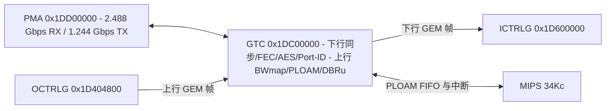

# 6.1 GTC：GPON 传输汇聚

GTC（GPON Transmission Convergence）模块实现 ITU-T G.984.3 下行成帧、RS(255,239) FEC 解码、AES-128 计数器模式解密、GEM Port-ID 过滤、PLOAM 消息收发，以及上行 BWmap 解析、DBRu 报告生成与 T-CONT 突发时序控制。

## 地址空间与时钟域

GTC 寄存器窗口位于物理地址 `0x1DC00000`（KSEG1 `0xBDC00000`），地址跨度 `0x000`–`0x2FC`（在 `0x1DC05000`–`0x1DC052FC` 存在别名映射）。

GTC 跨越两个硬件时钟与复位控制域：

- `SYS_GPE`（`0x1D700000`）：`GPONI`（bit 4，GPE 内部 GPON 接口时钟）与 `GPONE`（bit 5，GPE 外部 GPON 接口时钟）。
- `SYS_GPON`（`0x1DF00000`）：`GTCTX`（bit 0，155.52 MHz / 311.04 MHz 上行发送时钟）、`GTCTXPDI`（bit 1，上行 PDI 寄存器接口时钟）、`GTCRX`（bit 2，311.04 MHz 下行接收时钟）、`GTCRXPDI`（bit 3，下行 PDI 寄存器接口时钟）、`GPEIF`（bit 8，GTC 至 GPE 数据接口时钟）。

## 下行寄存器（`0x000`–`0x0A8`）

下行寄存器块（`GTC_DOWNSTR_PDI`）控制 GTC 帧同步、超帧计数、FEC 解码、AES-128 密钥切换、4096 项 GEM Port-ID 查找表、下行 PLOAM 接收 FIFO 及误码统计：

| 偏移 | 寄存器名 | 功能说明 |
| :--- | :--- | :--- |
| `0x000` | `GTC_DSSTAT_1` | 下行状态寄存器 1 |
| `0x004` | `GTC_DSDELSTAT` | 下行定界状态，`PSDEL`（bits [4:0]）指示 PSync 比特偏移 |
| `0x008` | `GTC_DLOS` | 下行失锁检测配置：`THRLOS`（bits [18:16] 失锁门限）、`THROOL`（bits [14:8] 失步门限）、`INV`（bit 6 极性翻转）、`WIN`（bits [5:0] 检测时间窗） |
| `0x00C` | `GTC_SFWIN` | Signal Fail 检测时间窗（125 µs 帧周期计数，bits [27:0]） |
| `0x010` | `GTC_SDWIN` | Signal Degrade 检测时间窗（bits [27:0]） |
| `0x014` | `GTC_SFTHR` | Signal Fail BIP 误码告警门限（bits [27:0]） |
| `0x018` | `GTC_SDTHR` | Signal Degrade BIP 误码告警门限（bits [27:0]） |
| `0x01C` | `GTC_BERRINTV` | 物理层 BIP 误码采样周期 |
| `0x020` | `GTC_GEMSTINTV` | GEM 统计采样间隔 |
| `0x024` | `GTC_PLTOUT` | PLOAM 接收超时门限 |
| `0x028` | `GEM_RSTAT` | GEM 帧定界状态（`SYNC` bit 0、`HUNT`、`PRE_SYNC`） |
| `0x02C` | `GTC_DSTEST_1` | 下行测试控制寄存器 1 |
| `0x030` | `GTC_DSTEST_2` | 下行测试控制寄存器 2 |
| `0x034` | `GTC_SCON` | 超帧同步控制寄存器 |
| `0x038` | `GTC_DSCON_1` | 下行控制寄存器 1（FEC 解码、解扰、AES 解密使能） |
| `0x03C` | `GTC_SFCNT` | 30-bit 下行超帧计数器（Superframe Counter，bits [29:0]） |
| `0x040`–`0x04C` | `AES_DEKEY1..4` | 128-bit AES 解密密钥（4 × 32-bit） |
| `0x050` | `AES_KEY_SWITCH` | AES 密钥切换超帧时刻（`SWTIME` bits [29:0]） |
| `0x054` | `GTC_RXPID_ADDR` | GEM Port-ID 查找表地址（`ADDR` bits [8:0] 范围 `0..511`，`WRITE` bit 15） |
| `0x058` | `GTC_RXPID_WR` | GEM Port-ID 查找表写数据（每行 8 个 Port-ID） |
| `0x05C` | `GTC_RXPID_RD` | GEM Port-ID 查找表读数据 |
| `0x060`–`0x068` | `GTC_MRX_1..3` | 下行 PLOAM 接收 FIFO（12 字节；读 `GTC_MRX_3` 弹出当前消息） |
| `0x06C` | `GTC_ID` | 本机 ONU-ID（`ONUID` bits [7:0]）与广播 PLOAM 接收使能（`BCAST` bit 8） |
| `0x070` | `GTC_DSISTAT_1` | 下行中断状态寄存器 |
| `0x074` | `GTC_DSIMASK_1` | 下行中断掩码寄存器 |
| `0x078` | `GTC_DSCNTRSTAT` | 下行计数器饱和状态与 GEM 丢帧计数 |
| `0x07C` | `GTC_BERRCNT` | 下行 BIP 比特误码计数 |
| `0x080` | `GEM_HERR_1` | GEM HEC 1-bit 或 2-bit 可纠错计数 |
| `0x084` | `GEM_HERR_2` | GEM HEC 不可纠错计数 |
| `0x088` | `GEM_BWMCERR` | BWmap CRC 可纠错计数 |
| `0x08C` | `GEM_BWMUERR` | BWmap CRC 不可纠错计数 |
| `0x090` | `GEM_RXFCNT` | 接收 GEM 帧计数 |
| `0x094` | `GEM_RXBCNT` | 接收 GEM 字节计数 |
| `0x098` | `GTC_FCERRCNT` | 下行 FEC 可纠字节计数 |
| `0x09C` | `GTC_FUERRCNT` | 下行 FEC 不可纠码字计数 |
| `0x0A0` | `GTC_FRCNT` | 下行 FEC 已纠码字计数 |
| `0x0A4` | `GTC_FRCBCNT` | 下行接收 FEC 总码字计数 |
| `0x0A8` | `GTC_RST_ROGUE` | Rogue ONU 检测复位触发 |

### `GTC_DSSTAT_1`（`0x000`）位域

| 位域 | 名称 | 说明 |
| :--- | :--- | :--- |
| bit 17 | `DFIFO_OFL` | 下行数据 FIFO 溢出 |
| bit 16 | `DFIFO_FULL` | 下行数据 FIFO 满 |
| bit 15 | `DSRES` | 下行硬件复位请求指示 |
| bit 14 | `DSFEC` | 下行 FEC 激活状态（`0` = 未激活，`1` = 激活） |
| bit 13 | `DLOS` | 下行信号丢失（Loss of Signal）状态 |
| bit 12 | `SF` | Signal Fail 告警状态 |
| bit 11 | `SD` | Signal Degrade 告警状态 |
| bits [10:9] | `SFSTATE` | 超帧同步状态机：`0` = `HUNT`，`1` = `PRESYNC`，`2` = `SYNC` |
| bits [8:7] | `STATE` | PSync 帧同步状态机：`0` = `HUNT`，`1` = `PRESYNC`，`2` = `SYNC` |
| bit 6 | `ATM` | 接收到 ATM 分区指示 |
| bits [5:4] | `PLSTAT` | PLOAM 接收状态：`0` = `OK`，`1` = `WARN`，`2` = `ERR` |
| bit 3 | `RXCRCE` | 下行 PLOAM CRC 校验错误 |
| bit 2 | `RXOFL` | 下行 PLOAM FIFO 溢出 |
| bit 1 | `RXFUL` | 下行 PLOAM FIFO 满 |
| bit 0 | `RXDAT` | 下行 PLOAM FIFO 非空（有消息可读） |

### GEM Port-ID 查找表（`GTC_RXPID_*`）

GTC 内部集成 512 行 × 32-bit 查找表，覆盖全部 4096 个 GEM Port-ID。每行（`GTC_RXPID_ADDR.ADDR = 0..511`）存放 8 个连续 Port-ID（`8 * ADDR + k`，`k = 0..7`）的属性，每个 Port-ID 占 4 bits：

| Port-ID 内位偏移 | 位名称 | 功能说明 |
| :--- | :--- | :--- |
| bit 3 | `DEC0..DEC7` | AES-128 解密使能：`0` = 明文直通，`1` = 启用 AES 计数器模式解密 |
| bit 2 | `OMCI0..OMCI7` | OMCI 通道标记：`0` = 普通业务帧，`1` = OMCI 控制帧（送往专用入向通道） |
| bit 1 | `MC0..MC7` | 组播标记：`0` = 单播 GEM 帧，`1` = 组播 GEM 帧 |
| bit 0 | `VAL0..VAL7` | Port-ID 有效位：`0` = 硬件直接丢弃，`1` = 接收并转发至 `ICTRLG` |

写表操作：先向 `GTC_RXPID_WR`（`0x058`）写入 32-bit 数据，再向 `GTC_RXPID_ADDR`（`0x054`）写入 `ADDR | (1 << 15)`（`WRITE = 1`）。读表操作：向 `GTC_RXPID_ADDR` 写入 `ADDR`（`WRITE = 0`），然后从 `GTC_RXPID_RD`（`0x05C`）读出 32-bit 数据。

### AES-128 解密与热切换

下行 AES-128 解密器使用超帧计数器与帧内块计数器生成密钥流。当 OLT 请求更换密钥时，新密钥写入影子寄存器 `AES_DEKEY1..4`（`0x040`–`0x04C`），目标切换超帧号写入 `AES_KEY_SWITCH.SWTIME`（`0x050` bits [29:0]）。当 `GTC_SFCNT`（`0x03C`）到达 `SWTIME` 时，硬件在超帧边界自动将影子密钥加载至工作密钥寄存器。

## 上行寄存器（`0x100`–`0x2FC`）

偏移 `0x0AC`–`0x0FC` 为保留空间，上行寄存器块（`GTC_UPSTR_PDI`）从 `0x100` 开始：

| 偏移 | 寄存器名 | 功能说明 |
| :--- | :--- | :--- |
| `0x100`–`0x108` | `GTC_RTIME_1..3` | 测距均衡时延（EqD）与响应时间配置 |
| `0x10C` | `GTC_USSTAT` | 上行状态（PLOAM 发送 FIFO 空/满、突发状态等） |
| `0x110` | `GTC_USESTAT` | 上行错误状态 |
| `0x114` | `GTC_USCON` | 上行控制（上行 FEC、PLOAMu、DBRu、前导码使能） |
| `0x118` | `GTC_USHDL` | 上行突发物理层开销长度配置 |
| `0x11C`–`0x124` | `GTC_USHDRC_AD/WD/RD` | 上行前导码（Preamble）与定界符（Delimiter）模式 RAM 间接读写口 |
| `0x128` | `GTC_MTX_CTRL` | 上行 PLOAM 发送控制与重复发送次数 |
| `0x12C`–`0x134` | `GTC_MTX_1..3` | 上行 PLOAM 发送寄存器（12 字节；写 `GTC_MTX_3` 触发消息入队） |
| `0x138` | `GTC_USISTAT` | 上行中断状态寄存器 |
| `0x13C` | `GTC_USIMASK` | 上行中断掩码寄存器 |
| `0x140` | `GTC_LASER` | 突发激光器开启提前量与关闭延迟量配置 |
| `0x144` | `GTC_USTEST` | 上行测试模式控制 |
| `0x148` | `GTC_USFETCH` | 向 `OCTRLG` 预取上行数据的提前时间偏移 |
| `0x14C` | `GTC_START_OFFSET` | 上行帧起始时间偏移校正 |
| `0x150`–`0x154` | `GTC_BWMAPWL/WH` | 手动写入 BWmap 测试项（低/高 32 位） |
| `0x158`–`0x1D4` | `GTC_TCONT_0..31` | 32 个硬件 T-CONT 的 Alloc-ID 配置（`ALLOCID` bits [11:0]，`USED` bit 31） |
| `0x1D8`–`0x254` | `GTC_BWMAPRH_0..31` | 32 个 T-CONT 解析出的 BWmap 高位状态 |
| `0x258`–`0x2D4` | `GTC_BWMAPRL_0..31` | 32 个 T-CONT 解析出的 BWmap 低位状态 |
| `0x2D8` | `GTC_FRM_RANGE` | 上行授权帧起止范围检查配置 |
| `0x2DC`–`0x2F0` | `GTC_BWMT_*` | BWmap Trace 捕获控制、状态、掩码、指针及缓冲读取口 |
| `0x2F4` | `GTC_ALL_TC` | 接收到的总 T-CONT 授权计数 |
| `0x2F8` | `GTC_REJ_TC` | 因超出合法范围被拒绝的 T-CONT 授权计数 |

### 上行 BWmap 解析与突发时序

1. **Alloc-ID 匹配**：下行 PCBd 中的 BWmap 数组经 CRC 校验后，与 `GTC_TCONT_0..31`（`0x158`–`0x1D4`）中 `USED = 1` 的 32 个 12-bit `ALLOCID` 并行比对。
2. **时延补偿与预取**：匹配成功的授权项（`StartTime`、`StopTime`、`Flags`）加上 `GTC_RTIME_1..3`（`0x100`–`0x108`）中的均衡时延与 `GTC_START_OFFSET`（`0x14C`）偏移后，在突发窗口到来前按 `GTC_USFETCH`（`0x148`）设定的提前量触发 `OCTRLG` 从对应 T-CONT 读取数据並封装 GEM 帧。
3. **突发激光控制**：在突发起始时刻减去 `GTC_LASER`（`0x140`）开启提前量时，GTC 拉高突发使能信号送往 PMA TX Slice，先发送 `GTC_USHDRC_*` RAM 中存储的 Guard Bits、Preamble 与 Delimiter，再发送 PLOAMu、DBRu 与 GEM 载荷；突发结束时刻加上关闭延迟量后拉低突发使能信号。
