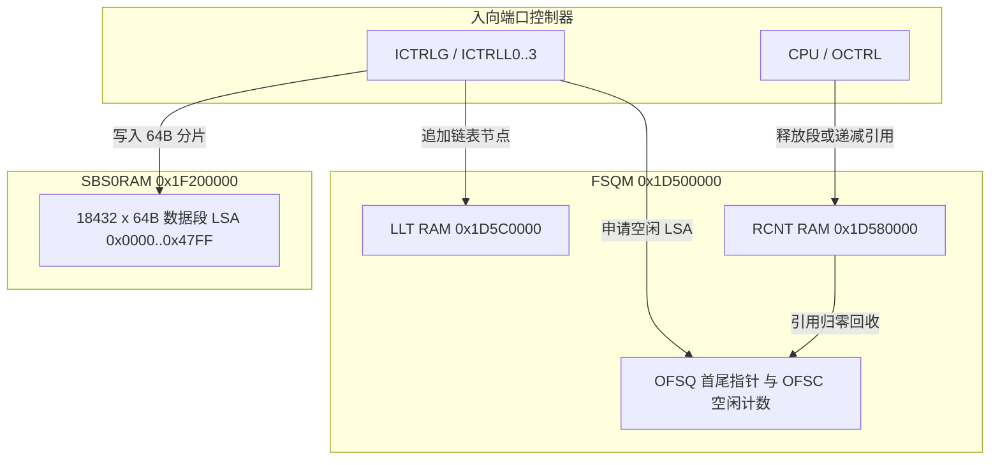

# 6.2 FSQM、SSB0 与 LLT

FSQM（Free Segment Queue Manager）、SSB0（Shared Segment Buffer 0）与 LLT（Linked List Table）构成 GPE 的片上共享报文缓存与段链表分配子系统。所有进入 GPE 的以太网帧、GEM 帧与 OMCI 消息均按 64 字节固定段（Segment）切分存入 SSB0，通过 15-bit 逻辑段地址（LSA，Logical Segment Address）在各硬件模块间传递描述符，避免报文载荷在片上内存间复制。

## 物理地址与硬件参数

| 硬件模块 | 物理基址 | KSEG1 基址 | 地址空间大小 | 说明 |
| :--- | :--- | :--- | :--- | :--- |
| `FSQM` | `0x1D500000` | `0xBD500000` | `0x00100000`（1 MiB） | 控制寄存器、IMQ/OMQ 队列窗口、RCNT 引用计数表与 LLT 链表 RAM |
| `SBS0CTRL` | `0x1F080000` | `0xBF080000` | `0x00000200`（512 B） | SSB0 内存接口控制、总线仲裁与 GPHY 固件窗口重映射寄存器 |
| `SBS0RAM` | `0x1F200000` | `0xBF200000` | `0x00130000`（1216 KiB） | 片上共享段缓存 SRAM |

段缓存与链表硬件规格如下：

- **段大小**：64 字节（`0x40` B）
- **最大报文段数**：`0x4800`（18,432 个段，`LSA` 范围 `0x0000`–`0x47FF`，对应 `18432 × 64 = 1,179,648` 字节 = 1152 KiB 报文缓冲；`SBS0RAM` 其余 64 KiB 可用于片上 GPHY 固件窗口等用途）
- **链表尾空指针（NIL）**：`0x7FFF`
- **段初始引用计数**：`1`（3-bit 引用计数器，支持最大 7 份组播/镜像引用）

## FSQM 寄存器与内部 RAM 映射（`0x1D500000`）

| 偏移 | 寄存器/RAM 名称 | 功能说明 |
| :--- | :--- | :--- |
| `0x00000` | `CTRL` | 全局控制：`AD14..AD0`（bits [30:16] 通道分配禁用掩码）、`RES`（bit 4 软复位）、`ALLOC_DIS`（bit 2 禁用段分配）、`ALLOC_FRZ`（bit 1 冻结分配状态机）、`ACT`（bit 0 模块激活） |
| `0x00004` | `PRIO` | 通道调度优先级（仅 A1x 步进有效） |
| `0x00008` | `IO_BUF_RD` | 15 个客户端读响应缓冲非空状态（bit 0 CPU、bits [5:1] `ICTRLx`、bits [8:6] `PCTRL`、bits [13:9] `OCTRLx`、bit 14 `IQM`） |
| `0x0000C` | `IO_BUF_WR` | 15 个客户端命令输入缓冲非空状态 |
| `0x00010`–`0x00018` | `IRNCR` / `IRNICR` / `IRNEN` | 中断状态、捕获与使能（bit 4 `Nil_Resp`、bit 2 `OFSQ_Underflow`、bit 0 `OFSQ_Overflow`） |
| `0x00020` | `IFSQ` / `TAILCAPR` | A1x 为内部空闲段队列首尾；A2x 为触发帧超长门限时的尾部 LSA 捕获寄存器 |
| `0x00024` | `OFSQ` | 空闲段队列（Free Segment Queue）首尾指针：`HEAD`（bits [14:0]）、`TAIL`（bits [30:16]） |
| `0x00028` | `IFSC` | 内部空闲段队列计数（仅 A1x） |
| `0x0002C` | `OFSC` | 空闲段队列当前可用段数（`LEN` bits [15:0]） |
| `0x00030` | `FSQT0` | 空闲段告警/反压门限 0（bits [15:0]） |
| `0x00070` | `FSQT1` | 空闲段告警/反压门限 1（bits [15:0]） |
| `0x000B0` | `FSQT2` | 空闲段告警/反压门限 2（bits [15:0]） |
| `0x000F0` | `FSQT3` | 空闲段告警/反压门限 3（bits [15:0]） |
| `0x00130` | `FSQT4` | 空闲段告警/反压门限 4（bits [15:0]） |
| `0x00180` | `LSARNG` | 合法 LSA 范围限制：`MINLSA`（bits [14:0]）、`MAXLSA`（bits [30:16]） |
| `0x00190`–`0x0019C` | `RLIMR0..3` | 单帧链表最大段数限制寄存器（防止异常超长帧耗尽缓冲，A2x） |
| `0x040000`–`0x05FFFF` | `IMQ[32768]` | 入向消息队列映射窗口（仅 A1x） |
| `0x060000`–`0x07FFFF` | `OMQ[32768]` | 出向消息队列映射窗口（写 `OMQ[HLSA] = TLSA` 触发整条报文链表的硬件遍历释放） |
| `0x080000`–`0x09FFFF` | `RCNT[32768]` | 段引用计数 RAM（每个 LSA 对应 3-bit `RCNT`） |
| `0x0A0000`–`0x0BFFFF` | `RCNT_INCDEC[32768]` | 段引用计数原子加减窗口 |
| `0x0C0000`–`0x0FFFFF` | `RAM[65536]` | LLT 链表 RAM（`RAM[LSA]` 存放下一段 `NLSA` 或尾标记 `0x7FFF`） |

## 段链表（LLT）分配与回收流程

1. **空闲链初始化**：系统启动时，将 `LSARNG` 设为 `MINLSA = 0x0000`、`MAXLSA = 0x47FF`；在 `RAM[0x0000..0x47FE]` 中依次写入 `i + 1`，在 `RAM[0x47FF]` 中写入 `0x7FFF`；随后设置 `OFSQ.HEAD = 0x0000`、`OFSQ.TAIL = 0x47FF`、`OFSC.LEN = 0x4800`，置位 `CTRL.ACT = 1`。
2. **入向分配与成链**：当 `ICTRLG` 或 `ICTRLL0..3` 接收报文时，每满 64 字节向 FSQM 请求一个段。FSQM 弹出当前 `OFSQ.HEAD` 作为分配的 `LSA`，读取 `RAM[LSA]` 更新为新的 `OFSQ.HEAD`，将 `OFSC.LEN` 减 1，并将 `RCNT[LSA]` 置为 `1`。报文首段记为 `HLSA`（Head LSA），后续段依次写入前一段的 `RAM[prev_LSA]`，末段记为 `TLSA`（Tail LSA）且 `RAM[TLSA] = 0x7FFF`。
3. **空闲水位监测**：硬件实时比较 `OFSC.LEN` 与 5 个门限寄存器 `FSQT0..4`，生成 5 路低水位状态信号送往 `IQM`、`ICTRLG` 与 `ICTRLL0..3`，用于触发入向 WRED/尾丢弃或以太网 Flow Control 反压。
4. **整链释放与引用递减**：当报文发送完成或被 `IQM`/`TMU` 丢弃时，模块将报文的 `HLSA` 与 `TLSA` 提交给 FSQM。FSQM 将链表各段的 `RCNT` 减 1；若减 1 后 `RCNT == 0`，硬件将该段或整条子链追加到 `OFSQ.TAIL` 末尾，更新 `OFSQ.TAIL` 并累加 `OFSC.LEN`。

## SBS0CTRL 寄存器（`0x1F080000`）

`SBS0CTRL` 控制 SSB0 SRAM 的访问时序、多主设备总线仲裁以及片上 GPHY 固件地址重映射：

| 偏移 | 寄存器名 | 功能说明 |
| :--- | :--- | :--- |
| `0x00` | `CTRL` | SSB0 控制器工作模式配置 |
| `0x04` | `STAT` | SSB0 控制器状态寄存器 |
| `0x08` | `ERR` | 非法地址访问错误状态 |
| `0x0C` | `EADR` | 错误访问地址捕获寄存器 |
| `0x10` | `GPHY0IMG` | GPHY0 固件基址重映射（`ADDRV` bits [21:14] 写入 `0x00204000` 指向物理地址 `0x1F204000`） |
| `0x14` | `ARB` | GPE 数据面与 MIPS/GPHY 总线访问仲裁权重配置 |
| `0x18` | `GPHY1IMG` | GPHY1 固件基址重映射（`ADDRV` bits [21:14]） |
| `0x1C` | `BAR0` | 基址窗口寄存器 0（A2x） |
| `0x20` | `BAR1` | 基址窗口寄存器 1（A2x） |
