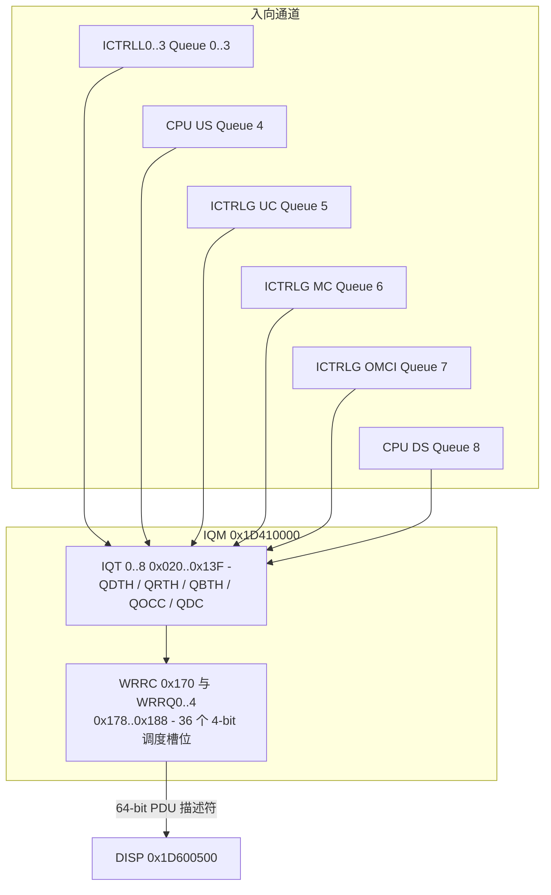

# 6.3 IQM 入队管理

IQM（Ingress Queue Manager）位于入向端口控制器（`ICTRLG`、`ICTRLL0..3`、`CPU`）与分发器（`DISP`）之间，管理 9 条硬件入向队列（Ingress Queues），执行基于段水位与全局空闲段门限的丢包控制、队列反压生成以及向 `DISP` 输出的 36 槽位加权轮询（WRR）调度。

## 地址空间与 9 条硬件入向队列

IQM 寄存器窗口位于物理地址 `0x1D410000`（KSEG1 `0xBD410000`），地址空间大小 `0x00010000`（64 KiB）。其时钟与复位由 `SYS_GPE`（`0x1D700000`）的 `IQM` 位（bit 8，`0x00000100`）控制。

9 条硬件入向队列（Queue `0..8`）具有固定的入向通道绑定关系：

| 队列号 | 通道名称 | 入向来源与业务类型 |
| :--- | :--- | :--- |
| 0 | `LAN_0` | LAN 端口 0（`ICTRLL0`）上行以太网帧 |
| 1 | `LAN_1` | LAN 端口 1（`ICTRLL1`）上行以太网帧 |
| 2 | `LAN_2` | LAN 端口 2（`ICTRLL2`）上行以太网帧 |
| 3 | `LAN_3` | LAN 端口 3（`ICTRLL3`）上行以太网帧 |
| 4 | `CPU_US` | MIPS CPU 注入的上行方向报文 |
| 5 | `GEM_UC` | WAN 侧（`ICTRLG`）下行单播 GEM 业务帧 |
| 6 | `GEM_MC` | WAN 侧（`ICTRLG`）下行组播 GEM 业务帧 |
| 7 | `OMCI` | WAN 侧（`ICTRLG`）下行 OMCI 控制帧 |
| 8 | `CPU_DS` | MIPS CPU 注入的下行方向报文 |

## IQM 寄存器映射（`0x1D410000`）

| 偏移 | 寄存器名 | 功能说明 |
| :--- | :--- | :--- |
| `0x000` | `CTRL` | 全局控制：`TSPRESCALE`（bits [26:24] 时间戳预分频）、`RAW`（bit 2）、`FRZ`（bit 1 冻结调度）、`ACT`（bit 0 模块激活） |
| `0x010`–`0x018` | `IRNCR` / `IRNICR` / `IRNEN` | 中断状态、捕获与使能：`BP8..BP0`（bits [28:20] 队列反压）、`QF8..QF0`（bits [16:8] 队列满）、`IF`（bit 4 内部 FIFO 满）、`CER`（bit 3 命令错）、`DR`（bit 2 丢包事件） |
| `0x020`–`0x13F` | `IQT[0..8]` | 9 条入向队列配置与状态寄存器组（每组占 `0x20` 字节，见下表） |
| `0x140` | `FPCR` | 内部空闲描述符指针计数器（`FPC` bits [10:0]） |
| `0x160` | `GOCC` | IQM 全局段占用计数器（`GOCC` bits [15:0]） |
| `0x164` | `GOTH` | IQM 全局段占用丢弃门限（`GOTH` bits [15:0]） |
| `0x168` | `GPDC` | IQM 全局入向丢包计数器（`GPDC` bits [15:0]） |
| `0x16C` | `TS` | 32-bit 自由运行时间戳计数器 |
| `0x170` | `WRRC` | WRR 调度器周期长度（`PER` bits [5:0]，最大有效槽位数为 36） |
| `0x178`–`0x188` | `WRRQ0..4` | WRR 调度槽位队列号配置表（每个寄存器 8 个 4-bit 槽位，共 36 个有效槽位 `ENTRY0..35`） |
| `0x190` | `SFREE0` | FSQM 空闲段门限 `FSQT0..3` 关联丢弃使能掩码（每个门限 9-bit 对应 Queue 0..8） |
| `0x194` | `SFREE1` | FSQM 空闲段门限 `FSQT4` 关联丢弃使能掩码（bits [8:0] 对应 Queue 0..8） |
| `0x200`–`0x20C` | `DRP0..3` | 最近一次被丢弃报文的 128-bit 描述符与头部信息捕获 |
| `0x210` | `DRC` | 最近一次丢弃原因捕获：`IQN`（bits [19:16] 队列号）、`TAIL_DROP`（bit 4 超过 `QDTH`）、`DEQ_DIS_DROP`（bit 3）、`GOTH_DROP`（bit 2 超过 `GOTH`）、`SFREE_DROP`（bit 1 触发 `FSQT` 低水位）、`QF_DROP`（bit 0 描述符满） |

### 单队列寄存器组（`IQT0..5`，基址 `0x020 + i * 0x20`）

每条入向队列 `i`（`i = 0..8`）包含 6 个 32-bit 寄存器：

| 队列内偏移 | 寄存器名 | 位域与功能说明 |
| :--- | :--- | :--- |
| `+0x00` | `IQT0` | `QE`（bit 31 入队使能）、`QDTH`（bits [27:16] 队列尾部丢弃门限）、`QRTH`（bits [11:0] 队列保留门限）；门限单位为 8 个 64B 段（512B） |
| `+0x04` | `IQT1` | `QB`（bit 31，置位后该队列退出 WRR 调度）、`QBTH`（bits [27:16] 反压触发高门限）、`QBTL`（bits [11:0] 反压解除低门限）；门限单位为 8 个段 |
| `+0x08` | `IQT2` | 实时状态：`QF`（bit 31 有报文等待）、`BP`（bit 30 反压有效）、`POCC`（bits [27:16] 排队 PDU 数）、`QOCC`（bits [14:0] 当前占用段数） |
| `+0x0C` | `IQT3` | `QDC`（bits [31:0] 该队列累计丢弃的 PDU 数，溢出回绕） |
| `+0x10` | `IQT4` | `TICK`：向 DISP 发送 PDU 时递增的计数器；低 8 位随 PDU 元数据传送，供重排使用 |
| `+0x14` | `IQT5` | `TMASK`：报文头分发目标掩码；bits [17:0] 选择六个 PE 的虚拟机组，bits [19:18] 选择 CPU Link 1/0 |

## 入队接纳控制、反压与 WRR 出队调度

1. **接纳控制与门限粒度**：`IQT0.QDTH/QRTH` 与 `IQT1.QBTH/QBTL` 以 **8 个段（512 字节）** 为单位，`IQT2.QOCC` 以单个段为单位。`QE` 控制入队接纳；超过 `QDTH` 后到达的 PDU 触发尾部丢弃。在 `QRTH` 以下，队列拥有保留缓冲配额；超过该门限后，接纳还受全局占用门限 `GOTH` 和 `SFREE0/1` 关联的 FSQM 空闲段水位控制。丢弃计数位于 `IQT3.QDC`，最近一次丢弃原因由 `DRC` 捕获。
2. **迟滞反压机制**：当段占用超过 `QBTH` 对应水位时，IQM 置位 `IQT2.BP` 并向入向接口输出反压；占用降至 `QBTL` 以下时撤销反压。
3. **36 槽位 WRR 调度表**：IQM 出队引擎循环扫描 `WRRQ0..4` 中的 4-bit 槽位（`WRRQ0..3` 各含 8 个槽位，`WRRQ4` 含 4 个有效槽位），`WRRC.PER` 配置调度周期。每个槽位选择队列 `0..8`，`0xF` 表示空槽。被选队列存在等待 PDU 且 `IQT1.QB == 0` 时，IQM 将队首描述符与报文头送往 `DISP`。各队列的槽位密度由 WRR 表配置。
