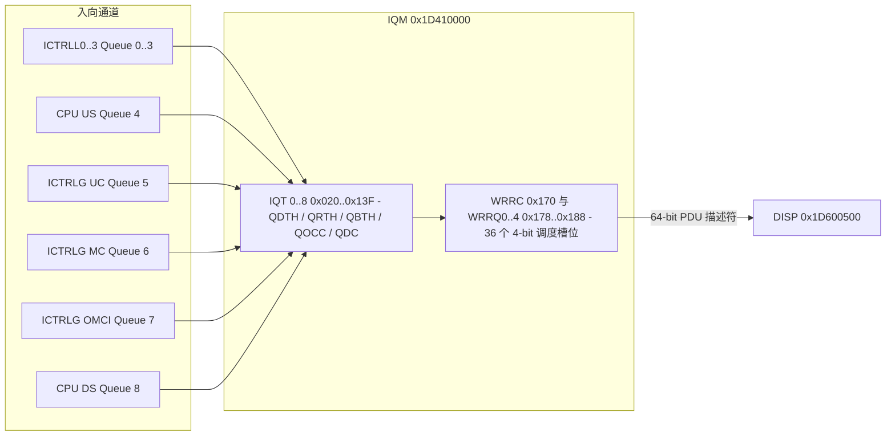

# 6.3 IQM 入队管理

IQM（Ingress Queue Manager）位于入向端口控制器（`ICTRLG`、`ICTRLL0..3`、`CPU`）与分发器（`DISP`）之间，管理 9 条硬件入向队列（Ingress Queues），执行基于段水位与全局空闲段门限的丢包控制、队列反压生成以及向 `DISP` 输出的 36 槽位加权轮询（WRR）调度。

## 地址空间与 9 条硬件入向队列

IQM 寄存器窗口位于物理地址 `0x1D410000`（KSEG1 `0xBD410000`），地址空间大小 `0x00010000`（64 KiB）。其时钟与复位由 `SYS_GPE`（`0x1D700000`）的 `IQM` 位（bit 8，`0x00000100`）控制。

9 条硬件入向队列（Queue `0..8`）具有固定的入向通道绑定关系：

| 队列号 | 通道名称 | 入向来源与业务类型 |
| :--- | :--- | :--- |
| 0 | `LAN_0` | LAN 端口 0（`ICTRLL0`）上行以太网帧 |
| 1 | `LAN_1` | LAN 端口 1（`ICTRLL1`）上行以太网帧 |
| 2 | `LAN_2` | LAN 端口 2（`ICTRLL2`）上行以太网帧 |
| 3 | `LAN_3` | LAN 端口 3（`ICTRLL3`）上行以太网帧 |
| 4 | `CPU_US` | MIPS CPU 注入的上行方向报文 |
| 5 | `GEM_UC` | WAN 侧（`ICTRLG`）下行单播 GEM 业务帧 |
| 6 | `GEM_MC` | WAN 侧（`ICTRLG`）下行组播 GEM 业务帧 |
| 7 | `OMCI` | WAN 侧（`ICTRLG`）下行 OMCI 控制帧 |
| 8 | `CPU_DS` | MIPS CPU 注入的下行方向报文 |

## IQM 寄存器映射（`0x1D410000`）

| 偏移 | 寄存器名 | 功能说明 |
| :--- | :--- | :--- |
| `0x000` | `CTRL` | 全局控制：`TSPRESCALE`（bits [26:24] 时间戳预分频）、`RAW`（bit 2）、`FRZ`（bit 1 冻结调度）、`ACT`（bit 0 模块激活） |
| `0x010`–`0x018` | `IRNCR` / `IRNICR` / `IRNEN` | 中断状态、捕获与使能：`BP8..BP0`（bits [28:20] 队列反压）、`QF8..QF0`（bits [16:8] 队列满）、`IF`（bit 4 内部 FIFO 满）、`CER`（bit 3 命令错）、`DR`（bit 2 丢包事件） |
| `0x020`–`0x13F` | `IQT[0..8]` | 9 条入向队列配置与状态寄存器组（每组占 `0x20` 字节，见下表） |
| `0x140` | `FPCR` | 内部空闲描述符指针计数器（`FPC` bits [10:0]） |
| `0x160` | `GOCC` | IQM 全局段占用计数器（`GOCC` bits [15:0]） |
| `0x164` | `GOTH` | IQM 全局段占用丢弃门限（`GOTH` bits [15:0]） |
| `0x168` | `GPDC` | IQM 全局入向丢包计数器（`GPDC` bits [15:0]） |
| `0x16C` | `TS` | 32-bit 自由运行时间戳计数器 |
| `0x170` | `WRRC` | WRR 调度器周期长度（`PER` bits [5:0]，最大有效槽位数为 36） |
| `0x178`–`0x188` | `WRRQ0..4` | WRR 调度槽位队列号配置表（每个寄存器 8 个 4-bit 槽位，共 36 个有效槽位 `ENTRY0..35`） |
| `0x190` | `SFREE0` | FSQM 空闲段门限 `FSQT0..3` 关联丢弃使能掩码（每个门限 9-bit 对应 Queue 0..8） |
| `0x194` | `SFREE1` | FSQM 空闲段门限 `FSQT4` 关联丢弃使能掩码（bits [8:0] 对应 Queue 0..8） |
| `0x200`–`0x20C` | `DRP0..3` | 最近一次被丢弃报文的 128-bit 描述符与头部信息捕获 |
| `0x210` | `DRC` | 最近一次丢弃原因捕获：`IQN`（bits [19:16] 队列号）、`TAIL_DROP`（bit 4 超过 `QDTH`）、`DEQ_DIS_DROP`（bit 3）、`GOTH_DROP`（bit 2 超过 `GOTH`）、`SFREE_DROP`（bit 1 触发 `FSQT` 低水位）、`QF_DROP`（bit 0 描述符满） |

### 单队列寄存器组（`IQT0..5`，基址 `0x020 + i * 0x20`）

每条入向队列 `i`（`i = 0..8`）包含 6 个 32-bit 寄存器：

| 队列内偏移 | 寄存器名 | 位域与功能说明 |
| :--- | :--- | :--- |
| `+0x00` | `IQT0` | 队列控制：`QE`（bit 2 入队使能）、`QD`（bit 1 出队阻塞）、`QBP`（bit 0 反压生成使能） |
| `+0x04` | `IQT1` | 丢弃门限（单位：8 个 64B 段 = 512B）：`QRTH`（bits [27:16] 队列保留门限）、`QDTH`（bits [11:0] 队列尾部丢弃门限） |
| `+0x08` | `IQT2` | 反压门限（单位：8 个 64B 段 = 512B）：`QBTHL`（bits [27:16] 反压解除低门限）、`QBTHH`（bits [11:0] 反压触发高门限） |
| `+0x0C` | `IQT3` | 实时段水位：`QOCC`（bits [14:0] 当前占用的 64B 段数）、`QBP`（bit 16 当前反压激活标志） |
| `+0x10` | `IQT4` | 丢包统计：`QDC`（bits [15:0] 该队列累计丢弃的报文数） |
| `+0x14` | `IQT5` | 报文水位：`QPOC`（bits [10:0] 当前排队的报文描述符个数） |

## 入队接纳控制、反压与 WRR 出队调度

1. **接纳控制与门限粒度**：`IQT1`（`QDTH`、`QRTH`）与 `IQT2`（`QBTHH`、`QBTHL`）的硬件位域以 **8 个段（512 字节）** 为粒度，与实时段计数 `IQT3.QOCC` 比对时由硬件左移 3 位（`<< 3`）。当新报文到达队列 `i` 时：
   - 若 `QE == 0`，或 `QOCC >= (QDTH << 3)`，硬件拒绝入队并向 FSQM 释放该报文占用的段，同时递增 `IQT4.QDC` 并锁存 `DRC.TAIL_DROP`。
   - 若 `QOCC >= (QRTH << 3)`（已超过该队列专享保留配额），且 `GOCC >= GOTH` 或 `SFREE0/1` 所绑定的 `FSQM.FSQT0..4` 空闲段低水位信号有效，硬件同样丢弃该报文，锁存 `DRC.GOTH_DROP` 或 `DRC.SFREE_DROP`。
2. **迟滞反压机制**：当 `IQT0.QBP == 1` 且 `QOCC >= (QBTHH << 3)` 时，IQM 置位 `IQT3.QBP` 并向对应的入向端口控制器（如 `ICTRLL0..3`）输出反压信号；直到队列排空至 `QOCC <= (QBTHL << 3)` 时才撤销反压。
3. **36 槽位 WRR 调度表**：IQM 出队引擎按 `0..WRRC.PER - 1` 循环扫描 `WRRQ0..4` 中的 4-bit 槽位（`WRRQ0..3` 各含 8 个槽位，`WRRQ4` 含 4 个槽位，共 36 个槽位）。每个槽位填写目标队列号 `0..8`（填写 `0xF` 表示空槽跳过）。若当前槽位指向的队列非空且 `IQT0.QD == 0`，IQM 弹出其队首 64-bit PDU 描述符连同 128-bit 报文头送往 `DISP`。为确保下行 OMCI 消息在高负载下不丢包，队列 7（`OMCI`）在 36 槽位表中分配更高密度的槽位。
