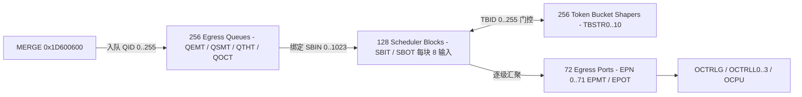

# 6.4 TMU 与 TBM

TMU（Traffic Management Unit）与 TBM（Dual Token Bucket Meter）分别实现 GPE 的出向层次化流量调度与流级双桶速率监管。

## 地址空间与硬件资源规模

| 硬件模块 | 物理基址 | KSEG1 基址 | 地址空间大小 | 硬件资源规模 |
| :--- | :--- | :--- | :--- | :--- |
| `TMU` | `0x1D404000` | `0xBD404000` | `0x00001000`（4 KiB） | 256 出向队列 (`QID`)、128 调度器块 (`SBID`)、1024 调度输入 (`SBIN`)、72 出向端口 (`EPN`)、256 令牌桶整形器 (`TBID`) |
| `TBM` | `0x1D600700` | `0xBD600700` | `0x00000100`（256 B） | 512 令牌桶 (`TBID 0..511`，配对组成 256 组双桶 Meter) |

时钟与复位控制位位于 `SYS_GPE`（`0x1D700000`）：

- `TMU` 位（bit 11，`0x00000800`）：控制 TMU 时钟与模块激活。
- `COP6` 时钟位实际是 bit 30（`0x40000000`）。资源头把 TBM 的功能路由 ID 定义为 14；尚无证据把它等同于 COP6，不能据该 ID 推导 TBM 的独立时钟位。

TMU 的 72 个出向端口（`EPN 0..71`）与预留调度器块（`SBID 0..127`）分配如下：

- `EPN 0..63`：上行 T-CONT 的常规/抢占出向端口空间（输出至 `OCTRLG`，绑定由 `tctable[]` 配置）
- `EPN 64..67`：4 个下行 LAN 物理端口（输出至 `OCTRLL0..3`）
- `EPN 68..71`：4 个虚拟 UNI 端口 `VUNI0..3`（输出至 `OCPU`）
- `SBID 93 + T-CONT 索引`：驱动为 32 个 T-CONT 预留的调度器块；这里不是任意 `EPN` 加 93
- `SBID 125`：异常包（Exception）调度器块
- `SBID 126`：上行 OMCI 调度器块

## TMU 全局寄存器（`0x000`–`0x120`）

| 偏移 | 寄存器名 | 功能说明 |
| :--- | :--- | :--- |
| `0x000` | `CTRL` | 全局控制：`MAXTB`（bits [15:8] 最大激活整形器数）、`RPS`（bit 4 随机丢弃概率缩放）、`DTA`（bit 2 禁用报文截断）、`FRZ`（bit 1 冻结状态机）、`ACT`（bit 0 模块激活） |
| `0x004` | `FPL` | 内部空闲描述符指针链表首尾（`HEAD` bits [11:0]、`TAIL` bits [27:16]） |
| `0x008` | `FPCR` | 空闲描述符指针计数器（`FPC` bits [11:0]） |
| `0x00C` | `FPTHR` | 空闲描述符耗尽门限（`FPTH` bits [11:0]） |
| `0x010` | `TIMER` | 32-bit 内部调度时钟计数器 |
| `0x014` | `LFSR` | WRED 随机丢弃线性反馈移位寄存器种子 |
| `0x018` / `0x01C` | `CPR` / `CSR` | 后台遍历进程速率与状态寄存器 |
| `0x020` | `GOCCR` | TMU 全局段占用计数（`GOCC` bits [16:0]） |
| `0x030`–`0x03C` | `GOTHR0..3` | TMU 全局 4 级色彩丢弃门限（`GOTH0..3`） |
| `0x040`–`0x04C` | `GPDCR0..3` | TMU 全局 4 级丢包计数器 |
| `0x060`–`0x07C` | `QFILL0..7` | 256 条出向队列非空位图（8 × 32-bit） |
| `0x080`–`0x088` | `EPFR0..2` | 72 个出向端口非空位图（3 × 32-bit） |
| `0x0A0`–`0x0BC` | `LPIC0..3` / `LPIT0..3` | LAN 端口 0..3 EEE LPI 控制与空闲计时器 |
| `0x0C0`–`0x0CC` | `ERDR` / `TADSPR` / `CTRLDBG` / `RELOGCTRL` | 错误丢弃捕获、T-CONT 提前调度偏移、调试与重入队控制 |
| `0x100`–`0x108` | `IRNCR` / `IRNICR` / `IRNEN` | 中断状态、捕获与使能（`LPI3..0`、`GOE`、`FPU`、`SBF`、`EPFC`） |
| `0x110` | `TBIDCR` | 令牌桶整形器超限捕获寄存器 |
| `0x120` | `ERINFOCR` | 错误入队请求信息捕获寄存器 |

## TMU 间接访问表与在线重配置口（`0x200`–`0x720`）

TMU 的五张硬件表通过各自的数据传递寄存器加命令寄存器（bit 31 `RW` 指示读写，低位指定表索引）间接访问：

### 1. 出向队列表（Queue Manager Table，`0x200`–`0x270`，索引 `QID 0..255`）

| 偏移 | 寄存器名 | 功能说明 |
| :--- | :--- | :--- |
| `0x200` | `QEMT` | 队列入队使能（`QE`）、丢弃模式（尾部丢弃 / WRED）及色彩门限映射 |
| `0x204` | `QSMT` | 队列状态与绑定的调度器输入端 `SBIN`（`0..1023`） |
| `0x208`–`0x218` | `QTHT0..4` | 队列门限参数：`MAXX`（最大段门限，硬件上限 `2304` 段 = 144 KiB）、`MIT0/MAT0`（Green WRED 最小/最大门限）、`MIT1/MAT1`（Yellow WRED 最小/最大门限）、`SLOPE0/SLOPE1`（8-bit 丢弃概率斜率）及 `QTTH0/1`（保留门限） |
| `0x220`–`0x228` | `QOCT0..2` | 队列占用计数：`WQOC`（指数移动平均段水位）、`QOCC`（实时段占用）、`QPOC`（排队报文数） |
| `0x230`–`0x23C` | `QDCT0..3` | 按颜色（Uncolored/Green、Yellow、Red）统计的队列丢包计数 |
| `0x240`–`0x248` | `QFMT0..2` | 队列内部描述符链表首尾指针（`HQP`、`TQP`） |
| `0x270` | `QMTC` | 队列表间接读写控制寄存器（`RW` bit 31，`QID` bits [7:0]） |

运行中修改队列参数时，需先暂停对应队列的入队使能位并排空队列，写入新的 `QEMT` 与 `QTHT0..4` 后再恢复入队使能。

### 2. 出向端口表（Egress Port Manager Table，`0x300`–`0x340`，索引 `EPN 0..71`）

- `EPMT`（`0x300`）：端口出队使能（`EPE`）及绑定的顶层调度器块 `SBID`。
- `EPOT0..1`（`0x304`–`0x308`）、`EPTT0..1`（`0x30C`–`0x310`）、`EPDT0..3`（`0x318`–`0x324`）：端口级报文占用量、丢弃门限与四色丢包计数器。
- `EPMTC`（`0x340`）：端口表间接读写控制寄存器（`RW` bit 31，`EPN` bits [6:0]）。

### 3. 调度器块表（Scheduler Block Table，`0x400`–`0x430`）

每个调度器块（`SBID 0..127`）具有 8 个输入端（`SBIN = SBID * 8 + leaf`，`leaf = 0..7`）和 1 个输出端：

- **输入表 `SBITR0..3`（`0x400`–`0x40C`）与 `SBITC`（`0x410`，索引 `SBIN 0..1023`）**：配置输入端使能（`SIE`）、反压传递使能（`SBP`）、下级对象类型（绑定队列 `QID` 或下级调度器块 `SBID`）、调度权重 `IWGT`（`0` 表示固定优先级 SP，非零表示 WFQ/WRR 权重）以及关联的令牌桶整形器 `TBID`。
- **输出表 `SBOTR0..1`（`0x420`–`0x424`）与 `SBOTC`（`0x430`，索引 `SBID 0..127`）**：配置调度器块输出去向（`OMOD = 0` 连接至出向端口 `EPN`；`OMOD = 1` 级联至上级调度器输入端 `SBIN`）。

### 4. 令牌桶整形器表（Token Bucket Shaper Table，`0x500`–`0x560`，索引 `TBID 0..255`）

- `TBSTR0..10`（`0x500`–`0x528`）与 `TBSTC`（`0x530`）：每个整形器包含双桶（Bucket 0 对应 PIR，Bucket 1 对应 CIR），配置整形模式 `MOD`、绑定的调度器输入端 `SBIN`、两级桶的速率尾数与指数（`SRM0/SRE0`、`SRM1/SRE1`）、最大突发字节数（`MBS0/MBS1`）以及实时令牌水位（`TBC0/TBC1`）。

### 5. 在线重配置命令口（`0x700`–`0x720`）

- `CFGARG0..3`（`0x700`–`0x70C`）、`CFGSBIN`（`0x710`）、`CFGTBID`（`0x714`）、`CFGEPN`（`0x718`）、`CFGCMD`（`0x720`）：提供硬件状态机原子重绑定命令，用于在流量运行中迁移队列与调度器树节点。

## TBM 双桶流监管器（`0x1D600700`）

TBM（Dual Token Bucket Meter）使用资源头中的功能路由 ID 14，在微码分类处理阶段对命中的业务流执行速率测量与三色标记（Green / Yellow / Red）。

| 偏移 | 寄存器名 | 功能说明 |
| :--- | :--- | :--- |
| `0x000` | `CTRL` | 全局控制：`ACT`（bit 31 激活）、`FRZ`（bit 30 冻结）、`TSPRESCALE`（bits [26:24] 时间戳预分频）、`EPOC`（bits [9:8]）、`CPERIOD`（bits [3:0]） |
| `0x040` | `TBMTR0` | 桶参数 0：`TBE`（bit 31 使能）、`TSS`（bit 30 时间戳缩放）、`CF`（bit 26 耦合标志）、`MOD`（bits [25:24] 模式）、`MRM`（bits [20:10] 速率尾数）、`MRE`（bits [3:0] 速率指数） |
| `0x044` | `TBMTR1` | 桶参数 1：`MBS`（bits [23:0] 最大突发字节数，上限 16 MiB - 1） |
| `0x048` | `TBMTR2` | 桶参数 2：`VTS`（bit 31 时间戳有效位）、`TBC`（bits [24:0] 当前令牌字节水位，bit 24 为符号位） |
| `0x04C` | `TBMTR3` | 桶参数 3：`ETS`（bits [31:20] 扩展时间戳）、`LTS`（bits [19:0] 上次更新时间戳） |
| `0x050` | `TBMTC` | 间接访问控制：`RW`（bit 31，`1` = 写，`0` = 读）、`SEL`（bits [18:16] 寄存器选择掩码）、`TBID`（bits [8:0] 桶编号 `0..511`） |
| `0x054` | `CHCONF` | 协处理器通道请求优先级配置 |
| `0x058` | `TBCONF` | 计量报文长度偏移修正值（`LENOFFS` bits [7:0]） |
| `0x080`–`0x088` | `IRNCR` / `IRNICR` / `IRNEN` | 中断状态、捕获与使能 |

512 个硬件桶按偶/奇索引配对使用（`2*n` 为 CIR 承诺速率桶，`2*n + 1` 为 PIR/EIR 峰值速率桶，共组成 256 组双桶监管器）。`TBMTR0.MOD`（bits [25:24]）支持四种标准计量模式：

- `0`（`MOD_DEFAULT`）：透明直通，不扣减令牌
- `1`（`MOD_RFC4115`）：MEF / RFC 4115 双桶监管模式（支持 `CF` 绿牌溢出耦合至黄牌桶）
- `2`（`MOD_RFC2698_CB`）：RFC 2698 色盲（Color-Blind）trTCM 模式
- `3`（`MOD_RFC2698_CA`）：RFC 2698 色敏（Color-Aware）trTCM 模式

## 本地依据与适用范围

`bsp/modules/onu/drv_onu_reg_tmu.h`、`drv_onu_reg_tbm.h`、`drv_onu_reg_sys_gpe.h` 与 `include/drv_onu_resource_gpe.h`。

上述 `bsp/` 路径按本次审计的 `linux-3.10.49` 基线读取，属于源码/静态固件证据；不将 `linux-7.3` 移植结果或未上板验证的解释当作原固件运行事实。
