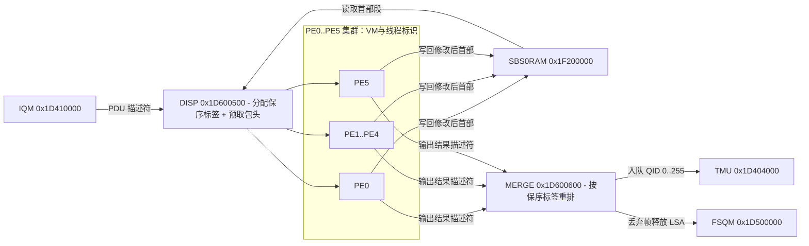

# 6.5 DISP 与 MERGE

DISP（Dispatcher）与 MERGE（Merger）包夹在 6 核可编程包处理集群（PE0–PE5）的两端：DISP 从 IQM 取出报文描述符与包头分片并分发给空闲的 PE 线程，MERGE 收集完成分类与编辑的报文并按入向分配的保序标签（Sequence Number）重排序后送入 TMU。

## 地址空间与时钟域

| 硬件模块 | 物理基址 | KSEG1 基址 | 地址空间大小 | 说明 |
| :--- | :--- | :--- | :--- | :--- |
| `DISP` | `0x1D600500` | `0xBD600500` | `0x00000100`（256 B） | 线程分发控制、SSB 预取长度与 Host Link 注入接口 |
| `MERGE` | `0x1D600600` | `0xBD600600` | `0x00000100`（256 B） | 线程回收控制、硬件重排序窗口、FSQM 释放队列与 Host Link 捕获接口 |

两个模块均位于 GPE 核心时钟域，由 `SYS_GPE`（`0x1D700000`）的 `DISP` 与 `MERGE` / `PE0..5` 相关时钟位控制。

## DISP 寄存器映射（`0x1D600500`）

| 偏移 | 寄存器名 | 功能说明 |
| :--- | :--- | :--- |
| `0x000` | `CTRL` | 全局控制：`FRZO`（bit 2 冻结输出）、`FRZI`（bit 1 冻结输入）、`ACT`（bit 0 模块激活） |
| `0x004` | `TCTRL0` | 虚拟机（VM）与 CPU 链路分发使能位图（bits [19:0]） |
| `0x008` | `TSTAT0` | 虚拟机与 CPU 链路运行状态位图（写 `1` 将对应位清零） |
| `0x00C` | `LCTRL0` | 链路控制寄存器 |
| `0x010` | `LSTAT0` | 链路状态寄存器 |
| `0x014` | `SSBMAX` | 从 `SBS0RAM` 自动预取至 PE 本地缓冲的最大段数（`MAX` bits [2:0]，每段 64B） |
| `0x020`–`0x02C` | `LDATA0..3` | 最近分发报文的数据镜像寄存器 0–3 |
| `0x040`–`0x050` | `LFIFO0..4` | 内部链路 FIFO 水位与状态寄存器 0–4 |
| `0x070` | `LINKHOST` | 主机链路接口状态 |
| `0x080` | `LINK_CTRL` | 主机向 DISP 直接注入控制字/报文的 Link 接口控制 |
| `0x090`–`0x098` | `LINK_IRNCR` / `LINK_IRNICR` / `LINK_IRNEN` | DISP Link 接口中断状态、捕获与使能 |
| `0x0A0` | `LINK_LEN` | Link 接口传输长度 |
| `0x0A4` / `0x0A8` | `LINK_DATA0` / `LINK_DATA1` | Link 接口 64-bit 数据读写寄存器（高/低 32 位） |

### `DISP.TCTRL0`（`0x004`）位域分配

每个 PE（`PE0..PE5`）内部包含 3 个虚拟机（`VM0..VM2`），寄存器注释使用 `Thread 0..3` 子标识。资源头每 PE 线程宏为 8、总线程宏为 56，不能据 VM 标识相乘宣称实现了 72 个物理线程。`DISP.TCTRL0` 按 **VM 粒度** 控制分发使能（共 18 个 VM 位加 2 个 CPU 链路位）：

| 位域 | 位名称 | 对应硬件执行单元 |
| :--- | :--- | :--- |
| bits [2:0] | `T02`、`T01`、`T00` | `PE0` 的 `VM2`、`VM1`、`VM0` |
| bits [5:3] | `T12`、`T11`、`T10` | `PE1` 的 `VM2`、`VM1`、`VM0` |
| bits [8:6] | `T22`、`T21`、`T20` | `PE2` 的 `VM2`、`VM1`、`VM0` |
| bits [11:9] | `T32`、`T31`、`T30` | `PE3` 的 `VM2`、`VM1`、`VM0` |
| bits [14:12] | `T42`、`T41`、`T40` | `PE4` 的 `VM2`、`VM1`、`VM0` |
| bits [17:15] | `T52`、`T51`、`T50` | `PE5` 的 `VM2`、`VM1`、`VM0` |
| bit 18 | `T60` | CPU Link 0 |
| bit 19 | `T61` | CPU Link 1 |

当某个 VM 使能且存在空闲线程时，DISP 从 IQM 取出 64-bit PDU 描述符，依据 `SSBMAX.MAX`（`0x014`）从 `SBS0RAM` 的首段 `HLSA` 连续预取报文头部段写入该线程的局部包头缓冲，并打上递增的保序序号后启动该线程。

## MERGE 寄存器映射（`0x1D600600`）

| 偏移 | 寄存器名 | 功能说明 |
| :--- | :--- | :--- |
| `0x000` | `CTRL` | 全局控制：`TIMEOUTDEACT`（bit 12 禁用超时丢弃）、`INITDONE`（bit 8 初始化完成只读标志）、`INITSTART`（bit 4 启动内部 RAM 初始化）、`FRZO`（bit 2 冻结输出）、`FRZI`（bit 1 冻结输入）、`ACT`（bit 0 模块激活） |
| `0x004` | `TCTRL0` | 线程回收使能寄存器 0（`T000`–`T213`，对应 PE0 VM0..2、PE1 VM0..2、PE2 VM0..1 的 32 个线程） |
| `0x008` | `TCTRL1` | 线程回收使能寄存器 1（`T220`–`T503`，对应 PE2 VM2、PE3 VM0..2、PE4 VM0..2、PE5 VM0 的 32 个线程） |
| `0x00C` | `TCTRL2` | 线程回收使能寄存器 2（`T510`–`T523` 及 CPU Link 线程，对应 PE5 VM1..2 的 8 个线程及主机通道） |
| `0x010` | `NILCOUNTER` | 接收到的空操作（NIL）结果计数 |
| `0x014` | `DISCARDCOUNTER` | 被 PE 标记为丢弃（Discard）的报文计数 |
| `0x018` | `FSQMQ` | 绑定用于向 FSQM 释放丢弃报文段的队列通道配置 |
| `0x020`–`0x028` | `IRNCR` / `IRNICR` / `IRNEN` | MERGE 中断状态、捕获与使能（线程超时、FIFO 溢出等） |
| `0x070` | `LINKHOST` | PE Link 主机接口状态 |
| `0x074` | `TMULINKHOST` | TMU Link 主机接口状态 |
| `0x080`–`0x0A8` | `LINK_CTRL` / `LINK_IRN*` / `LINK_LEN` / `LINK_DATA0..1` | MERGE 主机调试/注入 Link 接口寄存器组 |
| `0x0C0`–`0x0E8` | `TMU_LINK_CTRL` / `TMU_LINK_IRN*` / `TMU_LINK_LEN` / `TMU_LINK_DATA0..1` | 直接向 TMU 发送入队命令的 TMU Link 接口寄存器组 |

## 硬件保序与回收机制

1. **线程粒度使能**：与 `DISP.TCTRL0` 按 VM 控制不同，`MERGE.TCTRL0..2`（`0x004`–`0x00C`）为寄存器编码中的线程标识（`T<pe><vm><thread>`，`pe = 0..5`，`vm = 0..2`，`thread = 0..3`）提供独立的单比特使能位。
2. **乱序重排窗口**：不同 PE 线程处理不同复杂度报文（如单层 VLAN 透传与多层 VLAN + PPPoE + 组播复制）的耗时不同。先执行完的线程将修改后的包头段写回 `SBS0RAM`，并将输出描述符提交给 MERGE。MERGE 内部维护按保序标签索引的重排序缓冲，等待序号更早的报文完成后，按 DISP 分发时的先后顺序向 TMU 发起入队请求。
3. **硬件超时保护与段回收**：
   - 若某报文在 PE 线程中被判定为丢弃，MERGE 递增 `DISCARDCOUNTER`（`0x014`），并通过 `FSQMQ`（`0x018`）通道将该报文的 `HLSA`–`TLSA` 链表直接返还给 FSQM 回收。
   - 若某个线程因异常挂死导致保序窗口阻塞超过硬件看门狗门限（且 `CTRL.TIMEOUTDEACT == 0`），MERGE 触发超时中断并跳过该序号，防止整个数据面锁死。
