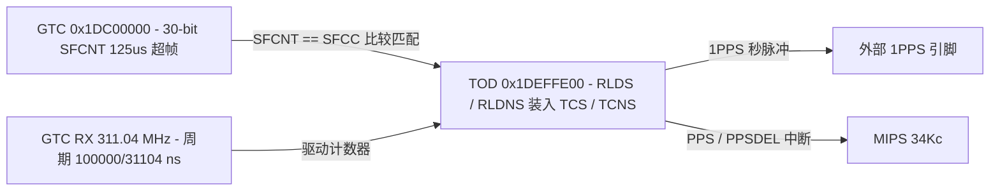

# 6.6 TOD 时间同步

TOD（Time of Day）模块基于下行 GTC 311.04 MHz 恢复时钟与 125 µs 超帧计数器（Superframe Counter），实现 ITU-T G.984.3 AMD2 / G.988 时间同步（IEEE 1588v2 / ToD）以及对外 1PPS 秒脉冲、时间戳串口和 NTR（Network Timing Reference，8 kHz 网络定时基准）信号输出。

## 地址空间与时钟域

TOD 寄存器窗口位于物理地址 `0x1DEFFE00`（KSEG1 `0xBDEFFE00`），地址范围 `0x1DEFFE00`–`0x1DEFFEFF`（大小 `0x100` 字节）。

时钟与引脚复用控制位于 `SYS_GPON`（`0x1DF00000`）：

- `SYS_GPON.CLKS` 的 `TOD` 位（bit 12，`0x00001000`）：控制 TOD 模块时钟与激活。
- `SYS_GPON.VCC`（Voice Clock Control）：控制 NTR 8 kHz 基准输出使能与分频（`NTR8KEN` bit 8、`NTREN` bit 7、`NTRFS` bits [2:0] 支持 8 kHz 至 8192 kHz 输出频率选择）。

## TOD 寄存器映射（`0x1DEFFE00`）

| 偏移 | 寄存器名 | 位域 | 功能说明 |
| :--- | :--- | :--- | :--- |
| `0x000` | `CFG` | `FRM` (bit 31) `INTDEL` (bits [27:16]) `PW` (bits [11:0]) | 全局配置： `FRM`：帧脉冲模式使能； `INTDEL`：相对 1PPS 上升沿的中断延迟时间（单位：100 µs，`0` = 无延迟）； `PW`：1PPS 输出脉冲宽度（单位：100 µs，默认 `0x002` = 200 µs） |
| `0x010` | `RLDNS` | `RLDNSHI` (bits [29:16]) `RLDNSLO` (bits [14:0]) | 纳秒预装载寄存器（Reload Nanoseconds）： `RLDNSHI`：100 µs 整数倍部分（范围 `0..9999`）； `RLDNSLO`：100 µs 内的 311.04 MHz 时钟周期数（范围 `0..31103`，每周期为 `100000 / 31104` ns ≈ `3.21502` ns） |
| `0x014` | `RLDS` | `SEC` (bits [30:0]) | 秒预装载寄存器（Reload Seconds，31-bit 秒值） |
| `0x018` | `SFCC` | `SFCC` (bits [29:0]) | 触发时间装载的目标 30-bit GPON 超帧计数值（Superframe Counter Compare） |
| `0x020` | `TCNS` | `TCNSHI` (bits [29:16]) `TCNSLO` (bits [14:0]) | 当前时间纳秒计数器（Time Counter Nanoseconds，高低位编码同 `RLDNS`） |
| `0x024` | `TCS` | `SEC` (bits [30:0]) | 当前时间秒计数器（Time Counter Seconds） |
| `0x030` | `WCNS` | `WCNSHI` (bits [29:16]) `WCNSLO` (bits [14:0]) | 自由运行墙钟纳秒计数器（Wallclock Counter Nanoseconds） |
| `0x040` | `PPSSEC` | `PPSSEC` (bits [15:0]) | 1PPS 秒低 16 位锁存值（在每次 1PPS 上升沿更新） |
| `0x0F0` | `IRNCR` | `PPS` (bit 1) `PPSDEL` (bit 0) | 中断状态寄存器：`PPS` 为秒脉冲上升沿中断，`PPSDEL` 为经过 `CFG.INTDEL` 延迟后的中断 |
| `0x0F4` | `IRNICR` | `PPS` (bit 1) `PPSDEL` (bit 0) | 中断捕获寄存器 |
| `0x0F8` | `IRNEN` | `PPS` (bit 1) `PPSDEL` (bit 0) | 中断使能寄存器 |

## 双分段纳秒计数器与超帧同步装载原理

### 1. 双分段纳秒编码（`RLDNS` / `TCNS` / `WCNS`）

为消除 311.04 MHz 时钟周期（`3.215020576...` ns）累加时的浮点舍入误差，TOD 硬件将 1 秒（`10^9` ns）划分为两级无损整数计数器：

- **低 15 位 `LO`（bits [14:0]）**：直接对 311.04 MHz 时钟计数，计数范围 `0..31103`。每计满 `31104` 个时钟周期，对应 `31104 / 311.04 MHz = 100 µs`（即 `100,000` ns），此时 `LO` 归零并向 `HI` 进位 1。
- **高 14 位 `HI`（bits [29:16]）**：以 `100 µs` 为单位计数，计数范围 `0..9999`。每计满 `10000` 次（`10000 × 100 µs = 1 s`），`HI` 归零并向秒寄存器 `TCS.SEC`（`0x024`）进位 1，同时在外部引脚产生宽度为 `CFG.PW × 100 µs` 的 1PPS 秒脉冲。

任意纳秒值 `ns`（`0 <= ns < 1,000,000,000`）与寄存器字段 `(HI, LO)` 的硬件换算关系为：

- `HI = ns / 100000`
- `LO = ((ns % 100000) * 31104) / 100000`
- 读回换算：`ns = HI * 100000 + (LO * 100000) / 31104`

### 2. 超帧匹配同步序列

1. OLT 通过 OMCI（如脉冲时间同步管理实体）下发未来某一超帧计数值 `SFC_target`（30-bit，`< 2^30`）对应的标准时间 `(Sec, Nanosec)`。
2. 结合测距均衡时延（EqD）、光纤传播时延与内部固定流水线偏置（以皮秒 `ps` 为单位的有符号修正量 `tod_offset_ps`），计算本地在 `SFC_target` 超帧边界应当装载的修正时间 `(Sec_corr, Nanosec_corr)`。
3. 将 `Nanosec_corr` 拆分为 `RLDNSHI` 与 `RLDNSLO` 写入 `RLDNS`（`0x010`），将 `Sec_corr` 写入 `RLDS`（`0x014`），最后将 `SFC_target` 写入 `SFCC`（`0x018`）。
4. 当下行 GTC 的超帧计数器 `GTC_SFCNT`（`0x1DC0003C`）递增至等于 `SFCC` 的超帧起始沿时，TOD 硬件在单拍内将 `RLDS` 与 `RLDNS` 原子锁存至工作计数器 `TCS`（`0x024`）与 `TCNS`（`0x020`），完成亚微秒级对齐。
5. 当需要输出串口时间报文（如 NMEA/TOD 字符串）时，使能 `IRNEN.PPS` 或 `IRNEN.PPSDEL` 中断，在秒脉冲触发或延迟 `CFG.INTDEL × 100 µs` 后读取 `TCS` 更新下一秒的时间报文。
