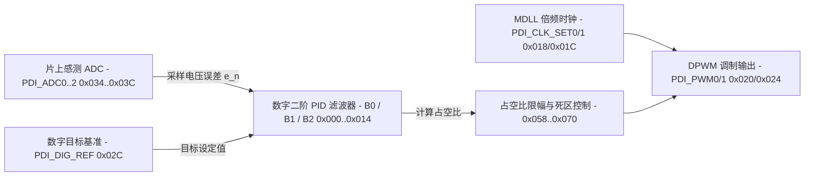

# 6.7 片上 DC/DC（Core、DDR、APD）

Falcon SoC 片上集成三套具有相同数字控制架构的开关电源控制器：1.0V 核心电压转换器（`DCDC_CORE`）、DDR 内存供电转换器（`DCDC_DDR`）以及为雪崩光电二极管（APD）提供高偏置电压的升压转换器（`DCDC_APD`）。

## 地址空间与实例划分

三个 DC/DC 控制器的寄存器块均位于 XBAR 外设区，共用同一套寄存器偏移布局：

| 硬件模块 | 物理基址 | KSEG1 基址 | 地址空间大小 | 用途说明 |
| :--- | :--- | :--- | :--- | :--- |
| `DCDC_CORE` | `0x1E803000` | `0xBE803000` | `0x00000400`（基址头文件公布的映射大小） | 1.0V 数字核心电源（Step-Down Buck） |
| `DCDC_DDR` | `0x1E804000` | `0xBE804000` | `0x00000400`（基址头文件公布的映射大小） | DDR2 / 接口电源（Step-Down Buck） |
| `DCDC_APD` | `0x1E805000` | `0xBE805000` | `0x00000400`（基址头文件公布的映射大小） | 光接收机 APD 高压偏置电源（Step-Up Boost） |

每个寄存器占用 32-bit 地址槽位，有效数据位位于低 8 位（bits [7:0]），下文还列出头文件的振荡器尾部字段（`0x400`、`0x404`），它们超出基址头公布的 `0x400` 映射大小；实际映射/访问范围需单独核对，不能直接按结构尾部推定窗口扩大。



## DC/DC 寄存器映射（偏移 `0x000`–`0x404`）

| 偏移 | 寄存器名 | 位域 | 功能说明 |
| :--- | :--- | :--- | :--- |
| `0x000` | `PDI_PID_HI_B0` | `COEFF_B0` (bits [7:0]) | 数字 PID 系数 `B0` 高字节（有符号二补码） |
| `0x004` | `PDI_PID_LO_B0` | `COEFF_B0` (bits [7:0]) | 数字 PID 系数 `B0` 低字节 |
| `0x008` | `PDI_PID_HI_B1` | `COEFF_B1` (bits [7:0]) | 数字 PID 系数 `B1` 高字节 |
| `0x00C` | `PDI_PID_LO_B1` | `COEFF_B1` (bits [7:0]) | 数字 PID 系数 `B1` 低字节 |
| `0x010` | `PDI_PID_HI_B2` | `COEFF_B2` (bits [7:0]) | 数字 PID 系数 `B2` 高字节 |
| `0x014` | `PDI_PID_LO_B2` | `COEFF_B2` (bits [7:0]) | 数字 PID 系数 `B2` 低字节 |
| `0x018` | `PDI_CLK_SET0` | `MDLL_BYP` (bit 7), `CLK_SEL_PWM` (bit 6), `MDLL_MUL` (bits [5:0]) | MDLL 时钟配置 0：旁路使能、PWM 时钟源选择与倍频系数 `MDLL_MUL` |
| `0x01C` | `PDI_CLK_SET1` | `ADC_CLK_MODE` (bit 4), `MDLL_IX2` (bit 3), `MDLL_RES` (bits [2:0]) | MDLL 时钟配置 1：ADC 采样时钟模式、电流倍增与电阻档位 |
| `0x020` | `PDI_PWM0` | `CPLOAD` (bits [7:0]) | DPWM 计数器预装载值（决定 PWM 周期） |
| `0x024` | `PDI_PWM1` | `DC_STATIC` (bits [7:0]) | 开环静态模式下的固定占空比设定值 |
| `0x028` | `PDI_BIAS_VREG` | `I_RED` (bit 5), `VREG_SEL` (bits [4:3]), `VREF` (bits [2:0]) | 内部基准与 LDO 调节电压档位选择 |
| `0x02C` | `PDI_DIG_REF` | `VREF_DIG` (bits [7:0]) | 闭环控制的目标数字基准值（决定稳压输出电压） |
| `0x030` | `PDI_GENERAL` | `TEST_DIG` (bit 7), `OC_RANGE` (bit 6), `ARM_SET` (bit 5), `EN_PWM` (bit 4), `MODE_PWM` (bits [3:2]), `P_FREEZE` (bit 1), `C_FREEZE` (bit 0) | 通用控制：PWM 输出使能（`EN_PWM`）、PWM 模式选择（`MODE_PWM`）、PID 参数冻结（`P_FREEZE`）与控制器冻结（`C_FREEZE`） |
| `0x034` | `PDI_ADC0` | `OS_CORR` (bits [7:3]), `GAIN_CAL` (bit 2), `FILT_DIS` (bit 1), `COMP_EN` (bit 0) | 误差感测 ADC 配置 0：失调校准、增益校准、滤波禁用与比较器使能 |
| `0x038` | `PDI_ADC1` | `CURR` (bits [7:4]), `SH_INIT` (bits [3:0]) | 误差感测 ADC 配置 1：偏置电流与采样保持初始值 |
| `0x03C` | `PDI_ADC2` | `ADC_TIMING` (bits [6:0]) | 误差感测 ADC 采样时序配置 |
| `0x040`–`0x04C` | `PDI_CONF_TEST_*` | `TEST` (bits [7:0]) | 模拟与数字测试多路复用配置（含 `_NOAUTO` 非自动锁存镜像） |
| `0x050` | `PDI_DCDC_STATUS` | `MDLL_LOCK` (bit 7), `READ_ADC` (bits [6:0]) | 实时状态：bit 7 为 MDLL 锁定指示，bits [6:0] 为有符号 ADC 读数 |
| `0x054` | `PDI_PID_STATUS` | `OV` (bit 4), `SATHI` (bit 3), `SATLO` (bit 2), `LCN` (bit 1), `LCP` (bit 0) | PID 运算状态：算术溢出（`OV`）、高/低限饱和（`SATHI`/`SATLO`）与极限环指示 |
| `0x058` | `PDI_DUTY_CYCLE` | `READ_DUTY` (bits [7:0]) | 当前闭环输出的实时 PWM 占空比读数 |
| `0x05C` | `PDI_NON_OV_DELAY` | `DEL_N` (bits [7:4]), `DEL_P` (bits [3:0]) | 上下桥臂开关管非交叠死区延迟配置（防止直通短路） |
| `0x060` | `PDI_ANALOG_GAIN` | `ACT_LOAD` (bit 5), `DUTY_SEL` (bit 4), `L_SENSE` (bits [3:2]), `A_GAIN` (bits [1:0]) | 模拟前端增益、电感感测档位与假负载使能 |
| `0x064` | `PDI_DUTY_CYCLE_MAX_SAT` | `DC_MAX_SAT` (bits [7:0]) | 饱和恢复时的占空比上限值 |
| `0x068` | `PDI_DUTY_CYCLE_MIN_SAT` | `DC_MIN_SAT` (bits [7:0]) | 饱和恢复时的占空比下限值 |
| `0x06C` | `PDI_DUTY_CYCLE_MAX` | `DC_MAX` (bits [7:0]) | 正常闭环运行的最大允许占空比 |
| `0x070` | `PDI_DUTY_CYCLE_MIN` | `DC_MIN` (bits [7:0]) | 正常闭环运行的最小允许占空比 |
| `0x074` | `PDI_ERROR_MAX` | `E_MAX` (bits [7:0]) | 触发快速饱和保护的最大允许误差门限 |
| `0x078` | `PDI_ERROR_READ` | `E_READ` (bits [7:0]) | 当前闭环控制误差读数 |
| `0x07C` | `PDI_DELAY_DEGLITCH` | `ALARM_DGL` (bits [7:4]), `ADC_DEL` (bits [3:0]) | 告警去毛刺时间与 ADC 触发延迟 |
| `0x080` / `0x084` | `PDI_LATCH_CONTROL` | `LATCH_CONTROL` (bits [6:0]) | 寄存器阴影锁存控制（及 `_NOAUTO` 窗口） |
| `0x088` | `PDI_CAP_CLK_CNT` | `CARD_CNT` (bits [7:0]) | 电容时钟计数读数 |
| `0x08C` | `PDI_MDLL_DIVIDER` | `DIVIDER` (bits [2:0]) | MDLL 反馈分频比配置 |
| `0x400` | `OSC_PDI_OSC_CONF` | 已定义控制位在 bits [7:0] | 内部振荡器配置寄存器；见映射范围说明 |
| `0x404` | `OSC_PDI_OSC_STATUS` | `CLK_FREQ` bit 0 | 内部振荡器状态寄存器；见映射范围说明 |

## 数字 PID 闭环与 APD 升压控制

### 1. 二阶数字 PID 传输函数

每个 PWM 周期内，误差 ADC 在 `PDI_DELAY_DEGLITCH.ADC_DEL` 指定的相位采样输出电压反馈值，并与目标基准 `PDI_DIG_REF`（`0x02C`）相减得到当前误差 `e[n]`。数字滤波器利用 3 个 16-bit 有符号系数 `B0`（`0x000`/`0x004`）、`B1`（`0x008`/`0x00C`）、`B2`（`0x010`/`0x014`）可用如下常见增量 PID 关系帮助理解；本地寄存器头只证明系数字段存在，尚未验证硬件的定点缩放、舍入、饱和位置与精确递推式：

```text
u[n] = u[n-1] + B0 * e[n] + B1 * e[n-1] + B2 * e[n-2]
```

计算结果经 `PDI_DUTY_CYCLE_MIN`（`0x070`）与 `PDI_DUTY_CYCLE_MAX`（`0x06C`）限幅后送入 DPWM 模块。

### 2. 芯片出厂校准熔丝（Fusing）

片上 eFuse 中存储有针对每颗芯片的 `offset_dcdc_core`、`gain_dcdc_core`、`offset_dcdc_ddr`、`gain_dcdc_ddr` 以及 `offset_dcdc_apd`、`gain_dcdc_apd` 校准字节，初始化时写入 `PDI_ADC0` 与 `PDI_DIG_REF` 以消除工艺偏差。

### 3. APD 温度随动调压（`DCDC_APD`）

雪崩光电二极管（APD）的击穿电压随环境温度升高而上升。在闭环运行期间，根据片上温度传感器测得的实时温度查表得到目标 APD 偏置电压对应的 `PDI_DIG_REF` 与最大占空比限制 `PDI_DUTY_CYCLE_MAX`，置位 `PDI_GENERAL.P_FREEZE` 更新参数后再解除冻结，从而维持 APD 倍增因子（M 值）恒定。

## 本地依据与适用范围

`bsp/modules/optic/drv_optic_reg_base.h`、`drv_optic_reg_dcdc.h` 与 `drv_optic_ll_dcdc_apd.c`。寄存器字段不构成输出电压、环路稳定性或校准质量的实测证明。

上述 `bsp/` 路径按本次审计的 `linux-3.10.49` 基线读取，属于源码/静态固件证据；不将 `linux-7.3` 移植结果或未上板验证的解释当作原固件运行事实。
