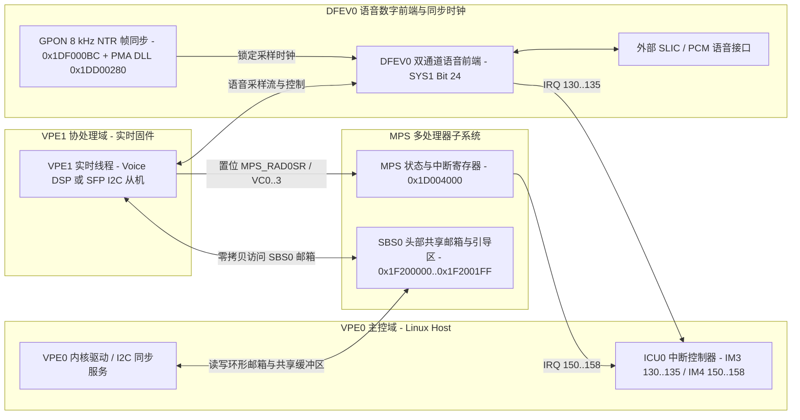

# 6.8 多处理器子系统（MPS）与语音数字前端（DFEV0）

Falcon SoC 的 MIPS32 34Kc 处理器包含两个硬件虚拟处理单元（`VPE0` 与 `VPE1`）。为支持双核间无锁通信、引导向量传递以及语音 DSP 业务处理，芯片集成了**多处理器子系统（Multi-Processor Subsystem，`MPS`）**与**双通道语音数字前端（Digital Front-End Voice 0，`DFEV0`）**。

---

## 地址空间、时钟门控与电源管理

`MPS` 与 `DFEV0` 的时钟使能、同步复位与模块休眠全部由 `SYS1` 控制器（物理基址 `0x1EF00000`）统一管理：

| 硬件模块 | 物理地址范围 | KSEG1 虚拟基址 | `SYS1` 控制位掩码 | 硬件职责说明 |
| :--- | :--- | :--- | :--- | :--- |
| `MPS` 寄存器块 | `0x1D004000`–`0x1D004FFF` | `0xBD004000` | `bit 25` (`0x02000000`) | 跨 VPE 核间中断触发、语音通道状态指示、硬件信号量与芯片标识（`MPS_CHIPID`） |
| `MPS` 共享邮箱（`mpsmbx`） | `0x1F200000`–`0x1F2001FF` | `0xBF200000` | 随 `SBS0` 开启 | 位于 `SBS0` 片上 SRAM 起始 `512 B` 窗口，存放 `VPE0`/`VPE1` BootROM 引导描述符、软复位魔数及上下行环形邮箱 |
| `DFEV0` 语音数字前端 | 片上专用 DSP 外设通道 | 由 `SYS1` 与 `VPE1` 控制 | `bit 24` (`0x01000000`) | 双通道语音编解码数字前端（Channel 0 / Channel 1），负责 PCM/ZSI 接口收发、抽取/插值滤波与外置 SLIC 控制 |

在 `SYS1`（`0x1EF00000`）中，`bit 25`（`MPS`）与 `bit 24`（`DFEV0`）横跨以下控制寄存器：

- `SYS1.CLKS`（`0x00`）/ `CLKEN`（`0x04`）/ `CLKCLR`（`0x08`）：读取、开启或关闭 `MPS`（bit 25）与 `DFEV0`（bit 24）时钟。
- `SYS1.ACTS`（`0x20`）/ `ACT`（`0x24`）/ `DEACT`（`0x28`）/ `RBT`（`0x2C`）：模块激活、去激活与单周期同步复位脉冲控制。
- `SYS1.PDCFG`（`0x40`）：`PDCFG_DFEV0`（`bit 24`）控制 `DFEV0` 硬件宏单元的低功耗掉电门控。在无语音接口的 SFP 光模块形态下，软件置位 `PDCFG_DFEV0` 关闭语音数字前端以降低整机功耗。

---

## MPS 核间中断与控制寄存器（`0x1D004000`）

`MPS` 寄存器块提供 `VPE0` 与 `VPE1` 之间的硬件事件通知机制，包含 4 个语音通道状态组（`VC0`–`VC3`）与 2 个通用模拟/数字前端状态组（`AD0`、`AD1`）：

| 偏移 | 寄存器名称 | 访问属性 | 位域与功能说明 |
| :--- | :--- | :--- | :--- |
| `0x0000` | `MPS_VC0ENR` | R/W | 语音通道 0（`VC0`）中断使能寄存器 |
| `0x0010` | `MPS_RVC0SR` | RO | 语音通道 0 原始中断状态寄存器（Raw Status） |
| `0x0030` | `MPS_CVC0SR` | WO | 语音通道 0 状态清除寄存器（写 1 清除对应状态位） |
| `0x0034` | `MPS_CVC1SR` | WO | 语音通道 1 状态清除寄存器 |
| `0x0038` | `MPS_CVC2SR` | WO | 语音通道 2 状态清除寄存器 |
| `0x003C` | `MPS_CVC3SR` | WO | 语音通道 3 状态清除寄存器 |
| `0x0040` | `MPS_RAD0SR` | RO | **AFE/DFE 0 原始状态寄存器**：`bit 0 (DU_MBX)` 为上行数据邮箱非空中断，`bit 1 (CU_MBX)` 为上行命令邮箱非空中断，`bit 2 (DD_MBX)` 为下行数据邮箱交接标志，`bit 3 (CD_MBX)` 为下行命令邮箱交接标志，高比特位指示命令错误、看门狗失败或过温告警 |
| `0x0044` | `MPS_RAD1SR` | RO | **AFE/DFE 1 原始状态寄存器** |
| `0x0048` | `MPS_SAD0SR` | WO | **AFE/DFE 0 状态置位寄存器**：软件写 1 可直接强制置位 `RAD0SR` 中的对应事件位以触发核间中断 |
| `0x004C` | `MPS_SAD1SR` | WO | **AFE/DFE 1 状态置位寄存器** |
| `0x0050` | `MPS_CAD0SR` | WO | **AFE/DFE 0 状态清除寄存器**：写 1 清除 `RAD0SR` 中已挂起的中断标志 |
| `0x0054` | `MPS_CAD1SR` | WO | **AFE/DFE 1 状态清除寄存器** |
| `0x0058` | `MPS_AD0ENR` | R/W | **AFE/DFE 0 中断使能寄存器**：控制 `RAD0SR` 中各状态位是否向 `ICU0` 输出 `MPS_IR4` 中断 |
| `0x005C` | `MPS_AD1ENR` | R/W | **AFE/DFE 1 中断使能寄存器**：控制 `RAD1SR` 中各状态位是否向 `ICU0` 输出 `MPS_IR5` 中断 |
| `0x0344` | `MPS_CHIPID` | RO | **芯片标识寄存器**：`VERSION [31:28]`（4-bit 芯片修订号）、`PARTNUM [27:12]`（16-bit 部件号）、`MANID [10:1]`（10-bit JEDEC 制造商 ID）、`ONE [0]`（恒为 `1`） |

---

## MPS 共享邮箱与 BootROM 引导描述符（`0x1F200000`）

`SBS0` 内存的起始 `512 B`（物理地址 `0x1F200000`–`0x1F2001FF`，KSEG1 `0xBF200000`–`0xBF2001FF`）由片上 BootROM 与 `MPS` 架构共同定义为双核引导配置区与核间通信邮箱（`mpsmbx`）。

### 1. 双核 BootROM 引导配置区（`0x1F200000`–`0x1F20003F`）

前 64 字节平均划分为 `CPU0`（`VPE0`）与 `CPU1`（`VPE1`）两个 32 字节的引导描述符表（`MBX_CPU0_BOOT_CFG` 与 `MBX_CPU1_BOOT_CFG`）：

| 物理地址 | 偏移 | 字段名称 | 硬件与 BootROM 行为说明 |
| :--- | :--- | :--- | :--- |
| `0x1F200000` | `+0x00` | `CPU0_BOOT_RVEC` | `VPE0` 复位引导向量地址 |
| `0x1F200004` | `+0x04` | `CPU0_BOOT_NVEC` | `VPE0` 普通异常向量地址 |
| `0x1F200008` | `+0x08` | `CPU0_BOOT_EVEC` | `VPE0` EJTAG 调试异常向量地址 |
| `0x1F20000C` | `+0x0C` | `CPU0_CP0_STATUS` | `VPE0` 初始 `CP0 Status` 寄存器值 |
| `0x1F200010` | `+0x10` | `CPU0_CP0_EEPC` | `VPE0` 错误异常返回地址（`ErrorEPC`）与热启动软复位跳转指针 |
| `0x1F200014` | `+0x14` | `CPU0_CP0_EPC` | `VPE0` 普通异常返回地址（`EPC`） |
| `0x1F200018` | `+0x18` | `CPU0_BOOT_SIZE` | `VPE0` 镜像字节长度 |
| `0x1F20001C` | `+0x1C` | `CPU0_CFG_STAT` | `VPE0` 引导配置状态字 |
| `0x1F200020` | `+0x20` | `CPU1_BOOT_RVEC` / `BOOT_PW1` | **复用字段**：1. 启动 `VPE1` 时写入 `VPE1` 固件入口地址（例如 `0xA0FC0000`）；2. 触发全芯片看门狗软重启前写入魔数 1 `0x4C545100`（ASCII `'LTQ\0'`） |
| `0x1F200024` | `+0x24` | `CPU1_BOOT_NVEC` / `BOOT_PW2` | **复用字段**：1. `VPE1` 普通异常向量；2. 软重启前写入魔数 2 `0x0051544C`（ASCII `'\0QTL'`）。若 BootROM 在看门狗复位后检测到 `PW1`/`PW2` 匹配，则直接跳转至 `0x1F200010`（`CPU0_CP0_EEPC`）执行快速热引导 |
| `0x1F200028` | `+0x28` | `CPU1_BOOT_EVEC` | `VPE1` 异常向量地址 |
| `0x1F20002C` | `+0x2C` | `CPU1_CP0_STATUS` | `VPE1` 初始 `CP0 Status` 值 |
| `0x1F200030` | `+0x30` | `CPU1_CP0_EEPC` | `VPE1` `ErrorEPC` 保存值 |
| `0x1F200034` | `+0x34` | `CPU1_CP0_EPC` | `VPE1` `EPC` 保存值 |
| `0x1F200038` | `+0x38` | `CPU1_BOOT_SIZE` | **VPE1 镜像长度 / 引导释放标志**：当 `VPE0` 将固件拷贝至 `VPE1` 专属内存区并填写 `CPU1_BOOT_RVEC` 后，向 `+0x38` 写入非零镜像字节数（或就绪标志），正在 BootROM 自旋等待的 `VPE1` 随即退出轮询并跳转至 `CPU1_BOOT_RVEC` 执行（对于加密语音固件，可调用 BootROM 内置的 `0xBF000290` 解密入口） |
| `0x1F20003C` | `+0x3C` | `CPU1_CFG_STAT` | `VPE1` 引导配置状态字 |

### 2. 环形邮箱与看门狗监控区（`0x1F200040`–`0x1F2001FF`）

当 `VPE1` 运行语音 DSP 固件时，`0x1F200040`–`0x1F2001FF`（`448 B`）被组织为四组硬件无关的环形 FIFO 指针头与共享数据池：

- **`0x1F200040`–`0x1F20007F`（FIFO 描述符头，64 B）**：依次存放上行命令队列（`MBX_UPSTR_CMD`）、下行命令队列（`MBX_DNSTR_CMD`）、上行语音数据队列（`MBX_UPSTR_DATA`）和下行语音数据队列（`MBX_DNSTR_DATA`）各自的基址指针（`BASE`）、字节容量（`SIZE`）、写索引（`WRITE`）与读索引（`READ`）。
- **`0x1F200080`–`0x1F2001AF`（邮箱有效载荷池）**：存放上下行控制命令消息与语音分组描述符。
- **`0x1F2001B0`（`VPE1_WDOG_CTR`，偏移 `+0x1B0` / `432`）**：`VPE1` 实时固件心跳计数器，由 `VPE0` 定时监控以检测 `VPE1` 是否发生死锁。

---

## DFEV0 语音数字前端与 GPON NTR 时钟同步

### 1. DFEV0 双通道架构与 NTR 锁相机制

`DFEV0` 为双通道语音信号数字前端硬件加速模块（包含 `Channel 0` 与 `Channel 1`），负责在片上语音 DSP（`VPE1`）与外部模拟用户线接口电路（SLIC）之间执行实时 PCM/ZSI 采样流传输、硬件抽取/插值滤波及信令状态机控制。

在 GPON 语音接入场景下，为避免语音采样时钟与局端 OLT 时钟频偏导致语音缓冲区滑码（Slip），硬件支持将语音采样时钟直接锁定至 GPON 下行 `8 kHz` 超帧时钟：

1. **GPON NTR（Network Timing Reference）参考时钟输出**：通过置位 `GPON_SYS`（`0x1DF00000`）偏移 `0xBC` 寄存器的 `bit 0`，使能由 `GTC` 下行恢复时钟分频导出的 `8 kHz` / `1.536 MHz` NTR 同步脉冲。
2. **PMA 语音 DLL/PLL 唤醒**：通过配置 `PMA` 的 `GPON_PLL_SLICE_PDI.PMD_RESETCONTROL`（`0x1DD00280`），清除 `DLL_PD`（`bit 11 = 0x800`）并置位 `DLL_RSTN`（`bit 10 = 0x400`），释放片上延迟锁相环（DLL）复位，为 `DFEV0` 提供与光链路同源同相的语音主时钟。

### 2. MPS 与 DFEV0 在 `ICU0` 中的中断映射汇总

`DFEV0` 的 6 路收发/通用中断映射在 `ICU0` 的 **`IM3` 组（高 6 位 `bits [31:26]`）**，而 `MPS` 的 9 路核间中断映射在 **`IM4` 组（`bits [22:14]`）**：

| 所属模块 | `ICU0` 组与位号 | 位掩码 | Linux 虚拟 IRQ | 中断源符号 | 硬件触发条件说明 |
| :--- | :--- | :--- | :--- | :--- | :--- |
| `DFEV0` | `IM3 bit 26` | `0x04000000` | `130` | `DFEV0_2TX` | 语音通道 1（Channel 1）发送 FIFO 中断 |
| `DFEV0` | `IM3 bit 27` | `0x08000000` | `131` | `DFEV0_2RX` | 语音通道 1（Channel 1）接收 FIFO 中断 |
| `DFEV0` | `IM3 bit 28` | `0x10000000` | `132` | `DFEV0_2GP` | 语音通道 1（Channel 1）通用事件中断 |
| `DFEV0` | `IM3 bit 29` | `0x20000000` | `133` | `DFEV0_1TX` | 语音通道 0（Channel 0）发送 FIFO 中断 |
| `DFEV0` | `IM3 bit 30` | `0x40000000` | `134` | `DFEV0_1RX` | 语音通道 0（Channel 0）接收 FIFO 中断 |
| `DFEV0` | `IM3 bit 31` | `0x80000000` | `135` | `DFEV0_1GP` | 语音通道 0（Channel 0）通用事件中断 |
| `MPS` | `IM4 bit 14` | `0x00004000` | `150` | `MPS_IR0` (`VC0`) | 语音通道 0 状态中断（受 `MPS_VC0ENR` 掩码控制） |
| `MPS` | `IM4 bit 15` | `0x00008000` | `151` | `MPS_IR1` (`VC1`) | 语音通道 1 状态中断 |
| `MPS` | `IM4 bit 16` | `0x00010000` | `152` | `MPS_IR2` (`VC2`) | 语音通道 2 状态中断 |
| `MPS` | `IM4 bit 17` | `0x00020000` | `153` | `MPS_IR3` (`VC3`) | 语音通道 3 状态中断 |
| `MPS` | `IM4 bit 18` | `0x00040000` | `154` | `MPS_IR4` (`AD0`) | AFE/DFE 0 邮箱与事件中断（受 `MPS_AD0ENR` 控制，主命令/数据上行通道） |
| `MPS` | `IM4 bit 19` | `0x00080000` | `155` | `MPS_IR5` (`AD1`) | AFE/DFE 1 邮箱与事件中断（受 `MPS_AD1ENR` 控制） |
| `MPS` | `IM4 bit 20` | `0x00100000` | `156` | `MPS_IR6` (`VC_AD_ALL`) | `VC0..3` 与 `AD0..1` 的逻辑或汇总中断 |
| `MPS` | `IM4 bit 21` | `0x00200000` | `157` | `MPS_IR7` (`SEM`) | 跨核硬件信号量（Hardware Semaphore）释放中断 |
| `MPS` | `IM4 bit 22` | `0x00400000` | `158` | `MPS_IR8` (`GLB`) | `MPS` 全局错误与系统级中断 |
