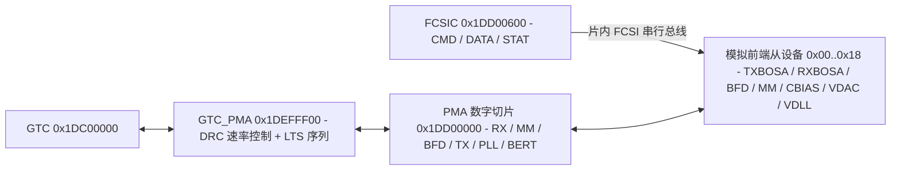

# 7.1 PMA 与 FCSI 总线

GPON PMA（Physical Medium Attachment）子层与 FCSI（Fast Control Serial Interface）控制器构成片上 2.48832 Gbps 下行接收与 1.24416 Gbps 上行突发发送的数模混合前端。PMA 数字切片通过 MMIO 寄存器直接控制，模拟前端（TXBOSA、RXBOSA、TXOMU、RXOMU、MM、VDAC、BFD、PI、CBIAS、VDLL）挂载在片内 FCSI 串行控制总线上。

## 地址空间映射

| 硬件模块 | 物理基址 | KSEG1 基址 | 地址空间大小 | 功能说明 |
| :--- | :--- | :--- | :--- | :--- |
| `PMA` | `0x1DD00000` | `0xBDD00000` | `0x00000400`（1 KiB） | PMA 六大数字控制切片（RX、MM、BFD、TX、PLL、BERT） |
| `FCSIC` | `0x1DD00600` | `0xBDD00600` | `0x00000020`（32 B） | FCSI 串行控制总线主控制器 |
| `PMA_INT200` | `0x1DD00700` | `0xBDD00700` | `0x00000010`（16 B） | 200 MHz 时钟域中断控制（`IRNCR` / `IRNICR` / `IRNEN`） |
| `PMA_INTTX` | `0x1DD00720` | `0xBDD00720` | `0x00000010`（16 B） | TX 时钟域中断控制（`IRNCR` / `IRNICR` / `IRNEN`） |
| `PMA_INTRX` | `0x1DD00740` | `0xBDD00740` | `0x00000010`（16 B） | RX 时钟域中断控制（`IRNCR` / `IRNICR` / `IRNEN`） |
| `GTC_PMA` | `0x1DEFFF00` | `0xBDEFFF00` | `0x00000100`（256 B） | GTC 与 PMA 间的速率选择与激光器训练序列发生器（LTS） |
| `SYS_GPON` | `0x1DF00000` | `0xBDF00000` | `0x00000100`（256 B） | GPON 子系统时钟门控、复位控制与 NTR 定时配置 |

## PMA 六大数字切片映射（`0x1DD00000`）

PMA 寄存器空间按偏移划分为 6 个功能切片（Slice）：

### 1. `GPON_RX_SLICE_PDI`（`0x080`–`0x0E8`）

负责 2.48832 Gbps 下行时钟数据恢复（CDR）、判决反馈均衡（DFE）、模拟前端失调校准以及时钟失锁（LOL，Loss of Lock）监测：

| 偏移 | 寄存器名 | 功能说明 |
| :--- | :--- | :--- |
| `0x080`–`0x08C` | `CDR1` / `CDR2` / `CDR3` / `MONITORCDR` | 数据通路 CDR1..3 与监测通路 CDR 相位控制 |
| `0x090`–`0x09C` | `CDR1LF` / `CDR2LF` / `CDR3LF` / `MONITORLF` | CDR 环路滤波器参数配置 |
| `0x0A0` / `0x0A4` | `CDR3DSM` / `CDR3DSMREAD` | CDR3 Delta-Sigma 调制器控制与频偏读数 |
| `0x0A8`–`0x0B4` | `DATA_HI` / `DATA_LO` / `MONITOR` / `MONITORREAD` | 主数据抽样比较器与监测抽样比较器阈值控制 |
| `0x0B8` / `0x0BC` | `EDGE_FALL` / `EDGE_RISE` | 下降沿与上升沿相位抽样器控制 |
| `0x0C0` | `DFECTRL` | 接收判决反馈均衡器（DFE）系数控制 |
| `0x0C4`–`0x0CC` | `CALCTRL` / `CALREAD` / `CALWRITE` | 接收比较器失调校准状态机控制与读写值 |
| `0x0D0` / `0x0D4` | `LOL_ALARMCFG_LO` / `LOL_ALARMCFG_HI` | CDR 失锁（Loss of Lock）告警高低频偏门限 |
| `0x0D8`–`0x0E4` | `MONITOR_COUNT_CFG` / `DIFF_COUNT` / `ERR_COUNT0..1` | 眼图裕度监测抽样计数与误码比较统计 |
| `0x0E8` | `AFECTRL` | 接收模拟前端控制寄存器 |

### 2. `GPON_MM_SLICE_PDI`（`0x100`–`0x160`）

控制 10 通道测量模块（Measurement Module）ADC 采样流水线，详见 [7.3 光学校准表与 DDM](03_laser_calibration.md)。

### 3. `GPON_BFD_SLICE_PDI`（`0x180`–`0x1F4`）

控制背光监测二极管（Monitor Photodiode，MPD）跨阻放大器（TIA）、P0（逻辑 0 电平）与 P1（逻辑 1 电平）双环自动功率控制（Dual-Loop APC/AMC）环路，详见 [7.2 BOSA 收发器控制](02_bosa_and_laser_control.md)。

### 4. `GPON_TX_SLICE_PDI`（`0x200`–`0x21C`）

控制上行突发数据通路、偏置电流通路与激光器开启时序：

| 偏移 | 寄存器名 | 功能说明 |
| :--- | :--- | :--- |
| `0x200` | `DATAPATH` | 上行调制数据通路控制（反相、预加重时钟分频与数据选择） |
| `0x204` | `BIASPATH` | 上行偏置电流通路控制 |
| `0x208` | `DATA_DELAY` | 调制数据相对偏置开启的比特延迟对齐 |
| `0x20C` | `LASER_ENABLE` | 激光器使能控制与软启动配置 |
| `0x210` | `LASER_BITDELAY` | 激光器突发开启/关闭比特级微调延迟 |
| `0x214` | `PI_CTRL` | 发送相位插值器（Phase Interpolator）控制 |
| `0x218` / `0x21C` | `MODULATOR_1` / `MODULATOR_2` | 调制电流驱动器控制寄存器 1–2 |

### 5. `GPON_PLL_SLICE_PDI`（`0x280`–`0x2B0`）

控制片上锁相环（PLL）与物理介质相关（PMD）子模块的软复位：

| 偏移 | 寄存器名 | 功能说明 |
| :--- | :--- | :--- |
| `0x280` | `PMD_RESETCONTROL` | 各模拟子模块（TXBOSA、RXBOSA、BFD、MM、PLL）独立复位释放控制 |
| `0x284`–`0x29C` | `CTRL1`–`CTRL7` | PLL 分频比、电荷泵、环路滤波器与 VCO 频段配置 |
| `0x2A0`–`0x2A8` | `A_CTRL1`–`A_CTRL3` | PLL 模拟偏置与参考时钟输入配置 |
| `0x2AC` | `STATUS` | PLL 锁定状态与 VCO 校准状态 |
| `0x2B0` | `PMA_TOP_CTRL` | PMA 顶层多路复用控制 |

### 6. `GPON_PMA_BERT_PDI`（`0x300`–`0x318`）

内置硬件误码率测试仪（BERT）：包含 `BERT_CONTROL`（`0x300`）、`BERT_PATTERN`（`0x304` PRBS 码型选择）、`BERT_CLK`（`0x308`）、`BERT_CNT`（`0x30C`）、`BERT_STATUSCTRL`（`0x310`）、`BERT_WRDCNT`（`0x314` 发送/接收字计数）及 `BERT_ERRCNT`（`0x318` 比特误码计数）。

## GTC_PMA 桥接与 LTS 发生器（`0x1DEFFF00`）

`GTC_PMA` 模块连接 GTC 与 PMA，提供上下行速率切换与 640-bit 可编程激光训练序列发生器（Laser Training Sequence）：

| 偏移 | 寄存器名 | 位域 | 功能说明 |
| :--- | :--- | :--- | :--- |
| `0x000` | `DRC` | `DSDLY` (bits [18:16]) `USDR` (bit 1) `DSDR` (bit 0) | 数据速率控制：下行相位延迟（`DSDLY`）、上行速率选择（`USDR`：`0` = 1.244 Gbps，`1` = 2.488 Gbps）、下行速率选择（`DSDR`） |
| `0x004` | `LTSC` | `EN` (bit 31) `ENL` (bit 30) `LEN` (bits [6:0]) | 激光训练序列控制：`EN` 启用序列发生器，`ENL` 保持使能，`LEN` 指定序列有效字节长度（范围 `2..78` 字节） |
| `0x080`–`0x0CC` | `LTSDATA0..19` | `DATA` (bits [31:0]) | 20 × 32-bit（共 80 字节）自定义训练码型缓冲 |

## FCSIC 串行总线控制器（`0x1DD00600`）

FCSI 是片内专用的高速 16-bit 寄存器读写串行总线，用于访问模拟前端（AFE）中的 16-bit 控制寄存器。主控制器 `FCSIC` 包含 5 个寄存器：

| 偏移 | 寄存器名 | 位域 | 功能说明 |
| :--- | :--- | :--- | :--- |
| `0x00` | `CTRL` | `ERR/RR/XE/XR`（bits 3:0） | 对应四类 FCSI 中断使能 |
| `0x04` | `STAT` | `ERR` (bit 3) `RR` (bit 2) `XE` (bit 1) `XR` (bit 0) | 状态寄存器：`ERR`（传输错误）、`RR`（Read Ready，读数据就绪）、`XE`（Transmit Empty，发送 FIFO 空）、`XR`（Transmit Ready，可写入下一笔数据） |
| `0x08` | `INTR` | `ERR` / `RR` / `XE` / `XR` | FCSI 中断状态与使能位 |
| `0x0C` | `CMD` | `CMD` (bits [15:13]) `AI` (bit 12) `LEN` (bits [11:8]) `ADDR` (bits [7:0]) | 传输命令寄存器： `CMD`：`0` = `WRITE`，`1` = `READ`，`2` = `RST`，`3` = `BUS_RST`，`4` = `CMD_RST`，`5` = `RES_RST`； `AI`：地址自动递增（`0` = 不递增，`1` = 递增）； `LEN`：突发传输字数； `ADDR`：8-bit FCSI 从设备寄存器地址（`0x00`–`0x18`） |
| `0x10` | `DATA` | `DATA` (bits [15:0]) | 16-bit 读写数据 FIFO 窗口 |

### FCSI 从设备地址分配（`ADDR 0x00`–`0x18`）

| FCSI 地址范围 | 从设备模块名 | 内部寄存器数量 | 功能说明 |
| :--- | :--- | :--- | :--- |
| `0x00`–`0x07` | `TXBOSA` | 8（`DDC0..1`、`BDC0..1`、`CTRL`、`CC`、`PH`、`PDS`） | BOSA 激光调制驱动器与偏置电流源模拟前端 |
| `0x08`–`0x0A` | `TXOMU` | 3（`TXDC`、`CTRL`、`CC`） | 外置光模块（OMU）发送端模拟接口 |
| `0x0B` | `RXBOSA` | 1（`CTRL`） | BOSA 接收机跨阻输入与 CDR 模拟前端控制 |
| `0x0D` | `RXOMU` | 1（`CTRL`） | 外置光模块（OMU）接收端模拟接口 |
| `0x0E` | `MM` | 1（`CTRL`） | 测量模块模拟多路复用器与基准源控制 |
| `0x0F` | `VDAC` | 1（`CTRL`） | 通用电压型数模转换器（VDAC）模拟控制 |
| `0x10`–`0x12` | `BFD` | 3（`GVS`、`CTRL0`、`CTRL1`） | 背光监测二极管（MPD）模拟跨阻增益与共模控制 |
| `0x13` | `PI` | 1（`CTRL`） | 相位插值器模拟电流控制 |
| `0x14`–`0x15` | `CBIAS` | 2（`CTRL0`、`CTRL1`） | 芯片全局带隙基准（Bandgap）与偏置电流源校准 |
| `0x18` | `VDLL` | 1（`CTRL`） | 电压延迟锁相环（VDLL）模拟控制 |

### FCSI 硬件读写序列

- **单字写操作**：等待 `STAT.XR == 1`，向 `DATA`（`0x10`）写入 16-bit 数据，再向 `CMD`（`0x0C`）写入 `(0 << 13) | (1 << 8) | addr`（`CMD = WRITE`、`LEN = 1`），最后轮询等待 `STAT.XE == 1` 确认移位完成。
- **单字读操作**：向 `CMD`（`0x0C`）写入 `(1 << 13) | (1 << 8) | addr`（`CMD = READ`、`LEN = 1`），轮询等待 `STAT.RR == 1`，然后从 `DATA`（`0x10`）读出低 16 位数据。
