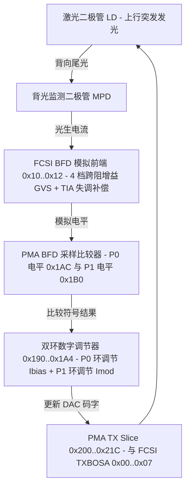

# 7.2 BOSA 收发器控制

Falcon SoC 支持两种光学前端工作模式：**BOSA 模式**（片上直接驱动双向光组件中的激光二极管与接收探测器，通过背光二极管构成闭环自动功率/消光比控制）与 **OMU 模式**（通过外部激光驱动器芯片连接光收发模块）。本节说明 BOSA 发送驱动器（`TXBOSA`）、接收前端（`RXBOSA`）及背光监测双环反馈单元（`BFD`）的硬件结构。

## TXBOSA 激光器驱动与偏置控制（FCSI `0x00`–`0x07`）

`TXBOSA` 位于 FCSI 地址 `0x00`–`0x07`，包含调制电流驱动器（Data Driver，控制 `I_mod`）与偏置电流源（Bias Driver，控制 `I_bias`）的模拟配置寄存器：

| FCSI 地址 | 寄存器名 | 位域 | 功能说明 |
| :--- | :--- | :--- | :--- |
| `0x00` | `TXBOSA_DDC0` | `FT` (bits [15:12]) `BLCD` (bit 11) `RTN` (bits [4:0]) | 调制驱动控制 0：上升/下降沿微调（`FT`）、基线漂移补偿禁用（`BLCD`）、负端端接电阻校准（`RTN`） |
| `0x01` | `TXBOSA_DDC1` | `ENPD` (bit 15) `CMR` (bits [14:10]) `RTP` (bits [4:0]) | 调制驱动控制 1：预驱动使能（`ENPD`）、共模电阻档位（`CMR`）、正端端接电阻校准（`RTP`） |
| `0x02` | `TXBOSA_BDC0` | `FT` (bits [15:12]) `BLCD` (bit 11) `RTN` (bits [4:0]) | 偏置驱动控制 0：偏置通路微调与负端端接校准 |
| `0x03` | `TXBOSA_BDC1` | `ENPD` (bit 15) `CMR` (bits [14:10]) `RTP` (bits [4:0]) | 偏置驱动控制 1：偏置通路预驱动与正端端接校准 |
| `0x04` | `TXBOSA_CTRL` | `PRE` (bit 7) `PDD` (bit 6) `PDB` (bit 5) `CED` (bit 4) `CE` (bit 3) `OP` (bit 2) `SE` (bit 1) `FFR` (bit 0) | 顶层控制：预加重使能（`PRE`）、数据驱动断电（`PDD`）、偏置驱动断电（`PDB`）、芯片使能（`CED`/`CE`）、输出极性（`OP`）、单端模式（`SE`）、快速滚降（`FFR`） |
| `0x05` | `TXBOSA_CC` | `PCM` (bits [14:11]) `PRTP` (bits [10:6]) `PRTN` (bits [5:1]) `CINV` (bit 0) | 电流控制：共模可编程电流（`PCM`）、正负端电流微调（`PRTP`/`PRTN`）、时钟反相（`CINV`） |
| `0x06` | `TXBOSA_PH` | `PBEN` (bits [12:11]) `PRTPB` (bits [10:7]) `PRTNB` (bits [6:3]) `RST` (bit 2) `RD` (bits [1:0]) | 相位与预偏置控制 |
| `0x07` | `TXBOSA_PDS` | `PSPRE` (bits [14:10]) `PCMD` (bits [9:6]) `PBENDD` (bits [5:0]) | 功率级分段驱动强度选择（决定 3 档发射功率等级 Power Level 0..2 的模拟电流跨度） |

## RXBOSA 接收模拟前端（FCSI `0x0B`）

`RXBOSA_CTRL`（FCSI 地址 `0x0B`）配置 2.488 Gbps 接收机跨阻输入缓冲、基线恢复与 CDR 模拟开关：

| 位域 | 名称 | 功能说明 |
| :--- | :--- | :--- |
| bit 14 | `C3OM` | CDR3 输出监测使能 |
| bit 13 | `DLCOM` | 双环校准输出监测使能 |
| bit 12 | `CINV` | 采样时钟极性反相 |
| bit 11 | `RST` | RXBOSA 模拟电路复位 |
| bits [10:8] | `TDS` | 测试数据信号多路选择 |
| bits [7:4] | `CDRM` / `CDRD` / `CDRF` / `CDRR` | 监测 CDR、数据 CDR、下降沿与上升沿抽样器使能 |
| bit 3 | `ISOM` | 隔离模式控制 |
| bits [2:0] | `BLCH` / `BLCL` / `BLCM` | 高、低、监测通道基线恢复（Baseline Wander Correction）控制 |

## 背光监测与双环控制（BFD：FCSI `0x10`–`0x12` 与 PMA `0x180`–`0x1F4`）

在突发上行发送期间，BOSA 内部的背光监测光电二极管（MPD）感应激光器尾光电流，送入片上 BFD（Back-Facet Diode）通道。BFD 由模拟前端（FCSI `0x10`–`0x12`）与数字双环控制器（PMA `0x1DD00180`–`0x1DD001F4`）共同组成。

### 1. FCSI `BFD` 模拟前端寄存器（`0x10`–`0x12`）

| FCSI 地址 | 寄存器名 | 位域 | 功能说明 |
| :--- | :--- | :--- | :--- |
| `0x10` | `BFD_GVS` | `GAIN3..0` (bits [15:0]) | 4 个 4-bit 跨阻增益校准档位（`GAIN0` bits [3:0]、`GAIN1` bits [7:4]、`GAIN2` bits [11:8]、`GAIN3` bits [15:12]） |
| `0x11` | `BFD_CTRL0` | `BLLD` (bits [15:12]) `VCM0V5` (bits [11:9]) `VCM0V6` (bits [8:6]) `CDRO` (bit 5) `RTSEL` (bits [4:3]) `BLCD` (bit 2) `CMSEL` (bits [1:0]) | 模拟共模电压（0.5V / 0.6V）、端接电阻选择（`RTSEL`）与基线时间常数控制 |
| `0x12` | `BFD_CTRL1` | `PDLS` (bits [14:12]) `IRED` (bit 11) `LDO` (bits [10:8]) `RINV` (bit 7) `CINV` (bit 6) `RST` (bit 5) `BLAP1` (bits [4:3]) `BLAP0` (bits [2:1]) `TDSEL` (bit 0) | 光电二极管电平移位（`PDLS`）、内部 LDO 电压档位、P0/P1 基线孔径控制（`BLAP0`/`BLAP1`） |

### 2. PMA `GPON_BFD_SLICE_PDI` 数字双环寄存器（`0x1DD00180`–`0x1DD001F4`）

| 偏移 | 寄存器名 | 功能说明 |
| :--- | :--- | :--- |
| `0x180`–`0x188` | `THRESHOLD_CTRL` / `SUMCTRL` / `SUM_PERSISTENCY` | 偏置与调制电流之和（`I_bias + I_mod`）过流保护门限与持续计数 |
| `0x18C` | `SATURATION` | 环路饱和门限配置 |
| `0x190` / `0x194` | `DUAL_LOOP_MOD_Init` / `DUAL_LOOP_BIAS_INIT` | 调制电流环（`MOD_INIT`）与偏置电流环（`BIAS_INIT`）初始码字装载 |
| `0x198` / `0x19C` | `DUAL_LOOP_MOD_STATUS` / `DUAL_LOOP_BIAS_STATUS` | 双环当前实时输出的调制电流与偏置电流码字只读状态 |
| `0x1A0` / `0x1A4` | `LOOP_REGULATION_BIAS` / `LOOP_REGULATION_MODULATION` | 偏置环与调制环步进增益、积分阈值与环路使能控制 |
| `0x1A8` | `TIAOFFSET` | MPD 跨阻放大器粗调与细调失调（Offset）补偿 DAC 码字 |
| `0x1AC` | `P0LEVEL` | 逻辑 `0` 光功率目标参考电压 DAC 设定值（`P0` 环比较基准） |
| `0x1B0` | `P1LEVEL` | 逻辑 `1` 光功率目标参考电压 DAC 设定值（`P1` 环比较基准） |
| `0x1B4` | `COMPARATOR_STATUS` | P0 与 P1 比较器实时输出状态 |
| `0x1B8` / `0x1BC` | `P0_DUAL_LOOP` / `P0_DATAPATH` | P0 采样通道环路滤波与连 `0` 游程匹配配置 |
| `0x1C0`–`0x1C8` | `P1_DUAL_LOOP` / `COMPAREPATTERN` / `P1_DATAPATH` | P1 采样通道环路滤波、特定比特码型匹配触发（Pattern Match）与数据路径配置 |
| `0x1CC`–`0x1D4` | `P1_BFD_POWERSAVE` / `P0_BFD_POWERSAVE` / `POWERSAVE` | 突发间隙（Burst Off）期间 BFD 模拟电路省电门控 |
| `0x1D8` / `0x1DC` | `P0_TRACE` / `P1_TRACE` | P0 与 P1 采样历史轨迹捕获寄存器 |
| `0x1E0` | `DATA_DELAY` | 发射比特流与 MPD 反馈采样点之间的环路延迟对齐（校正光电响应延迟） |
| `0x1E4` / `0x1E8` | `DAC_CTRL` / `GAIN_CTRL` | 内部参考 DAC 控制与跨阻增益自动切换控制 |
| `0x1EC`–`0x1F4` | `COMPARATOR_STATUSIB` / `BIASLOWSAT_CTRL` / `BIASLOWTHRESHOLD_CTRL` | 低偏置电流饱和限制与欠流告警阈值 |

## 双环控制（Dual-Loop Control）工作原理

1. **连码匹配采样**：由于 GPON 上行采用 1.244 Gbps 突发传输且 MPD 带宽有限，高频交替码型的光电信号存在码间干扰。硬件通过 `COMPAREPATTERN`（`0x1C4`）与 `DATA_DELAY`（`0x1E0`）对齐上行发射比特流，仅在出现连续多个 `0`（如 CID 连零段或特定连 `0` 数据段）的中心位置触发 `P0` 比较器采样，在出现连续多个 `1` 的中心位置触发 `P1` 比较器采样。
2. **开环与闭环切换**：
   - **开环模式（Open-Loop）**：禁用 `LOOP_REGULATION_BIAS`（`0x1A0`）与 `LOOP_REGULATION_MODULATION`（`0x1A4`）自动步进，直接根据实时芯片温度查表获取目标 `Ibias` 与 `Imod` 写入 `DUAL_LOOP_BIAS_INIT`（`0x194`）与 `DUAL_LOOP_MOD_Init`（`0x190`）。
   - **双闭环模式（Dual-Loop）**：将温度补偿后的目标光功率参考值写入 `P0LEVEL`（`0x1AC`）与 `P1LEVEL`（`0x1B0`）。每次上行突发中，硬件根据 `P0` 比较器符号自动微调 `Ibias`，根据 `P1` 比较器符号微调 `Imod`，并监控 `THRESHOLD_SUMCTRL`（`0x184`）防止激光器老化导致过流损坏。

## 本地依据与适用范围

`bsp/modules/optic` 的 `drv_optic_reg_fcsi_txbosa.h`、`drv_optic_reg_fcsi_rxbosa.h`、BFD/PMA 寄存器头与 `drv_optic_ll_mpd.c`。开闭环及采样原理是对字段用途的说明，不是本板光功率/安全裕量测量。

上述 `bsp/` 路径按本次审计的 `linux-3.10.49` 基线读取，属于源码/静态固件证据；不将 `linux-7.3` 移植结果或未上板验证的解释当作原固件运行事实。
