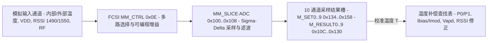

# 7.3 光学校准表与 DDM

PMA 测量模块（Measurement Module，MM）集成多通道模拟多路复用器与 Sigma-Delta ADC，支持最多 10 个时分复用测量槽位，用于实时采集芯片内部温度、外部热敏电阻温度、供电电压（VCC）、1490 nm 下行接收光功率（RSSI 1490）、1550 nm 视频叠加光功率（RSSI 1550）以及射频功率，并配合温度补偿查找表校准激光器与 APD 工作点。

## MM 模拟前端与数字切片寄存器

测量模块由 FCSI 模拟控制寄存器 `MM_CTRL`（FCSI 地址 `0x0E`）、带隙基准控制 `CBIAS_CTRL0..1`（FCSI 地址 `0x14`–`0x15`）以及 PMA 数字测量切片 `GPON_MM_SLICE_PDI`（物理基址 `0x1DD00100`）组成。

### 1. FCSI `MM_CTRL`（`0x0E`）与 `CBIAS_CTRL0..1`（`0x14`–`0x15`）

| FCSI 地址 | 寄存器名 | 位域 | 功能说明 |
| :--- | :--- | :--- | :--- |
| `0x0E` | `MM_CTRL` | `CINV` (bit 14) `OPBIAS` (bits [13:12]) `REFEN` (bit 11) `FBSEL` (bits [10:8]) `RVS` (bits [7:5]) `TINN` (bits [4:2]) `TINP` (bits [1:0]) | 测量模块模拟控制：ADC 时钟极性（`CINV`）、运放偏置（`OPBIAS`）、内部电压基准使能（`REFEN`）、反馈电阻档位（`FBSEL`）、参考电压分压选择（`RVS`）以及差分测试输入正负端选择（`TINP`/`TINN`） |
| `0x14` | `CBIAS_CTRL0` | `BG` (bits [15:8]) `IREF` (bits [7:0]) | 全局带隙基准电压（Bandgap）与基准电流源出厂校准值 |
| `0x15` | `CBIAS_CTRL1` | `TEMP` (bits [15:0]) | 片上温度传感器偏置电流配置 |

### 2. PMA `GPON_MM_SLICE_PDI`（`0x1DD00100`–`0x1DD00160`）

| 偏移 | 寄存器名 | 功能说明 |
| :--- | :--- | :--- |
| `0x100` | `ADC` | 测量 ADC 模拟与数字滤波器控制 |
| `0x104` | `MMADC_CLK` | 测量 ADC 采样时钟分频与门控配置 |
| `0x108` | `M_TIME_CONFIG` | 多路复用通道切换建立时间（Settling Time）与单通道积分采样周期配置 |
| `0x10C`–`0x130` | `M_RESULT_0`–`M_RESULT_9` | 10 个测量槽位的 16-bit 滤波后 ADC 采样结果寄存器 |
| `0x134`–`0x158` | `M_SET_0`–`M_SET_9` | 10 个测量槽位的通道输入源、正负端多路选择及增益档位配置寄存器 |
| `0x15C` | `ALARM_CFG` | 激光器安全过流与接收机过载硬件告警门限配置 |
| `0x160` | `MM_CFG` | 轮询扫描状态机使能与有效槽位掩码 |

## 10 通道测量槽位与物理量换算

`M_SET_0`–`M_SET_9`（`0x134`–`0x158`）定义循环扫描的测量项目：

- **基准校准槽位（Channels 0–5）**：测量内部基准电阻与短接零点，用于实时扣除运放失调电压（Offset）与增益温漂（Gain Drift）。
- **片内与外部温度（Channels 6–7）**：分别测量片内 PN 结温度传感器与外部 BOSA 热敏电阻电压，输出以 Kelvin（K）为单位的温度值。
- **动态复用测量槽位（Channels 8–9）**：支持按需切换四类外部监测输入：
  - `DDMI`（类型 `16`）：供电电压 `V_CC` 感测。当使用外部电阻分压采样时，电压换算关系为 `(M_RESULT_DDMI << 11) / V_ref`。
  - `RF`（类型 `17`）：射频叠加信号功率监测。
  - `RSSI1550`（类型 `18`）：1550 nm 接收光电流采样。
  - `RSSI1490`（类型 `19`）：1490 nm 下行 GPON 接收光电流采样，支持高、中、低三档分流电阻量程自动切换及暗电流扣除。

## 硬件校准参数与温度查找表结构

片上 eFuse 与非易失校准数据包含以下五类随温度（Kelvin 整数索引）索引的查找表以及三档发射功率等级（Power Level `0..2`）、两档 MPD 校准电流增益库（Gain Bank `2..3`）：

| 温度表编号 | 名称 | 每温步长 | 存储字段与硬件作用 |
| :--- | :--- | :--- | :--- |
| 表 2 | `Temp_Table_LaserRef` | 32 B | 三档发射功率等级（Level 0..2）下的目标消光比参考值 `P0` 与 `P1`（写入 `BFD.P0LEVEL` 与 `BFD.P1LEVEL`） |
| 表 3 | `Temp_Table_IbiasImod` | 32 B | 各温度点对应的激光器阈值偏置电流 `I_bias` 与调制电流 `I_mod` 初始码字（写入 `BFD.DUAL_LOOP_BIAS_INIT` 与 `DUAL_LOOP_MOD_Init`） |
| 表 4 | `Temp_Table_Vapd` | 32 B | 各温度点对应的 APD 升压目标参考值 `VREF_DIG` 与占空比上限 `DC_MAX`（写入 `DCDC_APD` 的 `0x02C` 与 `0x06C`） |
| 表 5 | `Temp_Table_Corr` | 32 B | MPD 响应度温度修正系数与 RSSI 1490 / RSSI 1550 接收光功率温度修正因子 |
| 表 6 | `Temp_Table_TcorrExt` | 4 B | 外部热敏电阻非线性温度查表修正值 |

在运行状态下，温度值在接口层采用 4 位小数定点数表示（高 12 位为整数 Kelvin，低 4 位为小数部分；查表时右移 4 位 `>> 4` 取整数温度索引）。每当实时温度变化满 1 K 时，根据上述五张表同步更新 `BFD`、`TXBOSA` 与 `DCDC_APD` 的工作点寄存器。
