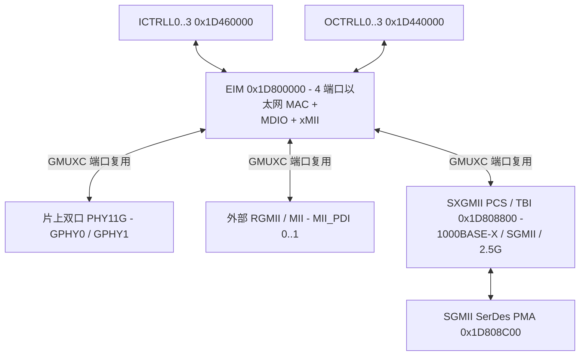

# 7.4 EIM、SGMII 与 SXGMII

Falcon 的以太网子系统由 EIM 的四个 MAC、片上 GPHY0/1、外部 xMII 接口和一条串行 SerDes 通道组成。串行通道分为两个寄存器块：`SGMII` 控制 PMA、PLL、发送器与接收 CDR，`SXGMII` 控制 PCS、TBI 和自协商。1G 与 2.5G 串行模式共用这条通道。

## 地址空间与时钟域

| 硬件模块 | 物理基址 | KSEG1 基址 | 地址空间大小 | 功能说明 |
| :--- | :--- | :--- | :--- | :--- |
| `EIM` | `0x1D800000` | `0xBD800000` | `0x00001000`（4 KiB） | 4 端口以太网 MAC、GPHY 配置壳层、MDIO 主机与 xMII 接口 |
| `SXGMII` | `0x1D808800` | `0xBD808800` | `0x00000100`（256 B） | TBI 自协商控制与 SGMII / 2.5G SXGMII PCS 层 |
| `SGMII` | `0x1D808C00` | `0xBD808C00` | `0x00000100`（256 B） | SerDes 模拟 PMA、PLL、差分发送器（TX）与 CDR 接收器（RX） |
| `SYS_ETH` | `0x1DB00000` | `0xBDB00000` | `0x00000100`（256 B） | 以太网子系统时钟门控、模块激活、数据通路多路复用（`GMUXC`）与速率选择（`DRC`/`DRS`） |

`SYS_ETH.GMUXC` 为每个硬件 MAC（`GMAC0`–`GMAC3`）选择 PHY 侧接口，可连接片上 GPHY、外部 xMII 或串行 PCS/SerDes。

## SYS_ETH 以太网系统控制（`0x1DB00000`）

| 偏移 | 寄存器名 | 功能说明 |
| :--- | :--- | :--- |
| `0x00`–`0x08` | `CLKS` / `CLKEN` / `CLKCLR` | 时钟状态、使能与关闭：`GPHY0MII2`（bit 24）、`GPHY1MII2`（bit 25）、`PADCTRL0/2`（bits 21:20）、`P0..P2`（bits 18:16）、`xMII`（bit 11）、`SGMII`（bit 10）、`GPHY1`（bit 9）、`GPHY0`（bit 8）、`MDIO`（bit 7）、`GMAC0..3`（bits 3:0） |
| `0x20`–`0x2C` | `ACTS` / `ACT` / `DEACT` / `RBT` | 模块激活状态、激活、去激活与软复位脉冲（位定义与 `CLKS` 对应） |
| `0xB0` | `EXTPHYC` | 外置 PHY 时钟输出使能（`CLKEN` bit 31）与频率选择（`CLKSEL` bits [2:0]：`1` = 25 MHz、`2` = 125 MHz、`5` = 50 MHz） |
| `0xB4` | `PDCFG` | 各端口无链路时自动时钟门控省电使能（`GMAC0..3`、`SGMII`、`xMII`） |
| `0xB8` | `DRC` | SGMII、xMII0/1 与 GMAC0..3 速率配置（10M / 100M / 1000M / 2500M） |
| `0xBC` | `GMUXC` | 每个 GMAC 占一个 4-bit 槽，其中低 3 位选择 PHY 侧接口；`GMACn` 的字段为 bits `[4n+2:4n]` |
| `0xC0` | `DRS` | 4 个 GMAC 通道经自协商后的实时生效速率只读状态 |
| `0xC4` | `SGMIIC` | 串行自协商选择：`ANP`（bit 1）取 `0` 为 TBX / Clause 37、取 `1` 为 SGMII；`ANMP`（bit 0）取 `0` 为 MAC 角色、取 `1` 为 PHY 角色 |

## EIM 以太网接口模块（`0x1D800000`）

以下列出 A2x 步进的 EIM 寄存器布局：

| A2x 偏移 | 寄存器组 / 名称 | 功能说明 |
| :--- | :--- | :--- |
| `0x000` | `MAC_TEST` | MAC 测试模式控制 |
| `0x004` | `MAC_PFAD_CFG` | Pause 流控帧源 MAC 地址注入使能（`SAMOD`） |
| `0x008`–`0x010` | `MAC_PFSA_0..2` | 48-bit Pause 流控帧源 MAC 地址（`PFAD[47:0]`） |
| `0x014` | `MAC_FLEN` | 全局以太网帧长度阈值（`LEN` bits [13:0]，掩码 `0x3FFF`）；各 MAC 的 `CTRL_2.MLEN` 选择该阈值 |
| `0x018` / `0x01C` | `MAC_VLAN_ETYPE_0/1` | 两个可编程外层/内层 VLAN TPID 以太网类型匹配值 |
| `0x020` / `0x024` | `MAC_IER` / `MAC_ISR` | 4 端口 MAC 顶层中断使能与中断状态 |
| `0x028` + `p * 0x28` | `MAC_PDI[0..3]` | 4 个独立 MAC 通道寄存器组： `+0x00` `PSTAT`：端口链路、双工、速率与流控状态； `+0x04` `PISR` / `+0x08` `PIER`：端口中断状态与使能（FCS 错、超长帧、对齐错、Pause 帧收发等）； `+0x0C` `CTRL_0`：帧校验（`FCS`）、短帧填充（`PADEN`）、双工与流控模式； `+0x10` `CTRL_1`：帧间隙（`IPG`）与短前导码配置； `+0x14` `CTRL_2`：超长帧/超短帧允许开关（`MLEN`、`LCHKL`、`LCHKS`）； `+0x18` `CTRL_3`：碰撞退避与重试限制； `+0x1C` `CTRL_4`：EEE LPI 发送等待与唤醒时间参数； `+0x20` `CTRL_5`：Jam 配置； `+0x24` `TESTEN`：环回测试使能 |
| `0x0C8`–`0x0E8` | `GPHY_CTL` / `GPHY_CFG_*` | 片上 GPHY0/1 复位释放、PLL 配置、LED 模式、自协商能力广告与 MDIO 物理地址分配（`GPHY_CFG_ADDR_0/1` 位于 `0x0E4/0x0E8`） |
| `0x0EC`–`0x0F8` | `EIM_STRB_GEN*` / `LAN_IFC_CFG_*` | LAN 接口定时选通与接口模式配置 |
| `0x0FC`–`0x178` | `EIM_MIB_*[0..3]` | 4 端口硬件 MIB 错误统计计数器（`FCSER`、`OVSZ`、`ALGN`、`LATE_COL`、`EXC_COL`、`SGL_COL`、`MUL_COL`、`DEF_TRANS`） |
| `0x17C` / `0x180` | `EIM_IER` / `EIM_ISR` | EIM 全局中断使能与状态 |
| `0x184`–`0x1C4` | `MDIO_PDI` | IEEE 802.3 Clause 22 / Clause 45 MDIO 主机控制器与 4 端口自动轮询状态机：`MDIO_CTRL`、`MDIO_READ`、`MDIO_WRITE`、`MDC_CFG_0/1`、`PHY_ADDR_0..3`、`MDIO_STAT_0..3`、`ANEG_EEE_0..3` |
| `0x1C8` + `p * 0x0C` | `MII_PDI[0..1]` | 2 个外置 xMII（MII / RMII / RGMII / GMII）接口配置、RGMII RX/TX 时钟延迟（`PCDU`）与驱动强度控制 |

## SXGMII PCS 与 TBI 子层（`0x1D808800`）

SXGMII 模块实现 8B/10B 编解码、弹性缓冲（Elasticity Buffer）、IEEE 802.3z Clause 37（1000BASE-X）及 Cisco SGMII 自协商状态机，支持工作在 1.25 Gbaud（1000BASE-X / SGMII）或 3.125 Gbaud（2.5G SGMII / HiSGMII）：

| 偏移 | 寄存器名 | 位域与功能说明 |
| :--- | :--- | :--- |
| `0x00` / `0x04` | `TBI_PDI_TXANEGH` / `TXANEGL` | 发送自协商配置寄存器 `tx_config_reg[15:0]` 的高 8 位与低 8 位 |
| `0x08` / `0x0C` | `TBI_PDI_RXANEGH` / `RXANEGL` | 接收到的对端自协商能力字 `rx_config_reg[15:0]` 的高 8 位与低 8 位 |
| `0x10` | `TBI_PDI_ANEGCTL` | 自协商控制：`OVRANEG`（bit 5 覆盖自协商模式）、`OVRABL`（bit 4 覆盖能力字）、`RANEG`（bit 3 重启自协商）、`ANEGEN`（bit 2 自协商使能）、`LT`（bits [1:0] 链路计时器：`1` = 1.6 ms，`3` = 10 ms） |
| `0x14` / `0x18` | `TBI_PDI_TBICTL` / `TBICTLT` | TBI 接口环回、软复位、极性翻转与逗号（Comma）检测控制 |
| `0x1C` / `0x20` | `TBI_PDI_TBITEST` / `RXERR` | 码型测试控制与 8B/10B 游程极性（Disparity）/ 非法码字错误计数 |
| `0x24` | `TBI_PDI_TBISTAT` | TBI 链路状态：`SSTAT`（bit 3 码字同步状态 `SYNC_STATUS`）、`ANEGERR`（bit 2 自协商错误）、`ABMSTAT`（bit 1 能力匹配状态）、`LSTAT`（bit 0 链路建立状态 `LINK_STATUS`） |
| `0x28` | `TBI_PDI_LPSTAT` | 对端速率（`DR` bits [6:5]）、双工（`DUP` bit 4）、Pause 能力（`PS` bits [3:2]）与远端故障（`RF` bits [1:0]）状态 |
| `0x2C` / `0x30` | `TBI_PDI_ISTAT` / `IMASK` | TBI 中断状态与掩码 |
| `0x34` | `S_SGMII_PCS_PDI_CFG` | PCS 层接口宽度与模式选择 |
| `0x38`–`0x4C` | `RXBCTRL` / `RXBCFG` / `RXBSTAT` / `TXBCTRL` / `TXBCFG` / `TXBSTAT` | 接收与发送弹性缓冲（FIFO）阈值、复位及下溢/上溢状态 |

## SGMII SerDes 模拟物理层（`0x1D808C00`）

`SGMII` 寄存器块控制高速串行 SerDes 通道的 PLL、发送预加重及接收 CDR：

| 偏移范围 | 寄存器组 | 功能说明 |
| :--- | :--- | :--- |
| `0x00`–`0x28` | `GLP_REGFILE_*` | 数字胶合逻辑（Glue Logic）时钟相位延迟与速率倍率配置 |
| `0x2C` / `0x30` | `PMA_REGFILE_STARTUP_CTRL` / `STATE` | SerDes 上电启动序列状态机控制与当前状态读数 |
| `0x34`–`0x60` | `PLL_REGFILE_CTRL1..7` / `A_CTRL1..4` / `STATUS` | SerDes 锁相环倍频系数（1.25 GHz / 3.125 GHz）、环路参数与锁定状态（`STATUS` `0x60`） |
| `0x64`–`0xA0` | `TX_REGFILE_0_*` / `TX_REGFILE_1_*` | 发送器摆幅控制、去加重/预加重抽头权重与端接阻抗配置 |
| `0xA4`–`0xBC` | `RX_REGFILE_CTRL1..2` / `CDR` / `EI` / `CAL` / `A_CTRL` / `TEST_CTRL` | 接收器均衡增益、CDR 相位跟踪环路、电空闲（Electrical Idle）检测与失调校准控制 |

## MAC 与 GPHY、串行 PHY 的连接选择

`GMUXC`（`SYS_ETH + 0xBC`）的每个 MAC 字段采用以下编码。更新 `GMACn` 时，保留其余字段，只修改掩码 `0x7 << (4 * n)`：

| 字段值 | MAC 所连接的 PHY 侧接口 |
| --- | --- |
| `0` | `GPHY0_GMII` |
| `1` | `GPHY0_MII2` |
| `2` | `GPHY1_GMII` |
| `3` | `GPHY1_MII2` |
| `4` | 串行 `SGMII` / `SXGMII` 通道 |
| `5` | `xMII0` |
| `6` | `xMII1` |

GPHY0/1 提供铜缆 PHY；SGMII PMA 与 SXGMII PCS 提供高速串行 PHY。两类 PHY 通过该复用矩阵连接到 EIM 的 MAC。切换 GMUXC 改变 MAC 的连接对象；串行 1G/2.5G 切换则更新同一串行通道的速率、PLL 和 CDR 配置。

## 串行速率与 PMA 配置档位

串行通道的速率字段位于 `SYS_ETH.DRC`（`+0xB8`）bits `[18:16]`，更新掩码为 `0x00070000`：

| MAC 数据速率 | DRC 字段编码 | 串行 PMA 档位 |
| --- | --- | --- |
| 10 Mbit/s | `0` | 1.25 Gbit/s |
| 100 Mbit/s | `1` | 1.25 Gbit/s |
| 1000 Mbit/s | `2` | 1.25 Gbit/s |
| 2500 Mbit/s | `4` | 3.125 Gbit/s |

以下列出两种串行档位的 PLL / CDR 设置；表内“掩码”表示读改写时替换的位，其余位保持原值。地址偏移相对 SGMII 基址 `0x1D808C00`。

| 偏移 / 寄存器 | 掩码 | 1.25G 档位写入位值 | 3.125G 档位写入位值 |
| --- | --- | --- | --- |
| `+0x34` `PLL_CTRL1` | `0xFFFF` | `0x0000` | `0xFFFF` |
| `+0x38` `PLL_CTRL2` | `0x00FF` | `0x0000` | `0x00DF` |
| `+0x3C` `PLL_CTRL3` | `0x0072` | `0x0042` | `0x0032` |
| `+0x50` `PLL_A_CTRL1` | `0x3800` | `0x0000` | `0x0800` |
| `+0x58` `PLL_A_CTRL3` | `0x2200` | `0x2200` | `0x0200` |
| `+0x5C` `PLL_A_CTRL4` | 整字写入 | `0x002E` | `0x017B` |
| `+0xA4` `RX_CTRL1` | `0xFF02` | `0x8F02` | `0x0F02` |
| `+0xAC` `RX_CDR` | `0x0377` | `0x0104` | `0x0204` |
| `+0x64` `TX_CTRL1` | `0x006A` | `0x0040` | `0x0000` |

两档共用以下设置：

| 偏移 / 寄存器 | 掩码 | 写入位值 |
| --- | --- | --- |
| `+0xB0` `RX_EI` | `0xFFFF` | `0x0004` |
| `+0x84` `TX1_CTRL1` | bit 0 | `0` |
| `+0x6C` `TX_CTRL3` | `0xFFFF` | `0x1FFF` |
| `+0x70` `TX_A_CTRL1` | `0xFF00` | `0x0800` |
| `+0x74` `TX_A_CTRL2` | `0x7FF0` | `0x0700` |

### 速率切换顺序

1. 在 `SYS_ETH.DEACT` / `ACT` 中对 SGMII 域执行去激活、再激活，位掩码为 `0x00000400`（bit 10）。
2. 更新 `DRC[18:16]`。
3. 按档位设置 PLL 寄存器。写完 `PLL_CTRL2[7:0]` 后，另一次读改写将其 bits `[9:8]` 设为 `1`；`PLL_A_CTRL2`（`+0x54`）置位 `0x4000`。
4. 向 `PMA_STARTUP_CTRL`（`+0x2C`）依次写入 `0x425`、`0x421`、`0x423`、`0x403`、`0x443`、`0x453`、`0x45B`、`0x65B`。
5. 配置 `RX_CTRL1`，延时 1 µs 后清除 bit 1；随后按顺序设置 `RX_CDR`、`RX_EI`、`TX_CTRL1`、`TX1_CTRL1`、`TX_CTRL3`、`TX_A_CTRL1`、`TX_A_CTRL2`。RX 极性翻转由 `RX_CTRL1` bit 2 控制，TX 极性翻转由 `TX_CTRL1` bit 1 控制。
6. 配置 SXGMII 的接收/发送缓冲：`+0x3C`、`+0x48` 的低 3 位均设为 `2`；`TBICTL`（`+0x14`）低 2 位设为 `2`。
7. 设置 PCS 自协商方式，并通过 `TBISTAT`（SXGMII `+0x24`）bit 3 读取码字同步状态。

PLL 配置完成后，链路同步状态由 PCS 持续报告。1G 和 2.5G 档位由主控选择。

### PCS 自协商方式

| 模式 | `ANEGCTL[5:0]` | 主要设置 |
| --- | --- | --- |
| SGMII 带内协商 | `0x35` | `OVRANEG=1`、`OVRABL=1`、`ANEGEN=1`、`LT=1`（1.6 ms） |
| 1000BASE-X / TBI 协商 | `0x37` | `OVRANEG=1`、`OVRABL=1`、`ANEGEN=1`、`LT=3`（10 ms） |

设置协商方式时，先配置 carrier extension，再向 `TXANEGH` / `TXANEGL` 写入能力字的高、低 8 位，最后写入 `ANEGCTL`：

- SGMII 带内协商清除 `TBICTL`（`+0x14`）bit 4 和 `TBICTLT`（`+0x18`）bit 0；两类发送配置字为 `0x0001` 与 `0x9801`。
- 1000BASE-X / TBI 协商置位上述两个 carrier-extension 位；能力字由双工能力和 PAUSE 能力组合。双工字段采用 `0x20`、`0x40` 或 `0x60`，PAUSE 字段采用 `0`、`0x80`、`0x100` 或 `0x180`。

重启自协商时，将 `ANEGCTL.RANEG`（bit 3）置 `1`，延时 1 µs，再清为 `0`。接收到的能力字位于 `RXANEGH` / `RXANEGL`，链路、同步和能力匹配状态位于 `TBISTAT`。
