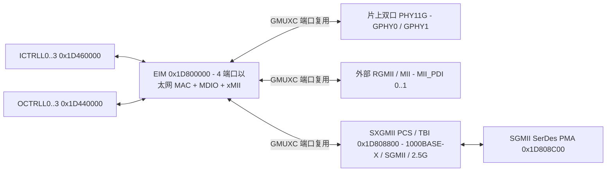

# 7.4 EIM、SGMII 与 SXGMII

以太网接口模块（EIM，Ethernet Interface Module）、SGMII 串行吉比特接口（PMA/PLL/TX/RX）与 SXGMII（含 TBI 10-Bit Interface 与 SGMII/SXGMII PCS 层，支持 10M/100M/1000M 及 2.5 Gbps 速率）组成 Falcon SoC 的 UNI（用户网络接口）侧以太网子系统。

## 地址空间与时钟域

| 硬件模块 | 物理基址 | KSEG1 基址 | 地址空间大小 | 功能说明 |
| :--- | :--- | :--- | :--- | :--- |
| `EIM` | `0x1D800000` | `0xBD800000` | `0x00001000`（4 KiB） | 4 端口以太网 MAC、GPHY 配置壳层、MDIO 主机与 xMII 接口 |
| `SXGMII` | `0x1D808800` | `0xBD808800` | `0x00000100`（256 B） | TBI 自协商控制与 SGMII / 2.5G SXGMII PCS 层 |
| `SGMII` | `0x1D808C00` | `0xBD808C00` | `0x00000100`（256 B） | SerDes 模拟 PMA、PLL、差分发送器（TX）与 CDR 接收器（RX） |
| `SYS_ETH` | `0x1DB00000` | `0xBDB00000` | `0x00000100`（256 B） | 以太网子系统时钟门控、模块激活、数据通路多路复用（`GMUXC`）与速率选择（`DRC`/`DRS`） |

UNI 逻辑端口号（`0..3`）与 EIM 内部 MAC 硬件通道索引采用反向映射：逻辑 UNI 端口 `index` 对应硬件 `MAC_PDI[3 - index]`。

## SYS_ETH 以太网系统控制（`0x1DB00000`）

| 偏移 | 寄存器名 | 功能说明 |
| :--- | :--- | :--- |
| `0x00`–`0x08` | `CLKS` / `CLKEN` / `CLKCLR` | 时钟状态、使能与关闭：`GPHY0MII2`（bit 24）、`GPHY1MII2`（bit 25）、`PADCTRL0/2`（bits 21:20）、`P0..P2`（bits 18:16）、`xMII`（bit 10）、`GPHY1`（bit 9）、`GPHY0`（bit 8）、`MDIO`（bit 7）、`SGMII`（bit 6）、`GMAC0..3`（bits 3:0） |
| `0x20`–`0x2C` | `ACTS` / `ACT` / `DEACT` / `RBT` | 模块激活状态、激活、去激活与软复位脉冲（位定义与 `CLKS` 对应） |
| `0xB0` | `EXTPHYC` | 外置 PHY 参考时钟输出使能（`CLKEN` bit 31）与频率选择（`CLKSEL` bits [2:0]：25 MHz / 50 MHz / 125 MHz） |
| `0xB4` | `PDCFG` | 各端口无链路时自动时钟门控省电使能（`GMAC0..3`、`SGMII`、`xMII`） |
| `0xB8` | `DRC` | SGMII、xMII0/1 与 GMAC0..3 速率配置（10M / 100M / 1000M / 2500M） |
| `0xBC` | `GMUXC` | 4 个 GMAC 通道（`GMAC0..3`，每个 3-bit）与物理接口（`GPHY0_GMII`、`GPHY0_MII2`、`GPHY1_GMII`、`GPHY1_MII2`、`SGMII`、`xMII0`、`xMII1`）的交叉复用矩阵 |
| `0xC0` | `DRS` | 4 个 GMAC 通道经自协商后的实时生效速率只读状态 |
| `0xC4` | `SGMIIC` | SGMII 时钟源与恢复时钟回路选择 |

## EIM 以太网接口模块（`0x1D800000`）

EIM 寄存器空间在 A1x 与 A2x 芯片步进中具有两套偏移布局（以下列出 A2x 步进布局，括注 A1x 差异）：

| A2x 偏移（A1x 偏移） | 寄存器组 / 名称 | 功能说明 |
| :--- | :--- | :--- |
| `0x000` | `MAC_TEST` | MAC 测试模式控制 |
| `0x004` | `MAC_PFAD_CFG` | Pause 流控帧源 MAC 地址注入使能（`SAMOD`） |
| `0x008`–`0x010` | `MAC_PFSA_0..2` | 48-bit Pause 流控帧源 MAC 地址（`PFAD[47:0]`） |
| `0x014` | `MAC_FLEN` | 全局最大以太网帧长度阈值（`LEN` bits [13:0]，掩码 `0x3FFF`，支持最高 9990 字节 Jumbo Frame） |
| `0x018` / `0x01C` | `MAC_VLAN_ETYPE_0/1` | 两个可编程外层/内层 VLAN TPID 以太网类型匹配值 |
| `0x020` / `0x024` | `MAC_IER` / `MAC_ISR` | 4 端口 MAC 顶层中断使能与中断状态（A1x 位于 `0x0E0`/`0x0E4`） |
| `0x040` + `p * 0x30` | `MAC_PDI[0..3]` | 4 个独立 MAC 通道寄存器组（A1x 为 `0x020 + p * 0x30`）： `+0x00` `PSTAT`：端口链路、双工、速率与流控状态； `+0x04` `PISR` / `+0x08` `PIER`：端口中断状态与使能（FCS 错、超长帧、对齐错、Pause 帧收发等）； `+0x0C` `CTRL_0`：帧校验（`FCS`）、短帧填充（`PADEN`）、双工与流控模式； `+0x10` `CTRL_1`：帧间隙（`IPG`）与短前导码配置； `+0x14` `CTRL_2`：超长帧/超短帧允许开关（`MLEN`、`LCHKL`、`LCHKS`）； `+0x18` `CTRL_3`：碰撞退避与重试限制； `+0x1C` `CTRL_4`：EEE LPI 发送等待与唤醒时间参数； `+0x20` `CTRL_5`：半双工载波侦听调整； `+0x24` `TESTEN`：环回测试使能 |
| `0x100`–`0x124` | `GPHY_CTL` / `GPHY_CFG_*` | 片上 GPHY0/1 复位释放、PLL 配置、LED 模式、自协商能力广告与 MDIO 物理地址分配（`GPHY_CFG_ADDR_0/1`） |
| `0x128`–`0x134` | `EIM_STRB_GEN*` / `LAN_IFC_CFG_*` | LAN 接口定时选通与接口模式配置 |
| `0x138`–`0x174` | `EIM_MIB_*[0..3]` | 4 端口硬件 MIB 错误统计计数器（`FCSER`、`OVSZ`、`ALGN`、`LATE_COL`、`EXC_COL`、`SGL_COL`、`MUL_COL`、`DEF_TRANS`） |
| `0x178`–`0x180` | `EIM_IER` / `EIM_ISR` | EIM 全局中断使能与状态 |
| `0x184`–`0x1C4` | `MDIO_PDI` | IEEE 802.3 Clause 22 / Clause 45 MDIO 主机控制器与 4 端口自动轮询状态机（A1x 位于 `0x168`–`0x1A8`）：`MDIO_CTRL`、`MDIO_READ`、`MDIO_WRITE`、`MDC_CFG_0/1`、`PHY_ADDR_0..3`、`MDIO_STAT_0..3`、`ANEG_EEE_0..3` |
| `0x1C8`–`0x1EC` | `MII_PDI[0..1]` | 2 个外置 xMII（MII / RMII / RGMII / GMII）接口配置、RGMII RX/TX 时钟延迟（`PCDU`）与驱动强度控制 |

## SXGMII PCS 与 TBI 子层（`0x1D808800`）

SXGMII 模块实现 8B/10B 编解码、弹性缓冲（Elasticity Buffer）、IEEE 802.3z Clause 37（1000BASE-X）及 Cisco SGMII 自协商状态机，支持工作在 1.25 Gbaud（1000BASE-X / SGMII）或 3.125 Gbaud（2.5G SGMII / HiSGMII）：

| 偏移 | 寄存器名 | 位域与功能说明 |
| :--- | :--- | :--- |
| `0x00` / `0x04` | `TBI_PDI_TXANEGH` / `TXANEGL` | 发送自协商配置寄存器 `tx_config_reg[15:0]` 的高 8 位与低 8 位 |
| `0x08` / `0x0C` | `TBI_PDI_RXANEGH` / `RXANEGL` | 接收到的对端自协商能力字 `rx_config_reg[15:0]` 的高 8 位与低 8 位 |
| `0x10` | `TBI_PDI_ANEGCTL` | 自协商控制：`OVRANEG`（bit 5 覆盖自协商模式）、`OVRABL`（bit 4 覆盖能力字）、`RANEG`（bit 3 重启自协商）、`ANEGEN`（bit 2 自协商使能）、`LT`（bits [1:0] `link_timer` 周期：`0` = 10 µs 测试值，`1` = 1.6 ms SGMII 标准，`2` = 10 ms 1000BASE-X 标准） |
| `0x14` / `0x18` | `TBI_PDI_TBICTL` / `TBICTLT` | TBI 接口环回、软复位、极性翻转与逗号（Comma）检测控制 |
| `0x1C` / `0x20` | `TBI_PDI_TBITEST` / `RXERR` | 码型测试控制与 8B/10B 游程极性（Disparity）/ 非法码字错误计数 |
| `0x24` | `TBI_PDI_TBISTAT` | TBI 链路状态：`SSTAT`（bit 3 码字同步状态 `SYNC_STATUS`）、`ANEGERR`（bit 2 自协商错误）、`ABMSTAT`（bit 1 能力匹配状态）、`LSTAT`（bit 0 链路建立状态 `LINK_STATUS`） |
| `0x28` | `TBI_PDI_LPSTAT` | 对端速率（`DR` bits [6:5]）、双工（`DUP` bit 4）、Pause 能力（`PS` bits [3:2]）与远端故障（`RF` bits [1:0]）状态 |
| `0x2C` / `0x30` | `TBI_PDI_ISTAT` / `IMASK` | TBI 中断状态与掩码 |
| `0x34` | `S_SGMII_PCS_PDI_CFG` | PCS 层接口宽度与模式选择 |
| `0x38`–`0x4C` | `RXBCTRL` / `RXBCFG` / `RXBSTAT` / `TXBCTRL` / `TXBCFG` / `TXBSTAT` | 接收与发送弹性缓冲（FIFO）阈值、复位及下溢/上溢状态 |

## SGMII SerDes 模拟物理层（`0x1D808C00`）

`SGMII` 寄存器块控制高速串行 SerDes 通道的 PLL、发送预加重及接收 CDR：

| 偏移范围 | 寄存器组 | 功能说明 |
| :--- | :--- | :--- |
| `0x00`–`0x28` | `GLP_REGFILE_*` | 数字胶合逻辑（Glue Logic）时钟相位延迟与速率倍率配置 |
| `0x2C` / `0x30` | `PMA_REGFILE_STARTUP_CTRL` / `STATE` | SerDes 上电启动序列状态机控制与当前状态读数 |
| `0x34`–`0x60` | `PLL_REGFILE_CTRL1..7` / `A_CTRL1..4` / `STATUS` | SerDes 锁相环倍频系数（1.25 GHz / 3.125 GHz）、环路参数与锁定状态（`STATUS` `0x60`） |
| `0x64`–`0xA0` | `TX_REGFILE_0_*` / `TX_REGFILE_1_*` | 发送器摆幅控制、去加重/预加重抽头权重与端接阻抗配置 |
| `0xA4`–`0xBC` | `RX_REGFILE_CTRL1..2` / `CDR` / `EI` / `CAL` / `A_CTRL` / `TEST_CTRL` | 接收器均衡增益、CDR 相位跟踪环路、电空闲（Electrical Idle）检测与失调校准控制 |
