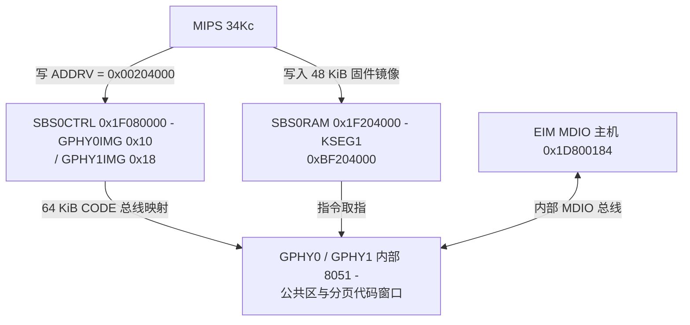

# 7.5 片上 PHY11G

Falcon SoC 内置两个 10/100/1000BASE-T 以太网物理层收发器（`GPHY0` 与 `GPHY1`；支持单口千兆 `11G` 与双口百兆 `22F` 模式）。每个 GPHY 内部集成一颗负责物理层控制、链路自协商、自动交叉线检测（Auto-MDIX）、功率管理与校准的 8051（MCS-51 兼容）微控制器。

## 时钟、复位与固件地址重映射

片上 GPHY 的时钟、复位、启动配置与固件存储窗口由 `SYS_ETH`（`0x1DB00000`）、`EIM`（基址 `0x1D800000`，GPHY 子寄存器从 `+0x100` 开始）及 `SBS0CTRL`（`0x1F080000`）共同控制：

| 寄存器块 | 寄存器名（偏移） | 位域与功能说明 |
| :--- | :--- | :--- |
| `SYS_ETH` (`0x1DB00000`) | `CLKS` / `CLKEN` / `CLKCLR` (`0x00`–`0x08`) `ACTS` / `ACT` / `DEACT` / `RBT` (`0x20`–`0x2C`) | `GPHY0`（bit 8，`0x00000100`）、`GPHY1`（bit 9，`0x00000200`）、`GPHY0MII2`（bit 24，`0x01000000`）、`GPHY1MII2`（bit 25，`0x02000000`）时钟与复位控制 |
| `EIM` (`0x1D800000`) | `GPHY_CTL` (`0x100`) `GPHY_CFG_VER` (`0x104`) `GPHY_CFG_PLL` (`0x108`) `GPHY_CFG_GEN_0/1` (`0x10C`/`0x110`) `GPHY_CFG_ANEG_0/1` (`0x114`/`0x118`) `GPHY_CFG_ADDR_0/1` (`0x11C`/`0x120`) | GPHY 顶层控制、模拟 IP 版本号、PLL 锁定配置、通用引脚配置、上电默认自协商能力广告及两个 GPHY 在内部 MDIO 总线上的 5-bit PHY 地址（`GPHY_CFG_ADDR_0/1`） |
| `SBS0CTRL` (`0x1F080000`) | `GPHY0IMG` (`0x10`) `GPHY1IMG` (`0x18`) | GPHY0 与 GPHY1 的 64 KiB 8051 程序空间基址重映射寄存器。`ADDRV`（bits [21:14]，掩码 `0x003FC000`）指定固件在片上 `SBS0` 地址空间中的 16 KiB 对齐偏移 |

### 从 SBS0RAM 启动的配置示例

1. **代码窗口准备**：以下示例将映像放在物理地址 `0x1F204000`，通过 `GPHY0IMG` 和 `GPHY1IMG` 配置两颗控制器的代码窗口。
2. **拷贝至 `SBS0RAM`**：将固件镜像复制到 `SBS0RAM` 起始偏移 `16 KiB` 处，即物理地址 `0x1F204000`（KSEG1 虚拟地址 `0xBF204000`）。
3. **重映射 `GPHY0IMG` / `GPHY1IMG`**：将 `0x00204000` 写入 `SBS0CTRL.GPHY0IMG`（`0x1F080010`）与 `SBS0CTRL.GPHY1IMG`（`0x1F080018`），指定两颗 GPHY 的映像源基址。若未加载外部 RAM 固件，可按步进选择片上掩膜 ROM 窗口（A11 步进为 `0x1F020000` 11G / `0x1F028000` 22F；A12 步进为 `0x1F018000` 11G / `0x1F024000` 22F）。
4. **释放复位**：通过 `SYS_ETH.CLKEN` 与 `SYS_ETH.ACT` 使能 `GPHY0`、`GPHY1` 时钟并释放复位，两颗 8051 从代码地址 `0x0000` 开始取指执行。

## GPHY 内部 8051 微控制器架构

片上 GPHY 内的微控制器采用 MCS-51 指令集，带有双数据指针（Dual-DPTR）扩展：

| 资源 | 访问方式 |
| --- | --- |
| 代码空间 | 64 KiB CODE 地址空间，由 `GPHY0IMG` / `GPHY1IMG` 映射到 SBS0 存储窗口 |
| 双 DPTR | `DPL` / `DPH` 位于 `0x82` / `0x83`；翻转 SFR `AUXR1`（`0xA2`）bit 0 切换两套指针 |
| 外部寄存器空间 | 使用 `movx @DPTR, A` / `movx A, @DPTR` 访问 PHY DSP、AFE、PCS 与 MDIO 邮箱寄存器 |
| 省电状态 | `PCON` 控制 Idle 状态，外设中断唤醒控制器 |

分页代码访问见 [GPHY 8051 执行接口](../05_coprocessors/09_gphy_8051_coprocessor.md)。
