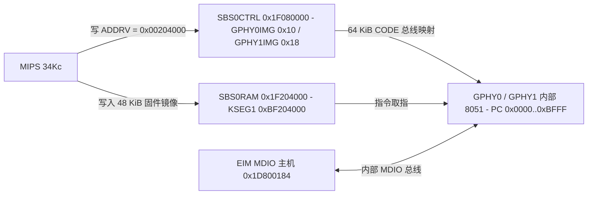

# 7.5 片上 PHY11G

Falcon SoC 内置两个 10/100/1000BASE-T 以太网物理层收发器（`GPHY0` 与 `GPHY1`，IP 核代号 `PHY11G` / `22F`）。每个 GPHY 内部集成一颗负责物理层控制、链路自协商、自动交叉线检测（Auto-MDIX）、功率管理与校准的 8051（MCS-51 兼容）微控制器。

## 时钟、复位与固件地址重映射

片上 GPHY 的时钟、复位、启动配置与固件存储窗口由 `SYS_ETH`（`0x1DB00000`）、`EIM`（`0x1D800100`）及 `SBS0CTRL`（`0x1F080000`）共同控制：

| 寄存器块 | 寄存器名（偏移） | 位域与功能说明 |
| :--- | :--- | :--- |
| `SYS_ETH` (`0x1DB00000`) | `CLKS` / `CLKEN` / `CLKCLR` (`0x00`–`0x08`) `ACTS` / `ACT` / `DEACT` / `RBT` (`0x20`–`0x2C`) | `GPHY0`（bit 8，`0x00000100`）、`GPHY1`（bit 9，`0x00000200`）、`GPHY0MII2`（bit 24，`0x01000000`）、`GPHY1MII2`（bit 25，`0x02000000`）时钟与复位控制 |
| `EIM` (`0x1D800000`) | `GPHY_CTL` (`0x100`) `GPHY_CFG_VER` (`0x104`) `GPHY_CFG_PLL` (`0x108`) `GPHY_CFG_GEN_0/1` (`0x10C`/`0x110`) `GPHY_CFG_ANEG_0/1` (`0x114`/`0x118`) `GPHY_CFG_ADDR_0/1` (`0x11C`/`0x120`) | GPHY 顶层控制、模拟 IP 版本号、PLL 锁定配置、通用引脚配置、上电默认自协商能力广告及两个 GPHY 在内部 MDIO 总线上的 5-bit PHY 地址（`GPHY_CFG_ADDR_0/1`） |
| `SBS0CTRL` (`0x1F080000`) | `GPHY0IMG` (`0x10`) `GPHY1IMG` (`0x18`) | GPHY0 与 GPHY1 的 64 KiB 8051 程序空间基址重映射寄存器。`ADDRV`（bits [21:14]，掩码 `0x003FC000`）指定固件在片上 `SBS0` 地址空间中的 16 KiB 对齐偏移 |

### 固件加载与启动硬件序列

1. **固件版本与大小**：PHY11G 8051 固件镜像大小上限为 `49,152` 字节（`0xC000`，48 KiB）。镜像内部嵌有以 `7E 81 7E` 开头、以 `81 7E 81` 结尾的版本标识帧（例如偏移 `0xAEE0`–`0xAF11` 处的 `PHY_1V6_11G_IP_AR10_A21_R8435_A134_T002C_6vB`），硬件步进支持 `PHY_1V5` 与 `PHY_1V6` 固件格式。
2. **拷贝至 `SBS0RAM`**：将固件镜像复制到 `SBS0RAM` 起始偏移 `16 KiB` 处，即物理地址 `0x1F204000`（KSEG1 虚拟地址 `0xBF204000`）。
3. **重映射 `GPHY0IMG` / `GPHY1IMG`**：将 `0x00204000` 写入 `SBS0CTRL.GPHY0IMG`（`0x1F080010`）与 `SBS0CTRL.GPHY1IMG`（`0x1F080018`），使两颗 GPHY 8051 的 `0x0000`–`0xBFFF` 代码空间指向 `0x1F204000`。若未加载外部 RAM 固件，硬件可根据步进回退至片上掩膜 ROM 窗口（A11 步进为 `0x1F020000` 11G / `0x1F028000` 22F；A12 步进为 `0x1F018000` 11G / `0x1F024000` 22F）。
4. **释放复位**：通过 `SYS_ETH.CLKEN` 与 `SYS_ETH.ACT` 使能 `GPHY0`、`GPHY1` 时钟并释放复位，两颗 8051 从代码地址 `0x0000` 开始取指执行。

## GPHY 内部 8051 微控制器架构

片上 GPHY 内的微控制器采用标准大端目标地址 MCS-51 指令集并带有双数据指针（Dual-DPTR）扩展：

| 架构特性 | 硬件实现细节 |
| :--- | :--- |
| **复位向量（`0x0000`）** | `0000: 02 03 3F`（`ljmp 0x033F`），跳过中断向量表与调用桩进入启动初始化例程 |
| **启动初始化（`0x033F`–`0x035A`）** | 清零内部 IRAM `0x00`–`0x7F`，设置堆栈指针 `SP = 0x3D`（`75 81 3D`），依次调用硬件校准与寄存器初始化子程序，最后置位 `EA`（`d2 af setbIE.7`）开启全局中断 |
| **主循环（`0x035B`–`0x035F`）** | `035B: 43 87 01`（`orl PCON, #0x01`）配合 `035E: 80 FB`（`sjmp 0x035B`），使 8051 在无中断任务时保持在 Idle 省电模式，完全由外设中断唤醒 |
| **中断向量表（`0x0003`–`0x007B`）** | 以 8 字节间隔排布 16 个中断槽位（`0x03`、`0x0B`、`0x13`、...、`0x7B`）： `0x23`：串口中断（测试 `SCON` `RI`/`TI`，跳转 `0x047C`）； `0x33`、`0x3B`、`0x43`、`0x4B`、`0x53`、`0x5B`、`0x63`、`0x6B`：8 个扩展硬件中断源，分别通过 `ljmp` 跳转至 `0x7710`、`0x7E48`、`0x81C0`、`0x8422`、`0x85DA`、`0x88DA`、`0x8926`、`0x8963` 处理链路状态机、EEE、DSP 校准与 MDIO 请求； 其余未使用槽位通过 `sjmp` 跳至 `0x0005`–`0x000A` 处的单字节 `reti`（`0x32`）桩 |
| **双 DPTR 扩展** | 通过 `xrl 0xA2, #0x01`（翻转 SFR `AUXR1` bit 0）在两套 `DPTR`（`DPL`/`DPH` 位于 `0x82`/`0x83`）之间切换，加速块数据搬移 |
| **函数指针调用桩（`0x0339`）** | `0339: E4 clr A` / `73 jmp @A+DPTR`；配合 `0x032D`（`mov DPL, R7` / `mov DPH, R6` / `clr A` / `jmp @A+DPTR`）实现 `R6:R7` 间接表驱动状态机 |
| **外部寄存器映射（`XDATA`）** | 通过 `movx @DPTR, A` / `movx A, @DPTR` 访问片上 PHY DSP、AFE、PCS 与 MDIO 邮箱寄存器，主要映射窗口为 `0x0000`–`0x0DAB`，另在 `0x7601` 与 `0xE020` 设有独立控制寄存器 |
