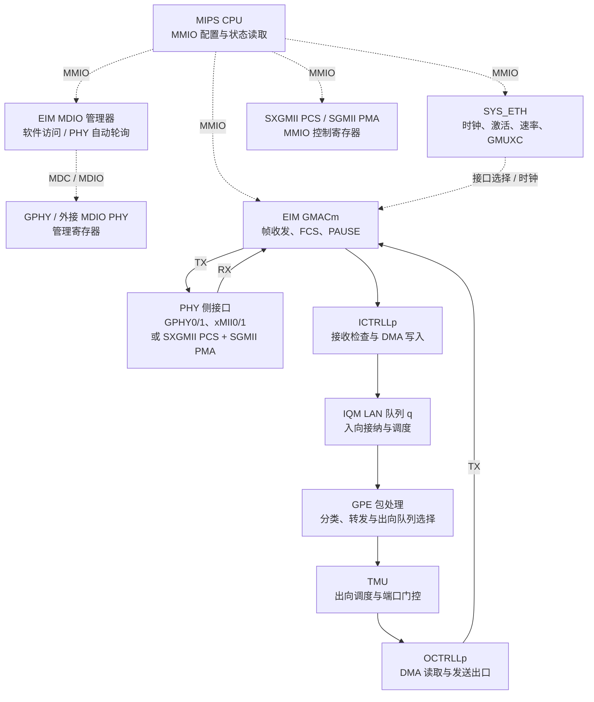
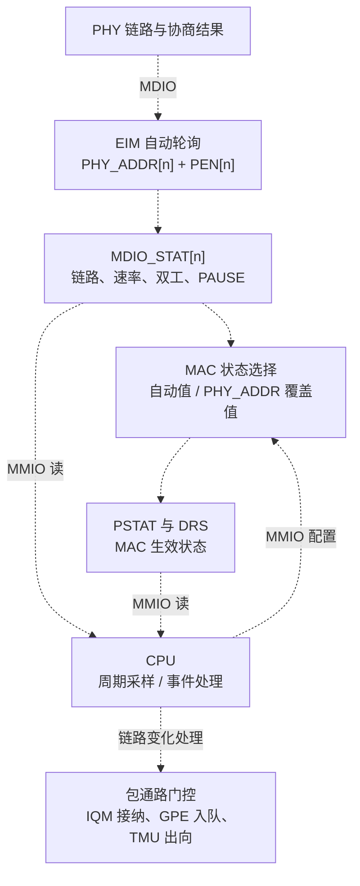

# 7.6 以太网端控制与 CPU 接口

Falcon 的以太网端包含四个 EIM MAC、PHY 接口复用矩阵、MDIO 管理器，以及连接 GPE 的四组 LAN 入向、出向控制器。CPU 通过 MMIO 配置这些单元，读取链路和计数器，并控制端口接纳、排队与发送。PHY 接口承载线侧信号；ICTRLL 和 OCTRLL 分别把接收、发送方向接入包处理系统。

## 内部逻辑与两条控制路径

下图按一条以太网端口路径展开。MAC 编号写作 `m`，LAN 控制器实例写作 `p`，IQM 队列写作 `q`；各单元的地址索引分别计算。实线表示帧或包处理描述符的流向；虚线表示 CPU 寄存器控制和 MDIO 管理。PHY 连接选择在 [7.4 EIM、SGMII 与 SXGMII](04_ethernet_mac_and_serdes.md) 中详述。

图中的 RX 与 TX 共用选定的 MAC 和 PHY 接口，分别经过 ICTRLL 与 OCTRLL。IQM、GPE 与 TMU 处理帧的接纳、转发和发送调度，相关寄存器见 [6.3 IQM 入队管理](../06_functional_blocks/03_iqm_and_queues.md) 和 [6.4 TMU 与调度器](../06_functional_blocks/04_tmu_and_scheduler.md)。

CPU 对 PHY 有两条配置路径：

| 路径 | CPU 访问的单元 | 控制对象 |
| --- | --- | --- |
| MMIO | SYS_ETH、EIM、SXGMII、SGMII | 时钟、MAC 连接、数据速率、PCS 自协商与 PMA 的 PLL/CDR |
| MDIO | EIM MDIO 主机，由其发送 MDC/MDIO 事务 | 具有 MDIO 地址的片上或外接 PHY，其控制、能力与状态寄存器 |

串行通道的 PCS 状态通过 SXGMII MMIO 读取。MDIO 自动轮询按端口保存的 PHY 地址访问 PHY，结果进入 EIM 的轮询状态寄存器。

## CPU 寄存器窗口

下表使用物理地址。MIPS 的直接非缓存 KSEG1 地址为物理地址加 `0xA0000000`，例如 EIM 对应 `0xBD800000`。寄存器采用 32-bit 访问。

| 单元 | 物理基址 | CPU 使用的主要寄存器 |
| --- | --- | --- |
| SYS_ETH | `0x1DB00000` | 时钟、ACT/DEACT/RBT、DRC、GMUXC、DRS |
| EIM | `0x1D800000` | GMAC0..3、MDIO、GPHY 配置、xMII 与中断状态 |
| SXGMII PCS | `0x1D808800` | 带内配置字、ANEGCTL、TBI 状态与弹性缓冲 |
| SGMII PMA | `0x1D808C00` | PLL、启动控制、TX、RX 与 CDR |
| SYS_GPE | `0x1D700000` | LAN0..3 包接口的时钟和激活 |
| ICTRLL0..3 | `0x1D460000 + p * 0x200` | RX 使能、DMA 写入、帧长限制和接收计数 |
| OCTRLL0..3 | `0x1D440000 + p * 0x100` | TX 使能、出向端口号、DMA 读取和发送计数 |
| IQM | `0x1D410000` | LAN 入向队列 `q` 的接纳使能与状态 |

### 时钟、激活和 PHY 选择

SYS_ETH 的时钟和激活寄存器使用同一组单元位。GMACm 的掩码为 `1 << m`；MDIO 为 `0x80`；GPHY0/1 为 `0x100` / `0x200`；SGMII 的 EIM 侧逻辑为 `0x400`；xMII 为 `0x800`。下文 MAC 寄存器表中的 `n` 均表示硬件 MAC 编号 `m`。

| SYS_ETH 偏移 | 寄存器 | 操作 |
| --- | --- | --- |
| `+0x00` | CLKS | 读取时钟状态 |
| `+0x04` | CLKEN | 写入目标单元掩码以启用时钟 |
| `+0x08` | CLKCLR | 写入目标单元掩码以关闭时钟 |
| `+0x20` | ACTS | 读取单元激活状态 |
| `+0x24` | ACT | 写入目标单元掩码以激活 |
| `+0x28` | DEACT | 写入目标单元掩码以去激活 |
| `+0x2C` | RBT | 对目标单元触发复位 |
| `+0xB8` | DRC | 配置接口速率 |
| `+0xBC` | GMUXC | 选择每个 GMAC 的 PHY 侧接口 |
| `+0xC0` | DRS | 读取每个 GMAC 的生效速率 |

激活一个单元的顺序为写 CLKEN、写 ACT，再检查 ACTS 中目标位全部置位。停用顺序为写 CLKCLR、写 DEACT，再检查 ACTS 中目标位全部清零。SYS_GPE 的 LANp 域使用掩码 `1 << p`，与 SYS_ETH 的 GMACm 分属两个控制窗口。

`GMUXC` 中，GMACn 的接口选择字段位于 bits `[4n+2:4n]`。字段值 `0/1` 选择 GPHY0 的 GMII/MII2，`2/3` 选择 GPHY1 的 GMII/MII2，`4` 选择串行通道，`5/6` 选择 xMII0/1。更新时使用掩码 `0x7 << (4*n)`，保留其他 MAC 的连接。

`DRC` 的串行字段为 bits `[18:16]`，xMII0/1 字段分别为 `[22:20]` / `[26:24]`。接口速率编码 `0/1/2` 对应 10/100/1000 Mbit/s；串行通道编码 `4` 对应 2500 Mbit/s。`DRS` 每个 MAC 占一个 4-bit 槽，低 3 位给出生效速率编码。串行 1G/2.5G 还需设置对应 PMA 档位，具体写入顺序见 7.4。

### MAC 寄存器与 MDIO 状态覆盖

以下为 A2x 布局。GMACn 寄存器组起点为 `EIM + 0x28 + n*0x28`。

| 组内偏移 | 寄存器 | 用途 |
| --- | --- | --- |
| `+0x00` | PSTAT | 当前 MAC/PHY 链路、双工、速率和 PAUSE 状态 |
| `+0x04` / `+0x08` | PISR / PIER | MAC 事件状态与中断使能 |
| `+0x0C` | CTRL_0 | MAC 接口模式，FCS 与填充，以及双工/PAUSE 选择 |
| `+0x10` | CTRL_1 | 帧间隔、前导码配置 |
| `+0x14` | CTRL_2 | 接收帧长度检查，bit 3 选择 Jumbo 阈值 |
| `+0x18` | CTRL_3 | 半双工重试与碰撞处理参数 |
| `+0x1C` / `+0x20` | CTRL_4 / CTRL_5 | LPI 和半双工发送参数 |
| `+0x24` | TESTEN | MAC 环回测试 |

CPU 在 `CTRL_0[1:0]` 选择自动、MII 或 GMII 接口；串行高速配置使用字段值 `3`。`CTRL_0` bit 7 启用发送 FCS。全局 `EIM + 0x14 MAC_FLEN[13:0]` 保存 Jumbo 帧长度阈值，每个 MAC 的 `CTRL_2` bit 3 选择该阈值。ICTRLLp 的 `MAXSIZE0` 则独立控制该接收入口允许的 PDU 长度。

EIM 还提供 `PHY_ADDR[n]`，将 PHY 地址和交给 MAC 的状态选择放在同一个寄存器中。其地址为 `EIM + 0x198 + 4*n`：

| 位域 | 配置值及作用 |
| --- | --- |
| `[4:0] ADDR` | MDIO PHY 地址 `0..31` |
| `[6:5] FCONRX` | `0` 自动；`1` 启用接收 PAUSE；`3` 禁用 |
| `[8:7] FCONTX` | `0` 自动；`1` 启用发送 PAUSE；`3` 禁用 |
| `[10:9] FDUP` | `0` 自动；`1` 全双工；`3` 半双工 |
| `[12:11] SPEED` | `0/1/2` 为 10/100/1000 Mbit/s；`3` 自动 |
| `[14:13] LNKST` | `0` 自动；`1` 链路有效；`2` 链路无效 |

自动选择使用 MDIO 轮询取得的 PHY 状态。强制选择由 CPU 在这些字段写入固定状态，适合无 MDIO 的固定连接或需要软件接管链路状态的场景。配置时分别维护 MAC 接口设置、PHY_ADDR 状态覆盖和 SYS_ETH 接口速率。

## MDIO 访问与自动轮询

### 单次 PHY 寄存器访问

| EIM 偏移 | 寄存器 | 位域 |
| --- | --- | --- |
| `+0x184` | MDIO_CTRL | bit 12 `MBUSY`；bits `[11:10] OP`；bits `[9:5] PHYAD`；bits `[4:0] REGAD` |
| `+0x188` | MDIO_READ | 读回 PHY 的 16-bit 数据 |
| `+0x18C` | MDIO_WRITE | 待发送的 16-bit 数据 |
| `+0x190` | MDC_CFG_0 | bits `[3:0] PEN`，逐端口启用自动轮询 |
| `+0x194` | MDC_CFG_1 | bits `[7:0]` 配置 MDC 时钟分频 |
| `+0x198 + 4*n` | PHY_ADDR[n] | PHY 地址与链路/速率/双工/PAUSE 覆盖选择 |
| `+0x1A8 + 4*n` | MDIO_STAT[n] | 自动轮询取得的 PHY 状态 |

读取 PHY 地址 `p` 的寄存器 `r`：

1. 轮询 `MDIO_CTRL.MBUSY`，等待 bit 12 清零。
2. 向 `MDIO_CTRL` 写入 `0x1800 | ((p & 0x1F) << 5) | (r & 0x1F)`。
3. 再等待 MBUSY 清零，读取 `MDIO_READ[15:0]`。

写入时先等待空闲，将数据写入 `MDIO_WRITE`，再向 `MDIO_CTRL` 写 `0x1400 | ((p & 0x1F) << 5) | (r & 0x1F)`，最后等待 MBUSY 清零。CPU 对共享的 MDIO 主机串行提交命令，并为等待设置超时。一次等待可采用 10 µs 采样间隔和 2500 次上限。

### 自动轮询与 MAC 生效状态

CPU 设置 `PHY_ADDR[n].ADDR` 后，置 `MDC_CFG_0.PEN[n]` 即可启用端口自动轮询。此路径用于片上 GPHY，也可管理具有 MDIO 地址的外接 PHY。轮询结果位于 `MDIO_STAT[n]`：

| 位域 | 状态 |
| --- | --- |
| bit 6 `PACT` | PHY 对 MDIO 访问有响应 |
| bit 5 `LSTAT` | 链路建立 |
| bits `[4:3] SPEED` | `0/1/2` 对应 10/100/1000 Mbit/s |
| bit 2 `FDUP` | 全双工 |
| bit 1 `RXPAUEN` | 接收 PAUSE 生效 |
| bit 0 `TXPAUEN` | 发送 PAUSE 生效 |

MAC 的 `PSTAT` 同时提供端口生效状态：bit 11 为 PHY 响应，bits 10/9 表示千兆/百兆速率，bit 8 为全双工，bit 3 为链路建立。CPU 可把 `MDIO_STAT` 的 PHY 采样与 `PSTAT`、`SYS_ETH.DRS` 的 MAC 生效状态对照读取。

### 无 MDIO 串行连接的 CPU 状态闭环

无 MDIO PHY 的串行连接由 CPU 读取 PCS 状态。CPU 先检查 `SXGMII.TBISTAT` bit 3 的码字同步，再读取 `ISTAT`，将读到的事件值写回确认；有配置字事件时，读取 `RXANEGH/RXANEGL` 拼成 16-bit 接收配置字。SGMII 路径从配置字提取链路、速率和双工；1000BASE-X/TBI 路径还根据双方能力选择双工和 PAUSE。

BASE-X/TBI 协商路径先将双方能力得到的 PAUSE 选择写入 `PHY_ADDR[m].FCONRX/FCONTX`，SGMII 路径使用其配置的 PAUSE 选择。链路状态发生变化时，CPU 按以下顺序把结果应用到 MAC 与包出口：

1. 禁止该端口的 GPE 入队，关闭 TMU 出向端口。
2. 配置为自动速率或千兆/2.5G 串行档位时，按当前速率更新串行 `DRC[18:16]`。
3. 无 MDIO PHY 时，将当前双工写入 `PHY_ADDR[m].FDUP`；10/100/1000 Mbit/s 结果同时写入 `PHY_ADDR[m].SPEED`。2.5G 使用 DRC、PMA 与 MAC 接口档位配置。
4. 链路有效时激活 GMACm，再启用 TMU 出向端口，最后开放 GPE 入队。

这条闭环通过 GMAC 激活和队列门控控制链路通断，双工、速率与 PAUSE 则使用各自的状态覆盖字段。连接到有 MDIO 地址的 PHY 时，链路采样采用 MDIO 自动轮询路径。

图中全部连线为控制或状态。EIM 的事件寄存器提供另一组观察点：`MAC_IER/ISR` 位于 `+0x20/+0x24`，按 MAC 端口汇总事件；集中 `EIM_IER/ISR` 位于 `+0x17C/+0x180`。LAN 入向溢出使用 `0x8 << p`，出向欠载使用 `0x80 << p`，GPHY0/1 事件使用 bits 0/1，SGMII 事件使用 bit 2。MAC 端口的 PISR/PIER 记录帧和流控事件。片上 PHY11G 的中断屏蔽通过 MDIO 寄存器 `0x19` 设置；外接 PHY 按其寄存器定义配置，PHY 引脚中断的 CPU 路由由中断控制与引脚连接配置确定。

## 帧入口、出口与门控

接收方向由 MAC 进入对应的 ICTRLL。ICTRLL 执行接收错误和长度检查，通过 DMA 写入包存储，并将报文交给相应的 IQM LAN 队列。ICTRLLp 的控制器 stride 为 `0x200`：

| ICTRLLp 内偏移 | 用途 |
| --- | --- |
| `+0x00 CTRL` bit 0 | 接收控制器 ACT |
| `+0x04 DMAW_CFG` | DMA 写入侧配置 |
| `+0x30 MAXSIZE0` | 以太网 PDU 接收长度阈值 |
| `+0x50/+0x54` | 接收字节计数低/高部分 |
| `+0x58/+0x5C` | 超长帧与 DMA 写入错误计数 |
| `+0x80/+0x84` | MAC 错误与丢弃计数 |
| `+0x90 RXPCNT` | 接收帧计数 |

IQM 队列 `q` 的 `IQT0` 位于 `IQM + 0x20 + q*0x20`，bit 31 `QE` 控制该队列是否接收入队。接收控制器 ACT、队列 QE 与 MAC 激活分别控制三个环节。

发送方向经 GPE 出向队列、TMU 调度，到 OCTRLL 读取包数据并送往对应的 MAC。OCTRLLp 的控制器 stride 为 `0x100`：

| OCTRLLp 内偏移 | 用途 |
| --- | --- |
| `+0x00 CTRL` | bit 0 ACT；bit 1 超时处理使能 |
| `+0x04 CFG[6:0]` | 对应的 TMU 出向端口号 EPN |
| `+0x14 TOUTCFG` | 发送超时配置 |
| `+0x18 DCTRL` | DMA 读取及空闲段归还配置 |
| `+0x1C/+0x20` | 发送字节计数低/高部分 |
| `+0x24 TXPCNT` | 发送帧计数 |
| `+0x4C STATE` | 发送 FIFO 与出向端口状态 |

OCTRLLp 可配置为 EPN `64+p`。改变 EPN 时先清 CTRL.ACT，再更新 CFG，完成后恢复 ACT。出向启动先启用 TMU 端口，再允许 GPE 对该端口的队列入队；停用时先禁止 GPE 入队，再关闭 TMU 端口。

## 一次端口配置、启动与停止

以下示例取 `m = p = q`，将 `OCTRLLp` 配置为 `EPN = 64 + p`，按各单元的编号操作。串行模式的 PLL/PCS 细节使用 7.4 的配置序列。

### 配置与启动

1. **收拢端口流量。** 清 IQM 队列 q 的 QE；禁止该端口的 GPE 入队，再关闭其 TMU 出向端口；清 EIM 的 `PEN[m]`。
2. **准备时钟与控制器。** 激活所需的 SYS_ETH MDIO、PHY/接口域，以及 SYS_GPE LANp 域。初始化 ICTRLLp 与 OCTRLLp 时先保持各自 ACT 为零，设置 OCTRLL EPN、DMA 参数和 ICTRLL MAXSIZE0。
3. **选择连接。** 更新 `GMUXC.GMACm`。片上 GPHY 使用自身配置的 MDIO 地址；xMII 设置对应的接口模式与时钟延迟；串行连接设置 DRC、PMA 档位和 PCS 协商。
4. **设置 MAC。** 配置 CTRL_0 的接口模式和 FCS，设置全局 MAC_FLEN 与该端口 CTRL_2 的 Jumbo 选择。将 PHY_ADDR 的速率、双工和 PAUSE 字段设为自动或所需固定值。通过 MDIO 设置 PHY 能力及协商控制。
5. **启动接收与状态采样。** 置 ICTRLLp/OCTRLLp 的 ACT，打开 IQM 队列 QE。具有 MDIO PHY 的端口写入 PHY_ADDR 并置 PEN[m]；串行通道启用对应的 PCS 协商配置。
6. **确认链路后开放发送。** 读取 MDIO_STAT，或读取串行 TBISTAT 与带内配置字；更新需要由 CPU 设置的接口速率和双工。激活 GMACm，检查 ACTS，再启用 TMU 出向端口，最后允许 GPE 入队。

### 状态读取

CPU 先读取管理状态，再观察数据计数：

- MDIO 连接检查 `PACT/LSTAT`；串行连接检查 TBI 同步和协商状态。
- 读取 PSTAT 与 DRS，确认 MAC 端的双工和速率。
- 接收方向读取 ICTRLL RXPCNT、丢弃和错误计数；发送方向读取 OCTRLL TXPCNT、STATE 与 EIM 的欠载状态。
- 启用相应中断时读取 MAC/EIM 的状态组，按事件来源处理；周期采样同样可以驱动链路变化处理。

### 停止端口

1. 清 IQM 队列 q 的 QE，停止接纳该端口的新入向报文。
2. 清 `MDC_CFG_0.PEN[m]`，停止该端口的自动轮询。
3. 禁止 GPE 对该端口的队列入队，再关闭对应 TMU 出向端口。
4. 本配置示例在关闭队列后等待 3300 µs，再进入接口去激活步骤。
5. 去激活 SYS_ETH GMACm；串行接口随后去激活其 EIM 侧 SGMII 域。关闭单独的 ICTRLL/OCTRLL 实例时，清各自 CTRL.ACT。

MAC、PHY 接口域和包控制器具有独立门控。SGMII PMA 的 PLL、CDR 与启动状态通过自己的寄存器控制，SYS_ETH 的 SGMII 位控制 EIM 侧逻辑。
