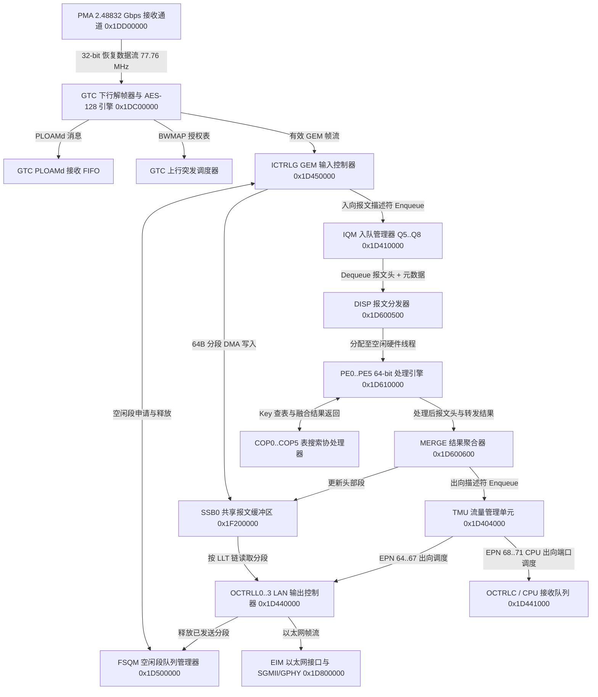

# 8.1 下行接收路径

下行接收路径覆盖从 2.48832 Gbps 光信号进入 `PMA`（`0x1DD00000`）与 `GTC`（`0x1DC00000`）开始，经 `ICTRLG`（`0x1D450000`）GEM 重组并写入 `SSB0`（`0x1F200000`）报文缓冲区，由 `IQM`（`0x1D410000`）、`DISP`（`0x1D600500`）、`PE0`–`PE5`（`0x1D610000`–`0x1D660000`）、`MERGE`（`0x1D600600`）和 `TMU`（`0x1D404000`）完成分类、改写与队列调度，最终经 `OCTRLL0`–`OCTRLL3`（`0x1D440000`–`0x1D440300`）与 `EIM`（`0x1D800000`）从 UNI 端口发出的硬件流水线。

---

## 1. GTC 下行定帧、FEC 与 GEM 解封装 (`0x1DC00000`)

`PMA`（`0x1DD00000`）接收 2.48832 Gbps NRZ 光信号并完成时钟数据恢复（CDR）与 32 位串并转换后，按 77.76 MHz 字时钟向 `GTC`（`0x1DC00000`）输出数据流。每个 125 µs GPON 下行帧固定为 38,880 字节。

### 1.1 物理同步状态机与前向纠错 (RS-FEC)

1. **PSync 帧同步**：`GTC` 搜索 32 位物理同步字 `PSync = 0xB6AB31E0`。状态机状态由 `downstr_gtc_scon`（偏移 `0x0C`）反映：
   - `HUNT`：失步搜索状态，搜寻 `0xB6AB31E0`。
   - `PRE_SYNC`：预同步状态，连续 `M`（缺省 `M = 2`）个 125 µs 周期检测到正确 `PSync` 后进入同步态。
   - `SYNC`：同步锁定状态；连续 `N`（缺省 `N = 5`）帧丢失 `PSync` 时置位 `downstr_gtc_istatus_1`（偏移 `0x00`）中的 `LOF`（Loss of Frame）中断位并退回 `HUNT`。
2. **解扰码与 RS(255,239) 译码**：根据 `downstr_gtc_scon.DESCR_BYP` 与 `FEC_DECA` 控制位，硬件对 `PSync` 之后的帧净荷执行 `x^7 + x^6 + 1` 解扰码及 Reed-Solomon RS(255,239) 纠错译码。译码器每码块最多纠正 8 个字节错误，统计计数器如下：

| 字节偏移 | 寄存器名 | 说明 |
| --- | --- | --- |
| `0x98` | `downstr_gtc_fcerrcnt` | 已纠正的 FEC 字节错误计数 |
| `0x9C` | `downstr_gtc_fuerrcnt` | 不可纠正的 FEC 码字计数 |
| `0xA0` | `downstr_gtc_frcnt` | 正确接收的 FEC 码字计数 |
| `0xA4` | `downstr_gtc_frcbcnt` | 接收到的 FEC 校验字节总数 |

### 1.2 PCBd 提取：超帧计数器、PLOAMd 与 BWMAP

`GTC` 从下行物理控制块（PCBd）分离出以下三类控制数据：

- **Ident 与 30-bit 超帧计数器 (`SFC`)**：验证 4 字节 `Ident` 字段的 HEC 后，将 30 位超帧计数器锁存至 `downstr_gtc_sfcnt`（偏移 `0x10`），同时供 AES-128 计数器模式解密引擎与 Time of Day (`TOD`) 模块读取。
- **PLOAMd 消息**：校验 13 字节下行 PLOAM 消息的 CRC-8（生成多项式 `g(x) = x^8 + x^2 + x + 1`）。当 `ONU-ID` 匹配本机 `ONU-ID` 或广播地址 `0xFF` 时，消息推入内部 PLOAMd 接收 FIFO，并触发 `downstr_gtc_istatus_1.PLOAM_RX` 中断。
- **BWMAP 授权数组**：基于 `Plend` 字段（连续发送两次并带 HEC 保护）解析出本帧上行带宽分配图（每项 8 字节：`Alloc-ID`、`Flags`、`SStart`、`SStop`、`CRC-8`），直接送入 `GTC` 上行调度器。

### 1.3 40-bit GEM 帧头解析与 Port-ID 硬件过滤

PCBd 之后的 GTC 净荷区由连续的 GEM 帧组成。每个 GEM 帧以 5 字节（40 位）头部起始，位域定义如下：

| 位域范围 | 字段名称 | 宽度 | 硬件处理说明 |
| --- | --- | --- | --- |
| `[39:28]` | `PLI` | 12-bit | Payload Length Indicator，指示紧随其后的 GEM 净荷字节数（`0`–`4095`） |
| `[27:16]` | `Port-ID` | 12-bit | GEM 端口标识符（`0`–`4095`），用作 `GTC` 与 `ICTRLG` 端口查找表索引 |
| `[15:13]` | `PTI` | 3-bit | Payload Type Indicator：`bit 2` 指示 OAM/维护帧，`bit 1` 指示拥塞，`bit 0` 为 `0` 表示非末分片、为 `1` 表示末分片（End of Frame） |
| `[12:0]` | `HEC` | 13-bit | Header Error Control，BCH(39,12,2) 编码加上 1 位奇偶校验；可纠正单比特错误、检测双比特错误 |

`GTC` 内部集成 4096 项的 Port-ID 过滤表（512 × 32-bit 片上 RAM，每个 32 位字存放 8 个 Port-ID 的 4-bit 配置），通过间接访问寄存器 `downstr_gtc_rxpid_addr`（`0x54`）、`downstr_gtc_rxpid_wr`（`0x58`）和 `downstr_gtc_rxpid_rd`（`0x5C`）读写。每个 Port-ID 的 4-bit 配置位定义如下：

| 位偏移 | 位名称 | 说明 |
| --- | --- | --- |
| `bit 3` | `VALID` | `1`：接收该 Port-ID 的 GEM 帧；`0`：直接丢弃 |
| `bit 2` | `ENCRYPT_EN` | `1`：该 Port-ID 的 GEM 净荷启用 AES-128 计数器模式解密；`0`：明文直通 |
| `bits [1:0]` | `QUEUE_SEL` | 下游通道选择指示 |

当 `VALID == 1` 且 `ENCRYPT_EN == 1` 时，`GTC` 根据 30 位超帧计数器与帧内块计数器生成 128 位 Counter Block，使用 `downstr_aes_dekey[0..3]`（偏移 `0x40`–`0x4C`）中的活动密钥对 GEM 净荷执行在线 AES-128 解密；当到达 `downstr_aes_key_switch`（偏移 `0x50`）匹配的切换超帧号时，硬件在帧边界切换至影子密钥。

---

## 2. ICTRLG：GEM 分片重组与 SSB0 写入 (`0x1D450000`)

通过 `GTC` 过滤与解密的 GEM 帧进入 `ICTRLG`（Input Control GPON，物理基址 `0x1D450000`，窗口大小 `0x10000`）。

### 2.1 ICTRLG 寄存器与两级 GEM 端口映射表

`ICTRLG` 的控制寄存器与内部映射表布局如下：

| 字节偏移 | 寄存器/表名 | 宽度与项数 | 位域与功能说明 |
| --- | --- | --- | --- |
| `0x0000` | `ctrl` | 32-bit | `ACT`（bit 0）：模块使能；`CRC`（bit 1）：以太网 FCS 校验使能；`FRMCNT`（bit 2）：帧计数模式；`DBG`（bit 16）：调试访问使能 |
| `0x0004` | `dmaw_cfg` | 32-bit | `ALLOCQ`（bits 1:0）：向 `FSQM` 申请空闲段的逻辑队列号（0 或 1）；`FREEQ`（bits 9:8）：错包丢弃时归还空闲段的队列号；`LSARLMT`（bits 23:16）：本地段分配请求上限 |
| `0x0008` | `timeout` | 32-bit | `TIME`（bits 15:0）：GEM 分片重组超时阈值（按 312.5 MHz 周期计数） |
| `0x0030`–`0x004C` | `maxsize[0..7]` | 8 × 32-bit | `SIZE`（bits 15:0）：对应 `PDUT` 0..7 的最大重组字节数上限（典型配置：以太网 `9990`、OMCI `1984`、IP/MPLS `65535`） |
| `0x4000`–`0x7FFC` | `gpt[4096]` | 4096 × 32-bit | **GEM Port Table**：以 12-bit `Port-ID` 为索引。`VALID`（bit 8）：端口有效位；`GPIX`（bits 7:0）：映射到 8-bit 内部 GEM 端口索引（`0`–`255`） |
| `0x8000`–`0x83FC` | `gpix_cfg[256]` | 256 × 32-bit | **GPIX Configuration Table**：以 8-bit `GPIX` 为索引。`IQN`（bits 4:3）：目标入向队列选择；`PDUT`（bits 2:0）：基础协议类型（`0`：Ethernet，`1`：OMCI，`2`：IPv4，`3`：IPv6，`5`：MPLS 等） |
| `0x8400`–`0x87FC` | `gpix_rxfcnt[256]` | 256 × 32-bit | 各 `GPIX` 接收帧计数器 |
| `0x8800`–`0x8FFC` | `gpix_rxbcntl/h[256]` | 256 × 64-bit | 各 `GPIX` 接收字节数 64 位计数器（低 32 位位于 `0x8800`，高 32 位位于 `0x8C00`） |

### 2.2 OMCI 与业务报文的硬件识别及重组流程

1. **两级表查找 (`Port-ID` → `GPIX` → `PDUT` / `IQN`)**：
   - `ICTRLG` 提取 GEM 头部的 12-bit `Port-ID` 查询 `gpt[Port-ID]`。若 `VALID == 0`，该帧丢弃并递增 `dcnt2`（偏移 `0x20`，无有效 GPIX 丢包计数）。
   - 若 `VALID == 1`，取出 8-bit `GPIX` 并查询 `gpix_cfg[GPIX]`，获取 3-bit 协议类型 `PDUT` 和 2-bit 入队指示 `IQN`。
   - OMCI 管理帧由 `gpix_cfg[GPIX].PDUT == 1`（OMCI 类型）标识，而非依赖 GEM 头部的 `PTI` 位。当 `PDUT == 1` 时，硬件校验 OMCI Trailer（含 CRC-32），并在重组完成后将报文直接导向 `IQM` 的管理队列 `Q8`。
   - 当 `PDUT` 为用户数据报文时，`gpix_cfg[GPIX].IQN`（`0`..`3`）将报文映射到 `IQM` 的 GPON 下行数据队列：`IQN == 0` 对应 `IQM Q5`，`IQN == 1` 对应 `IQM Q6`，`IQN == 2` 或 `3` 对应 `IQM Q7`。
2. **FSQM 空闲段申请与 LLT 链接**：
   - 片上共享报文缓冲区 `SSB0`（物理基址 `0x1F200000`）按 64 字节粒度划分为 `0x4800`（18,432）个物理段（Segment），段指针宽度为 15-bit（`0x0000`–`0x47FF`），链表尾标志为 `NIL = 0x7FFF`。
   - 当帧的首个分片到达时，`ICTRLG` 通过 `dmaw_cfg.ALLOCQ` 指定的通道向 `FSQM`（`0x1D500000`）弹出一个空闲段号作为 `HeadLSA`（头部逻辑段地址），并将报文前 64 字节（预留头部偏移 `HDR_OFF` 后）通过 DMA 写入 `SSB0` 对应段。
   - 若报文跨越多个 64 字节段或跨越多个 GEM 分片（`PTI[0] == 0`），`ICTRLG` 持续向 `FSQM` 申请新段 `NextLSA`，并在 `FSQM` 的逻辑链接表（LLT RAM，`0x1D510000`）中将上一段的表项写为 `LLT[CurrLSA] = NextLSA`，同时暂存该 `GPIX` 的重组上下文（`HeadLSA`、`TailLSA`、当前累计长度 `LEN`）。
3. **末分片完成与入队 (`PTI[0] == 1`)**：
   - 当收到 `PTI[0] == 1` 的末分片时，`ICTRLG` 将末段的 LLT 表项封口（`LLT[TailLSA] = 0x7FFF`），检查重组总长度是否超过 `maxsize[PDUT]` 且（对于以太网报文）FCS 是否正确。
   - 若校验失败或重组超时（超过 `timeout.TIME`），`ICTRLG` 将 `HeadLSA` 至 `TailLSA` 的整条段链一次性归还给 `FSQM` 的 `dmaw_cfg.FREEQ`，释放全部已占用的 `SSB0` 段。
   - 若校验通过，`ICTRLG` 生成包含 `HeadLSA`、`TailLSA`、`PDU_LEN`、`HDR_LEN`、`GPIX`、`PDUT` 及源端口标识的入向报文描述符（Packet Descriptor），压入 `IQM` 对应的入向队列（`Q5`–`Q8`）。

---

## 3. IQM 入队管理与 DISP 报文分发 (`0x1D410000` / `0x1D600500`)

### 3.1 IQM 9 路入向队列分配与拥塞门限

`IQM`（Ingress Queue Manager，物理基址 `0x1D410000`）管理 9 条硬件入向 FIFO 队列（`Q0`–`Q8`），各队列的端口归属如下：

| 入向队列号 | 源硬件模块 | 典型流量类型 |
| --- | --- | --- |
| `Q0`–`Q3` | `ICTRLL0`–`ICTRLL3` | UNI LAN 端口 0–3 上行入向以太网流量 |
| `Q4` | `ICTRLC0` / `ICTRLC1` | CPU 注入报文及内部回环流量 |
| `Q5` | `ICTRLG` (`IQN = 0`) | GPON 下行高优先级（如语音/控制）数据流 |
| `Q6` | `ICTRLG` (`IQN = 1`) | GPON 下行组播/视频数据流 |
| `Q7` | `ICTRLG` (`IQN = 2, 3`) | GPON 下行普通单播数据流 |
| `Q8` | `ICTRLG` (`PDUT = 1`) | GPON 下行 OMCI 管理帧与 OAM 帧 |

每条队列在 `IQM` 中配有独立的占用计数器 `qocc[0..8]`、丢包计数器 `qdcnt[0..8]` 以及门限寄存器组 `iqt[i]`（步长 `0x20`）：
- `qdth`：队列尾部丢弃门限（Queue Discard Threshold，硬件寄存器按 `segments >> 3` 即 8 段为单位存储）。
- `qrth`：队列预留门限（Queue Reservation Threshold）。
- `qbth` / `qbtl`：队列背压高/低门限（Backpressure High / Low Threshold）。
- `goth` / `gocc`：全局共享段占用门限与当前计数。
- 此外，`FSQM` 维护 5 级全局空闲段门限 `FSQT0`–`FSQT4`（缺省配置为 `FSQT0 = 1024`，`FSQT1..4 = 12288`），当剩余空闲段低于对应颜色门限时触发入向早期丢弃。

### 3.2 DISP 头部提取与 PE 硬件线程派发

`IQM` 通过加权轮询调度器（`WRRQ0`–`WRRQ4`）从非空的 `Q0`–`Q8` 中选出下一个待处理描述符，送往 `DISP`（Dispatcher，物理基址 `0x1D600500`）：

1. **保序流水号分配**：`DISP` 为每个出队报文分配单调递增的序列号（Sequence Number），用于在多线程并行处理后由 `MERGE` 恢复同一数据流的报文顺序。
2. **报文头部预取**：`DISP` 根据描述符中的 `HeadLSA` 和 `HDR_LEN`，从 `SSB0` 读取报文前部（最高 128 字节头部区域），连同入向描述符元数据打包为线程上下文。
3. **空闲线程投递**：`DISP` 监控 `PE0`–`PE5` 共 48 个硬件线程（每颗 PE 含 3 台虚拟机 `VMx0`–`VMx2`、8 个硬件线程）的就绪状态，将头部与元数据直接写入首个空闲线程的本地数据 RAM 缓冲槽，并唤醒该线程从程序计数器起始入口执行分类微码。

---

## 4. SCE (PE0–PE5) 与 COP0–COP5 分类及头部改写

6 颗 64 位处理单元 `PE0`–`PE5`（物理基址 `0x1D610000`–`0x1D660000`，运行频率 625 MHz）通过内部交换网络与 6 个专用 16 位表搜索协处理器 `COP0`–`COP5` 协同完成下行转发决策：

| 流水阶段 | 执行引擎与协处理器 | 访问的硬件表 ID 与名称 | 硬件处理动作 |
| --- | --- | --- | --- |
| 1. 入向端口属性解析 | `PE` + `COP3` (`TBL`) | `DS_GEM_PORT` (ID 25，256 项)、`BRIDGE_PORT` (ID 65，88 项) | 以 `GPIX` 查询下行 GEM 端口表，获取关联的 `Bridge Port Index`、入向计量器 ID（Meter ID）与多播标志 |
| 2. 颜色标记与监管 | `PE` + `TBM` (`0x1D600700`) | 双桶令牌计量器 (`0`–`511`) | 若绑定了入向 Meter，向硬件 `TBM` 发起令牌扣减请求，根据 RFC 2698 / RFC 4115 判定报文颜色（Green / Yellow / Red） |
| 3. 扩展 VLAN 转换 | `PE` + `COP5` (`EXT`) | `EXTENDED_VLAN` (ID 41)、`VLAN_RULE` (ID 42，1024 项)、`VLAN_TREATMENT` (ID 43) | 提取外层与内层 VLAN 标签（EtherType、VID、PCP、DEI），在 `COP5` 执行二分/扫描规则匹配，返回标签剥离、压入、重写或 DSCP-to-PCP 映射指令 |
| 4. 转发域 (FID) 分配 | `PE` + `COP0` (`FID`) | `FID_ASSIGNMENT` (ID 1)、`FID_HASH` (ID 2) | 根据转换后的外层 VID 与 BridgeIndex 计算哈希或直接索引，解析出二层桥接域 `FID`（Filtering Identifier） |
| 5. 目的地址查表 | `PE` + `COP1` (`FWD`)、`COP4` (`MSF`) | `SHORT_FWD_HASH` (ID 9)、`SHORT_FWD_MAC` (ID 10)、`LONG_FWD_HASH` (ID 33) | 单播帧以 `FID + DMAC` 在 `COP1` 哈希查找出向 Bridge Port 与目标队列；IPv4/IPv6 组播帧结合 `COP4` 源过滤表解析出向端口位图（Port Map） |
| 6. 出向 VLAN 过滤 | `PE` + `COP2` (`TAG`) | `TAGGING_FILTER` (ID 17)、`VLAN` (ID 18) | 对目标 Bridge Port 执行出向 VID 白名单/黑名单过滤 |
| 7. 报文头重写与提交 | `PE` → `MERGE` (`0x1D600600`) | PE 本地头部缓冲区 | 在 PE 本地内存执行 VLAN Tag 增删改与 MAC 修改，调整 `HDR_OFF` 与 `HDR_LEN`，将修改后的头部与出向队列号 `QID` 提交给 `MERGE` |

`MERGE`（物理基址 `0x1D600600`）按 `DISP` 分配的序列号对 `PE0`–`PE5` 提交的结果重排序：
- 将修改后的报文头部写回 `SSB0` 的 `HeadLSA` 段。
- 若该报文为组播帧且匹配多个出向端口，`MERGE` 硬件自动复制描述符并将 `FSQM` 中对应段链的引用计数（Reference Counter）置为复制份数，无需在 `SSB0` 中拷贝报文净荷。
- 将出向报文描述符送入 `TMU`（`0x1D404000`）的目标出向队列 `QID`（`0`–`255`）。

---

## 5. TMU 队列管理、OCTRLL0–3 与 EIM 发送 (`0x1D404000` / `0x1D440000` / `0x1D800000`)

### 5.1 TMU WRED 准入与分级调度器

`TMU`（Traffic Management Unit，物理基址 `0x1D404000`）维护 256 条出向队列（`QID 0..255`）、128 个分级调度器块（Scheduler Block `0..127`）和 72 个出向端口（Egress Port Number `EPN 0..71`）：

1. **WRED 颜色敏感准入控制**：每个出向队列的最大物理段容量上限为 2304 段（`2304 × 64B = 144 KiB`），并配有尾部丢弃门限 `MAXX` 及 Green/Yellow 双色 WRED 斜率门限（`MINTHG`、`MAXTHG`、`MAXPG`、`MINTHY`、`MAXTHY`、`MAXPY`）。Red 报文超过 `MINTHY` 即丢弃；Yellow 与 Green 报文在对应门限区间内按 8-bit 硬件概率斜率执行随机早期丢弃。被 `TMU` 丢弃的报文立即由硬件遍历 `LLT` 将段链归还 `FSQM`。
2. **三级调度树与双桶整形 (TBS)**：256 条出向队列通过最多 3 级调度块汇聚至 72 个 `EPN`。每个调度块的 8 个输入支持 SP（Strict Priority）优先级或加权轮询（WRR，权重 `1`–`1023`），且任意队列或调度块均可绑定硬件双桶整形器（Token Bucket Shaper `0`–`255`，支持 PIR/PBS 与 CIR/CBS 限速）。
3. **出向端口 (`EPN 0..71`) 全局映射**：
   - `EPN 0`–`63`：对应上行 `OCTRLG` 的 32 个 T-CONT 常规与抢占端口（`rEPN` / `pEPN`）。
   - `EPN 64`–`67`（`0x40`–`0x43`）：固定对应下行 `OCTRLL0`–`OCTRLL3`（UNI 以太网端口 `0`–`3`）。
   - `EPN 68`–`71`（`0x44`–`0x47`）：固定对应 `OCTRLC` 的 4 个 CPU 主机接收端口（`EPFC0`–`EPFC3`，用于向 VPE0 上送 WAN 主机帧、LCT 维护帧、IGMP/ARP/DHCP 协议捕获帧及镜像调试帧）。

### 5.2 OCTRLL0–OCTRLL3 DMA 读取与段回收

`OCTRLL0`–`OCTRLL3`（Output Control LAN，物理基址 `0x1D440000`、`0x1D440100`、`0x1D440200`、`0x1D440300`）负责将 `TMU` 调度出的描述符重组为以太网字节流：

| 字节偏移 | 寄存器名 | 位域与功能说明 |
| --- | --- | --- |
| `0x00` | `ctrl` | `ACT`（bit 0）：激活输出状态机；`TOUTEN`（bit 1）：超时检测使能；`NEXT`（bit 4）：单步调试推进 |
| `0x04` | `cfg` | `EPN`（bits 6:0）：绑定的 `TMU` 出向端口号（`OCTRLL0..3` 固定配置为 `64 + port_id`，即 `EPN 64..67`） |
| `0x08` | `dctrl` | `FQ`（bit 0）：释放已发送分段时归还至 `FSQM` 的空闲队列编号（0 或 1） |
| `0x0C` | `toutcfg` | `TOUTVALUE`（bits 15:0）：端口发送挂死超时阈值（缺省 `0x6D` 对应 `1 s`） |
| `0x20` / `0x24` | `txbcntl` / `txbcnth` | 已发送总字节数 64 位计数器 |
| `0x28` | `txpcnt` | 已发送总包数计数器 |
| `0x2C`–`0x44` | `txp64cnt`–`txp1519cnt` | 按以太网帧长区间（64、65–127、128–255、256–511、512–1023、1024–1518、≥1519）统计的发送包数计数器 |

发送过程如下：
1. `OCTRLLn` 向绑定的 `EPN`（`64..67`）发起调度请求，接收包含首段 `HLSA`、尾段 `TLSA`、改写后头部长度 `HDRL`、净荷体偏移 `OFFS` 与净荷体长度 `BDYL` 的 128-bit 调度响应。
2. 先从首段 `HLSA` 偏移 `0` 处读取 `HDRL` 字节的改写后二层头部送入 `EIM` 发送 FIFO，随后沿 `LLT[HLSA]` 定位到原始净荷首段，跳过前 `OFFS` 字节（原二层头部），继续读取 `BDYL` 字节的报文净荷直至 `TLSA`。
3. 每当一个 64 字节段的数据全部移出后，`OCTRLLn` 立即将该段地址 `CurrLSA` 归还给 `FSQM`（若该段因组播复制带有大于 1 的引用计数，则递减引用计数，减至 0 时合入空闲链表），然后沿 `LLT[CurrLSA]` 跳转至下一段直至遇到 `0x7FFF`（`NIL`）。
4. 若出向以太网帧剥离 VLAN 标签后不足 60 字节（不含 4 字节 FCS），硬件自动补零填充至最小帧长，并在帧尾计算及追加 32-bit IEEE 802.3 FCS 校验和，最终由 `EIM`（`0x1D800000`）经片上 `GPHY0`/`GPHY1` 或 `SGMII`/`SXGMII` SerDes（`0x1D808C00` / `0x1D808800`，1 Gbps 或 2.5 Gbps）发送至外部主机。
