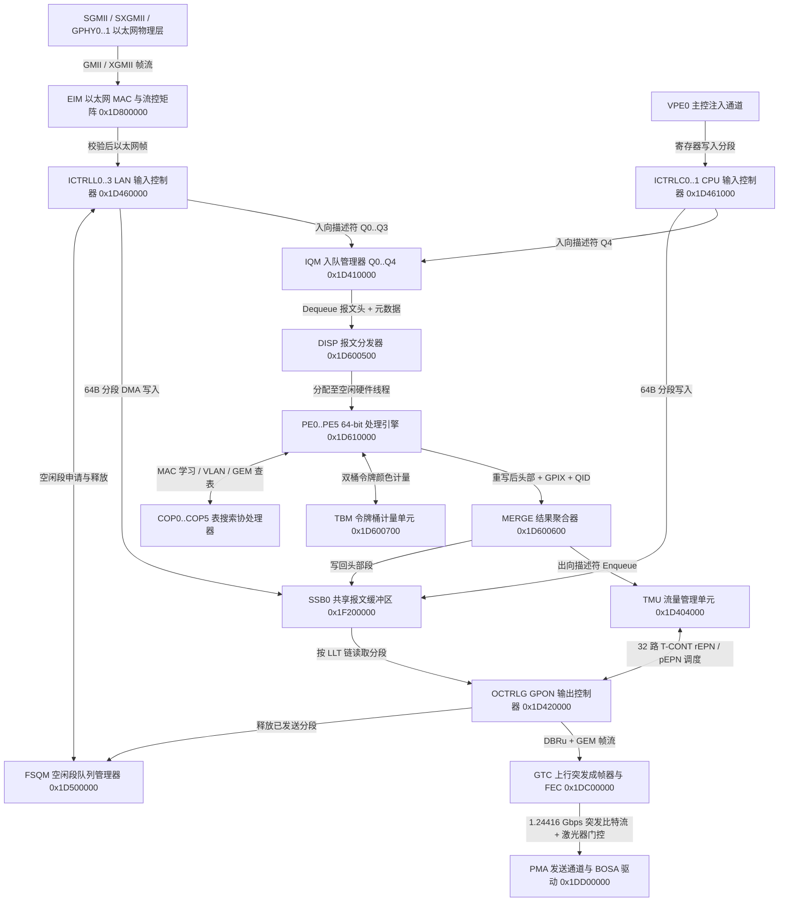

# 8.2 上行发送路径

上行发送路径覆盖从以太网 UNI 接口（`SGMII`/`SXGMII` 或片上 `GPHY0`/`GPHY1`）进入 `EIM`（`0x1D800000`）与 `ICTRLL0`–`ICTRLL3`（`0x1D460000`–`0x1D460600`），或从主控 CPU 经 `ICTRLC0`–`ICTRLC1`（`0x1D461000`–`0x1D461100`）注入 `SSB0`（`0x1F200000`），经 `IQM`（`0x1D410000`）、`DISP`（`0x1D600500`）、`PE0`–`PE5`（`0x1D610000`–`0x1D660000`）、`TBM`（`0x1D600700`）、`MERGE`（`0x1D600600`）和 `TMU`（`0x1D404000`）完成二层桥接、流分类、双桶监管与 T-CONT 分级调度，最终由 `OCTRLG`（`0x1D420000`）、`GTC`（`0x1DC00000`）和 `PMA`（`0x1DD00000`）按 BWMAP 授权执行 GEM 切片封装与 1.24416 Gbps 光突发发送的硬件流水线。

---

## 1. EIM、ICTRLL0–3 与 ICTRLC0–1 入向采集 (`0x1D800000` / `0x1D460000` / `0x1D461000`)

### 1.1 EIM 以太网 MAC 接收与 IEEE 802.3x 流控

外部以太网信号经 `SGMII`（`0x1D808C00`，1 Gbps / 2.5 Gbps）、`SXGMII`（`0x1D808800`）或片上 `GPHY0`/`GPHY1` 进入 `EIM`（Ethernet Interface Module，物理基址 `0x1D800000`）：
- **帧定界与 FCS 校验**：MAC 剥离前导码（Preamble）与帧起始定界符（SFD `0xD5`），校验 32-bit CRC-32 FCS，并根据最大帧长配置寄存器过滤超长帧（Jumbo Frame 上限可达 9,990 字节）。
- **PAUSE 流控反压**：当 `IQM` 中对应 UNI 入向队列（`Q0`–`Q3`）的占用量越过背压高门限 `qbth` 时，`EIM` 硬件自动以源 MAC 地址寄存器配置值向对端发送 IEEE 802.3x PAUSE 帧（EtherType `0x8808`，Opcode `0x0001`），或在半双工模式下施加 Jam 信号。

### 1.2 ICTRLL0–ICTRLL3 LAN 输入控制器 (`0x1D460000`–`0x1D460600`)

4 个 LAN 输入控制器 `ICTRLL0`–`ICTRLL3` 位于物理基址 `0x1D460000`、`0x1D460200`、`0x1D460400`、`0x1D460600`（步长 `0x200`）。硬件内部对 UNI 端口索引采用反向映射（逻辑 LAN 端口 `index` 对应硬件单元 `3 - index`），单实例寄存器定义如下：

| 字节偏移 | 寄存器名 | 位域与功能说明 |
| --- | --- | --- |
| `0x00` | `ctrl` | `ACT`（bit 0）：激活接收状态机；`RAW`（bit 1）：Raw 模式使能；`BC`（bit 2）：广播识别使能 |
| `0x04` | `dmaw_cfg` | `ALLOCQ`（bits 1:0）：向 `FSQM` 申请空闲段的队列号；`FREEQ`（bits 9:8）：异常丢包时归还段的队列号；`LSARLMT`（bits 23:16）：段分配请求上限 |
| `0x08`–`0x24` | `maxsize[0..7]` | `SIZE`（bits 15:0）：按 PDU 类型 0..7 设定的最大接收字节数阈值 |
| `0x28` / `0x2C` | `rxbcntl` / `rxbcnth` | 接收总字节数 64 位计数器 |
| `0x30` | `rxpcnt` | 接收总包数计数器 |
| `0x34`–`0x4C` | `rxp64cnt`–`rxp1519cnt` | 按帧长区间（64、65–127、128–255、256–511、512–1023、1024–1518、≥1519）统计的接收包计数器 |
| `0x50` | `ovsizecnt` | 超长帧丢弃计数器 |
| `0x54` | `dcnt` | 因 `FSQM` 段耗尽或 `IQM` 满导致的硬件丢包计数器 |
| `0x58` | `macerrcnt` | `EIM` 报告的 MAC 层 CRC/对齐错误帧计数器 |

`ICTRLLn` 接收到一个以太网帧时，向 `FSQM`（`0x1D500000`）逐段申请 64 字节 `SSB0` 段，在首段起始处预留 `HDR_OFF`（32 字节）头部扩展空间以便后续压入外层/内层 VLAN 标签或 PPPoE/GEM 头部，将帧数据通过 DMA 写入 `SSB0` 并在 `LLT` 中链接各段，最后生成入向描述符压入 `IQM` 的 `Q0`–`Q3`。

### 1.3 ICTRLC0–ICTRLC1 CPU 报文注入控制器 (`0x1D461000`–`0x1D461100`)

主控 CPU（VPE0）发送 OMCI 响应帧、IGMP/MLD 报告或管理平面报文时，通过 `ICTRLC0`（`0x1D461000`）或 `ICTRLC1`（`0x1D461100`）向数据通路注入报文：
1. 从 `FSQM` 申请空闲段并按 64 字节块将 PDU 写入 `SSB0` 内存窗口，同时在 `LLT` 中建立段链（末段写 `0x7FFF`）。
2. 将首段地址 `HeadLSA`、尾段地址 `TailLSA`、报文长度 `PDU_LEN`、协议类型 `PDUT`（例如 OMCI 或 Ethernet）以及目标队列标识写入 `IQM` 的 CPU 入向队列 `Q4`（或直接注入指定的 `TMU` 出向队列）。

---

## 2. SCE 上行分类、源 MAC 学习与 TBM 流量监管

`IQM` 从 `Q0`–`Q4` 调度出上行报文描述符后，经 `DISP`（`0x1D600500`）提取前 128 字节头部并分发至 `PE0`–`PE5`（`0x1D610000`–`0x1D660000`）的硬件线程。上行硬件处理流水线依次执行以下步骤：

1. **UNI 端口属性与入向 Bridge Port 解析**：
   - `PE` 读取本地常量表 `LAN_PORT`（ID 67，4 项）与 `BRIDGE_PORT`（ID 65，88 项），提取该 UNI 端口关联的 `Bridge Port Index`、缺省 VID/PCP、入向 ACL 掩码、源 MAC 学习使能位及学习数量上限。
2. **4-Lane 入向 ACL 与 EtherType 硬件过滤**：
   - 提取报文的 EtherType、VLAN、IPv4/IPv6 五元组字段，与 `ETHERTYPE_FILTER` 表及 4 通道 ACL 规则表比对，执行丢弃、强制重映射队列或捕获上送 CPU 动作。
3. **Extended VLAN 转换 (`COP5`) 与出向 VLAN 过滤 (`COP2`)**：
   - 将报文的タグ状态（Untagged / Single-Tagged / Double-Tagged）送入 `COP5`（`EXT`）检索 `EXTENDED_VLAN`（ID 41）、`VLAN_RULE`（ID 42）与 `VLAN_TREATMENT`（ID 43），执行上行 VLAN 标签压入（如 QinQ S-Tag 封装）、VID 翻译或 PCP 重映射。
4. **FID 确定 (`COP0`) 与源 MAC 硬件自动学习 (`COP1`)**：
   - `COP0`（`FID`）根据桥接索引与转换后的 VID 查找 `FID_ASSIGNMENT`（ID 1）/ `FID_HASH`（ID 2），确定报文所属的二层转发域 `FID`。
   - `COP1`（`FWD`）以 `FID + SMAC` 检索 `SHORT_FWD_HASH`（ID 9）与 `SHORT_FWD_MAC`（ID 10）。若源 MAC 未命中或入向端口号发生迁移，且当前 Bridge Port 的学习计数器未达上限，硬件将新 `FID + SMAC -> BridgePort` 表项写入 `SHORT_FWD_MAC` 并复位老化时间戳。
5. **上行 GEM 端口映射 (`COP3` / `COP4`)**：
   - 根据 Bridge Port 映射模式（802.1p P-Mapper `PMAPPER` 表 ID 66、VID 映射或流分类结果），确定上行目标 `GPIX`（8-bit 内部 GEM 端口索引，`0`–`255`）及对应的 `TMU` 出向队列号 `QID`（`0`–`255`），再查询 `US_GEM_PORT`（ID 33，256 项 × 64-bit）获取关联的上行计量器 ID 与加密标志。
6. **TBM 双桶三色流量监管 (`0x1D600700`)**：
   - 若 Bridge Port、VLAN 或上行 GEM Port 绑定了流量计量器（Meter），`PE` 向硬件 `TBM`（Token Bucket Meter，物理基址 `0x1D600700`）发起计量请求。
   - `TBM` 硬件支持 512 个单桶或 256 对双桶计量器（CIR/CBS 承诺桶与 PIR/PBS 峰值桶），兼容 RFC 2698（trTCM）与 RFC 4115（MEF 色盲/色敏模式）。`TBM` 根据当前桶水位与报文长度即时扣除令牌，返回报文颜色（Green / Yellow / Red）；Red 报文直接标记丢弃或降级，Green/Yellow 颜色随描述符传递至 `MERGE` 与 `TMU`。

---

## 3. TMU 上行调度、TBS 整形与 T-CONT 绑定 (`0x1D404000`)

`MERGE`（`0x1D600600`）将改写后的以太网帧头写回 `SSB0` 首段，并将带有目标 `QID`（`0`–`255`）、`GPIX`（`0`–`255`）和颜色标记的描述符推入 `TMU`（`0x1D404000`）。

### 3.1 队列 -> 调度块 (SB) -> T-CONT EPN 拓扑

上行方向共支持 32 个硬件 T-CONT（索引 `TCIX 0..31`）。每个 T-CONT 在 `TMU` 与 `OCTRLG` 之间绑定一对出向端口号（`EPN < 72`）：
- **常规出向端口 (`rEPN`，Regular Egress Port)**：承载该 T-CONT 下的普通优先级与加权轮询（WRR）业务流量。
- **抢占出向端口 (`pEPN`，Preempting Egress Port)**：承载该 T-CONT 下的高优先级低时延流量，可在 GEM 分片边界抢占同一 T-CONT 内正在发送的常规帧。

在 `TMU` 内部，256 条出向队列通过 128 个分级调度器块（Scheduler Block `SB 0..127`）汇聚至各 T-CONT 的 `EPN`（顶层 T-CONT 调度块编号遵循 `SB_ID = 93 + EPN` 固定映射关系）：
1. 每个调度块具有 8 个输入叶子（Leaf `0..7`），各叶子可独立配置为 SP（Strict Priority，Level `0..7`）或相同优先级下的 WRR 权重（Weight `1`–`1023`）。
2. 任意出向队列或调度块输出均可挂载 256 个硬件双桶整形器（Token Bucket Shaper `TBS 0..255`）之一；当整形桶令牌不足时，硬件暂时挂起该队列或调度分支的参与资格，直至令牌恢复。

---

## 4. OCTRLG：T-CONT 状态报告 (DBRu) 与 GEM 切片封装 (`0x1D420000`)

`OCTRLG`（Output Control GPON，物理基址 `0x1D420000`，窗口大小 `0x10000`）连接 `TMU` 与 `GTC` 上行通道，负责根据下行 BWMAP 授权从对应 T-CONT 读取数据、生成 DBRu 队列占用报告并执行 GEM 分片与头部封装。

### 4.1 OCTRLG 核心寄存器与三张硬件映射表

| 字节偏移 | 寄存器/表名 | 宽度与项数 | 位域与功能说明 |
| --- | --- | --- | --- |
| `0x0000` | `ctrl` | 32-bit | `ACT`（bit 0）：激活 `OCTRLG` 状态机；`TCRP`（bit 1）：T-CONT 报告模式 |
| `0x0004` | `cfg0` | 32-bit | `GTCFIFOTHRES`（bits 8:0）：向 `GTC` TX FIFO 写入的背压水位阈值；`IDLELEN`（bits 19:16）：GEM Idle 帧模式字长度；`IBS`（bit 24）：帧间突发同步控制 |
| `0x0008` | `cfg1` | 32-bit | `GEMPLSIZE`（bits 11:0）：最大单次 GEM 净荷切片长度（上限 `4095` 字节）；`TXPCNTFRAG`（bit 16）：分片计数模式；`TC0GTCFIFOTHRES`（bits 26:24）：T-CONT 0 专用 FIFO 水位 |
| `0x000C` | `dctrl` | 32-bit | `FQ`（bit 0）：已发送 `SSB0` 段归还至 `FSQM` 的空闲队列号（0 或 1） |
| `0x0010` | `dbrudbg` | 32-bit | 软件调试注入的 DBRu 报告值 |
| `0x0040`–`0x007C` | `idleframe[0..15]` | 16 × 32-bit | 无业务发送时填充带宽授权的 64 字节 GEM Idle 净荷模板 |
| `0x4000`–`0x7FFC` | `tcmap[4096]` | 4096 × 32-bit | **Alloc-ID to T-CONT Map**：以 BWMAP 中的 12-bit `Alloc-ID`（`0`–`4095`）为索引，输出 `VALID`（bit 5）与 5-bit 内部 T-CONT 索引 `TCIX`（bits 4:0，`0`–`31`） |
| `0x8000`–`0x807C` | `tctable[32]` | 32 × 32-bit | **T-CONT Configuration Table**：以 5-bit `TCIX`（`0`–`31`）为索引，配置该 T-CONT 绑定的常规端口号 `rEPN`（bits 6:0）与抢占端口号 `pEPN`（bits 14:8，最高位为有效位） |
| `0x8400`–`0x87FC` | `gpixtable[256]` | 256 × 32-bit | **GPIX to Port-ID Table**：以描述符携带的 8-bit `GPIX`（`0`–`255`）为索引，映射为写入上行 GEM 帧头的 12-bit `GPID`（bits 11:0，即 GEM `Port-ID`） |
| `0x8800`–`0x8BFC` | `txpcnt[256]` | 256 × 32-bit | 各 `GPIX` 上行已发送包/分片计数器 |
| `0x9000`–`0x97FC` | `txbcntl/h[256]` | 256 × 64-bit | 各 `GPIX` 上行已发送字节数 64 位计数器 |
| `0x9800`–`0x9814` | `txtpcnt`..`txttcnt` | 6 × 32-bit | 全局上行总包数、总字节数（64-bit）、总 Idle 帧数、总发送周期与总 T-CONT 突发次数统计 |

### 4.2 BWMAP 驱动的 DBRu 生成与 GEM 任意字节切片

当 `GTC` 解析出匹配本机的上行带宽授权（`Alloc-ID`、`Flags`、`SStart`、`SStop`）时，`OCTRLG` 按以下硬件状态机执行：

1. **Alloc-ID 查表与 T-CONT 定位**：
   - 用 12-bit `Alloc-ID` 索引 `tcmap[Alloc-ID]`。若 `VALID == 1`，取出 5-bit `TCIX`，再读取 `tctable[TCIX]` 获得该 T-CONT 的抢占端口 `pEPN` 与常规端口 `rEPN`。
2. **DBRu 动态带宽报告组装**：
   - 若授权中的 `Flags.Send_DBRu` 置位，`OCTRLG` 从 `TMU` 实时读取该 `TCIX` 关联队列的未发送累积字节数（以 4 字节字为单位），按授权指定的报告模式（Mode 0：1 字节、Mode 1：2 字节、Mode 2：4 字节）计算非线性压缩码并附加 CRC-8，放置在本次授权窗口起始处交由 `GTC` 发送。
3. **抢占/常规描述符拉取与 GEM 帧切片**：
   - `OCTRLG` 优先检查 `pEPN` 是否有待发报文；若无，则从 `rEPN` 拉取描述符（含 `HeadLSA`、`PDU_LEN`、`GPIX`）。
   - 用 8-bit `GPIX` 查找 `gpixtable[GPIX]` 获得 12-bit `Port-ID`。
   - 比较当前报文剩余字节数 `REM_LEN`、单帧上限 `cfg1.GEMPLSIZE` 以及本次 BWMAP 授权窗口剩余可用字节数 `GRANT_REM`：
     - 若 `GRANT_REM >= REM_LEN + 5`：整帧或末分片可在当前授权窗口内发完。硬件构造 5 字节 GEM 头部（`PLI = REM_LEN`，`Port-ID = GPID`，`PTI = 3'b001` 表示末分片，计算 13-bit `HEC`），从 `SSB0` 按 `LLT` 链读出全部剩余数据并向 `FSQM` 归还已读完的 64 字节段。
     - 若 `5 < GRANT_REM < REM_LEN + 5`：当前授权窗口不足以容纳整帧，硬件在任意字节边界执行 GEM 切片，构造非末分片 GEM 头（`PLI = GRANT_REM - 5`，`Port-ID = GPID`，`PTI = 3'b000` 表示后续仍有分片），仅发出 `GRANT_REM - 5` 字节净荷，并保存该端口当前段内字节偏移与剩余长度，留待下次同 T-CONT 授权到达时继续发送。
     - 若当前 T-CONT 队列为空或 `GRANT_REM <= 5`：`OCTRLG` 自动生成 5 字节 GEM Idle 帧头（`PLI = 0`，`Port-ID = 0xFFF`，`PTI = 0`，`HEC = 0x165`）及 `idleframe[]` 空闲净荷，填满剩余的授权时隙。

---

## 5. GTC 上行突发组装与 PMA 激光器门控 (`0x1DC00000` / `0x1DD00000`)

`OCTRLG` 输出的 DBRu 与 GEM 字节流进入 `GTC` 上行模块（`0x1DC00000`）与 `PMA` 发送切片（`0x1DD00000`）：

1. **突发开销组装 (PLOu 与 PLOAMu)**：
   - 根据 OLT 通过 `Upstream_Overhead` 与 `Extended_Burst_Length` PLOAM 消息下发的参数，`GTC` 在每个突发窗口（Burst）前端自动拼装物理层开销 `PLOu`：包含保护时间（Guard Bits）、Type 1/2/3 前导码（Preamble）和定界符（Delimiter），随后填入 1 字节 `BIP`、1 字节 `ONU-ID` 和 1 字节指示字段 `Ind`。
   - 若授权 `Flags.Send_PLOAMu` 置位，`GTC` 从上行 PLOAM 发送队列弹出一条 13 字节 PLOAMu 消息（自动附加 CRC-8）插入 `Ind` 之后。
2. **上行扰码与 RS(255,239) FEC 编码**：
   - 若授权 `Flags.Use_FEC` 或全局上行 FEC 使能位置位，`GTC` 对突发帧净荷按 239 字节数据块计算 16 字节 Reed-Solomon 校验码（末块采用缩短码），并执行 `x^7 + x^6 + 1` 自同步扰码。
3. **均衡时延 (`EqD`) 触发与激光器突发偏置控制**：
   - `GTC` 综合下行帧起始时刻、测距获得的均衡时延寄存器（粗粒度字偏移与比特级微调）以及授权中的 `SStart`、`SStop` 字节偏移，驱动 `PMA` 发送 FIFO（`gpon_tx_slice_pdi_fifo`，偏移 `+0x20C`）与激光器门控寄存器（`gpon_tx_slice_pdi_laser`，偏移 `+0x210`）。
   - 在突发数据比特移出前，硬件按配置的提前量 `nLaserEnStartExt` / `nLaserOffset` 提前拉高 `Burst_Enable` 信号开启 BOSA 激光器偏置与调制电流源；在突发末比特移出后，按延后量 `nLaserEnEndExt` 关断激光器电流，使非授权时隙内光功率处于关断基底以下。
