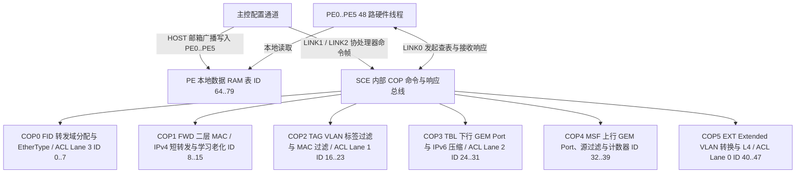
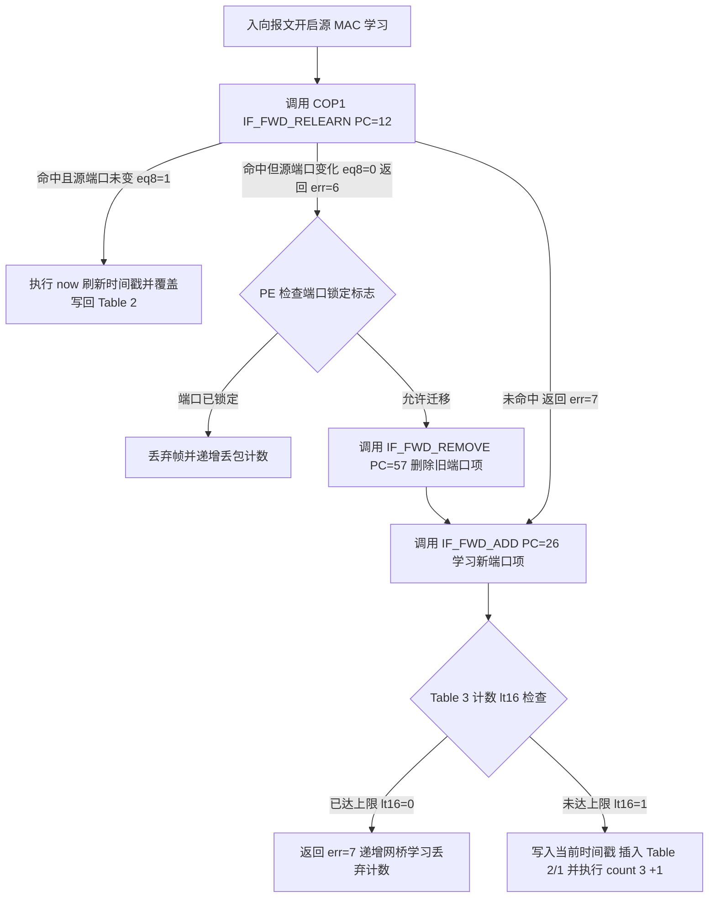

# 8.3 GPE 表接口与 FID 转发

GPE（GPON Packet Engine）采用双域硬件表架构支撑线速报文解析与转发：定长配置属性表镜像存储在 6 颗 `PE`（`PE0`–`PE5`，`0x1D610000`–`0x1D660000`）各自的片上数据 RAM 中，供硬件线程直接寻址；流表、哈希表、规则表与计数器表存储在 6 个表搜索协处理器功能块（`COP0 = FID`、`COP1 = FWD`、`COP2 = TAG`、`COP3 = TBL`、`COP4 = MSF`、`COP5 = EXT`）的专用表 SRAM 中，由协处理器微码或硬连线表引擎执行哈希查找、单链表遍历、三态掩码匹配或原子计数。各功能块的完整表存储器布局与表项位域见 [5.5 SCE 硬件功能块详解](../05_coprocessors/05_sce_function_blocks.md)，协处理器微码的逐行指令实现见 [5.8 TSE 微码固件反汇编逐行详解](../05_coprocessors/08_tse_firmware_disassembly.md)。

---

## 1. 硬件表编号空间与存储域划分

GPE 将全部硬件表统一编址在 7-bit 全局 `Table ID`（`0`–`79`）空间内，按 `ID = 64` 划分为两个物理存储域：

| 存储域 | 全局 Table ID 范围 | 硬件寻址译码 | 物理位置与访问机制 |
| --- | --- | --- | --- |
| **COP 协处理器表** | `0`–`63` | `cop_id = id >> 3` `tbl_id = id & 0x7` | 位于 `COP0`–`COP5` 专用表 SRAM（各功能块容量不能由单一 8 KiB 假设推断）。通过 `LINK0`（PE 线程）或 `LINK1`/`LINK2`（主控）发送 `LINKC1` 原语（`READ`、`WRITE`、`ADD`、`REMOVE`、`SEARCH`、`SEARCHR`、`SEARCHW`、`COUNT`、`EXEC`）访问 |
| **PE 本地镜像表** | `64`–`79` | `pe_tbl_idx = id - 64` | 位于 `PE0`–`PE5` 的 12 KiB 本地数据 RAM。转发线程直接读取；主控通过 `HOST[1]`–`HOST[9]` 邮箱寄存器配合 `PCTRL.ISIG` 信号以 `pe_mask = 0x3F` 广播写入全部 6 颗 `PE` |

### 1.1 数据通路转发查表总览

| 全局 Table ID | 表名称 | 所属功能块 | 项数 × 宽度 | 表类型 / 模式 | 报文转发阶段与硬件用途 |
| --- | --- | --- | --- | --- | --- |
| `1` / `6` | `FID_ASSIGNMENT_TABLE` | `COP0` (`FID`) | 256 × 64-bit | `LLIST` (`GENERIC` / `MASK`) | 哈希冲突链表，将 `(prio_inner, vid_inner, prio_outer, vid_outer)` 映射为 8-bit `FID` 与 `cross_connect` 标志 |
| `2` | `FID_HASH_TABLE` | `COP0` (`FID`) | 128 × 32-bit | `HASH` (`GENERIC`) | 128 桶 FID 哈希头表，指向 `FID_ASSIGNMENT_TABLE` 冲突链首节点 |
| `3` | `ETHERTYPE_FILTER_TABLE` | `COP0` (`FID`) | 64 × 32-bit | `LIST` (`GENERIC`) | 二层 16-bit EtherType 协议过滤列表（由 `IF_ETHFILT_SEARCHW` 检索并置位命中标志） |
| `4` / `5` | `ACL_FILTER_TABLE_LANE3` | `COP0` (`FID`) | 128 × 256-bit | `LIST` (`GENERIC` / `TERNARY`) | 4 通道并行 ACL 搜索的第 4 通道（`IF_ACL_SEARCH_3`） |
| `9` | `SHORT_FWD_HASH_TABLE` | `COP1` (`FWD`) | 512 × 32-bit | `HASH` (`GENERIC`) | 二层 MAC 与 IPv4 短转发表的 512 桶哈希头表 |
| `10` / `12` | `SHORT_FWD_TABLE` | `COP1` (`FWD`) | 1024 × 128-bit | `LLIST` / `VARRAY` | 存放单播 MAC、组播 MAC、IPv4 单播与 IPv4 组播转发项（物理表 2 为 `LLIST` 供查表增删，物理表 4 为重叠基址 `VARRAY` 供 `IF_FWD_AGE` 顺序扫描老化） |
| `11` | `LEARNING_LIMITATION_TABLE` | `COP1` (`FWD`) | 128 × 32-bit | `ARRAY` (`GENERIC`) | 按桥接端口索引存放 16-bit `learning_limit` 与 16-bit `association_count` |
| `17` | `TAGGING_FILTER_TABLE` | `COP2` (`TAG`) | 128 × 64-bit | `VARRAY` (`GENERIC`) | VLAN Tagging Filter 入口描述符表（含 `tci_mask`、过滤极性与 `vlan_table_index`） |
| `18` | `VLAN_TABLE` | `COP2` (`TAG`) | 1024 × 32-bit | `LIST` (`MASK`) | 供 `IF_TAG_FILTER` 顺序比对 16-bit TCI 的过滤段列表 |
| `19` | `MAC_FILTER_TABLE` | `COP2` (`TAG`) | 256 × 64-bit | `LLIST` (`GENERIC`) | 源/目的 MAC 地址过滤链表 |
| `20` / `21` | `ACL_FILTER_TABLE_LANE1` | `COP2` (`TAG`) | 128 × 256-bit | `LIST` (`GENERIC` / `TERNARY`) | 4 通道并行 ACL 搜索的第 2 通道（`IF_ACL_SEARCH_1`） |
| `25` | `DS_GEM_PORT_TABLE` | `COP3` (`TBL`) | 256 × 128-bit | `VARRAY` (`GENERIC`) | 下行 GEM 端口属性表（以 8-bit `GPIX` 直接索引） |
| `26` | `IPV6_REDUCTION_HASH_TABLE` | `COP3` (`TBL`) | 256 × 32-bit | `HASH` (`GENERIC`) | 128-bit IPv6 地址压缩表 256 桶哈希头 |
| `27` | `IPV6_REDUCTION_TABLE` | `COP3` (`TBL`) | 400 × 256-bit | `LLIST` (`GENERIC`) | 将 128-bit IPv6 地址压缩映射为 9-bit 短索引（`0`–`399`） |
| `28` / `29` | `ACL_FILTER_TABLE_LANE2` | `COP3` (`TBL`) | 128 × 256-bit | `LIST` (`GENERIC` / `TERNARY`) | 4 通道并行 ACL 搜索的第 3 通道（`IF_ACL_SEARCH_2`） |
| `33` | `US_GEM_PORT_TABLE` | `COP4` (`MSF`) | 256 × 64-bit | `VARRAY` (`GENERIC`) | 上行 GEM 端口属性表（以 8-bit `GPIX` 索引出向 `GEM Port-ID` 与 `egress_queue`） |
| `34` | `DS_MC_IP_SOURCE_FILTER_TABLE` | `COP4` (`MSF`) | 512 × 128-bit | `LIST` (`GENERIC`) | 下行 IGMPv3 / MLDv2 组播源 IP 地址过滤表 |
| `35` | `COUNTER_TABLE` | `COP4` (`MSF`) | 704 × 32-bit | `ARRAY` (`GENERIC`) | 桥接端口收发/丢包、上下行 GEM Port 帧计数与网桥学习丢弃计数器 |
| `36` | `VLAN_METERING_TABLE` | `COP4` (`MSF`) | 64 × 32-bit | `LIST` (`GENERIC`) | 基于 VID 的上下行 `TBM` 计量器绑定表 |
| `41` | `EXTENDED_VLAN_TABLE` | `COP5` (`EXT`) | 128 × 64-bit | `VARRAY` (`GENERIC`) | Extended VLAN 引擎入口描述符表（含 `rule_table_pointer` 与自定义 TPID） |
| `42` | `VLAN_RULE_TABLE` | `COP5` (`EXT`) | 1024 × 64-bit | `LIST` (`CUSTOM`) | Extended VLAN 96-bit 键匹配规则表 |
| `43` | `VLAN_TREATMENT_TABLE` | `COP5` (`EXT`) | 1024 × 64-bit | `VARRAY` (`GENERIC`) | Extended VLAN 标签剥离、重写与压入动作表（由 `treat` 指令合成 128-bit 改写向量） |
| `44` | `L4_FILTER_TABLE` | `COP5` (`EXT`) | 64 × 32-bit | `LIST` (`GENERIC`) | 四层 TCP/UDP 端口号过滤列表 |
| `45` / `46` | `ACL_FILTER_TABLE_LANE0` | `COP5` (`EXT`) | 128 × 256-bit | `LIST` (`GENERIC` / `TERNARY`) | 4 通道并行 ACL 搜索的第 1 通道（`IF_ACL_SEARCH_0`） |
| `64` | `CONSTANTS_TABLE` | `PE0`–`PE5` | 51 × 32-bit | `ARRAY` | SCE 全局协议常量、TPID、老化周期与异常计量器参数表 |
| `65` | `BRIDGE_PORT_TABLE` | `PE0`–`PE5` | 88 × 128-bit | `VARRAY` | 桥接端口配置表（含入出向 VLAN 索引、计量器、网桥索引与转发控制标志） |
| `66` | `PMAPPER_TABLE` | `PE0`–`PE5` | 32 × 96-bit | `VARRAY` | IEEE 802.1p P-Mapper 8 路优先级到上行 `GPIX` 映射表 |
| `67` | `LAN_PORT_TABLE` | `PE0`–`PE5` | 8 × 256-bit | `VARRAY` | UNI 物理端口入口属性表 |
| `76` | `BRIDGE_TABLE` | `PE0`–`PE5` | 8 × 256-bit | `ARRAY` | 8 个虚拟网桥实例配置表（广播/未知单播/未知组播 64-bit 泛洪端口位图） |

---

## 2. Bridge Port 硬件表 (`BRIDGE_PORT_TABLE`, ID 65)

`BRIDGE_PORT_TABLE`（ID 65）在每颗 `PE` 本地数据 RAM 中包含 88 个表项（索引 `0`–`87`），每个表项占 128 位（4 个 32 位字 `Word 0`–`Word 3`）。无论是 UNI 物理端口、802.1p P-Mapper 还是单播/组播 GEM 端口，均通过分配独立的 `Bridge Port Index` 接入二层桥接矩阵。

### 2.1 本地大端结构中的字段布局

以下从 `bsp/modules/onu/include/drv_onu_gpe_tables.h:struct gpe_bridge_port_table` 的大端分支读取，适用该 3.10 基线表 ABI；不能把后续移植新增字段混入原固件布局。

| 字 | 位域 | 字段 |
| --- | --- | --- |
| Word 0 | 31；9:8；7:0 | `valid`；`tp_type`；`tp_pointer` |
| Word 1 | 28:26；25:16；15:7；6:0 | `dscp_table_pointer`；`egress_filter_mask`；`meter_id_egress`；`tagging_filter_egress` |
| Word 2 | 31:23；22:16；15:8；7:0 | `meter_id_ingress`；`tagging_filter_ingress`；`da_filter_pointer`；`sa_filter_pointer` |
| Word 3 | 30:28；27:25；24:23；22:21 | 出/入向颜色标记；DA/SA 过滤模式 |
| Word 3 | 20:19；18:16；15:12 | `port_state`；`bridge_index`；`forwarding_method` |
| Word 3 | 11；10；9；8 | 端口锁定；IPv6 未知组播泛洪禁用；出向 meter 使能；本地交换使能 |
| Word 3 | 7；6；5；4；3；2；1；0 | 出向无标签丢弃；出向标签过滤；入向 meter；未知组播/未知单播泛洪禁用；入向无标签丢弃；入向标签过滤；学习使能 |

此前将 `learning_limit` 放在 Word 0、将 `exception_profile/ext_vlan_idx` 放在本表的布局没有该结构依据，已移除。异常模板的方向掩码与重定向动作见 [VLAN 与异常处理](04_vlan_and_qos_processing.md)。

---

## 3. FID 分配 (`COP0`) 与二层 MAC 转发、学习及老化 (`COP1`)

### 3.1 FID 转发域分配机制 (`COP0`)

`COP0`（`FID`）将报文的 32 位内外层 VLAN 标签键 `(prio_inner, vid_inner, prio_outer, vid_outer)` 映射为 8-bit 桥接转发域标识符 `FID`，支持共享 VLAN 学习（SVL，多个 VID 映射到同一 `FID`）与独立 VLAN 学习（IVL，每个 VID 映射到独立 `FID`）：

1. **只读查找 (`IF_FID_LOOKUP_MC`, `PC = 0`)**：
   - `COP0` 对输入的 32 位 VLAN 键计算 7-bit CRC 哈希值，读取 128 项的 `FID_HASH_TABLE`（ID 2）桶头。
   - 若桶头 `valid == 1`，提取 `[29:16]` 的链表首节点指针装入 `%index`，沿 `FID_ASSIGNMENT_TABLE`（ID 1，256 × 64-bit `LLIST`）遍历冲突链比对 32 位键，命中后返回 64 位表项（其中 `Word 1 [7:0]` 为 `fid`，`Word 1 [8]` 为 `cross_connect`）。
2. **单播查找与未命中自动分配 (`IF_FID_LOOKUP_UC`, `PC = 6`)**：
   - 先执行与 `IF_FID_LOOKUP_MC` 相同的哈希与链表搜索；若未命中，则直接从 `FID_ASSIGNMENT_TABLE` 空闲链分配新节点写入待插入的 `FID` 映射，并在原哈希桶为空时自动将新节点索引写回 `FID_HASH_TABLE`。

### 3.2 二层短转发表查找、源学习与老化状态机 (`COP1`)

`COP1`（`FWD`）管理 `SHORT_FWD_HASH_TABLE`（ID 9，512 × 32-bit 哈希桶头表）、`SHORT_FWD_TABLE`（ID 10 / 12，1024 × 128-bit 冲突链表池）和 `LEARNING_LIMITATION_TABLE`（ID 11，128 × 32-bit 端口学习限制表）：

- **目的地址查找 (`IF_FWD_FORWARD`, `PC = 1`)**：以 64 位键（`FID + DMAC` 或 `FID + DIP`）查 `Table 1` 与 `Table 2`。命中时读取高 64 位转发载荷，通过 `mov %data1, 0x100` 与 `or %data1, %data2` 将 `Word 2 [8]` 活动位置 `1` 后以 `add 2, 1` 覆盖写回，并将目标 `bridge_port_index`（单播）或 23 位 `port_map`（组播）返回给 PE。
- **源 MAC 重学习与端口迁移检测 (`IF_FWD_RELEARN`, `PC = 12`)**：查 `Table 1` 与 `Table 2`。若未命中则返回软错误 `%err = 7` 触发 `IF_FWD_ADD`；若已命中，硬件 `[eq8]` 条件比对表中已存的 `source_port` 与当前入向源端口：端口一致时执行 `now` 刷新 `Word 3 [15:0]` 时间戳并原地更新；端口不一致时返回软错误 `%err = 6`。
- **新 MAC 插入与学习上限控制 (`IF_FWD_ADD`, `PC = 26`)**：若表项置位了 `learning_limitation_enable`（`Word 2 [9]`），微码先读取 `Table 3[source_port]` 检查 `[lt16]`（`association_count < learning_limit`），超限则返回 `%err = 7`；通过检查后执行 `now` 打上当前硬件时间戳，插入 `Table 2` 冲突链与 `Table 1` 桶头，并对 `Table 3[source_port]` 执行 `count 3, +1`。
- **硬件老化扫描与自动断链 (`IF_FWD_AGE`, `PC = 0` → `PC = 77` → `PC = 57`)**：`PCTRL` 硬件定时器周期性触发老化线程按索引 `0`–`1023` 调用 `IF_FWD_AGE`。微码通过 `Table 4`（`VARRAY` 视图）读取 128 位表项，将低 64 位键装入 `%key`，检查 `dynamic_enable`（`Word 2 [10] == 1`）与硬件老化条件 `[aged]`；一旦老化到期，微码直接跳转至 `IF_FWD_REMOVE`（`PC = 57`），先对 `Table 3[source_port]` 执行 `count 3, -1`，再执行 `remove 2` 从冲突链摘除节点，并根据 `[first]` 与 `[last]` 标志自动更新或清空 `Table 1` 哈希桶头。

---

## 4. SCE 全局常量表 (`CONSTANTS_TABLE`, ID 64)

`CONSTANTS_TABLE`（ID 64）驻留在每颗 `PE` 本地数据 RAM 中，共 51 个 32 位字（行索引 `0`–`50`），提供报文解析微码所需的协议常量与默认参数：

| Row | 符号 | 用途 |
| --- | --- | --- |
| 0 | `ONU_GPE_CONST_PACKET_ENABLE` | 固件报文处理使能 |
| 1 / 2 / 3 | `DEFAULT_FID / VID / DEFAULT_DSCP` | 默认 FID、内外 VID、DSCP |
| 5 | `FWD_TABLESIZE` | 老化使用的转发表大小 |
| 6 / 7 | `TPID_CD / TPID_AB` | 两组 TPID |
| 9 | `ADDED_LATENCY` | 延迟循环预装载 |
| 11 / 12 | `LOCALMAC_ADRH / LOCALMAC_ADRL` | 本地 CPU MAC 高/低部分 |
| 13 | `ANI_EXCEPTION_METER` | bits 8:0 是桶索引（最低位应为 0），bit 9 是使能 |
| 14 / 15 / 16 | `ANI/UNI/IGMP_EXCEPT_POLICER_THRESHOLD` | 异常 policer 门限 |
| 17 | `METER_L2_MODE` | 计量模式 |

来源为 `bsp/modules/onu/include/drv_onu_resource_gpe.h` 的 `ONU_GPE_CONST_*`，每项 32 位，字节偏移为 Row × 4。未命名项不能从通用协议功能自行补出寄存器含义。

## 本地依据与适用范围

`bsp/modules/onu/include/drv_onu_gpe_tables.h`、`drv_onu_resource_gpe_tables.h`、`drv_onu_resource_gpe.h`；COP 调用语义另见原始 `tse*.bin`。所有表容量均需区别资源定义、固件初值和运行分配。

上述 `bsp/` 路径按本次审计的 `linux-3.10.49` 基线读取，属于源码/静态固件证据；不将 `linux-7.3` 移植结果或未上板验证的解释当作原固件运行事实。
