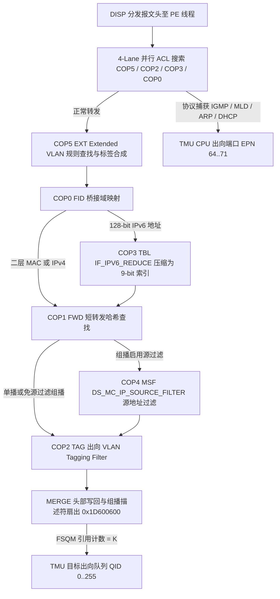

# 8.4 Extended VLAN、ACL 与组播

GPE 的 VLAN 转换、入向流分类（4-Lane ACL）、IPv6 地址压缩与组播扇出分别由专用硬件功能块 `EXT`（`COP5`）、`TAG`（`COP2`）、`TBL`（`COP3`）、`FID`（`COP0`）、`FWD`（`COP1`）和 `MSF`（`COP4`）配合 `PE0`–`PE5` 及 `MERGE`（`0x1D600600`）完成。各功能块的完整寄存器与表项位域见 [5.5 SCE 硬件功能块详解](../05_coprocessors/05_sce_function_blocks.md)。

---

## 1. Extended VLAN 硬件转换引擎 (`COP5` `EXT`)

`COP5`（`EXT`）处理单标签、双标签（QinQ）及无标签报文的 VLAN 匹配与头部改写，内部维护三张 64 位宽硬件表：`EXTENDED_VLAN_TABLE`（ID 41）、`VLAN_RULE_TABLE`（ID 42）和 `VLAN_TREATMENT_TABLE`（ID 43），由微码 `IF_VLAN_TRANSLATE`（`PC = 0`–`9`）串联执行：

1. **读取端口描述符 (`EXTENDED_VLAN_TABLE`, ID 41, 128 × 64-bit `VARRAY`)**：
   - 开启 `ena_ing_ext_vlan` 或 `ena_egr_ext_vlan` 的桥接端口通过 `BRIDGE_PORT.ext_vlan_idx` 指定 `EXTENDED_VLAN_TABLE` 索引。
   - 微码执行 `searchr 1, 0, 64` 读出该端口允许剥离的最大标签数 `max_tags_to_remove`（`Word 0 [25:24]`）、两套自定义 TPID 值 `inner_tpid_1_value` / `inner_tpid_2_value` 以及规则列表在 `VLAN_RULE_TABLE` 中的起始下标 `rule_table_pointer`（`Word 1 [29:16]`，即 `%data1.48`）。
2. **自定义协议规则匹配 (`VLAN_RULE_TABLE`, ID 42, 1024 × 64-bit `LIST` / `CUSTOM`)**：
   - 微码将 `rule_table_pointer` 装入 `%index`，执行 `searchr 2, 0, 64`。
   - `COP5` 的 `CUSTOM` 硬件匹配器同时比对入向帧的 96 位标签键（外层 TCI/TPID、内层 TCI/TPID、EtherType、内外层标签存在位）、`EXTENDED_VLAN_TABLE` 的端口自定义 TPID 以及 `CUSTOM0`–`CUSTOM4` 寄存器中的全局 TPID 与协议号（`0x0800` IPv4、`0x8863` PPPoE、`0x0806` ARP、`0x86DD` IPv6），直至命中规则或遇到 `end == 1` 终止。
3. **读取动作并硬件合成改写指令 (`VLAN_TREATMENT_TABLE`, ID 43, 1024 × 64-bit `VARRAY` + `treat` 指令)**：
   - 命中 `VLAN_RULE_TABLE[k]` 后，微码保持 `%index = k` 不变，执行 `searchr 3, 0, 64` 读出同下标的 `VLAN_TREATMENT_TABLE[k]`。
   - 随后执行专用指令 `treat`（`0x7810`），由硬件在单周期内根据 `number_of_tags_to_remove`、内外层 PCP/VID/TPID/DEI 生成规则以及入向 DSCP 候选优先级合成 128 位输出指令包返回给 `PE`。
   - `PE` 线程根据返回的 `remove_tags`、`add_outer_tag`、`add_inner_tag` 与新构造的 TCI/TPID，在本地头部缓冲区调整 `HDR_OFF` 与 `HDR_LEN` 完成二层帧头重写。

---

## 2. VLAN Tagging Filter 与 TCI 掩码列表 (`COP2` `TAG`)

`COP2`（`TAG`）在桥接转发路径上提供出入向 VLAN 过滤与 VLAN 计量绑定：

1. **`TAGGING_FILTER_TABLE` (`COP2` Table 1, 全局表 ID 17, 128 × 64-bit `VARRAY`)**：
   - 由 `BRIDGE_PORT.tag_filter_idx` 索引。`Word 0` 包含 `pass_on_match_enable`（bit 19，白名单/黑名单极性）、`tagged_drop_enable`（bit 18）、`tagged_pass_enable`（bit 17）、`untagged_drop_enable`（bit 16）和 16 位 `tci_mask`（bits 15:0）；`Word 1 [29:16]` 包含 `vlan_table_index`。
2. **`tag` 硬件指令与 `VLAN_TABLE` (`COP2` Table 2, 全局表 ID 18, 1024 × 32-bit `LIST`)**：
   - 微码 `IF_TAG_FILTER`（`PC = 0`–`15`）先执行 `tag` 指令（`0x7808`）快速处置无标签帧与无需查表的有标签帧。
   - 当需要比对 VID/TCI 列表时，微码将 `vlan_table_index` 装入 `%index`，将 `tci_mask` 装入 `%key_mask`，执行 `search 2` 扫描 `VLAN_TABLE` 子段，最后通过 `xorn %res1, %data1.19`（`0x6f98`）将列表命中标志与 `pass_on_match_enable` 做同或运算得出最终放行（`1`）或丢弃（`0`）结果。
3. **基于 VLAN 的计量器绑定 (`COP4` Table 4, `VLAN_METERING_TABLE`, 全局表 ID 36, 64 × 32-bit `LIST`)**：
   - 当端口启用了 VLAN 流量监管时，`PE` 以报文 VID 在 `COP4` 的 `VLAN_METERING_TABLE` 中检索绑定的 `us_meter_pointer` 或 `ds_meter_pointer`，并向 `COP14`（`TBM`）发起令牌桶扣减。

---

## 3. 4-Lane 并行 ACL 流分类、EtherType 过滤与异常捕获

### 3.1 4-Lane 并行 ACL 三态查找 (`COP5` / `COP2` / `COP3` / `COP0`)

SCE 将 128 条 256-bit ACL 规则槽位分布在 4 个独立的协处理器功能块中，构成 4 条并行查找通道：
- **Lane 0**：`COP5`（`EXT`）物理表 5/6，全局表 ID `45`/`46`，入口 `IF_ACL_SEARCH_0`（`PC = 10`）。
- **Lane 1**：`COP2`（`TAG`）物理表 4/5，全局表 ID `20`/`21`，入口 `IF_ACL_SEARCH_1`（`PC = 16`）。
- **Lane 2**：`COP3`（`TBL`）物理表 4/5，全局表 ID `28`/`29`，入口 `IF_ACL_SEARCH_2`（`PC = 10`）。
- **Lane 3**：`COP0`（`FID`）物理表 4/5，全局表 ID `4`/`5`，入口 `IF_ACL_SEARCH_3`（`PC = 32`）。

每条通道的微码首先从 `GENERIC` 表槽位 `0` 读取 256 位掩码（`read 4/5, 0, 256`），随后在共享同一物理基址的 `TERNARY` 表上从指定起始索引执行三态搜索（`searchr 5/6, 0, 128`），命中后通过 `mov %index, %prev_src || return 32` 返回命中规则下标与 `Word 6` 中的转发覆盖动作（目标端口覆盖、队列优先级覆盖、`TBM` 计量器绑定、重定向或丢弃）。

### 3.2 EtherType 与 L4 端口硬件过滤 (`COP0` ID 3 / `COP5` ID 44)

- **二层 EtherType 过滤**：`COP0` 的 `ETHERTYPE_FILTER_TABLE`（ID 3，64 × 32-bit `LIST`）由 `IF_ETHFILT_SEARCHW`（`PC = 28`）检索 16 位以太网协议号并在命中时通过 `searchw 3, 0, 32` 更新状态字。
- **四层 TCP/UDP 端口过滤**：`COP5` 的 `L4_FILTER_TABLE`（ID 44，64 × 32-bit `LIST`）提供 16 位四层源/目的端口号匹配。

### 3.3 协议捕获与异常报文上送 (`EXCEPTION_TABLE`, ID 78)

每个 `BRIDGE_PORT` 绑定一个 `exception_profile`（`0`–`7`），索引 `PE` 本地数据 RAM 中的 `EXCEPTION_TABLE`（ID 78，8 × 64-bit）。每项由 32 位 `forward_mask` 与 32 位 `cpu_mask` 组成，为 IGMP、MLD、ARP、DHCPv4/v6、PPPoE Discovery/Session、802.1X EAPOL、STP BPDU、CFM/OAM 以及 `ETHERTYPE_EXCEPTION_TABLE`（ID 79）定义的 8 种自定义 EtherType 分别指定丢弃（`00`）、仅硬件转发（`10`）、仅捕获上送 CPU（`01`）或转发同时镜像至 CPU（`11`）。

被判定为上送 CPU 的报文由 `PE` 赋予对应的异常原因码并路由至 `TMU` 的 CPU 出向端口（`EPN 64..71`）。对于来自 GPON ANI 侧的异常报文，`PE` 在入队前读取 `CONSTANTS_TABLE`（ID 64）Row 15–16 中的 `ani_exception_meter_id` 与 `ani_exception_meter_en`，调用 `COP14`（`TBM`）实施速率限制。

---

## 4. 组播转发、IPv6 地址压缩、源过滤与零拷贝扇出

### 4.1 二层 MAC 组播与 IPv4 组播转发 (`COP1` `FWD`)

- **二层 MAC 组播**：以 `FID + 组播 DMAC` 在 `COP1` 的 `SHORT_FWD_HASH_TABLE`（ID 9）与 `SHORT_FWD_TABLE`（ID 10）中查找。表项的 `port_map_indicator`（`Word 2 [23]`）置为 `1`，由 `Word 2 [22:16]`（`port_map_low[6:0]`）与 `Word 3 [15:0]`（`port_map_high[15:0]`）共同组成 23 位出向桥接端口位图。
- **IPv4 组播**：以 `FID + 32-bit IPv4 组播地址` 查找 `COP1` `SHORT_FWD_TABLE`。每次组播帧命中时，`IF_FWD_FORWARD` 微码自动置位 `Word 2 [8]` 活动位。

### 4.2 128-bit IPv6 地址哈希压缩 (`COP3` `TBL`)

针对 128 位 IPv6 目的地址，`PE` 先将 128 位 IPv6 地址发往 `COP3`（`TBL`）执行 `IF_IPV6_REDUCE`（`PC = 0`–`5`）：
1. `COP3` 对 128 位 IPv6 地址计算 8 位 CRC 哈希值，查找 `IPV6_REDUCTION_HASH_TABLE`（ID 26，256 × 32-bit）。
2. 沿桶头指针在 `IPV6_REDUCTION_TABLE`（ID 27，400 × 256-bit `LLIST`）中比对完整的 128 位 IPv6 地址，命中后返回 9 位槽位索引 `%index`（`0`–`399`）。
3. `PE` 将该 9 位压缩索引与 8 位 `FID` 组合为 64 位短键，继续送入 `COP1`（`FWD`）的 `SHORT_FWD_TABLE` 查找出向端口或组播位图。

### 4.3 IGMPv3 / MLDv2 组播源地址过滤 (`COP4` `MSF`)

当组播流启用了源地址过滤时，`PE` 向 `COP4`（`MSF`）的 `DS_MC_IP_SOURCE_FILTER_TABLE`（ID 34，512 × 128-bit `LIST`）发起 64 位键（`source_ip_address` + `multicast_group_ip_address`）搜索，根据命中项的 `port_map`（`Word 2 [31:16]`）与 `exclude_enable`（`Word 2 [8]`，`INCLUDE` / `EXCLUDE` 模式）裁剪最终允许转发的出向端口位图。

### 4.4 `MERGE` 与 `FSQM` 硬件零拷贝扇出 (`0x1D600600` / `0x1D500000`)

当组播或泛洪报文经过 `COP1`/`COP4` 及 `COP2` 出向过滤后，得出包含 `K`（`K >= 1`）个有效出向端口的位图：
1. `MERGE`（`0x1D600600`）统计置位端口数量 `K`，通知 `FSQM`（`0x1D500000`）将该报文 `HeadLSA` 段链的引用计数器设置为 `K`。
2. `MERGE` 依次为位图中的每个目标端口生成独立的出向报文描述符（携带各自的出向 `QID` 与出向 VLAN 改写结果），逐个压入 `TMU`（`0x1D404000`）。
3. 整个扇出过程在 `SSB0`（`0x1F200000`）中仅保留一份报文数据段链；每当一个出向控制器（`OCTRLL0`–`OCTRLL3` 或 `OCTRLG`）读完一个 64 字节段并请求释放时，`FSQM` 将该段的引用计数减 1，直至最后一个副本发送完毕（引用计数归零）时才将该段回收至空闲队列。
