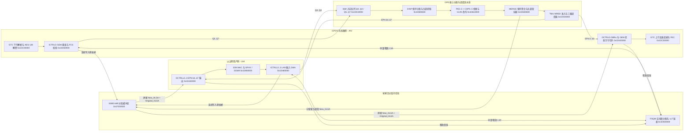
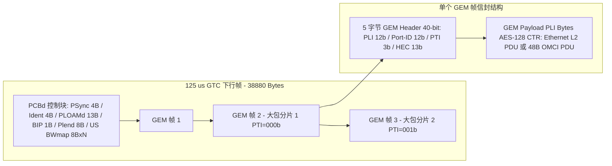
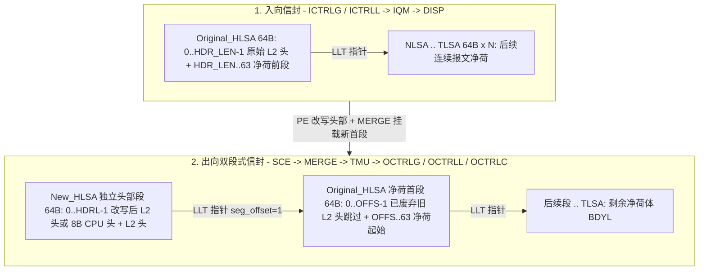
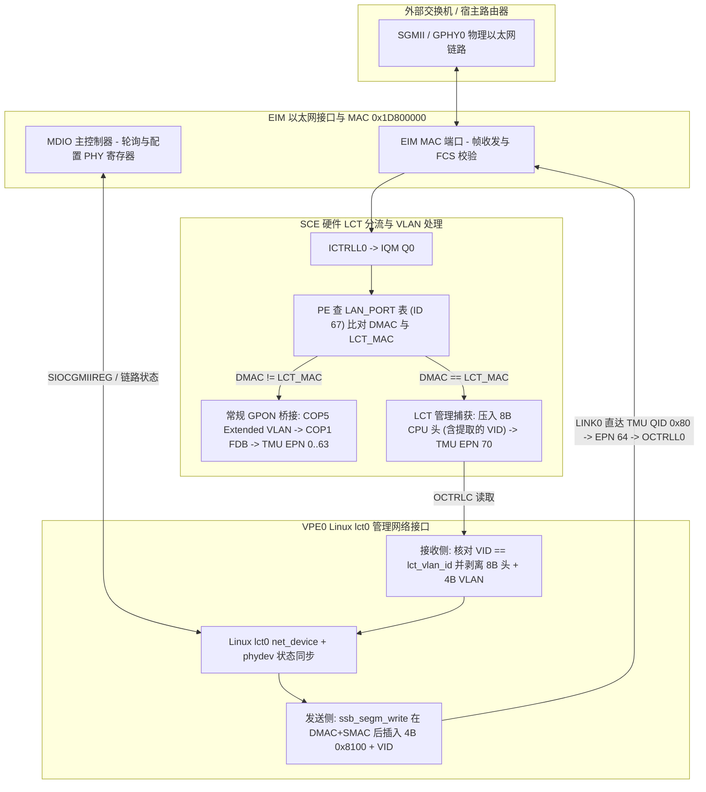

# 8.5 硬件快转闭环、GEM 封装信封、CPU 流量监听与 LCT 管理接口

GPE 数据通路在硬件上同时支持**无 CPU 介入的全卸载线速转发（Happy Hardware Forward Path）**与**细粒度 CPU 介入（协议捕获、镜像抓包、原始报文注入及带内/本地管理通信）**。以下详细阐述端到端硬件快转闭环、GEM 报文在光链路与 `SSB0` 内存中的信封结构、CPU 监听与注入 GPE 流量的硬件通道，以及主机网络接口（`lct0`、`host`）与以太网物理层（`GPHY` / `SGMII`）和 VLAN 标签处理的交互机制。

---

## 1. 端到端硬件全卸载快转路径（Happy Hardware Forward Path）

在稳态二层桥接与 VLAN 转发场景下，GPON ANI 侧与以太网 UNI 侧之间的双向数据流量全部在片上硬件状态机、包缓冲 RAM（`SSB0`）与微码引擎（`SCE` + `COP0..5`）内部闭环流动，主控 `VPE0` CPU 全程**零中断、零内存拷贝、零描述符干预**。

### 1.1 快转路径实现零 CPU 介入的四项硬件机制

1. **硬件闭环内存管理（`FSQM` + `SSB0`）**：
   - 入向 DMA 控制器（`ICTRLG` 或 `ICTRLL0..3`）在收到帧首字节时直接向 `FSQM`（`0x1D500000`）的分配队列（`OQ1`）弹出 15-bit 逻辑段地址（`LSA`），按 64 字节粒度写入 `SSB0`（`0x1F200000`）并在 `LLT`（`0x1D510000`）中串联成链。
   - 出向 DMA 控制器（`OCTRLL0..3` 或 `OCTRLG`）每向物理层移出一个 64 字节段，立即将该 `LSA` 推入 `FSQM` 的释放队列（`IQ1`）；若帧在入向因 CRC/FCS 错误或超长被丢弃，或因 `TMU` WRED 拥塞被丢弃，硬件同样自动遍历 `LLT` 回收整条段链。
2. **双段式头部/净荷分离改写（Split Header/Body Envelope）**：
   - 当 `PE0`–`PE5` 对报文执行 VLAN 标签压入（`+4 B` / `+8 B`）、剥离（`-4 B` / `-8 B`）或 PPPoE/MAC 改写时，二层帧头长度发生变化。
   - 为避免在 `SSB0` 中搬移后续上千字节的报文净荷，`MERGE`（`0x1D600600`）向 `FSQM` 申请一个独立的 **64 字节新头部段（`New_HLSA`）**，将改写后的二层头（长度 `HDRL` 字节）写入 `New_HLSA` 偏移 `0` 处，并在 `LLT` 中将 `New_HLSA` 指向原始首段 `Original_HLSA`（`LLT[New_HLSA] = Original_HLSA`），同时在描述符中记录原始二层头被跳过字节数 `OFFS` 与剩余净荷长度 `BDYL`。
   - 出向 DMA 读取时先从 `New_HLSA` 读取 `HDRL` 字节新头，随后沿 `LLT` 跳至 `Original_HLSA` 的 `+OFFS` 字节偏移处继续读取 `BDYL` 字节净荷，在发送流水线上完成实时拼接。
3. **微码与协处理器硬件自主 MAC 学习（`COP1` `FWD`）**：
   - 上行以太网帧经过 `PE` 与 `COP1` 时，若源 MAC（`FID + SMAC`）未在 `SHORT_FWD_TABLE`（ID 10）中命中，`IF_FWD_LEARN` 微码直接利用 `COP1` 的哈希桶分配与时间戳指令完成硬件自动学习及老化刷新，无需上送 CPU 学习。
4. **BWMAP 硬件直驱的上行突发与分片（`GTC` -> `OCTRLG` -> `TMU`）**：
   - `GTC` 从每帧下行 PCBd 提取出 BWMAP 授权后直接触发 `OCTRLG`。`OCTRLG` 自动查表将 12-bit `Alloc-ID` 转换为 `TMU` 的 `rEPN`/`pEPN` 端口号，实时读取队列堆积量生成 `DBRu` 报告，并按授权窗口剩余字节数对任意长度的以太网帧实施字节级 GEM 切片与上下文挂起/恢复（保存在 `DPTR[64]` 与 `DCONTEXT[64]` 中）。

---

## 2. GEM 帧封装、解封装与内存信封结构

GPON 封装方法（GEM，ITU-T G.984.3）在物理层控制块（PCBd）之后的 GTC 净荷区内提供面向连接的变长帧复用。在 Falcon 硬件中，一个报文从光纤比特流到片上内存再到以太网接口共经历三层信封形态转换。

### 2.1 光链路 GTC 帧与 5 字节 GEM 头部信封（Wire Envelope）

每个 125 µs 下行 GTC 帧（2.48832 Gbps 下固定为 `38,880 B`）由帧首的 `PCBd` 与紧随其后的 `GTC Payload` 组成。`GTC Payload` 内紧密排列连续的 GEM 帧（无业务时填充 5 字节 GEM Idle 帧 `0x000FFF0165`）：

5 字节（40-bit）GEM 头部的各字段定义及硬件解封装行为如下：

| 位域（大端序） | 字段名 | 位宽 | 硬件解封装（`GTC` + `ICTRLG`）与上行封装（`OCTRLG`）行为 |
| :--- | :--- | :--- | :--- |
| `bits [39:28]` | `PLI` | 12-bit | **Payload Length Indicator（净荷字节长度，`0..4095`）**：指示紧随 5 字节 GEM 头之后的净荷字节数。`GTC` 状态机利用 `PLI + 5` 字节偏移直接定位下一个 GEM 帧头的起始位置 |
| `bits [27:16]` | `Port-ID` (`GPID`) | 12-bit | **GEM 端口标识符（`0..4095`）**：1. 下行在 `GTC` 中索引 `downstr_gtc_rxpid[4096]`（决定是否接收及是否启动 AES-128 CTR 解密），随后在 `ICTRLG` 中索引 `gpt[4096]` 映射为 8-bit 内部索引 `GPIX`（`0..255`）；2. 上行在 `OCTRLG` 中由 `gpixtable[256]` 将 `GPIX` 反向映射为 `GPID` 填入帧头 |
| `bits [15:13]` | `PTI` | 3-bit | **Payload Type Indicator（净荷类型与分片指示）**：`bit 2` = OAM 维护帧指示；`bit 1` = 拥塞指示；**`bit 0` = 末分片标志（Last Fragment，`LF`）**：`0` 表示当前帧仅为上层 PDU 的非末分片（后续仍有同 `Port-ID` 的 GEM 分片），`1` 表示当前帧为完整 PDU 或最后一个分片 |
| `bits [12:0]` | `HEC` | 13-bit | **Header Error Control**：前 39 位经 BCH(39,12,2) 编码产生 12 位校验位（生成多项式 `x^12 + x^10 + x^8 + x^5 + x^4 + x^3 + 1`）并附加 1 位偶校验。硬件支持纠正单比特与双比特头部错误；若检测到不可纠正多比特错误，`GTC` 丢弃该帧并进入 GEM 重新狩猎（Hunt）状态 |

### 2.2 GEM 净荷内的二层协议信封（Ethernet-over-GEM 与 OMCI）

GEM 净荷经过 `GTC` 在线 AES-128 CTR 解密并由 `ICTRLG` 跨分片（连接所有 `PTI[0] == 0` 分片直至 `PTI[0] == 1`）重组后，根据 `ICTRLG.GPIX_CFG[GPIX].PDUT` 重组出两类核心二层信封：

1. **以太网二层帧信封（`PDUT = 0`，Ethernet-over-GEM，ITU-T G.984.3 Section 8.3.2）**：
   - 在 GPON GEM 封装中，**以太网物理层的 7 字节前导码（Preamble `0x55..55`）与 1 字节帧起始定界符（SFD `0xD5`）被完全剥离**，不进入 GEM 净荷。
   - GEM 净荷的第 0 字节直接从 **目的 MAC 地址（`DMAC`，6 字节）** 开始，完整保留 **4 字节以太网帧校验序列（`FCS`，IEEE 802.3 CRC-32）**：

   | 字节偏移 | 字段名称 | 长度 | 在 `ICTRLG` / `OCTRLG` 中的硬件处理说明 |
   | :--- | :--- | :--- | :--- |
   | `+0` | `DMAC` | `6 B` | 目的 MAC 地址（单播、组播 `01:00:5E:...` / `33:33:...` 或广播 `FF:FF:FF:FF:FF:FF`） |
   | `+6` | `SMAC` | `6 B` | 源 MAC 地址 |
   | `+12` | `Outer / Inner VLAN` | `0 / 4 / 8 B` | 可选的 802.1Q / 802.1ad 标签（例如 `0x88A8 + S-TCI`、`0x8100 + C-TCI`） |
   | `+12 + 4N` | `EtherType / Length` | `2 B` | 以太网协议类型（如 `0x0800` IPv4、`0x86DD` IPv6、`0x8863/0x8864` PPPoE） |
   | `+14 + 4N` | `L3 Payload` | `46..9972 B` | 三层数据报文净荷（最短补齐使不含 FCS 的二层帧达 60 字节） |
   | `末尾 4 B` | `Ethernet FCS` | `4 B` | **32-bit CRC-32 校验和**：下行重组完成时由 `ICTRLG`（当 `CTRL.CRC_EN = 1` 时）硬件校验，校验通过后在写入 `SSB0` 的长度字段中剥离 FCS；上行由 `OCTRLG`/`GTC` 在封装 GEM 前自动重算并追加 4 字节 FCS |

2. **OMCI 管理消息信封（`PDUT = 3` / `GPIX_CFG.PDUT = 1`，ITU-T G.988）**：
   - OMCI 通道拥有独立的専用 `GEM Port-ID`（由下行 `Assign_ONU-ID` 与 `Configure_Port-ID` PLOAM 消息指派，固定映射至 `GPIX 254/255`，且在 `downstr_gtc_rxpid` 中不启用 AES 加密）。
   - OMCI 消息**不包含任何以太网 MAC 头部**，GEM 净荷直接承载 48 字节基准消息（Baseline Message，Device ID `0x0A`）：`TCID (2B) | MsgType (1B) | DevID 0x0A (1B) | ME Class (2B) | ME Instance (2B) | Content (32B) | Trailer 0x0028 + CRC-32 (8B)`。
   - `ICTRLG` 硬件直接校验末尾 4 字节 CRC-32（失败则递增 `BADOMCI` 偏移 `0x0060` 计数器并丢弃），校验通过后压入 `IQM` 的 OMCI 专用队列。

### 2.3 片上 `SSB0` 内存信封与 128-bit 描述符（In-Memory Envelope）

报文在 `SSB0`（物理基址 `0x1F200000`，有效数据包缓冲区起始偏移由 `SBS0CTRL.BAR1` 指定，即 `PSA = 0x1F200000 + BAR1 + LSA × 64`）中传递时，在 `SCE` 处理前后具有两种不同的内存信封形态：

当出向模块（`OCTRLG`、`OCTRLL0..3` 或 CPU 的 `OCTRLC`）向 `TMU` 发送 64-bit `SCHEDULE_REQUEST` 后，`TMU` 返回 **128-bit（4 × 32-bit 字）`SCHEDULE_RESPOND` 描述符**，精确描述双段式信封的拼接参数：

| 响应字 | 位域范围 | 符号名称 | 硬件信封拼接含义 |
| :--- | :--- | :--- | :--- |
| `Word 0` | `bits [15:13]` | `PDUT` | 协议数据单元类型：`0` = `ETH`（以太网），`1` = `IP`，`2` = `MPLS`，`3` = `OMCI`，`7` = `CMD`（内部控制命令） |
| `Word 0` | `bits [9:0]` | `SEGL` | 该报文占用的 `SSB0` 64 字节逻辑段总数（包含 `New_HLSA` 头部段与全部净荷段） |
| `Word 1` | `bits [15:8]` | `OFFS` | **净荷段内跳过偏移（Body Offset，字节数）**：指示跳过头部段后，在第一个净荷段（`Original_HLSA`）起始处需跳过的旧二层头部字节数 |
| `Word 1` | `bits [7:0]` | `HDRL` | **新头部长度（Header Length，字节数）**：存储在 `HLSA`（`New_HLSA`）段内偏移 `0` 处的改写后二层头（含可能压入的 VLAN 标签及 8 字节 CPU 异常头）字节数 |
| `Word 2` | `bits [30:16]` | `TLSA` | **尾段逻辑地址（Tail LSA）**：报文最后一个 64 字节段的 15-bit 地址（`LLT[TLSA] = 0x7FFF`） |
| `Word 2` | `bits [14:0]` | `HLSA` | **头段逻辑地址（Head LSA）**：报文首个 64 字节段（即 `New_HLSA`）的 15-bit 地址 |
| `Word 3` | `bits [15:0]` | `BDYL` | **净荷体字节长度（Body Length）**：从净荷首段偏移 `OFFS` 开始直至 `TLSA` 末尾的净荷字节数。重组后报文总长度 `LEN = HDRL + BDYL` |

---

## 3. CPU 介入数据通路、流量监听（Tap / Mirror）与报文注入机制

主控 `VPE0` CPU 通过五组基于片上 64-bit `LINK` 协议的硬件控制器（`OCTRLC`、`ICTRLC0`、`ICTRLC1`、`LINK0`、`LINK1`）接入 GPE 流水线，能够在入向分类前或出向调度后读取、监听、镜像或注入任意报文。

### 3.1 五组 CPU 硬件接入通道寄存器与协议对比

`OCTRLC`、`ICTRLC0/1` 与 `LINK0/1/2` 共享统一的 64-bit FIFO 寄存器模型（`CTRL` `0x00`、`IRNCR` `0x10`、`IRNICR` `0x14`、`IRNEN` `0x18`、`LEN` `0x20`、`DATA0` `0x24`、`DATA1` `0x28`），每次写 `DATA0`（低 32 位）+ `DATA1`（高 32 位）压入一个 64-bit 字，并通过 `CTRL.SOP`（`bit 1`）与 `CTRL.EOP`（`bit 0`）标记消息首尾：

| 硬件接口 | 物理基址 | 连接的 GPE 端点 | 消息格式（宽度） | 硬件功能与适用场景 |
| :--- | :--- | :--- | :--- | :--- |
| `OCTRLC` | `0x1D441000` | `TMU` 出向端口 `EPN 68..71`（`0x44..0x47`） | 发送 64-bit `SCHEDULE_REQUEST`；接收 128-bit `SCHEDULE_RESPOND` | **CPU 统一报文接收出口**：当 `TMU` 的 `EPN 68..71` 非空并触发 `TMU_IRNCR.EPFC0..3`（bits 8..11）中断时，CPU 通过 `OCTRLC` 请求调度并获取 `HLSA..TLSA`，随后直接从 `SSB0` 读取报文 |
| `ICTRLC0` | `0x1D461000` | `IQM` 入向队列 `Q4` (`CPU_US`) | 发送 128-bit `ENQUEUE_REQUEST` (`HLSA`, `TLSA`, `PLEN`, `GPIX`) | **上行入向流水线注入（经过 SCE）**：将 CPU 发出的报文（如 `host` 接口 WAN 报文）送入 `IQM Q4`，使其完整经历 `SCE` 的上行 VLAN 转换、ACL 与 T-CONT 队列映射 |
| `ICTRLC1` | `0x1D461100` | `IQM` 入向队列 `Q8` (`CPU_DS`) | 发送 128-bit `ENQUEUE_REQUEST` (`PDUT=0` 以太网或 `PDUT=7` `CMD`) | **下行入向流水线注入与 PE 表访问**：1. 模拟从 GPON 侧注入下行以太网帧并交由 `SCE` 分类转发至 UNI；2. 发送 `PDUT = 7`（`GPIX = 0xFF`）的内部命令帧读写 `PE`/`COP` 硬件表 |
| `LINK0` | `0x1D450000` | `TMU` 任意出向队列 `QID 0..255` | 发送 128-bit `DELIVER_REQUEST` (`IPN=7`, `QID`, `HLSA`, `TLSA`, `PLEN`, `GPIX`, `REQ_C=1<<29`) | **出向队列直接注入（绕过 SCE）**：跳过 `IQM` 与 `SCE` 分类引擎，直接将构造好的报文（如 OMCI 上行响应、`lct0..3` 本地管理帧、环路检测帧）压入指定的 `TMU` 出向队列 `QID` |
| `LINK1` | `0x1D450100` | `IQM` 入向队列 `Q7` (`OMCI`) | 读取 14 或 18 个 32-bit 字 | **OMCI 入向直读通道**：直接从 `DISP`/`IQM` 读取下行 48 字节基准 OMCI 消息或描述符 |

### 3.2 4 个 CPU 出向端口（`EPN 68..71`）与 8 个逻辑网络端口映射

在系统内部，CPU 侧共定义 8 个逻辑收发端口（`port_id 0..7`，对应 Linux 网络设备名 `host`、`lct0`–`lct3`、`exc`、`dbg`、`dbc`），分别关联至 `TMU` 的 CPU 出向端口 `EPN 68`（`cpu_port = 0`）与 `EPN 70`（`cpu_port = 2`）：

| 端口号 (`port_id`) | 接口名称 | 类型 (`type`) | 绑定的接收端口 (`EPN`) | 默认发送目标 (`QID` / 通道) | 头部模式 (`hdr_mode`) | 硬件数据流向与用途说明 |
| :--- | :--- | :--- | :--- | :--- | :--- | :--- |
| `0` | `host` | `2` (ANI) | `EPN 68` (`cpu_port 0`, `QID 240..247`) | `IQM Q4` (`0x04`，经 `ICTRLC0`) | `1` (ANI) | **WAN 侧三层主机接口（如 TR-069 / IP Host）**：收发承载于 GPON 业务 GEM 端口上的本机三层 IP 管理流量 |
| `1` | `lct0` | `1` (UNI 0) | `EPN 70` (`cpu_port 2`, `QID 176..183`) | `TMU QID 0x80` (`128`，经 `LINK0` 直达 `EPN 64`) | `2` (UNI) | **UNI 0 本地维护接口（Local Craft Terminal）**：与外部主机通过物理以太网口进行本地 SSH / Web / Telnet 通信 |
| `2` | `lct1` | `1` (UNI 1) | `EPN 70` (`cpu_port 2`) | `TMU QID 0x88` (`136`，经 `LINK0` 直达 `EPN 65`) | `2` (UNI) | **UNI 1 本地维护接口** |
| `3` | `lct2` | `1` (UNI 2) | `EPN 70` (`cpu_port 2`) | `TMU QID 0x90` (`144`，经 `LINK0` 直达 `EPN 66`) | `2` (UNI) | **UNI 2 本地维护接口** |
| `4` | `lct3` | `1` (UNI 3) | `EPN 70` (`cpu_port 2`) | `TMU QID 0x98` (`152`，经 `LINK0` 直达 `EPN 67`) | `2` (UNI) | **UNI 3 本地维护接口** |
| `5` | `exc` | `0` (CPU) | `EPN 70` (`cpu_port 2`) | 由报文前 4/8 字节动态指定任意 `QID` 或 `IQM Q4/Q8` | `3` (EXC) | **协议异常捕获与原始注入接口**：接收 IGMP / MLD / ARP / DHCP / 802.1X 捕获帧（带 8B SCE 头），并支持向任意队列注入原始帧 |
| `6` | `dbg` | `0` (CPU) | `EPN 70` (`cpu_port 2` 实时克隆) | 不用于发送（只读监听） | `3` (EXC) | **CPU 端口全量镜像监听网卡**：开启后自动克隆 `EPN 70` 收到的所有原始帧（含 8B SCE 内部元数据头），供 `tcpdump` 抓包诊断 |
| `7` | `dbc` | `2` (ANI) | `EPN 70` (`cpu_port 2`, `GPIX=0xFE`) | `TMU QID 0xFA` (`250`，`GPIX=0xFE`，附带 `0x81000000` 标签) | `1` (ANI) | **ANI 光侧带内调试通道（Debug Channel）**：通过预留 `GPIX 0xFE` 与 OLT 进行带内维护帧收发 |

### 3.3 `EPN 70` 报文的 8 字节 SCE 内部元数据信封（CPU Envelope Header）

所有由 `SCE` 转发至 `EPN 70`（`cpu_port = 2`）的报文，其 `New_HLSA` 首段的起始 8 个字节（`buf.data[0..7]`）并非以太网 `DMAC`，而是由 `PE` 微码压入的 **8 字节 SCE CPU 元数据头**，紧随其后的偏移 `+8` 处才是以太网帧的 `DMAC`：

| 字节偏移 | 位域 | 字段含义与硬件分流判据 |
| :--- | :--- | :--- |
| `Byte 0` | `bits [7:0]` | 入向队列或分类目标队列标识 |
| `Byte 1` | `bits [7:6]` | **源/目的逻辑 UNI 端口号（`lan_idx = data[1] >> 6`，取值 `0..3`）**：标识该帧来自或归属于 `UNI0`–`UNI3` 中的哪一个物理以太网口 |
| `Byte 1` | `bits [5:0]` | 桥接端口与分类标志位 |
| `Byte 2` | `bits [7:0]` | **关联的 `GPIX`（内部 GEM 端口索引）**：当 `data[2] == 0xFE` 时标识来自 GPON ANI 带内调试通道（`dbc`） |
| `Byte 3` | `bits [4:0]` | **异常原因码（`Exception Index`）**：例如 `0x00` 表示正常本地路由（如命中 LCT MAC 或 DBC 帧），`0x15` 表示环路检测帧（Loop Detection Frame，`EtherType 0xFFFA`），其余值对应 IGMP、ARP、DHCP、EAPOL 或 ACL 捕获原因码 |
| `Byte 4` | `bit 7` (`0x80`) | **外层 VLAN 有效标志（`VLAN_VALID`）**：`1` 表示入向帧携带外层 VLAN 标签且已被提取至 `Byte 4..5`；`0` 表示入向无标签 |
| `Byte 4..5` | `Byte 4 [3:0] : Byte 5 [7:0]` | **提取的 12-bit 外层 VLAN ID（`VID`）**：由 `SCE` 解析并填入，供 CPU 在接收 LCT 管理帧时直接核对管理 VLAN ID |
| `Byte 6` | `bits [7:0]` | 保留状态字 |
| `Byte 7` | `bits [7:0]` | **内嵌净荷偏移量（`offset`）**：指示二层/三层协议载荷相对于 `+8` 起始处的字节偏移（用于环路检测与 DBC 帧解析） |

当 `EPN 70` 触发 `TMU_IRNCR_EPFC2`（`bit 10`）中断时，CPU 读取完整报文并根据上述 8 字节信封头执行多路分流：
1. 若 `dbg`（端口 6）已打开，首先将包含 8 字节 SCE 头在内的完整报文克隆一份上送 `dbg` 接口。
2. 若 `(data[3] & 0x1F) == 0x15` 且内嵌净荷以 `0xFF 0xFA` 开头、源 MAC 匹配本机 `lan_mac[lport]`，则在驱动内部直接完成**硬件端口环路检测（Loop Detection）**，自动调用 `lan_ingress_port_enable(pport, 0)` 关闭发生环路的 `IQM` 入向队列并上报环路事件；其余异常码报文保留 8 字节头直接上送 `exc`（端口 5）。
3. 若 `(data[3] & 0x1F) == 0` 且 `data[2] == 0xFE` 且 `data[4] & 0x80` 置位，则剥离 8 字节头与内部偏移后上送 `dbc`（端口 7）。
4. 其余 `Exception Index == 0` 的帧即为发往本机 UNI 口的 **LCT 管理帧**，剥离 8 字节头（及可选的 4 字节 LCT VLAN 标签）后按 `lan_idx = data[1] >> 6` 上送 `lct0`–`lct3`（端口 1–4）。

### 3.4 CPU 监听、抓包（Traffic Tap）与原始注入的四种工作模式

1. **无损协议镜像（`EXCEPTION_TABLE` ID 78 双掩码模式）**：
   - 每个桥接端口关联一个 `exception_profile`（`0..7`），对应 `PE` 本地 `EXCEPTION_TABLE` 中的 64-bit 表项（32-bit `forward_mask` + 32-bit `cpu_mask`）。
   - 对任意协议位（IGMP、MLD、ARP、DHCPv4/v6、PPPoE、802.1X、BPDU、CFM 或 8 个自定义 EtherType），将对应位在 `forward_mask` 与 `cpu_mask` 中**同时置 `1`**，即可令 `MERGE` 在维持线速硬件转发的同时，零拷贝复制一份描述符发往 `EPN 70`（由 `exc` 与 `dbg` 接收），实现特定控制协议的旁路监听。
2. **基于 4-Lane ACL 的精准业务流抓包（Flow Mirroring / Trapping）**：
   - 在 `COP5`/`COP2`/`COP3`/`COP0` 的 128 条 256-bit 三态 ACL 表中写入匹配规则（可匹配任意源/目的 IP、四层端口、MAC、VID 或入向 GEM Port `GPIX`），在动作字（`Word 6`）中置位异常捕获动作，即可将线上特定用户或特定 GEM 端口的流量实时镜像或重定向至 `EPN 70`。
3. **UNI 端口混杂模式抓包（Promiscuous Mode）**：
   - 当在 Linux 下对 `lct0`（或配合 `dbg`/`exc`）开启混杂模式（如运行 `tcpdump -i lct0` 或 `tcpdump -i dbg`）时，驱动保存当前 `EXCEPTION_TABLE` Profile 1 配置并将其改写为全捕获模式，使进入 UNI 的流量上送 `EPN 70`。
4. **通过 `exc` 接口（端口 5）向任意硬件队列注入原始报文**：
   - 向 `exc` 网络接口发送报文时，报文前 4 字节或 8 字节（由 `data[3]` 的 `bit 5 (0x20)` 选择：`0` = 4 字节头，`1` = 8 字节头）作为**硬件注入控制头**，并在写入 `SSB0` 前自动剥离：
     - **当 `data[3]` 的 `bit 6 (0x40) == 0`（直接出向队列注入）**：通过 `LINK0`（`ssb_equeue_write`）绕过 `SCE`，直接将报文打入 `QID = data[0]`（`0..255` 任意 `TMU` 出向队列），且 `GPIX` 由 `data[2]` 指定。
     - **当 `data[3]` 的 `bit 6 (0x40) == 1`（入向分类流水线注入）**：
       - 若 `data[3]` 的 `bit 7 (0x80) == 0`：通过 `ICTRLC1` 注入 **`IQM Q8`（下行入向队列）**，模拟来自 GPON 侧的下行包，目标 UNI 端口由 `data[1] >> 6` 指定。
       - 若 `data[3]` 的 `bit 7 (0x80) == 1`：通过 `ICTRLC0` 注入 **`IQM Q4`（上行入向队列）**，模拟上行包交由 `SCE` 分类，`GPIX` 由 `data[2]` 指定。

---

## 4. CPU / Linux 接口与以太网 PHY、VLAN 标签及 LCT 管理接口的交互

在 SFP GPON Stick（如 MA5671A）或单端口 ONU 中，物理上仅有一个以太网 UNI 接口（经 `SGMII` 或片上 `GPHY0` 连接外部交换机或路由器）。该物理接口必须同时承载**透明桥接的 GPON 宽带业务流**与**终结在 ONU 本地 Linux 系统的 `lct0` 管理流量**。

### 4.1 基于 `LAN_PORT` 表（ID 67）的物理端口业务与管理硬件分流

1. **LCT MAC 地址下发至微码表**：
   - 当 Linux 系统配置或修改 `lct0`–`lct3` 的网卡 MAC 地址时，驱动向 `PE` 发送内部表写命令（表 ID `0x43` / `67` `LAN_PORT`，实例掩码 `0x3F`，表项索引 `0..3`），将该管理接口的 48-bit MAC 地址写入 `LAN_PORT.mac_address_high`（高 16 位）与 `LAN_PORT.mac_address_low`（低 32 位）。
2. **`PE` 入向微码硬件识别**：
   - 从以太网 PHY 进入 `EIM` 与 `ICTRLL0`（`IQM Q0`）的每一个以太网帧，在进入 `PE` 线程的第一阶段即读取 `LAN_PORT` 表：
     - **用户业务帧（`DMAC != LCT_MAC`）**：进入标准 GPON 桥接流程（由 `COP5` 执行用户 VLAN 规则转换、`COP1` 查找转发数据库、送入 `TMU` 的 T-CONT 出向端口 `EPN 0..63` 由 `OCTRLG` 发往 OLT）。
     - **本地管理帧（`DMAC == LCT_MAC`，或匹配管理 ARP 规则）**：`PE` 立即旁路后续 GPON 桥接流程，将该帧重定向至 CPU 出向端口 `EPN 70`，并在帧首附上 8 字节 SCE CPU 元数据头（其中 `data[1] >> 6` 记录入向 UNI 端口号 `0..3`）。

### 4.2 CPU 路径上的 VLAN 打标（Tagging）与剥离（Untagging）机制

系统在 **LAN 侧本地管理接口（`lct0`）** 与 **WAN 侧光网络主机接口（`host`）** 上采用两套截然不同的 VLAN 标签处理机制：

| 对比维度 | `lct0`–`lct3`（以太网 UNI 侧本地管理接口） | `host`（GPON ANI 侧 WAN 主机接口） |
| :--- | :--- | :--- |
| **入向（RX）VLAN 过滤与剥离** | **SCE 提取 + CPU 核对剥离**：1. 若未启用 `lct_vlan_enabled`，剥离 8B CPU 头后直接交付 `lct0`；2. 若启用了 `lct_vlan_enabled`，`SCE` 将入向帧的外层 VLAN 提取至 8B CPU 头的 `data[4..5]`（`data[4] bit 7` 为有效位，低 12 位为 `VID`）。CPU 校验 `VID == lct_vlan_id`：不匹配则直接丢弃；匹配则将 `DMAC+SMAC`（`data[8..19]`）向后平移 4 字节覆盖原 802.1Q 标签（`memmove(data+12, data+8, 12)`），跳过前 12 字节后向 Linux `lct0` 交付无标签帧 | **COP5 全硬件剥离**：下行 WAN 管理流量在经过 `SCE` 时，直接由 `COP5`（`EXT`）匹配 `VLAN_RULE_TABLE` 并执行 `VLAN_TREATMENT_TABLE` 的标签剥离动作；到达 `EPN 68` 时已是不带外层 WAN VLAN 的以太网帧，CPU 从 `OCTRLC` 读出后直接交付 `host` |
| **出向（TX）VLAN 压入与队列路径** | **绕过 SCE + 写入 `SSB0` 时内联插入**：`lct0` 发送时经 `LINK0` 直接投入 `TMU QID 0x80`（`EPN 64` 最高优先级队列），**完全绕过 `SCE`（避免被用户口的上行 Extended VLAN 规则污染）**。当启用了 `lct_vlan_enabled` 时，`ssb_segm_write()` 在写入 `SSB0` 首段时先写入 12 字节 `DMAC+SMAC`，在偏移 `+12` 处直接插入 4 字节 `0x81000000 \| lct_vlan_id`，再写入后续字节，由 `OCTRLL0` 发往以太网 PHY | **注入 `IQM Q4` + COP5 全硬件打标**：`host` 发送时经 `ICTRLC0` 注入 `IQM Q4`（`custom_mode = 0x00040000`），进入 `SCE` 上行分类流水线，由 `COP5`（`EXT`）自动按 OMCI 下发的 Extended VLAN 规则压入 WAN 管理 VLAN（S-VLAN / C-VLAN）并映射至管理 T-CONT 队列 |

### 4.3 Linux 网络设备与以太网 PHY（`GPHY0/1` / `SGMII`）的链路联动

1. **MDIO 总线与 `phy_device` 绑定**：
   - `EIM`（`0x1D800000`）内置的 MDIO 主控制器管理片上 `GPHY0`/`GPHY1`（内部 MDIO 地址由 `lan_port[i].cfg.mdio_dev_addr` 指定）及外部 PHY。
   - `lct0`–`lct3` 在注册 `net_device` 时关联对应的 Linux `phy_device`（`dev->phydev`），将针对 `lct0` 的 `SIOCETHTOOL`、`SIOCGMIIPHY`、`SIOCGMIIREG`、`SIOCSMIIREG` ioctl 直接转发至内核 PHY 子系统，使 `ethtool lct0` 能够直接读写物理以太网口速率、双工与自协商状态。
2. **双端载波状态（Carrier Status）硬件同步**：
   - **UNI 侧（`lct0`–`lct3`）**：链路状态轮询机检测到 `EIM` MAC / `GPHY` / `SGMII` 端口的 Link Up/Down 或速率/双工变化时，一方面向用户态队列压入 `ONU_EVENT_LINK_STATE_CHANGE`（事件码 `0x0D`），另一方面调用 `onu_net_status_uni()` 触发 `lct0` 的 `link_change` 回调，实时切换 `netif_carrier_on(lct0)` 与 `netif_carrier_off(lct0)`；发送函数 `net_pdu_write()` 在写入 `SSB0` 前亦会调用 `net_is_port_up()` 检查 MAC 链路状态。
   - **ANI 侧（`host` 与 `dbc`）**：当 GPON PLOAM 状态机进入或退出 `O5 (Operation)` 正常工作状态时，触发 `onu_net_status_ani()` 同步更新 `host` 与 `dbc` 网络接口的载波状态。
