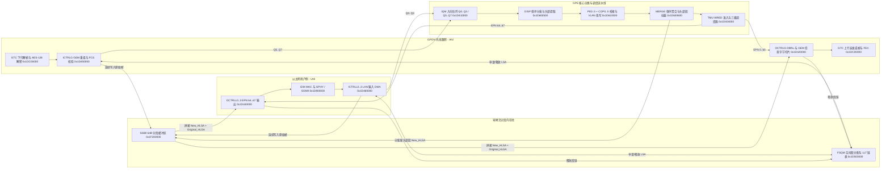
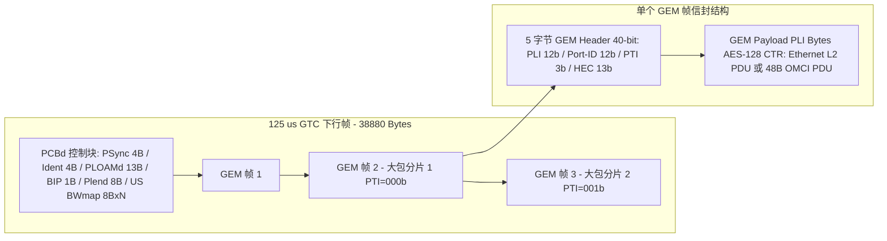
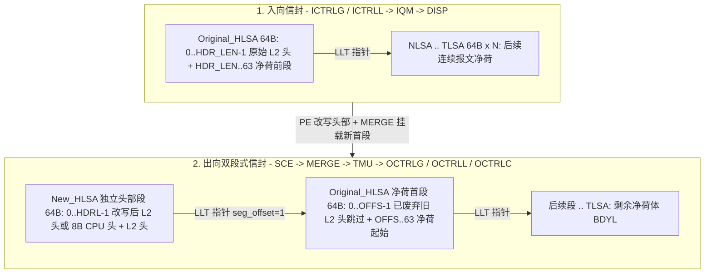
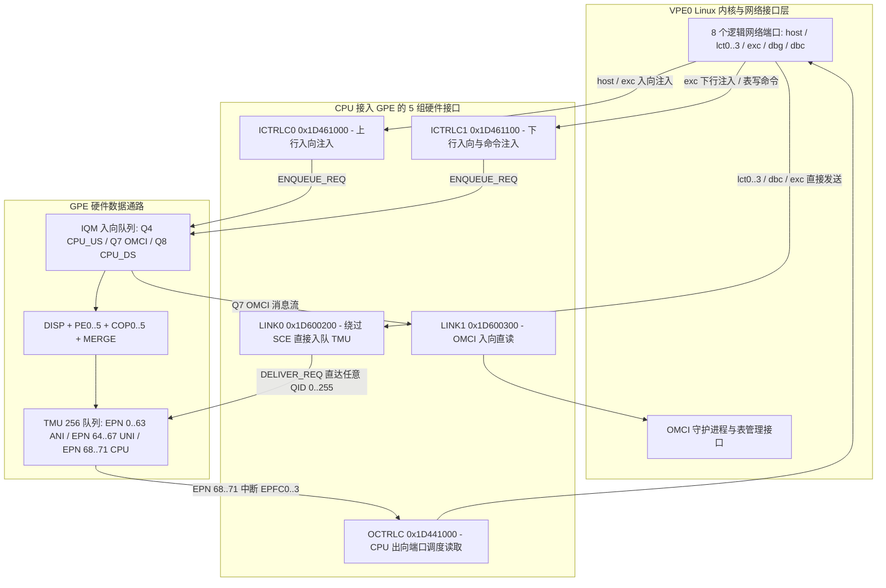

# 8.5 硬件快转闭环、GEM 封装信封、CPU 流量监听与 LCT 管理接口

GPE 数据通路在硬件上同时支持**无 CPU 介入的全卸载线速转发（Happy Hardware Forward Path）**与**细粒度 CPU 介入（协议捕获、镜像抓包、原始报文注入及带内/本地管理通信）**。以下详细阐述端到端硬件快转闭环、GEM 报文在光链路与 `SSB0` 内存中的信封结构、CPU 监听与注入 GPE 流量的硬件通道，以及主机网络接口（`lct0`、`host`）与以太网物理层（`GPHY` / `SGMII`）和 VLAN 标签处理的交互机制。

---

## 1. 端到端硬件全卸载快转路径（Happy Hardware Forward Path）

在稳态二层桥接与 VLAN 转发场景下，GPON ANI 侧与以太网 UNI 侧之间的双向数据流量全部在片上硬件状态机、包缓冲 RAM（`SSB0`）与微码引擎（`SCE` + `COP0..5`）内部闭环流动，普通转发包无需逐包经过主控 `VPE0`。控制面、异常、拥塞与统计仍可能引起 CPU 中断或软件处理，因此这里不表示整机“零中断”，也不是吞吐量实测。

### 1.1 快转路径实现零 CPU 介入的四项硬件机制

1. **硬件闭环内存管理（`FSQM` + `SSB0`）**：
   - 入向 DMA 控制器（`ICTRLG` 或 `ICTRLL0..3`）在收到帧首字节时直接向 `FSQM`（`0x1D500000`）的分配队列（`OQ1`）弹出 15-bit 逻辑段地址（`LSA`），按 64 字节粒度写入 `SSB0`（`0x1F200000`）并在 `LLT`（`0x1D5C0000`）中串联成链。
   - 出向 DMA 控制器（`OCTRLL0..3` 或 `OCTRLG`）每向物理层移出一个 64 字节段，立即将该 `LSA` 推入 `FSQM` 的释放队列（`IQ1`）；若帧在入向因 CRC/FCS 错误或超长被丢弃，或因 `TMU` WRED 拥塞被丢弃，硬件同样自动遍历 `LLT` 回收整条段链。
2. **双段式头部/净荷分离改写（Split Header/Body Envelope）**：
   - 当 `PE0`–`PE5` 对报文执行 VLAN 标签压入（`+4 B` / `+8 B`）、剥离（`-4 B` / `-8 B`）或 PPPoE/MAC 改写时，二层帧头长度发生变化。
   - 为避免在 `SSB0` 中搬移后续上千字节的报文净荷，`MERGE`（`0x1D600600`）向 `FSQM` 申请一个独立的 **64 字节新头部段（`New_HLSA`）**，将改写后的二层头（长度 `HDRL` 字节）写入 `New_HLSA` 偏移 `0` 处，并在 `LLT` 中将 `New_HLSA` 指向原始首段 `Original_HLSA`（`LLT[New_HLSA] = Original_HLSA`），同时在描述符中记录原始二层头被跳过字节数 `OFFS` 与剩余净荷长度 `BDYL`。
   - 出向 DMA 读取时先从 `New_HLSA` 读取 `HDRL` 字节新头，随后沿 `LLT` 跳至 `Original_HLSA` 的 `+OFFS` 字节偏移处继续读取 `BDYL` 字节净荷，在发送流水线上完成实时拼接。
3. **微码与协处理器硬件自主 MAC 学习（`COP1` `FWD`）**：
   - 上行以太网帧经过 `PE` 与 `COP1` 时，若源 MAC（`FID + SMAC`）未在 `SHORT_FWD_TABLE`（ID 10）中命中，`IF_FWD_RELEARN` / `IF_FWD_ADD` 微码直接利用 `COP1` 的哈希桶分配与时间戳指令完成硬件自动学习及老化刷新，无需上送 CPU 学习。
4. **BWMAP 硬件直驱的上行突发与分片（`GTC` -> `OCTRLG` -> `TMU`）**：
   - `GTC` 从每帧下行 PCBd 提取出 BWMAP 授权后直接触发 `OCTRLG`。`OCTRLG` 自动查表将 12-bit `Alloc-ID` 转换为 `TMU` 的 `rEPN`/`pEPN` 端口号，实时读取队列堆积量生成 `DBRu` 报告，并按授权窗口剩余字节数对任意长度的以太网帧实施字节级 GEM 切片与上下文挂起/恢复（保存在 `DPTR[64]` 与 `DCONTEXT[64]` 中）。

---

## 2. GEM 帧封装、解封装与内存信封结构

GPON 封装方法（GEM，ITU-T G.984.3）在物理层控制块（PCBd）之后的 GTC 净荷区内提供面向连接的变长帧复用。在 Falcon 硬件中，一个报文从光纤比特流到片上内存再到以太网接口共经历三层信封形态转换。

### 2.1 光链路 GTC 帧与 5 字节 GEM 头部信封（Wire Envelope）

每个 125 µs 下行 GTC 帧（2.48832 Gbps 下固定为 `38,880 B`）由帧首的 `PCBd` 与紧随其后的 `GTC Payload` 组成。`GTC Payload` 内紧密排列连续的 GEM 帧（无业务时填充 5 字节 GEM Idle 帧 `0x000FFF0165`）：

5 字节（40-bit）GEM 头部的各字段定义及硬件解封装行为如下：

| 位域（大端序） | 字段名 | 位宽 | 硬件解封装（`GTC` + `ICTRLG`）与上行封装（`OCTRLG`）行为 |
| :--- | :--- | :--- | :--- |
| `bits [39:28]` | `PLI` | 12-bit | **Payload Length Indicator（净荷字节长度，`0..4095`）**：指示紧随 5 字节 GEM 头之后的净荷字节数。`GTC` 状态机利用 `PLI + 5` 字节偏移直接定位下一个 GEM 帧头的起始位置 |
| `bits [27:16]` | `Port-ID` (`GPID`) | 12-bit | **GEM 端口标识符（`0..4095`）**：1. 下行在 `GTC` 中索引 `downstr_gtc_rxpid[4096]`（决定是否接收及是否启动 AES-128 CTR 解密），随后在 `ICTRLG` 中索引 `gpt[4096]` 映射为 8-bit 内部索引 `GPIX`（`0..255`）；2. 上行在 `OCTRLG` 中由 `gpixtable[256]` 将 `GPIX` 反向映射为 `GPID` 填入帧头 |
| `bits [15:13]` | `PTI` | 3-bit | **Payload Type Indicator（净荷类型与分片指示）**：`bit 2` = OAM 维护帧指示；`bit 1` = 拥塞指示；**`bit 0` = 末分片标志（Last Fragment，`LF`）**：`0` 表示当前帧仅为上层 PDU 的非末分片（后续仍有同 `Port-ID` 的 GEM 分片），`1` 表示当前帧为完整 PDU 或最后一个分片 |
| `bits [12:0]` | `HEC` | 13-bit | **Header Error Control**：前 39 位经 BCH(39,12,2) 编码产生 12 位校验位（生成多项式 `x^12 + x^10 + x^8 + x^5 + x^4 + x^3 + 1`）并附加 1 位偶校验。硬件支持纠正单比特与双比特头部错误；若检测到不可纠正多比特错误，`GTC` 丢弃该帧并进入 GEM 重新狩猎（Hunt）状态 |

### 2.2 GEM 净荷内的二层协议信封（Ethernet-over-GEM 与 OMCI）

GEM 净荷经过 `GTC` 在线 AES-128 CTR 解密并由 `ICTRLG` 跨分片（连接所有 `PTI[0] == 0` 分片直至 `PTI[0] == 1`）重组后，根据 `ICTRLG.GPIX_CFG[GPIX].PDUT` 重组出两类核心二层信封：

1. **以太网二层帧信封（`PDUT = 0`，Ethernet-over-GEM，ITU-T G.984.3 Section 8.3.2）**：
   - 在 GPON GEM 封装中，**以太网物理层的 7 字节前导码（Preamble `0x55..55`）与 1 字节帧起始定界符（SFD `0xD5`）被完全剥离**，不进入 GEM 净荷。
   - GEM 净荷的第 0 字节直接从 **目的 MAC 地址（`DMAC`，6 字节）** 开始，完整保留 **4 字节以太网帧校验序列（`FCS`，IEEE 802.3 CRC-32）**：

   | 字节偏移 | 字段名称 | 长度 | 在 `ICTRLG` / `OCTRLG` 中的硬件处理说明 |
   | :--- | :--- | :--- | :--- |
   | `+0` | `DMAC` | `6 B` | 目的 MAC 地址（单播、组播 `01:00:5E:...` / `33:33:...` 或广播 `FF:FF:FF:FF:FF:FF`） |
   | `+6` | `SMAC` | `6 B` | 源 MAC 地址 |
   | `+12` | `Outer / Inner VLAN` | `0 / 4 / 8 B` | 可选的 802.1Q / 802.1ad 标签（例如 `0x88A8 + S-TCI`、`0x8100 + C-TCI`） |
   | `+12 + 4N` | `EtherType / Length` | `2 B` | 以太网协议类型（如 `0x0800` IPv4、`0x86DD` IPv6、`0x8863/0x8864` PPPoE） |
   | `+14 + 4N` | `L3 Payload` | `46..9972 B` | 三层数据报文净荷（最短补齐使不含 FCS 的二层帧达 60 字节） |
   | `末尾 4 B` | `Ethernet FCS` | `4 B` | **32-bit CRC-32 校验和**：下行重组完成时由 `ICTRLG`（当 `CTRL.CRC_EN = 1` 时）硬件校验，校验通过后在写入 `SSB0` 的长度字段中剥离 FCS；上行由 `OCTRLG`/`GTC` 在封装 GEM 前自动重算并追加 4 字节 FCS |

2. **OMCI 管理消息信封（`PDUT = 3` / `GPIX_CFG.PDUT = 1`，ITU-T G.988）**：
   - OMCI 通道拥有独立的専用 `GEM Port-ID`（由下行 `Assign_ONU-ID` 与 `Configure_Port-ID` PLOAM 消息指派，固定映射至 `GPIX 254/255`，且在 `downstr_gtc_rxpid` 中不启用 AES 加密）。
   - OMCI 消息**不包含任何以太网 MAC 头部**，GEM 净荷直接承载 48 字节基准消息（Baseline Message，Device ID `0x0A`）：`TCID (2B) | MsgType (1B) | DevID 0x0A (1B) | ME Class (2B) | ME Instance (2B) | Content (32B) | Trailer 0x0028 + CRC-32 (8B)`。
   - `ICTRLG` 硬件直接校验末尾 4 字节 CRC-32（失败则递增 `BADOMCI` 偏移 `0x0060` 计数器并丢弃），校验通过后压入 `IQM` 的 OMCI 专用队列。

### 2.3 片上 `SSB0` 内存信封与 128-bit 描述符（In-Memory Envelope）

报文在 `SSB0`（物理基址 `0x1F200000`，有效数据包缓冲区起始偏移由 `SBS0CTRL.BAR1` 指定，应只取 `BAR1` 的 `BA1V` 字段作为可变边界；不能直接把完整 `BAR1` 寄存器值当作字节偏移）中传递时，在 `SCE` 处理前后具有两种不同的内存信封形态：

当出向模块（`OCTRLG`、`OCTRLL0..3` 或 CPU 的 `OCTRLC`）向 `TMU` 发送 64-bit `SCHEDULE_REQUEST` 后，`TMU` 返回 **128-bit（4 × 32-bit 字）`SCHEDULE_RESPOND` 描述符**，精确描述双段式信封的拼接参数：

| 响应字 | 位域范围 | 符号名称 | 硬件信封拼接含义 |
| :--- | :--- | :--- | :--- |
| `Word 0` | `bits [15:13]` | `PDUT` | 协议数据单元类型：`0` = `ETH`（以太网），`1` = `IP`，`2` = `MPLS`，`3` = `OMCI`，`7` = `CMD`（内部控制命令） |
| `Word 0` | `bits [9:0]` | `SEGL` | 该报文占用的 `SSB0` 64 字节逻辑段总数（包含 `New_HLSA` 头部段与全部净荷段） |
| `Word 1` | `bits [15:8]` | `OFFS` | **净荷段内跳过偏移（Body Offset，字节数）**：指示跳过头部段后，在第一个净荷段（`Original_HLSA`）起始处需跳过的旧二层头部字节数 |
| `Word 1` | `bits [7:0]` | `HDRL` | **新头部长度（Header Length，字节数）**：存储在 `HLSA`（`New_HLSA`）段内偏移 `0` 处的改写后二层头（含可能压入的 VLAN 标签及 8 字节 CPU 异常头）字节数 |
| `Word 2` | `bits [30:16]` | `TLSA` | **尾段逻辑地址（Tail LSA）**：报文最后一个 64 字节段的 15-bit 地址（`LLT[TLSA] = 0x7FFF`） |
| `Word 2` | `bits [14:0]` | `HLSA` | **头段逻辑地址（Head LSA）**：报文首个 64 字节段（即 `New_HLSA`）的 15-bit 地址 |
| `Word 3` | `bits [15:0]` | `BDYL` | **净荷体字节长度（Body Length）**：从净荷首段偏移 `OFFS` 开始直至 `TLSA` 末尾的净荷字节数。重组后报文总长度 `LEN = HDRL + BDYL` |

---

## 3. CPU 介入数据通路、流量监听（Tap / Mirror）与报文注入机制

主控 `VPE0` CPU 通过五组基于片上 64-bit `LINK` 协议的硬件控制器（`OCTRLC`、`ICTRLC0`、`ICTRLC1`、`LINK0`、`LINK1`）接入 GPE 流水线，能够在入向分类前或出向调度后读取、监听、镜像或注入任意报文。

### 3.1 五组 CPU 硬件接入通道寄存器与协议对比

`OCTRLC`、`ICTRLC0/1` 与 `LINK0/1/2` 共享统一的 64-bit FIFO 寄存器模型（`CTRL` `0x00`、`IRNCR` `0x10`、`IRNICR` `0x14`、`IRNEN` `0x18`、`LEN` `0x20`、`DATA0` `0x24`、`DATA1` `0x28`），每次写 `DATA0`（低 32 位）+ `DATA1`（高 32 位）压入一个 64-bit 字，并通过 `CTRL.SOP`（`bit 1`）与 `CTRL.EOP`（`bit 0`）标记消息首尾：

| 硬件接口 | 物理基址 | 连接的 GPE 端点 | 消息格式（宽度） | 硬件功能与适用场景 |
| :--- | :--- | :--- | :--- | :--- |
| `OCTRLC` | `0x1D441000` | `TMU` 出向端口 `EPN 68..71`（`0x44..0x47`） | 发送 64-bit `SCHEDULE_REQUEST`；接收 128-bit `SCHEDULE_RESPOND` | **CPU 统一报文接收出口**：当 `TMU` 的 `EPN 68..71` 非空并触发 `TMU_IRNCR.EPFC0..3`（bits 8..11）中断时，CPU 通过 `OCTRLC` 请求调度并获取 `HLSA..TLSA`，随后直接从 `SSB0` 读取报文 |
| `ICTRLC0` | `0x1D461000` | `IQM` 入向队列 `Q4` (`CPU_US`) | 发送 128-bit `ENQUEUE_REQUEST` (`HLSA`, `TLSA`, `PLEN`, `GPIX`) | **上行入向流水线注入（经过 SCE）**：将 CPU 发出的报文（如 `host` 接口 WAN 报文）送入 `IQM Q4`，使其完整经历 `SCE` 的上行 VLAN 转换、ACL 与 T-CONT 队列映射 |
| `ICTRLC1` | `0x1D461100` | `IQM` 入向队列 `Q8` (`CPU_DS`) | 发送 128-bit `ENQUEUE_REQUEST` (`PDUT=0` 以太网或 `PDUT=7` `CMD`) | **下行入向流水线注入与 PE 表访问**：1. 模拟从 GPON 侧注入下行以太网帧并交由 `SCE` 分类转发至 UNI；2. 发送 `PDUT = 7`（`GPIX = 0xFF`）的内部命令帧读写 `PE`/`COP` 硬件表 |
| `LINK0` | `0x1D600200` | `TMU` 任意出向队列 `QID 0..255` | 发送 128-bit `DELIVER_REQUEST` (`IPN=7`, `QID`, `HLSA`, `TLSA`, `PLEN`, `GPIX`, `REQ_C=1<<29`) | **出向队列直接注入（绕过 SCE）**：跳过 `IQM` 与 `SCE` 分类引擎，直接将构造好的报文（如 OMCI 上行响应、`lct0..3` 本地管理帧、环路检测帧）压入指定的 `TMU` 出向队列 `QID` |
| `LINK1` | `0x1D600300` | `IQM` 入向队列 `Q7` (`OMCI`) | 读取 14 或 18 个 32-bit 字 | **OMCI 入向直读通道**：直接从 `DISP`/`IQM` 读取下行 48 字节基准 OMCI 消息或描述符 |

### 3.2 CPU 出向端口与通道分配

TMU 提供 `EPN 68..71` 四个 CPU 出向端口。队列到端口的绑定可配置，例如将 ANI 管理流量送往 `EPN 68`、UNI 管理与异常流量送往 `EPN 70`。这些是通道分配策略；逻辑管理接口数量并不等于硬件端口数量。

### 3.3 `EPN 70` 报文的 8 字节 SCE 内部元数据信封（CPU Envelope Header）

所有由 `SCE` 转发至 `EPN 70`（`cpu_port = 2`）的报文，其 `New_HLSA` 首段的起始 8 个字节并非以太网 `DMAC`，而是由 `PE` 微码压入的 **8 字节 SCE CPU 元数据头**，紧随其后的偏移 `+8` 处才是以太网帧的 `DMAC`：

| 字节偏移 | 位域 | 字段含义与硬件分流判据 |
| :--- | :--- | :--- |
| `Byte 0` | `bits [7:0]` | 入向队列或分类目标队列标识 |
| `Byte 1` | `bits [7:6]` | **源/目的逻辑 UNI 端口号（取值 `0..3`）**：标识该帧来自或归属于 `UNI0`–`UNI3` 中的哪一个物理以太网口 |
| `Byte 1` | `bits [5:0]` | 桥接端口与分类标志位 |
| `Byte 2` | `bits [7:0]` | **关联的 `GPIX`（内部 GEM 端口索引）**：值为 `0xFE` 时标识来自 GPON ANI 带内调试通道（`dbc`） |
| `Byte 3` | `bits [4:0]` | **异常原因码（`Exception Index`）**：例如 `0x00` 表示正常本地路由（如命中 LCT MAC 或 DBC 帧），`0x15` 表示环路检测帧（Loop Detection Frame，`EtherType 0xFFFA`），其余值对应 IGMP、ARP、DHCP、EAPOL 或 ACL 捕获原因码 |
| `Byte 4` | `bit 7` (`0x80`) | **外层 VLAN 有效标志（`VLAN_VALID`）**：`1` 表示入向帧携带外层 VLAN 标签且已被提取至 `Byte 4..5`；`0` 表示入向无标签 |
| `Byte 4..5` | `Byte 4 [3:0] : Byte 5 [7:0]` | **提取的 12-bit 外层 VLAN ID（`VID`）**：由 `SCE` 解析并填入，供 CPU 在接收 LCT 管理帧时直接核对管理 VLAN ID |
| `Byte 6` | `bits [7:0]` | 保留状态字 |
| `Byte 7` | `bits [7:0]` | **内嵌净荷偏移量（`offset`）**：指示二层/三层协议载荷相对于 `+8` 起始处的字节偏移（用于环路检测与 DBC 帧解析） |

### 3.4 捕获、镜像与注入

异常掩码选择需要处理的入向或出向异常；`REDIRECTION_TABLE` 的目标队列与 `snooping_enable` 决定重定向或保留原转发路径的镜像。ACL 可进一步限定 MAC、VID、IP、传输层端口及 GEM 端口等条件。捕获与镜像都会消耗 CPU 出向端口和共享缓冲资源，不能由正常转发路径的线速能力推导出镜像路径必然无丢包。

CPU 注入有两类路径：通过 `ICTRLC0/1` 进入 `IQM Q4/Q8` 时，报文经过 SCE 分类与规则处理；通过 `LINK0` 直接投递 TMU 队列时，绕过 SCE。因此直接投递的帧头、VLAN 标签、长度和目标队列必须在提交前准备完成。

## 4. UNI 业务流与管理流的共享

一个物理 UNI 可以同时承载透传业务流与终结于 CPU 的管理流。MA5671A 通过 SFP 高速串行以太网接口连接宿主；片上 GPHY 是另一种 SoC 接口能力，不应将二者视为同一条板级链路。

`LAN_PORT` 表（ID 67）的管理 MAC 配置可供 PE 分类使用。匹配管理规则的报文可以送往 CPU 出向端口；业务帧继续经过 VLAN 处理、转发表查询和 T-CONT 队列映射。具体匹配优先级由微码与规则配置决定。

| 通路 | VLAN 处理位置 | 配置要求 |
| --- | --- | --- |
| UNI 到 CPU | SCE 可提取 VLAN 信息到 CPU 元数据头；CPU 决定是否接收及剥离标签 | 管理 VLAN 与元数据解释须保持一致 |
| CPU 经 LINK0 到 UNI | 绕过 SCE，不执行 SCE VLAN 转换 | 提交前构造完整以太网帧及所需标签 |
| CPU 经 IQM Q4 到 ANI | 经过 SCE 的上行 VLAN 规则 | 配置关联的桥端口、VLAN 动作及 T-CONT 队列 |
| ANI 到 CPU | 可先执行下行 VLAN 规则，再送 CPU 出向端口 | CPU 接收格式应与所选规则匹配 |

链路状态独立于管理通道配置。UNI 侧需分别检查 MAC 与 PHY/串行接口的链路、速率及双工状态；ANI 侧需满足 GPON 激活与授权条件。逻辑管理通道可用不等于全部物理链路均已就绪。
