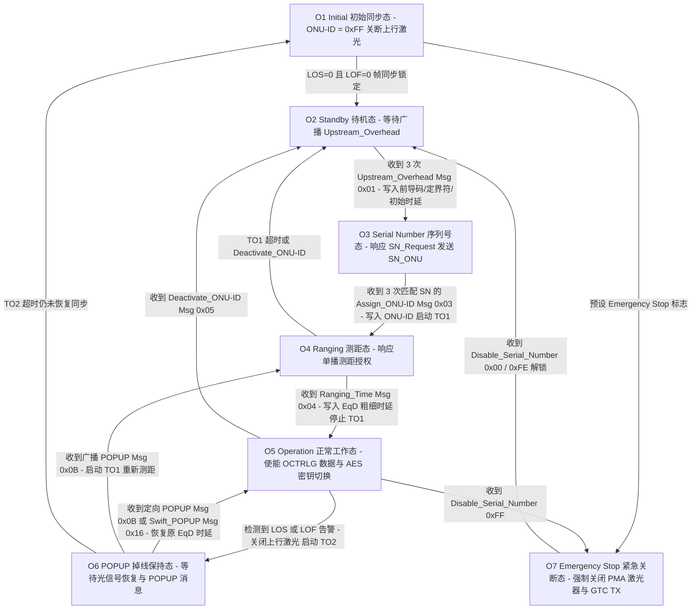

# 9.1 PLOAM 状态机

`GTC`（物理基址 `0x1DC00000`）与 `PMA`（物理基址 `0x1DD00000`）协同实现 ITU-T G.984.3 定义的 GPON 物理层操作管理维护（PLOAM）通道及 O1–O7 激活状态机。硬件负责下行 13 字节 PLOAMd 帧的 CRC-8 校验、`ONU-ID` 过滤、上行 PLOAMu 突发插入、序列号请求随机延时退避以及均衡时延（`EqD`）字/比特级定时控制；状态机逻辑消费 `GTC` 接收 FIFO 与物理层告警中断（`LOS`、`LOF`），驱动从初始同步（O1）到正常工作态（O5）的寄存器重配置。

---

## 1. PLOAM 帧结构与 GTC 硬件寄存器接口 (`0x1DC00000`)

### 1.1 13 字节 PLOAM 消息格式

上下行 PLOAM 消息长度固定为 13 字节（104 位），置于下行 PCBd 或上行突发帧头部 `PLOu` 的 `Ind` 字段之后：

| 字节偏移 | 字段名称 | 宽度 | 硬件处理说明 |
| --- | --- | --- | --- |
| `Byte 0` | `ONU-ID` | 8-bit | 目标或源 ONU 标识符（`0x00`–`0xFD` 为单播地址，`0xFF` 为广播地址）。`GTC` 硬件仅接收匹配本机 `downstr_gtc_onuid` 或 `0xFF` 的下行消息 |
| `Byte 1` | `Message-ID` | 8-bit | PLOAM 消息类型编码（下行合法范围为 `0x01`–`0x17`，超出范围触发软件告警位 `0x80`） |
| `Byte 2`–`11` | `Data[0..9]` | 80-bit | 10 字节消息载荷 |
| `Byte 12` | `CRC` | 8-bit | 基于生成多项式 `g(x) = x^8 + x^2 + x + 1` 的硬件校验和；下行 CRC 错误帧由 `GTC` 直接丢弃 |

### 1.2 GTC 与 PMA 测距、同步及加密寄存器

PLOAM 状态机在状态迁移过程中直接读写的 `GTC`（`0x1DC00000`）、`PMA`（`0x1DD00000`）与 `OCTRLG`（`0x1D420000`）寄存器如下：

| 模块与偏移 | 寄存器名称 | 状态机操作时机与硬件功能 |
| --- | --- | --- |
| `GTC + 0x00` | `downstr_gtc_istatus_1` | 提供 `LOF`（帧失步）、`LOS`（光信号丢失）、`PLOAM_RX`（接收 FIFO 非空）、`BER`（BIP 定时器到期）与 `SF`/`SD`（信号劣化）中断标志 |
| `GTC + 0x0C` | `downstr_gtc_scon` | 下行同步状态机控制与状态（`HUNT` / `PRE_SYNC` / `SYNC`）及下行 FEC 译码状态 |
| `GTC + 0x10` | `downstr_gtc_sfcnt` | 30-bit 下行超帧计数器（Superframe Counter），用于核对 `Key_Switching_Time` |
| `GTC + 0x40`–`0x4C` | `downstr_aes_dekey[0..3]` | 128-bit AES 下行解密密钥寄存器（按 `Key[3]`..`Key[0]` 字序写入影子密钥缓冲区） |
| `GTC + 0x50` | `downstr_aes_key_switch` | AES 密钥切换目标超帧号；当 `downstr_gtc_sfcnt` 到达该值时硬件自动启用新密钥 |
| `GTC + 0x54` / `0x58` | `downstr_gtc_rxpid_addr` / `wr` | 4096 项下行 GEM Port-ID 属性表间接读写口（配置 `VALID` 与 `ENCRYPT_EN`） |
| `GTC TX` | `upstr_gtc_onuid` | 本机 8-bit `ONU-ID` 寄存器（O1/O2 态置为 `0xFF`，O3 收到 `Assign_ONU-ID` 后更新） |
| `GTC TX` | `upstr_gtc_delim` / `preamble` | 上行突发前导码（Type 1/2/3）长度、模式字节与 16/24-bit 定界符寄存器（O2 态配置） |
| `GTC TX` | `upstr_gtc_offset` | 上行均衡时延（`EqD`）字/字节级粗调偏移与比特级细调偏移寄存器（O2 写初始值，O4/O5 写测距修正值） |
| `PMA + 0x20C` | `gpon_tx_slice_pdi_fifo` | 发送数字 FIFO 相位与延时补偿寄存器（O4/O5 测距更新时同步复位或调整） |
| `PMA + 0x210` | `gpon_tx_slice_pdi_laser` | 激光器突发使能门控寄存器（O1/O6/O7 关闭激光器，O3/O4/O5 使能突发门控） |
| `OCTRLG + 0x4000` | `tcmap[4096]` | 12-bit `Alloc-ID` 到 5-bit `TCIX` 映射表（O3 绑定默认 `Alloc-ID = ONU-ID` 至 `TCIX 0`，O5 处理 `Assign_Alloc-ID`） |

---

## 2. O1–O7 状态迁移与硬件配置序列

### 2.1 O1 (Initial State) 与 O2 (Standby State)

1. **O1 帧同步捕获**：
   - 状态机复位 `upstr_gtc_onuid = 0xFF`，关闭 `OCTRLG` 数据通道与 `PMA` 上行激光器突发输出，清空 128 项下行 PLOAM 环形缓冲队列（`ds_write_idx = ds_read_idx = 0`），并启动 1000 ms 同步监控定时器 `TO0`。
   - 若非易失环境标志 `emergency_stop_state != 0`，状态机直接转入 **O7**。
   - 当 `PMA` 光接收锁相环锁定（`LOS == 0`）且 `GTC` 连续捕获 `PSync = 0xB6AB31E0` 进入 `SYNC` 态（`LOF == 0`）时，停止 `TO0` 并迁入 **O2**。
2. **O2 上行突发开销配置 (`Upstream_Overhead`, Msg ID `0x01`)**：
   - 在 O2 态等待 OLT 连续广播 3 次相同的 `Upstream_Overhead` 消息（`ds_repeat == 3`）。
   - 解析消息载荷中的保护比特数（Guard Bits）、Type 1 与 Type 2 前导码比特数、Type 3 前导码字节模式、3 字节定界符（Delimiter）以及状态标志位（含功率等级模式与预设均衡时延 `start_offset`），依次写入 `GTC` 上行开销寄存器组。
   - 若消息指示启用预设 `EqD`，将 `start_offset` 写入 `upstr_gtc_offset`；随后开启 `GTC` 对序列号请求授权（`SN_Request`）的响应及随机延时发生器（Random Delay，范围 `0`–`48` µs），迁入 **O3**。

### 2.2 O3 (Serial Number State) 与 O4 (Ranging State)

1. **O3 序列号上报与 `ONU-ID` 分配**：
   - 每当 BWMAP 中出现针对序列号发现的授权且通过 `SN_Mask` 掩码过滤时，`GTC` 在随机退避延时后自动触发突发发送，上报 `Serial_Number_ONU`（Msg ID `0x01`，含 4 字节 Vendor-ID、4 字节 VSSN、随机延时值及 GEM 支持标志）。上行序列号请求累计次数计入 `sn_req_total`，达到阈值 `sn_req_thr` 时置位告警标志。
   - 当收到连续 3 次匹配本机 8 字节序列号的 `Assign_ONU-ID`（Msg ID `0x03`）时：
     - 将分配的 8-bit `ONU-ID` 写入 `GTC` 的 `upstr_gtc_onuid` / `downstr_gtc_onuid`。
     - 在 `OCTRLG.tcmap[ONU-ID]` 中建立默认 `Alloc-ID`（等于 `ONU-ID`）到 `T-CONT 0`（承载 OMCI 与 PLOAMu）的硬件映射。
     - 关闭 `GTC` 的序列号随机退避延时，启动测距超时定时器 `TO1`（缺省 10 s），迁入 **O4**。
2. **O4 单播测距与 `EqD` 均衡时延锁定**：
   - 在 O4 态，`GTC` 切换为单授权响应模式（仅响应 `Alloc-ID == ONU-ID` 的测距授权并回送 `Serial_Number_ONU`）。
   - 当收到单次或 3 次一致的 `Ranging_Time`（Msg ID `0x04`）时：
     - 从 `Data[1..4]` 提取 32-bit 比特级均衡时延 `EqD`，拆分为字节偏移量 `offset = EqD >> 3` 与比特微调余数 `EqD & 0x7`，结合校准修正量 `offset_corr` 直接写入 `GTC` 上行时延寄存器 `upstr_gtc_offset` 及 `PMA` 发送 FIFO 控制寄存器。
     - 停止 `TO1` 定时器，清零 4 个 BWMAP 边界约定探测计数器 `scheme_cnt[0..3]`，解除 `GTC` 单授权限制并激活 `OCTRLG` 上行状态机，迁入 **O5**。
   - 若 `TO1` 超时仍未收到 `Ranging_Time`，则清除已分配的 `ONU-ID`（恢复 `0xFF`）并退回 **O2**。

### 2.3 O5 (Operation State) 运行期协议处理

在 O5 正常工作态，状态机处理以下下行 PLOAM 消息与硬件事件：

| 下行消息 / 事件 | Msg ID | 重复要求 | 硬件寄存器操作与状态机响应 |
| --- | --- | --- | --- |
| `Ranging_Time` | `0x04` | 1× / 3× | 在线微调运行期 `EqD`：按有符号或绝对字节偏移直接更新 `upstr_gtc_offset` |
| `Deactivate_ONU-ID` | `0x05` | 3× | 比较 4 个 BWMAP 边界计数器（`SStart == 0` 与 `SStop == Max` 在开闭区间下的统计值）选定 `bwmap_convention`，复位 `ONU-ID = 0xFF`，关闭上行并返回 **O2** |
| `Disable_Serial_Number` | `0x06` | 3× | 当 `Data[0] == 0xFF` 且匹配本机 SN 时，关断 `PMA` 激光器与 `GTC` 发送，置位 `emergency_stop_state = 1`，转入 **O7** |
| `Encrypted_Port-ID` | `0x08` | 3× | 提取 12-bit `Port-ID` 与加密标志，通过 `downstr_gtc_rxpid_addr` / `wr` 更新 `GTC` Port-ID 过滤表的 `ENCRYPT_EN` 位 |
| `Request_Password` | `0x09` | 1× | 读取 10 字节注册 `Password`，构造 `Password`（Msg ID `0x02`）向 `GTC` PLOAMu 队列连发 3 次 |
| `Assign_Alloc-ID` | `0x0A` | 3× | 提取 12-bit `Alloc-ID`（`Data[0..1]`）与类型（`Data[2]`），在 `OCTRLG.tcmap[Alloc-ID]` 中使能或解除该 `Alloc-ID` 映射 |
| `No_Message` | `0x0B` | — | 空闲填充消息，直接忽略 |
| `BER_Interval` | `0x0C` | 3× | 将 32-bit BIP 累积间隔写入 `GTC` BER 定时器；定时器到期时读取下行 BIP 误码数并发送带 4-bit 序列号的 `REI`（Msg ID `0x08`） |
| `Key_Switching_Time` | `0x13` | 3× | 在收到非重复确认帧时，将 30-bit 切换帧号写入 `downstr_aes_key_switch`（`0x1DC00050`），并将 128-bit 密钥按字序（`key[3]`..`key[0]`）写入 `downstr_aes_dekey[0..3]`（`0x1DC00040`–`0x1DC0004C`） |
| `Extended_Burst_Length` | `0x14` | 3× | 更新 O3 与 O4/O5 阶段的 Type 3 前导码扩展字节数 |
| `PON-ID` | `0x15` | 1× | 提取 7 字节 PON-ID 与发射光功率级供 OMCI 查询，不改变当前状态 |
| `Request_Key` | `0x11` | 1× | 生成 128-bit 随机密钥，拆分为 Frag 0 与 Frag 1 两个 `Encryption_Key`（Msg ID `0x05`）分片各连发 3 次 |

### 2.4 O6 (POPUP State) 与 O7 (Emergency Stop State)

1. **O6 掉线保护与快速重入 (`POPUP` / `Swift_POPUP`)**：
   - 在 O5 态一旦检测到 `LOS` 或 `LOF` 中断，状态机立即关断上行突发发送，启动 `TO2` 定时器（缺省 100 ms）与 10 ms 恢复防抖定时器 `TO0`，进入 **O6**。
   - 若在 `TO2` 到期前光信号与下行帧同步恢复：
     - 收到定向 `POPUP`（Msg ID `0x0B`，`ONU-ID` 为本机 ID）或广播 `Swift_POPUP`（Msg ID `0x16`）时：无需重新测距，直接恢复原 `EqD` 延时与 `OCTRLG` 上行通道，停止 `TO2` 并返回 **O5**。
     - 收到广播 `POPUP`（Msg ID `0x0B`，`ONU-ID == 0xFF`）时：停止 `TO2`，启动 `TO1` 并转入 **O4** 执行重测距。
   - 若 `TO2` 超时仍未恢复同步，则退回 **O1**。
2. **O7 紧急激光关断态**：
   - 在 O7 态，硬件锁定关闭 `PMA` 激光器驱动与 `GTC` 上行通道，忽略除 `Disable_Serial_Number` 之外的所有激活消息；仅当收到 `Data[0] == 0x00`（解除本机禁用）或 `0xFE`（解除全部 ONU 禁用）的 `Disable_Serial_Number`（3 次）时，才迁回 **O2**。
