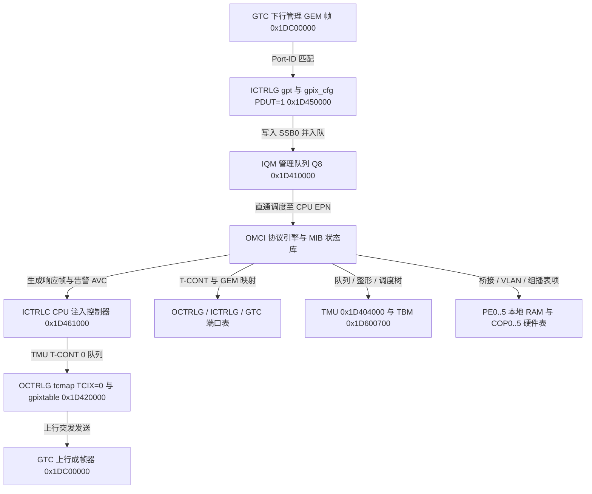

# 9.2 OMCI 与 MIB

OMCI（ONT Management and Control Interface，ITU-T G.988）通道建立在专用管理 GEM 端口与默认 `T-CONT 0` 之上。硬件通过 `ICTRLG`（`0x1D450000`）的协议类型标识（`PDUT = 1`）与 `IQM Q8`（`0x1D410000`）隔离下行 OMCI 帧并上送主控 CPU，上行响应帧经 `ICTRLC`（`0x1D461000`）注入 `T-CONT 0` 调度队列并由 `OCTRLG`（`0x1D420000`）封装发送。OMCI 控制面解析管理实体（Managed Entity, ME）原语后，将其转换为对 `GTC`、`ICTRLG`、`OCTRLG`、`TMU`、`TBM`、`PE0`–`PE5` 及 `COP0`–`COP5` 硬件表的读写操作。

---

## 1. OMCI 帧硬件收发通道与报文格式

### 1.1 硬件 OMCC 通道配置 (`GPIX 0` 与 `T-CONT 0`)

在 PLOAM 进入 O3/O5 状态且 OLT 下发 `Configure-Port-ID` PLOAM 消息（Msg ID `0x0E`）指定 OMCC GEM `Port-ID` 后，硬件按以下寄存器链激活 OMCI 通道：

1. **下行接收通路**：
   - `GTC`（`0x1DC00000`）：在 Port-ID 过滤表（`downstr_gtc_rxpid_addr` / `wr`）中将 OMCC `Port-ID` 的 `VALID` 位置 `1`。
   - `ICTRLG`（`0x1D450000`）：将 `gpt[OMCC_PortID]` 配置为 `VALID = 1`、`GPIX = 0`；将 `gpix_cfg[0]` 的 `PDUT`（bits 2:0）设为 `1`（OMCI PDU 类型），并将 `maxsize[1]`（偏移 `0x34`）设为 `1984` 字节。
   - 当 `PDUT == 1` 的 GEM 帧在 `SSB0`（`0x1F200000`）重组完毕后，`ICTRLG` 直接将其描述符压入 `IQM` 的专用管理队列 `Q8`，经 `SCE` 透传至 `TMU` 的 CPU 接收端口，触发主控接收中断。
2. **上行发送通路 (`FIO_GPE_OMCI_SEND`)**：
   - `OCTRLG`（`0x1D420000`）：`tcmap[ONU-ID]` 映射至 `TCIX = 0`（默认 `T-CONT 0`），`gpixtable[0]` 写入 12-bit `OMCC_PortID`。
   - 主控发送最大 1984 字节的 OMCI 帧时，通过 `ICTRLC` 将报文段写入 `SSB0`，生成携带 `GPIX = 0`、`PDUT = 1` 的描述符注入 `T-CONT 0` 绑定的高优先级抢占出向队列，并在节能状态机（PSM）处于睡眠态时触发硬件唤醒事件。

### 1.2 Baseline (`0x0A`) 与 Extended (`0x0B`) 消息格式

硬件与协议栈同时支持 ITU-T G.988 基准格式（Baseline，定长 48 字节）与扩展格式（Extended，可变长最大 1980 字节）：

| 字段位置 | 字段名称 | Baseline (`DB = 0x0A`) | Extended (`DB = 0x0B`) | 说明 |
| --- | --- | --- | --- | --- |
| `Bytes 0..1` | `TCID` | 16-bit | 16-bit | `bit 15` 为高优先级指示位，`bits 14:0` 为事务相关标识符 |
| `Byte 2` | `Message Type` | 8-bit | 8-bit | `bit 7` = `0`，`bit 6` = `AR`（请求确认），`bit 5` = `AK`（响应标志），`bits 4:0` = 动作码（`4` Create，`6` Delete，`8` Set，`9` Get，`11` Get All Alarms，`13` MIB Upload，`14` MIB Upload Next，`16` Alarm，`17` AVC，`19`–`22` Software Download） |
| `Byte 3` | `Device ID` | `0x0A` | `0x0B` | 区分基准定长帧与扩展变长帧（OMCC 版本支持集掩码 `0xA0` / `0x82`） |
| `Bytes 4..5` | `ME Class` | 16-bit | 16-bit | 管理实体类编号（如 `262` = T-CONT，`268` = GEM Port CTP，`171` = Extended VLAN） |
| `Bytes 6..7` | `ME Instance` | 16-bit | 16-bit | 管理实体实例 ID |
| `Bytes 8..N` | `Content` | 32 Bytes (`Bytes 8..39`) | `2 + L` Bytes（含 16-bit 长度 `L`，最大 1966 B） | 属性掩码、属性值、MIB 上传分片或软件镜像段载荷 |
| `Trailer` | `OMCI Trailer` | 8 Bytes (`Bytes 40..47`)：含 `0x00000028` 长度字段与 32-bit CRC | 4 Bytes：仅含 32-bit CRC | IEEE 802.3 CRC-32（初值 `0xFFFFFFFF`，生成多项式 `0x04C11DB7`） |

---

## 2. MIB 初始化与全局硬件基线配置

在 OMCI MIB 复位（MIB Reset，ME 2 `ONT Data`）或冷启动加载静态初期 MIB 配置文件（`/etc/mibs/*.ini`）时，控制面依次对 GPE 硬件执行以下基线初始化：

1. **硬件资源能力查询 (`FIO_GPE_CAPABILITY_GET`, 28 B)**：
   - 读取芯片支持的硬件表容量上限：最大 `256` 个 GEM 端口（`GPIX 0..255`）、`32` 个 T-CONT（`TCIX 0..31`）、`256` 条 `TMU` 出向队列、`128` 个调度块及 `512` 个 `TBM` 计量器。
2. **ANI 侧共享异常流量计量器配置**：
   - 在 `TBM`（`0x1D600700`）中分配 1 个共享双桶计量器，配置承诺信息速率与峰值信息速率 `CIR = PIR = 320,000 bps`（40 KB/s），承诺突发尺寸与峰值突发尺寸 `CBS = PBS = 240,000 B`，模式设为 RFC 2698。
   - 读取 176 字节 `PE` 全局常量表 `CONSTANTS`（ID 68），将分配到的计量器索引写入偏移 `+60`（Row 15 `ani_exception_meter_id`），将偏移 `+64`（Row 16 `ani_exception_meter_en`）置为 `1`，并通过 `FIO_GPE_SCE_CONSTANTS_SET` 广播写回 `PE0`–`PE5`，限制从 PON 侧上送 CPU 的异常协议帧总带宽。

---

## 3. 核心管理实体 (ME) 到硬件表与寄存器的映射

OLT 通过 OMCI `Create`、`Set`、`Delete` 原语配置业务通路时，各管理实体直接驱动以下硬件模块：

| ME Class | 管理实体名称 | 目标硬件模块与表 ID | 硬件寄存器与表项联动过程 |
| --- | --- | --- | --- |
| **ME 262** | `T-CONT` | `OCTRLG` (`0x1D420000`) `TMU` (`0x1D404000`) | 当 OLT 将 `Alloc-ID` 属性由 `0xFFFF` 修改为有效 12-bit 值时： 1. 在 `OCTRLG.tcmap[Alloc-ID]` 中写入 5-bit `TCIX`（`0`–`31`）并置位 `VALID`。 2. 在 `OCTRLG.tctable[TCIX]` 中绑定常规出向端口 `rEPN` 与抢占出向端口 `pEPN`。 3. 在 `TMU` 中启用顶层调度器块 `SB_ID = 93 + EPN`。 |
| **ME 268** | `GEM Port Network CTP` | `GTC` (`0x1DC00000`) `ICTRLG` (`0x1D450000`) `OCTRLG` (`0x1D420000`) `COP3` ID 25 / `COP4` ID 33 | 1. 分配空闲 8-bit `GPIX`（`1`–`255`）。 2. 下行通道：置位 `GTC` Port-ID RAM 的 `VALID` 位，写 `ICTRLG.gpt[Port-ID] = GPIX` 与 `ICTRLG.gpix_cfg[GPIX]`，并在 `COP3` `DS_GEM_PORT` 表（ID 25）写入 64-bit 下行属性。 3. 上行通道：写 `OCTRLG.gpixtable[GPIX] = Port-ID`，并在 `COP4` `US_GEM_PORT` 表（ID 33）写入 64-bit 上行属性（含关联的 `TMU` 队列与上行 `TBM` 计量器 ID）。 |
| **ME 277** **ME 278** | `Priority Queue` `Traffic Scheduler` | `TMU` (`0x1D404000`) | 1. 配置 `TMU` 出向队列 `QID`（`0`–`255`）的最大段容量上限（最大 2304 段）及 Green/Yellow WRED 丢弃概率门限。 2. 将队列挂载至对应 T-CONT 调度块（`SB 0..127`）的输入叶子，按 ME 属性设置 SP 优先级或 WRR 权重（`1`–`1023`）。 |
| **ME 290** | `Traffic Descriptor` | `TBM` (`0x1D600700`) `TMU TBS` (`0x1D404000`) | 将 `SIR`（CIR）、`PIR`、`CBS`、`PBS` 及色盲/色敏模式（RFC 2698 / RFC 4115）换算为硬件令牌补充速率与桶容量，写入入向 `TBM` 计量器寄存器（`TBMTR0..3`、`TBMTC`）及出向 `TMU` 双桶整形器（`TBS 0..255`）。 |
| **ME 45** **ME 47** | `MAC Bridge Service Profile` `MAC Bridge Port Config` | `PE` RAM `BRIDGE` (ID 69) `BRIDGE_PORT` (ID 65) | 1. 在 `BRIDGE` 表（ID 69）分配虚拟网桥索引并设置 MAC 学习总上限。 2. 根据 `TP Type`（UNI、GEM IWTP、802.1p Mapper、IP Host）分配 `Bridge Port Index`（`0`–`87`），构造 128-bit `BRIDGE_PORT` 表项（含 `Word 3` 的 20 个控制位，如 `ena_ani_side`、`ena_src_mac_learning`、`ena_port_lock`）广播写入 `PE0`–`PE5`。 |
| **ME 130** | `802.1p Mapper Service Profile` | `PE` RAM `PMAPPER` (ID 66) | 在 `PMAPPER` 表（ID 66，32 × 64-bit）中将 8 个 802.1p 优先级槽位（PCP `0`–`7`）分别映射至对应的上行 `GEM Interworking TP` 关联的 8-bit `GPIX`。 |
| **ME 84** | `VLAN Tagging Filter Data` | `PE` RAM `VLAN_START_ID` (ID 74) `COP2` ID 17 & ID 18 | 1. 在 `VLAN_START_ID`（ID 74）分配 12 槽连续段，将最多 12 个 16-bit VID 写入 `COP2` `VLAN` 表（ID 18）。 2. 将 `Forwarding Operation`（`0x00`–`0x21`）映射为 `COP2` `TAGGING_FILTER` 表（ID 17）的 64-bit 过滤掩码，并把表索引填入关联 `BRIDGE_PORT.tag_filter_idx`。 |
| **ME 171** | `Extended VLAN Tagging Operation` | `COP5` ID 41, ID 42, ID 43 | 将下发的 16 字节扩展 VLAN 规则项拆解为 64-bit `VLAN_RULE`（ID 42）与 64-bit `VLAN_TREATMENT`（ID 43），按双标签、单标签、无标签三段连续排序写入 `COP5`，并更新 `EXTENDED_VLAN`（ID 41）的 `base_ptr` 与三段结束指针，最后置位关联 `BRIDGE_PORT` 的 `ena_ing_ext_vlan` / `ena_egr_ext_vlan`。 |
| **ME 309** **ME 310** | `Multicast Operations Profile` `Multicast Subscriber Config` | `COP1` ID 9 & ID 10 `COP4` ID 34 & ID 35 | 使能 UNI 桥接端口上的 IGMP/MLD 硬件捕获模板（上送 CPU 解析 Join/Leave），并在 `COP1` `SHORT_FWD_MAC`（ID 10）或 `COP4` `LONG_FWD_IPV6`（ID 35）中动态维护组播组出向端口位图 `mc_port_map` 及源地址过滤表。 |
| **ME 134** | `IP Host Config Data` | `PE` RAM `CONSTANTS` (ID 68) 主机网络栈 | 将 IP Host 接口的 48-bit MAC 地址写入 `CONSTANTS` 表（ID 68）Row 17–20 以使能硬件本地 MAC 识别；当主机接口通过 DHCP 获取 IPv4 地址、掩码、网关与 DNS 时，触发属性变更通知（AVC）更新 ME 134 属性 `9`–`15`。 |

---

## 4. 软件镜像升级状态机 (ME 7 `Software Image`)

ME 7（实例 `0` 对应 SPI NOR 的 `image0` 分区，实例 `1` 对应 `image1` 分区）通过以下四阶段协议与硬件 Flash 分区交互：

1. **`Start Software Download`（Action 19）**：
   - 协商窗口大小 `Window Size = W`（每个窗口包含 `1`–`256` 个 Section，每个基准 Section 携带 31 字节镜像数据，单窗口最大 `256 × 31 = 7936` 字节）及待下载镜像总字节数。
2. **`Download Section`（Action 20）**：
   - 接收带递增 Section 号（`0`..`W-1`）的分片并填入 7936 字节窗口重组缓冲区（`FIO_GPE_OMCI_WINDOW_SET`）；仅末个 Section（`AK = 1`）触发 `Download Section Response` 确认整窗接收结果，若中间丢片则返回失败由 OLT 重传该窗口。
   - 每收满一窗，将完整窗口数据流式写入非活动槽位对应的 MTD 分区（`image0` 偏移 `0x0C0000` 或 `image1` 偏移 `0x800000`）。
3. **`End Software Download`（Action 21）**：
   - 对已接收的全部镜像字节流计算 IEEE 802.3 CRC-32（初值 `0xFFFFFFFF`，多项式 `0x04C11DB7`），与 `End Software Download` 携带的 32-bit `CRC-32` 及 uImage 头部校验和比对；校验通过后置位该槽位的 `Is Valid = 1`。
4. **`Activate Software`（Action 22）与 `Commit Software`（Action 23）**：
   - `Activate` 更新非易失引导环境中的活动镜像槽位指针并触发系统复位；`Commit` 将目标槽位标记为 `Is Committed = 1`，固化默认启动分区。
