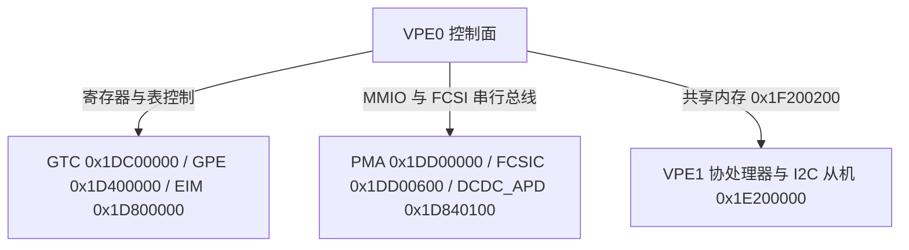

# 9.3 硬件控制域与 VPE1 双地址从机共享内存

主控处理器（VPE0）通过三组管理接口分别控制片上 GPON 数据通路、光物理层模拟前端以及 VPE1 双地址 I2C 从机协处理器：

| 管理接口 / 控制通道 | 管辖的硬件模块与物理地址空间 |
| --- | --- |
| GPON 数据通路与 LAN 控制接口 (`/dev/onu`) | `GTC`（`0x1DC00000`）、`GPE`/`SCE`（`0x1D400000`–`0x1D700000`）、`SSB0`（`0x1F200000`）、`EIM`/`SGMII`/`GPHY`（`0x1D800000`）、`TOD`（`0x1D400500`） |
| 光物理层与电源控制接口 (`/dev/optic`) | `PMA`（`0x1DD00000`）、`FCSIC`（`0x1DD00600` 桥接 BOSA 模拟寄存器）、`DCDC_APD`（`0x1D840100`）、`DCDC_CORE`（`0x1E800600`）、`DCDC_DDR`（`0x1E800500`） |
| SFF-8472 双地址从机接口 (`/dev/sfp_eeprom0..1`) | `I2C` 双地址从机（`0x1E200000`，监听 `0xA0`/`0xA2`）与 `SBS0` VPE1 共享内存（物理 `0x1F200200` / KSEG0 `0x9F200200`） |
| CPU 报文收发通道 (`ICTRLC` / `OCTRLC`) | `ICTRLC0..1`（`0x1D461000`）与 `OCTRLC`（`0x1D441000`）虚拟主机端口（`host`、`lct0`–`lct3`、`exc`、`dbg`、`dbc`） |

---

## 1. GPON 与交换数据通路控制功能族 (`/dev/onu`)

数据通路控制接口按硬件子系统划分为 8 个功能族：

| 功能族名称 | `type` (Magic) | 槽位数量 (`nr`) | 管辖硬件模块与功能范围 |
| --- | --- | --- | --- |
| **Common** | `0x01` (1) | 24 (`0..23`) + CLI (`255`) | 版本查询、寄存器直接读写、固件版本与内置文本 CLI 通道（`nr = 255`） |
| **Event / FIFO** | `0x02` (2) | 3 (`200..202`) | 异步硬件事件通知 FIFO 使能、事件掩码配置与非阻塞读取 |
| **GTC** | `0x03` (3) | 35 (`0..34`) | `GTC`（`0x1DC00000`）初始化、下行/上行帧参数、PLOAM 序列号/密码、BIP/FEC 计数器、Dying Gasp 与激光门控时序 |
| **GPE** | `0x04` (4) | 128 (`0..127`) | `GPE`（`0x1D400000`）全局激活、`PE0`–`PE5` / `COP0`–`COP5` 微码加载、`IQM`、`TMU`（队列/WRED/调度块/TBS）、`TBM`、`OCTRLG`、`ICTRLG`、T-CONT、GEM 端口、`TOD` 与 OMCI 帧收发 |
| **GPE Table** | `0x05` (5) | 101 (`0..100`) | `PE` 本地 RAM 表（ID `64..77`）与 `COP0`–`COP5` 硬件表（ID `0..63`）读写、Bridge Port、FID、MAC 短转发、IPv6 长转发、Extended VLAN、VLAN Tagging Filter 与 4-Lane ACL |
| **PLOAM** | `0x06` (6) | 9 (`0..8`) | PLOAM 状态机初始化、当前状态（O1–O7）读取、消息注入与提取、状态机推进 |
| **LAN** | `0x07` (7) | 56 (`0..55`) | `EIM`（`0x1D800000`）、`ICTRLL0..3`、`OCTRLL0..3`、`SGMII`/`SXGMII` SerDes 模式、`GPHY0..1` 固件地址、MDIO 寄存器读写、PAUSE 流控与 RMON 以太网统计计数器 |
| **PSM** | `0x08` (8) | 15 (`0..14`) | Doze / Cyclic Sleep 光模块节能状态机定时器与硬件唤醒控制 |

### 1.1 核心硬件配置操作

| 命令标识 | 32-bit 编码 | `type` / `nr` | 载荷字节数 | 硬件配置内容 |
| --- | --- | --- | --- | --- |
| `FIO_GTC_CFG_SET` / `GET` | `0x80280300` / `0x40280301` | `3` / `0..1` | 40 B | 配置 `GTC` BIP 阈值、SF/SD 门限、密码、ONU 响应超时与激光器偏移 |
| `FIO_GTC_INIT` | `0x80080302` | `3` / `2` | 8 B | 复位并初始化 `GTC` 下行与上行硬件模块 |
| `FIO_GPE_INIT` | `0x80680400` | `4` / `0` | 104 B | 装载 `PE0`–`PE5` 与 `COP0`–`COP5` 微码，初始化 `FSQM`、`IQM`、`TMU`、`DISP`、`MERGE` |
| `FIO_GPE_CFG_SET` / `GET` | `0x80200401` / `0x40200402` | `4` / `1..2` | 32 B | 配置 `ICTRLG`/`OCTRLG` PDU 最大长度、GEM 切片上限与重组超时 |
| `FIO_GPE_CAPABILITY_GET` | `0x401C0475` | `4` / `117` | 28 B | 读取 GPE 硬件队列、GEM 端口、T-CONT、计量器与调度器总数上限 |
| `FIO_GPE_TCONT_SET` / `GET` | `0x8010040B` / `0xC010040C` | `4` / `11..12` | 16 B | 配置 `OCTRLG.tcmap`、`OCTRLG.tctable` 及 `TMU` 顶层调度块（`93 + EPN`） |
| `FIO_GPE_GEM_PORT_ADD` / `SET` | `0xC01C0410` / `0x801C0465` | `4` / `16`, `101` | 28 B | 配置 `GTC` Port-ID 过滤、`ICTRLG.gpt`、`OCTRLG.gpixtable` 及 `COP3`/`COP4` GEM 表 |
| `FIO_GPE_EGRESS_QUEUE_CFG_SET` | `0x8040041E` | `4` / `30` | 64 B | 配置 `TMU` 出向队列容量上限（`<= 2304` 段）与 WRED 门限/斜率（12-bit 概率右移 4 位写硬件） |
| `FIO_GPE_SCHEDULER_CFG_SET` | `0x80140424` | `4` / `36` | 20 B | 配置 `TMU` 128 个调度器节点的层级连接、SP 优先级与 WRR 权重 |
| `FIO_GPE_TOKEN_BUCKET_SHAPER_CFG_SET` | `0x8018042B` | `4` / `43` | 24 B | 配置 `TMU` 256 个双桶整形器（PIR/CIR 最小 2500 B/s，CBS/PBS） |
| `FIO_GPE_METER_CFG_SET` | `0x801C0431` | `4` / `49` | 28 B | 配置 `TBM`（`0x1D600700`）512 个令牌桶计量器（RFC 2698 / RFC 4115） |
| `FIO_GPE_SHARED_BUFFER_CFG_SET` | `0x80140434` | `4` / `52` | 20 B | 配置 `FSQM`（`0x1D500000`）5 级全局空闲段门限 `FSQT0`–`FSQT4` |
| `FIO_GPE_OMCI_SEND` | `0x87C40424` | `4` / `36` | 1988 B | 通过 `ICTRLC` 向 `T-CONT 0` 发送最大 1984 字节上行 OMCI 帧 |
| `FIO_LAN_PORT_CFG_SET` | `0x80200706` | `7` / `6` | 32 B | 配置 UNI 端口物理模式（`GPHY` / `SGMII` 1G / `SXGMII` 2.5G）、自协商与双工状态 |

---

## 2. 光物理层与电源控制功能族 (`/dev/optic`)

光物理层接口管理 BOSA/OMU 模拟前端、`FCSIC` 串行总线与三路 DCDC 转换器，按硬件子模块划分为 12 个功能族（`type` 编码 `200`–`211`）：

| 子模块名 | `type` (Magic) | 槽位数量 (`nr`) | 管辖的硬件单元与校准环路 |
| --- | --- | --- | --- |
| `optic` | `200` (`0xC8`) | 9 (`0..8`) + CLI (`100`) | 顶层工作模式（BOSA vs OMU）、状态机周期与引脚配置 |
| `goi` | `201` (`0xC9`) | 18 (`0..17`) | GPON Optical Interface 50 字节总配置、初始化就绪状态（16 B）、扩展状态（92 B）、温度告警阈值（40 B）与查找表加载 |
| `fcsi` | `202` (`0xCA`) | 3 (`0..2`) | `FCSI`（Fast Control Serial Interface）模拟前端寄存器配置与预驱动参数 |
| `mm` | `203` (`0xCB`) | 11 (`0..10`) | Measurement Module 片上 ADC 电压、电流、芯片内部温度、外部热敏电阻温度与收发光功率测量（54 B） |
| `mpd` | `204` (`0xCC`) | 4 (`0..3`) | Monitor Photodiode 背光监测二极管双环（P0 偏置环 / P1 调制环）TIA 增益、DAC 偏移与闭环参数 |
| `bert` | `205` (`0xCD`) | 11 (`0..10`) | Bit Error Rate Tester 硬件伪随机码（PRBS）发生器与误码率分析器 |
| `omu` | `206` (`0xCE`) | 10 (`0..9`) | Optical Module Unit 外置光模块模式信号检测与激光使能控制 |
| `bosa` | `207` (`0xCF`) | 22 (`0..21`) | Bi-Directional Optical Sub-Assembly 片上直驱激光器偏置电流（`Ibias`）、调制电流（`Imod`）、双环 APC 闭环与 RSSI 接收光功率 |
| `cal` | `208` (`0xD0`) | 68 (`0..67`) | 产线校准与实时温度查找表（`Laser_Ref`、`Vapd`、MPD 校准、RSSI 校准、电流/功率换算系数）读写 |
| `dcdc_apd` | `209` (`0xD1`) | 5 (`0..4`) | `DCDC_APD`（`0x1D840100`）雪崩光电二极管高压升压器目标电压与占空比控制 |
| `ldo` | `210` (`0xD2`) | 3 (`0..2`) | 片上线性稳压器（LDO）使能与状态查询 |
| `event` | `211` (`0xD3`) | 5 (`0..4`) | 光模块过温、欠温、过流、激光器老化告警事件中断状态 |

---

## 3. VPE0–VPE1 双地址 I2C 从机共享内存契约 (`0x1F200200`)

VPE1 协处理器与主控 VPE0 通过位于 `SBS0` 的固定共享内存区（物理地址 `0x1F200200`，KSEG0 虚拟地址 `0x9F200200`，总长 `0x7AC` = 1964 字节）交换 SFF-8472 双地址（`0xA0`/`0xA2`）EEPROM 数据与状态。

### 3.1 共享内存布局 (`0x1F200200`, 1964 B)

共享内存区包含两个对称的 976 字节 EEPROM 银行结构（`Bank 0` 对应从地址 `0xA0`，`Bank 1` 对应从地址 `0xA2`）及 12 字节全局控制尾：

| 字节偏移 | 字段名称 | 大小 | 硬件与协处理器交互说明 |
| --- | --- | --- | --- |
| `+0x000` | `bank[0].write_counter` | 4 B | VPE1 每次处理完外部主机对 `0xA0` 的 I2C 写事务后递增此计数并触发 MPS 跨核中断 |
| `+0x004` | `bank[0].last_write_offset` | 4 B | 最近一次外部 I2C 写入的起始字节偏移与长度信息 |
| `+0x008` | `bank[0].data[640]` | 640 B | `0xA0` 镜像数据区（低 128B 静态区 + 高 128B 分页区，共 5 个 128B 页） |
| `+0x288` | `bank[0].wp_mask[320]` | 320 B | 写保护位掩码数组（决定外部 I2C 主机能否改写对应偏移字节） |
| `+0x3C8` | `bank[0].i2c_addr` / `flags` | 8 B | 从设备 7/8-bit I2C 地址（缺省 `0xA0`）与当前活动页号 |
| `+0x3D0`–`+0x79F` | `bank[1]` (`0xA2` DDM 区) | 976 B | 结构与 `bank[0]` 相同，存放 SFF-8472 `0xA2` 诊断监控值、阈值、软控制位与扩展页 |
| `+0x7A0` | `sda_gpio` | 4 B | I2C SDA 绑定的 GPIO 编号（缺省 `39`） |
| `+0x7A4` | `scl_gpio` | 4 B | I2C SCL 绑定的 GPIO 编号（缺省 `40`） |
| `+0x7A8` | `processing_enabled` | 4 B | VPE1 从机事务处理总使能标志（`1` = 运行，`0` = 挂起） |

---

## 4. CPU 虚拟端口映射 (`ICTRLC` ↔ `OCTRLC`)

GPE 的 CPU 收发通道（`ICTRLC0..1` `0x1D461000` 与 `OCTRLC` `0x1D441000`）在控制面映射为 8 个逻辑端口：

| 端口编号 (`port_num`) | 接口名称 | 硬件映射与报文收发用途 |
| --- | --- | --- |
| `0` | `host` | OMCI `IP Host Config Data`（ME 134）关联的三层协议栈接口（DHCP / TR-069 / 远程管理） |
| `1`–`4` | `lct0`–`lct3` | Local Craft Terminal 本地维护终端接口，分别绑定 UNI 端口 `0`–`3`（匹配 `CONSTANTS` 表本地 MAC 的管理流量） |
| `5` | `exc` | GPE 捕获异常报文接口（IGMP / MLD / ARP / 802.1X 等） |
| `6` / `7` | `dbg` / `dbc` | 硬件调试捕获与控制接口 |
