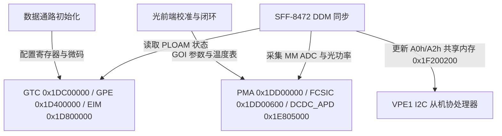

# 9.4 主控操作、光路校准与 DDM 刷新

主控操作涵盖数据通路启动、光路校准、设备管理和状态观察。它们协调硬件资源，但不是 SoC 自动完成的单一启动动作。板级职责和存储约束见 [启动与板级配置](../10_ma5671a_board_reference/02_dts_and_board_config.md)。

| 操作职责 | 硬件与服务范围 | 完成条件 |
| --- | --- | --- |
| 数据通路初始化 | GTC、GPE、LAN、缓冲和队列 | 微码就绪、端口配置有效、状态可读 |
| 光路校准 | PMA、BOSA、APD 电源与温度表 | 单板校准有效、测量稳定、告警受控 |
| GPON 管理 | PLOAM、OMCI、MIB 与业务配置 | 激活成功、管理通道可达、业务配置一致 |
| SFP 设备服务 | 双地址 EEPROM、DDM、软控制 | 宿主可读、动态值更新、控制事件得到处理 |
| 运行观察 | 光路/链路状态、计数器、异常报文 | 能区分无光、未激活、未配置与转发异常 |
| 维护与诊断 | 本地维护、远程调试和协议模拟 | 仅在所需服务启用；模拟结果不能代替真实链路验证 |

片上各硬件子系统上电后需按依赖顺序完成 `GTC`、`GPHY`、`GPE`/`SCE`、`EIM`、`PMA`/`BOSA` 与 `VPE1` 的寄存器配置及微码装填，随后进入双环自动功率控制（APC）、APD 温度补偿与 SFF-8472 DDM 周期刷新循环。

---

## 1. GPON 数据通路与 LAN 硬件初始化序列

系统启动阶段按硬件依赖顺序执行以下寄存器与协处理器初始化：

| 步骤 | 目标硬件模块 | 硬件初始化动作 |
| --- | --- | --- |
| 1. PLOAM 复位 | `GTC` (`0x1DC00000`) | 清空 PLOAM 接收队列，将状态机置于 O1 初始同步态 |
| 2. GTC 配置与激活 | `GTC` (`0x1DC00000`) | 1. 写入 8 字节 GPON 序列号与 10 字节注册密码。 2. 配置 `GTC` SF/SD 误码门限、激光器开启/关断扩展时延与 PLOAM 超时。 3. 解除 `GTC` 硬件复位并使能下行帧同步器与 Dying Gasp 硬件自动发包触发器。 |
| 3. GPHY 固件装载 | `SBS0` (`0x1F204000`) `SBS0CTRL` (`0x1F080000`) | 将 8051 代码映像写入片上 `SBS0` RAM（物理地址 `0x1F204000`），配置 `GPHY0IMG`/`GPHY1IMG` 重映射基址并释放 `SYS_ETH` 复位 |
| 4. GPE 与微码启动 | `SYS_GPE` (`0x1D700000`) `PCTRL` (`0x1D600000`) `PE0`–`PE5` / `COP0`–`COP5` `FSQM` (`0x1D500000`) | 1. 通过 `SYS_GPE` 使能 GPE 各功能块时钟并执行硬件复位。 2. 暂停 `PE0`–`PE5` 全部 18 台虚拟机（`PCTRL.TCTRL0`），将 64 位分类微码写入 6 颗 PE 的 `PROG[]` 存储器，将 `tse0.bin`–`tse5.bin` 装入 `COP0`–`COP5` 微码 RAM。 3. 按配置的段索引范围建立 `FSQM` 的 `SSB0` 空闲链表，再激活 `MERGE`、`DISP`、`IQM`、`TMU`、`ICTRLG` 与 `OCTRLG`；可寻址段数不等于本次配置实际投入的段数。 |
| 5. 共享缓冲水位设置 | `FSQM` (`0x1D500000`) | 编程 `FSQM` 的 5 级全局空闲段阈值寄存器 `FSQT0`–`FSQT4`（典型值 `1024`、`12288`、`12288`、`12288`、`12288`） |
| 6. EIM 与 UNI 端口激活 | `EIM` (`0x1D800000`) `SGMII` (`0x1D808C00`) `SXGMII` (`0x1D808800`) | 1. 激活 `EIM`、`ICTRLL0..3`（`0x1D460000`）与 `OCTRLL0..3`（`0x1D440000`）。 2. 根据接口模式配置 `SGMII`（1 Gbps SGMII / 1000BASE-X）或 `SXGMII`（2.5 Gbps HiSGMII / SerDes）锁相环与自协商寄存器，写入 IEEE 802.3x PAUSE 帧源 MAC 地址。 |

---

## 2. 光模拟前端初始化与双环 APC 校准控制流

光控制环路协同管理 `PMA`（`0x1DD00000`）、`FCSIC`（`0x1DD00600`）、`BOSA` 模拟电路与 `DCDC_APD`（`0x1E805000`）升压控制器：

### 2.1 光路参数装填与状态轮询

1. **GOI 参数装填**：
   - 将光收发器硬件参数（收发极性掩码、激光器最大偏置与调制电流限制、背光监测 MPD 标定电阻与耦合比、工作温区、温度告警滞回区间）及累计激光工作时长写入光驱动层。
2. **硬件就绪状态轮询**：
   - 以 50 ms 间隔轮询硬件就绪状态，等待 `FCSIC` 串行总线、片上温度传感器 ADC（`MM`）与 `DCDC_APD` 软启动完成。

### 2.2 三张温度查找表与硬件闭环控制

硬件就绪后，按温度范围（`230 K`–`370 K`，步进 `1 K`）加载三张查找表以驱动硬件闭环：

| 查找表名称 | 温度范围 (Kelvin) | 编码转换与硬件闭环动作 |
| --- | --- | --- |
| `laser_ref_base` | `230 K`–`370 K` | 出厂基准温度下激光器逻辑 `0`（消光基底 `P0`）与逻辑 `1`（发光峰值 `P1`）的目标背光 MPD 参考值 |
| `laser_ref` | `230 K`–`370 K` | 当前运行期各温度点 `P0`/`P1` 参考值及对应的初始偏置电流 `I_bias`、调制电流 `I_mod` 预估值 |
| `vapd_bd` | `230 K`–`370 K` | 接收端雪崩光电二极管（APD）随温度变化的击穿电压补偿曲线。加载时将参考电压按 `V_ref_fixed = round(V_ref * 512)` 转换为定点整数，连同调节步长与饱和占空比下发至 `DCDC_APD`（`0x1E805000`） |

在运行期间：
- `MM`（Measurement Module）周期性采样片上与外置热敏电阻温度 `T`（单位 K）。
- 根据当前温度 `T` 索引 `vapd_bd` 表，实时调整 `DCDC_APD` 输出高压以维持恒定的 APD 雪崩倍增增益。
- `BFD` / `MPD` 双环自动功率控制（APC）硬件在突发发送窗口内采样背光二极管电流，与 `laser_ref` 表在温度 `T` 下的 `P0`、`P1` 目标值比对，通过 `FCSIC` 动态修正 `TXBOSA` 驱动器的偏置 DAC（`I_bias`）与调制 DAC（`I_mod`）。

---

## 3. SFF-8472 (A0h/A2h) 寄存器装填与实时 DDM 刷新

VPE0 与 VPE1 通过共享内存（`0x1F200200`）向外部宿主机提供符合 SFF-8472 规范的双 I2C 从地址寄存器空间：

1. **静态初始化阶段**：
   - 将 `Bank 0` 绑定至从地址 `0xA0`（默认只读写保护 `0x00`–`0xFF`），将 `Bank 1` 绑定至从地址 `0xA2`（默认写保护低 128 字节中的静态告警门限区，开放 Byte 110 软控制位与高页可写区）。
   - `0xA0` 保存标识、连接器、标称速率、厂商（Bytes 20–35）、部件号（40–55）、修订号（56–59）、波长（60–61）、序列号（68–83）和日期（84–91）。标识字段由设备配置提供；标称速率不能替代实际链路状态，运行时也不应假定这些字段会随链路模式自动重写。
   - 累加计算 Bytes 0–62 与 Bytes 64–94 的低 8 位校验和，分别写入 `0xA0` Byte 63（`CC_BASE`）与 Byte 95（`CC_EXT`）；共享内存 `+0x7A8` 的事务处理标志控制 VPE1 是否响应外部 I2C 总线读写。
2. **DDM 实时监控循环**：
   - 周期性读取 `MM` 与 `BOSA` 的 5 项实时测量值，按 SFF-8472 大端定点格式转换后写入 `0xA2`（诊断 bank 数据区）：
     - **模块温度**（Bytes 96–97）：有符号 16-bit 定点数，单位 `1/256 °C`。
     - **供电电压 `V_cc`**（Bytes 98–99）：无符号 16-bit 整数，单位 `100 µV`。
     - **激光器偏置电流 `I_bias`**（Bytes 100–101）：无符号 16-bit 整数，单位 `2 µA`。
     - **发射光功率 `TX_Power`**（Bytes 102–103）：无符号 16-bit 整数，单位 `0.1 µW`。
     - **接收光功率 `RX_Power` (RSSI)**（Bytes 104–105）：无符号 16-bit 整数，单位 `0.1 µW`。
   - 同步比对 `0xA2` Bytes 0–39 中的高低告警（Alarm）与预警（Warning）阈值，更新 Bytes 112–113（Alarm Flags）和 Bytes 116–117（Warning Flags）。
   - 外部宿主写入后的通知来自每 bank 的 32 字节写事件位图，主控按位读取并清除。Byte 110 的软控制需要由主控处理事件并协调光路控制，不能把 EEPROM 字节写入直接等同于硬件关断成功。
