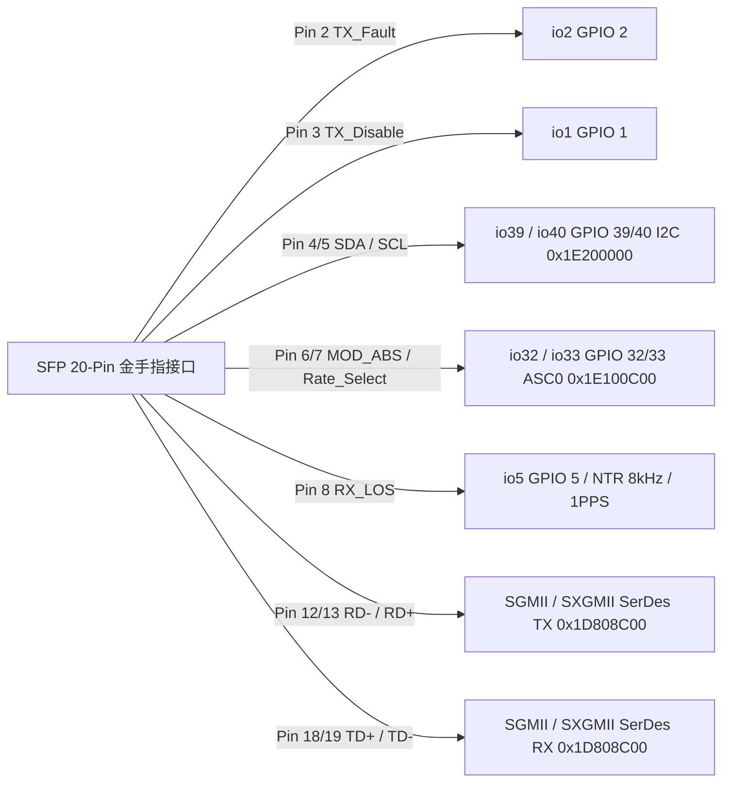

# 10.1 引脚映射与串口模式

MA5671A 采用 SFP MSA 20-Pin 金手指封装，将 Falcon（PEB/PEF 98035）片上高速 SerDes、模拟前端及 5 组 Pad/GPIO 银行（`PADCTRL0`–`PADCTRL4` / `GPIO0`–`GPIO4`）映射至 SFP 控制信号、双地址 I2C 从机、SPI NOR Flash 与复用调试串口（`ASC0`）。



---

## 1. 5 组 Pad 控制器与 GPIO 银行物理地址映射

片上引脚分为 5 个银行（Bank 0–4，每组最多 32 个引脚，全局 GPIO 编号 `bank * 32 + pin_offset`），分别由 `SBS0`（`0x1F000000`）与 `FPI`（`0x1E000000`）总线上的 `PADCTRLn`（引脚复用、上下拉与驱动强度）和 `GPIOn`（方向、输入输出数据与中断控制）管辖：

| 银行编号 | 全局 GPIO 范围 | `PADCTRL` 物理基址 | `GPIO` 物理基址 | 所属时钟与复位域 | 板级已用引脚范围 |
| --- | --- | --- | --- | --- | --- |
| Bank 0 | `GPIO 0`–`31` (`io0`–`io31`) | `0x1DB01000` | `0x1DB01100` | `SYS1` (`0x1EF00000`) | `io0`, `io1`, `io2`, `io4`, `io5`, `io6`, `io7`, `io8`, `io9`–`io14` |
| Bank 1 | `GPIO 32`–`63` (`io32`–`io63`) | `0x1E800100` | `0x1E800200` | `SYS1` (`0x1EF00000`) | `io32`, `io33`, `io34`, `io37`, `io38`, `io39`, `io40`, `io43`–`io45` |
| Bank 2 | `GPIO 64`–`95` (`io64`–`io95`) | `0x1DB02000` | `0x1DB02100` | `SYS1` (`0x1EF00000`) | EBU / SPI NOR Flash 专用引脚 (`localbus@10000000`) |
| Bank 3 | `GPIO 96`–`127` (`io96`–`io127`) | `0x1E800300` | `0x1E800400` | `SYS1` (`0x1EF00000`) | 未引出 |
| Bank 4 | `GPIO 128`–`159` (`io128`–`io159`) | `0x1D800100` | `0x1D800200` | `SYS_ETH` (`0x1D800000`) | 未引出 |

---

## 2. SFP 20-Pin 金手指与板级 GPIO 完整映射表

### 2.1 SFP MSA 20-Pin 金手指信号分配

| SFP Pin | MSA 标准名称 | 信号方向 (相对模块) | 连接的 Falcon 硬件单元 / 引脚 | 板级功能说明 |
| --- | --- | --- | --- | --- |
| `1`, `9`, `10`, `11`, `14`, `17`, `20` | `VeeT` / `VeeR` | GND | 信号地与激光器/接收器地 | 模块参考地 |
| `2` | `TX_Fault` | Output | `io2` (`GPIO 2`, `&gpio0 2`) | 激光器发送故障开漏输出；在 `ASC0` 复用模式 1 下可复用为串口信号 |
| `3` | `TX_Disable` | Input | `io1` (`GPIO 1`, `&gpio0 1`) | 宿主机关闭激光器控制输入（高电平关断光发射） |
| `4` | `MOD-DEF(2)` (`SDA`) | Bi-Dir | `io39` (`GPIO 39`, `&gpio1 7`) | SFF-8472 双地址（`0xA0`/`0xA2`）I2C 数据线（由 VPE1 协处理器驱动） |
| `5` | `MOD-DEF(1)` (`SCL`) | Input | `io40` (`GPIO 40`, `&gpio1 8`) | SFF-8472 I2C 时钟线 |
| `6` | `MOD-DEF(0)` | Output | `io32` (`GPIO 32`, `&gpio1 0`) | 在位指示输出（正常运行拉低表示模块在位）；复用为 `ASC0` 串口 RX 引脚 |
| `7` | `Rate_Select` (`RS0`) | Input / Output | `io33` (`GPIO 33`, `&gpio1 1`) | 速率选择引脚；复用为 `ASC0` 串口 TX 引脚 |
| `8` | `LOS` (`RX_LOS`) | Output | `io5` (`GPIO 5`, `&gpio0 5`) | 接收光信号丢失指示输出（无光拉高）；可通过 `pinselect-ntr` 切换为 8 kHz NTR 或 1PPS 时钟输出 |
| `12`, `13` | `RD-`, `RD+` | Output | `SGMII` / `SXGMII` SerDes TX | 1000BASE-X / SGMII (1.25 GBd) 或 HiSGMII / 2500BASE-X (3.125 GBd) 差分接收数据输出至宿主 |
| `15`, `16` | `VccR`, `VccT` | Power | +3.3 V 电源轨 | 驱动片上 `DCDC_CORE`（1.0 V）、`DCDC_DDR`（1.8 V）、`DCDC_APD`（高压升压）及 3.3 V I/O |
| `18`, `19` | `TD+`, `TD-` | Input | `SGMII` / `SXGMII` SerDes RX | 1.25 GBd / 3.125 GBd 差分发送数据从宿主输入至模块 |

### 2.2 片上全部已配置 GPIO 与复用组 (`falcon-sfp.dts` 与启动脚本)

| 引脚名 | 全局 GPIO | 银行与位偏移 | 设备树 Pinctrl 组 / 函数 | 板级配置与运行期行为 |
| --- | --- | --- | --- | --- |
| `io0` | `GPIO 0` | `&gpio0 0` | `por` (`function = "rst"`) | 上电复位参考引脚 |
| `io1` | `GPIO 1` | `&gpio0 1` | GPIO Input | SFP Pin 3 `tx_disable` 输入（记录于 `/etc/config/sfp_pins`） |
| `io2` | `GPIO 2` | `&gpio0 2` | GPIO Output (`tx_fault`) | SFP Pin 2 `tx_fault` 输出（记录于 `/etc/config/sfp_pins`） |
| `io4` | `GPIO 4` | `&gpio0 4` | `ntr` (`function = "ntr"`) | 网络定时参考（Network Timing Reference）内部信号 |
| `io5` | `GPIO 5` | `&gpio0 5` | `pinselect-ntr`：`ntr8k` (`mux 0`) / `pps` (`mux 2`) / `gpio` (`mux 1`) | SFP Pin 8 `los` 输出；默认处于 GPIO 模式（下拉关闭，输出 `0`），可动态切换为 8 kHz NTR 或 TOD 1PPS 输出 |
| `io6` | `GPIO 6` | `&gpio0 6` | `hrst` (`function = "rst"`, `lantiq,pull = <2>`) | 硬件外设复位输出（上拉使能，挂载于 `pinctrl-0` 默认状态） |
| `io7`, `io8` | `GPIO 7`, `8` | `&gpio0 7`, `8` | `mdio` (`function = "mdio"`) | 板级由 `/etc/init.d/lan.sh` 通过 `/sys/class/gpio/export` 导出为 GPIO 7 与 GPIO 8 输入状态监测 |
| `io9`–`io14` | `GPIO 9`–`14` | `&gpio0 9..14` | `bootled` (`function = "led"`) | 片上状态指示灯组 |
| `io32` | `GPIO 32` | `&gpio1 0` | `pinselect-asc0`：`asc` (`mux 0`) 或 GPIO (`mux 1`) | SFP Pin 6 `mod_def` / `ASC0` 串口 RX 引脚 |
| `io33` | `GPIO 33` | `&gpio1 1` | `pinselect-asc0`：`asc` (`mux 0`) 或 GPIO (`mux 1`) | SFP Pin 7 `Rate_Select` / `ASC0` 串口 TX 引脚 |
| `io34` | `GPIO 34` | `&gpio1 2` | GPIO Output | 板载 EEPROM 硬件写保护（WP）控制引脚，由 `mod_sfp_i2c.ko` 申请并默认拉高保护，密码校验通过后短暂拉低解锁 |
| `io37`, `io38` | `GPIO 37`, `38` | `&gpio1 5`, `6` | Bit-banged I2C (`i2c-gpio-custom`) | 由 `/etc/init.d/fw_env.sh` 执行 `insmod i2c-gpio-custom bus0=0,37,38,5` 注册为主机侧软件模拟 I2C 总线 0（SDA=`37`, SCL=`38`） |
| `io39`, `io40` | `GPIO 39`, `40` | `&gpio1 7`, `8` | `i2c@200000` / `sfp_i2c:sda`, `sfp_i2c:scl` | SFP Pin 4/5 I2C 从机接口，由 `mod_sfp_i2c.ko` 写入共享内存 `+0x7A0`/`+0x7A4`（`sda_gpio = 39`, `scl_gpio = 40`）交由 VPE1 驱动 |
| `io43`–`io45` | `GPIO 43`–`45` | `&gpio1 11..13` | `pinselect-asc1`：`slic` (`io43..45`) 或 `asc` (`io44..45`) | 默认配置为 `slic` 模式，可切换将 `io44`/`io45` 映射为第二串口 `ASC1`（`0x1E100B00`） |

---

## 3. `pinselect-asc0` 串口复用模式与引脚冲突管理

由于 SFP 20-Pin 接口没有专用的 UART 引脚，系统通过设备树中的 `pinselect-asc0` 节点和 U-Boot 环境变量 `asc0`（`0`..`3`）控制 `io32`（Pin 6）与 `io33`（Pin 7）在调试串口 `ASC0`（`0x1E100C00`，`115200 8N1`）和 SFP 标准控制信号之间的切换：

### 3.1 `pinselect-asc0` 四种硬件复用状态 (`falcon-sfp.dts`)

| `asc0` 变量值 | 设备树状态名 | `io32` (Pin 6) 硬件配置 | `io33` (Pin 7) 硬件配置 | `/etc/init.d/pin_cfg.sh` 导出的受限引脚 (`get_restrictions`) |
| --- | --- | --- | --- | --- |
| `0` | `asc0` (`default`) | `mux = 0` (`ASC0 RX`) | `mux = 0` (`ASC0 TX`) | `ASC_RX ASC_TX`（双向串口启用，Pin 6 不输出固定低电平） |
| `1` | `func1` | `mux = 1`, `pull = 2`, `output = 0` (GPIO 输出低电平，指示 `MOD-DEF(0)` 在位) | `mux = 0` (`ASC0 TX` 单向日志输出) | `ASC_TX`（串口仅单向发送，Pin 6 作为标准在位信号拉低） |
| `2` | `func2` | `mux = 0` (`ASC0 RX` 单向接收) | `mux = 1`, `pull = 2` (GPIO 输入上拉) | `ASC_RX`（串口仅单向接收，Pin 7 释放为 GPIO 输入） |
| `3` | `func3` | `mux = 1`, `pull = 2`, `output = 0` (GPIO 输出低电平，指示 `MOD-DEF(0)` 在位) | `mux = 1`, `pull = 2` (GPIO 输入上拉) | 无串口占用（完全关闭 `ASC0` 外部引脚，完全符合 SFP MSA 电气定义） |

### 3.2 `/etc/config/sfp_pins` 与 `S63 pin_cfg.sh` 初始化流程

1. 首次启动时，`/etc/uci-defaults/sfp-pins-preconfig` 生成 `/etc/config/sfp_pins` 默认 UCI 配置：
   ```text
   config pins 'default'
       option tx_fault '2'
       option tx_disable '1'
       option los '5'
       option mod_def '32'
   ```
2. 启动阶段执行 `/etc/init.d/pin_cfg.sh`（`START=63`）：
   - 调用 `/lib/falcon.sh` 中的 `falcon_asc0_pin_mode` 读取 U-Boot 环境变量 `asc0`（缺省为 `0`），向 `/sys/devices/1e800100.pad/pinselect-asc0/state` 写入对应的状态名（`asc0`、`func1`、`func2` 或 `func3`）。
   - 若 `asc0` 设为 `1`（`func1`）且 U-Boot 环境变量 `tx_fault_pin == 0`，则将 `TX_Fault` 占用的引脚列入受限集合以释放复用通道。
   - 调用 `optic optic_pin_cfg_set` 将当前未被 `ASC0` 占用的 `tx_fault`（GPIO 2）、`tx_disable`（GPIO 1）、`los`（GPIO 5）和 `mod_def`（GPIO 32）引脚编号下发给 `mod_optic.ko`，交由光驱动状态机直接接管硬件 GPIO 控制。
