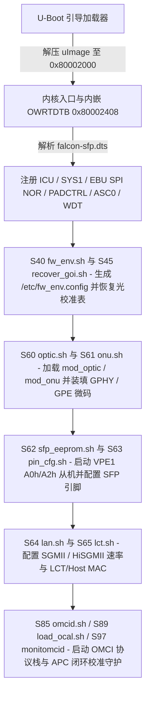

# 10.2 falcon-sfp.dts 与启动脚本

MA5671A 的板级硬件拓扑由内嵌于内核镜像头部的扁平设备树 `falcon-sfp.dts`（`model = "SFP - Lantiq Falcon SFP Stick"`，`compatible = "lantiq,falcon-sfp", "lantiq,falcon"`）定义，并在系统启动阶段由 `/lib/falcon.sh` 及 `/etc/rc.d/S40`–`S99` 初始化脚本按序拉起各硬件子系统。

---

## 1. 内核镜像头部与内嵌设备树 (`OWRTDTB:`) 布局

内核镜像加载与入口虚拟地址为 `0x80002000`（物理地址 `0x00002000`）。由于 U-Boot 引导时不单独传递外部 DTB 指针，编译构建阶段将编译后的 8,160 字节二进制设备树（FDT）直接嵌入在内核镜像文件偏移 `0x0410` 处：

| 镜像文件偏移 | KSEG0 虚拟地址 | 长度 | 内容与硬件引导行为 |
| --- | --- | --- | --- |
| `0x0000`–`0x03FF` | `0x80002000`–`0x800023FF` | 1024 B | 全零 `nop` 指令滑道（uImage 入口点落在此区间起始处） |
| `0x0400`–`0x0407` | `0x80002400`–`0x80002407` | 8 B | 跳转指令 `j 0x8000A690` 及分支延迟槽 `nop`，跳过内嵌 DTB 区域 |
| `0x0408`–`0x040F` | `0x80002408`–`0x8000240F` | 8 B | ASCII 魔数标识 `"OWRTDTB:"`（`4F 57 52 54 44 54 42 3A`） |
| `0x0410`–`0x23EF` | `0x80002410`–`0x800043EF` | 8160 B | `falcon-sfp.dts` 编译生成的 Flattened Device Tree (`0xD00DFEED`) |
| `0x8690` | `0x8000A690` | — | `kernel_entry`：初始化栈与 `$gp`，清空 `.bss`，从 `0x80002410` 读取内嵌 FDT 构建设备节点 |

---

## 2. `falcon-sfp.dts` 总线与外设节点清单

| 设备树路径 | `compatible` 属性 | 物理基址与长度 (`reg`) | 中断号 (`interrupts`) / 核心属性 |
| --- | --- | --- | --- |
| `/cpus/cpu@0` | `"mips,mips34kc"` | — | 大端 MIPS 34Kc，支持 VPE0/VPE1 双虚拟处理单元 |
| `/memory@0` | — | `0x00000000` (`0x04000000`) | 64 MiB DDR2 SDRAM（可由 U-Boot `memsize=` 覆盖） |
| `/chosen` | — | — | `bootargs = "console=ttyLTQ0,115200 init=/etc/preinit"` |
| `/clocks/cpu` | `"fixed-clock"` | — | `clock-frequency = <400000000>` (400 MHz) |
| `/clocks/io` | `"fixed-clock"` | — | `clock-frequency = <200000000>` (200 MHz) |
| `/clocks/fpi` | `"fixed-clock"` | — | `clock-frequency = <100000000>` (100 MHz) |
| `/biu@1F800000/icu@80200` | `"lantiq,icu"` | `0x1F880200` (`0xA0`) | 5 组 32 位中断控制器（IM0–IM4），管理 IRQ `8`–`167` |
| `/biu@1F800000/watchdog@803F0` | `"lantiq,wdt"` | `0x1F8803F0` (`0x10`) | 硬件看门狗定时器 |
| `/sbs0@1F000000/status@1002000` | `"lantiq,status-falcon"` | `0x1EE00000` (`0x100`) | 芯片 ID、Fuses 与子系统配置状态块 |
| `/sbs0@1F000000/sys1@100000` | `"lantiq,sys1-falcon"` | `0x1EF00000` (`0x100`) | `SYS1` 时钟门控、复位控制与 CPU0CC 分频 |
| `/sbs0@1F000000/pad@B01000` | `"lantiq,pad-falcon"` | `0x1DB01000` (`0x100`) | Bank 0 Pad 复用控制器（关联 `gpio0@B01100`，IRQ `114`） |
| `/sbs0@1F000000/pad@B02000` | `"lantiq,pad-falcon"` | `0x1DB02000` (`0x100`) | Bank 2 Pad 复用控制器（关联 `gpio2@B02100`，IRQ `115`） |
| `/fpi@1E000000/asc@100C00` | `"lantiq,asc"` | `0x1E100C00` (`0x100`) | `ASC0` 主控制台串口（`ttyLTQ0`），IRQ `104` (TX)、`106` (RX)、`107` (ERR) |
| `/fpi@1E000000/asc@100B00` | `"lantiq,asc"` | `0x1E100B00` (`0x100`) | `ASC1` 第二串口，IRQ `96` (TX)、`98` (RX)、`99` (ERR) |
| `/fpi@1E000000/i2c@200000` | `"lantiq,falcon-i2c"`, `"i2c-gpio"` | `0x1E200000` (`0x10000`) | 硬件 I2C 控制器（IRQ `18`..`21`），或回退绑定 `&gpio1 7` (GPIO 39) 与 `&gpio1 8` (GPIO 40) |
| `/fpi@1E000000/gptu@100A00` | `"lantiq,gptu-falcon"` | `0x1E100A00` (`0x100`) | 通用定时器单元（Timer 1A–3B，IRQ `126`..`131`） |
| `/fpi@1E000000/pad@800100` | `"lantiq,pad-falcon"` | `0x1E800100` (`0x100`) | Bank 1 Pad 复用控制器（关联 `gpio1@800200`，IRQ `148`），承载 `pinselect-asc0` 与 `pinselect-asc1` |
| `/fpi@1E000000/pad@800300` | `"lantiq,pad-falcon"` | `0x1E800300` (`0x100`) | Bank 3 Pad 复用控制器（关联 `gpio3@800400`，IRQ `149`） |
| `/sbs2@1D000000/sys_eth@800000` | `"lantiq,sys-eth-falcon"` | `0x1D800000` (`0x100`) | 以太网子系统时钟与复位控制（关联 `pad@800100` 与 `gpio4@800200`，IRQ `72`） |
| `/sbs2@1D000000/sys_gpe@700000` | `"lantiq,sys-gpe-falcon"` | `0x1D700000` (`0x100`) | GPE 数据包引擎 625 MHz 时钟门控与硬件块复位控制器 |

---

## 3. SPI NOR Flash (`localbus@10000000`) 分区表

`localbus@10000000` 挂载 EBU 串行闪存控制器（物理地址 `0x10000000` 映射 16 MiB Flash 窗口，`0x1E102000` 为 EBU 控制寄存器），连接 Spansion S25FL129P（`spansion,s25fl129p0`，最大时钟 80 MHz，开启 `m25p,fast-read`），固定划分为 4 个 MTD 分区：

| MTD 设备 | 分区名称 (`label`) | 起始偏移 | 分区大小 | 用途说明 |
| --- | --- | --- | --- | --- |
| `/dev/mtd0` | `uboot` | `0x000000` | `0x040000` (256 KiB) | U-Boot 引导加载程序 |
| `/dev/mtd1` | `uboot_env` | `0x040000` | `0x080000` (512 KiB) | 主备双冗余 U-Boot 环境变量区（主扇区偏移 `0x0`，备扇区偏移 `0x40000`，扇区大小 `64 KiB`） |
| `/dev/mtd2` | `image0` | `0x0C0000` | `0x740000` (7,424 KiB) | 主固件槽位（Slot 0，含 64B uImage 头、LZMA 内核、SquashFS 只读根文件系统与 JFFS2 `rootfs_data` 读写层） |
| `/dev/mtd3` | `image1` | `0x800000` | `0x800000` (8,192 KiB) | 备固件槽位（Slot 1，供 OMCI ME 7 双镜像平滑升级切换） |

---

## 4. `/lib/falcon.sh` 板级识别与 MAC 派生规则

`/lib/falcon.sh` 提供供所有初始化脚本调用的板级参数读取函数：

1. **板型与端口识别**：
   - `falcon_board_name()`：从 `/proc/cpuinfo` 读取 `machine` 字段并归一化，返回 `"SFP"`（对应 `SFP - Lantiq Falcon SFP Stick`）。
   - `falcon_get_number_of_lan_ports()`：根据 `SFP` 板型返回 `1`（仅启用 1 个 SerDes UNI 端口）。
   - `falcon_default_lct_get()`：返回默认本地维护终端接口名 `"lct0"`。
2. **基准 MAC 与 4 路接口 MAC 派生 (`falcon_mac_get`)**：
   - `falcon_base_mac_get()` 从 `/proc/cmdline` 提取 `ethaddr=` 参数（若未指定则回退为 `ac:9a:96:00:00:00`）。
   - `falcon_mac_get <type>` 将基准 MAC 的末字节加偏移量生成各虚拟接口的独立 MAC 地址：

| 接口类型参数 (`<type>`) | 末字节累加偏移 | 绑定的网络接口与硬件用途 |
| --- | --- | --- |
| `lct*` / `lan` / `lan0` | `+0` | `lct0` 本地维护接口及 UNI 端口 0 PAUSE 流控源 MAC |
| `lan1` | `+1` | 预留第二 LAN 端口 MAC |
| `host` | `+2` | `host` 接口（对应 OMCI ME 134 `IP Host Config Data`，写入 `PE` `CONSTANTS` 表） |
| `wan` | `+3` | WAN 侧管理接口 MAC |

---

## 5. GPON 启动脚本链路 (`/etc/rc.d/S40`–`S99`)

系统按以下启动序号依次拉起驱动模块与守护进程：

| 启动序号与脚本路径 | 加载的模块 / 调用的工具 | 核心板级初始化动作 |
| --- | --- | --- |
| `S40` `/etc/init.d/fw_env.sh` | `i2c-gpio-custom` | 检测 `/dev/mtd1`（`uboot_env`）并生成 `/etc/fw_env.config`；执行 `insmod i2c-gpio-custom bus0=0,37,38,5` 注册 GPIO 37/38 软件 I2C 总线 |
| `S45` `/etc/init.d/recover_goi.sh` | `fw_printenv`, `uudecode`, `tar` | 若 `/etc/optic/.goi_recovered` 不存在且环境变量 `goi_config` 非空，将 `goi_config` 中的 `@` 替换为换行符后经 `uudecode` 与 `tar xz -C /` 解压恢复 `/etc/optic/` 校准表 |
| `S60` `/etc/init.d/optic.sh` | `mod_optic.ko` | 加载 `mod_optic.ko`，创建 `/dev/optic0`（主设备号 249）与符号链接 `/dev/optic` |
| `S61` `/etc/init.d/onu.sh` | `mod_onu.ko`, `onu` | 加载 `mod_onu.ko`，创建 `/dev/onu0` 与 `/dev/onu`；读取 `nSerial`、`nPassword`、`nDyingGaspEnable`、`olt_type`、`ploam_emergency_stop_state`，依次调用 `onu` 执行 `ploam_init`、`gtcsns`、`gtccs`、`gtci`、`langfd "phy11g.bin"`、`gpei`、`gpe_shared_buffer_cfg_set`；若 `goi_calibrated >= 1` 则执行 `onu gtc_watchdog_set 1` |
| `S62` `/etc/init.d/sfp_eeprom.sh` | `mod_sfp_i2c.ko`, `sfp_i2c` | 加载 `mod_sfp_i2c.ko`（启动 VPE1 `sfp_i2c_vpe.bin`），创建 `/dev/sfp_eeprom0`（`0xA0`）与 `/dev/sfp_eeprom1`（`0xA2`）；写入 SFF-8472 厂商/部件号/SN/速率字段并使能 VPE1 处理，最后启动 `sfp_i2c -a` 后台 DDM 监控 |
| `S63` `/etc/init.d/pin_cfg.sh` | `optic` | 根据 U-Boot `asc0` 变量切换 `/sys/devices/1e800100.pad/pinselect-asc0/state`，调用 `optic optic_pin_cfg_set` 配置 `tx_fault`/`tx_disable`/`los`/`mod_def` |
| `S64` `/etc/init.d/lan.sh` | `onu` | 导出 GPIO 7 与 GPIO 8；读取 `sgmii_mode`（`1`..`5`）转换为 `lanpcs` 端口模式参数，初始化 `EIM`、配置 PAUSE 帧 MAC 并启用 UNI 端口 0 |
| `S65` `/etc/init.d/lct.sh` | `mod_onu_netdev.ko` | 加载虚拟网卡驱动，为 `lct0` 与 `host` 配置派生的 MAC 地址与管理 IP |
| `S85` `/etc/init.d/omcid.sh` | `omcid` | 创建 `/tmp/omci_pipe`，读取 `mib_file`（缺省 `/etc/mibs/data_1g_8q.ini`）、`omci_iop_mask` 与 `olt_type`，启动 `omcid` 守护进程 |
| `S87` `/etc/init.d/load_dti_agent.sh` | `gpon_dti_agent` | 启动 DTI 调试代理监听 TCP 端口 `9000` |
| `S89` `/etc/init.d/load_ocal.sh` | `ocal` | 创建 `/tmp/ocal_pipe`，启动 `ocal` 加载 50B GOI 配置与三张温度查找表，激活 BOSA 双环 APC 与 `DCDC_APD` 温度补偿 |
| `S97` `/etc/init.d/monitomcid` | 监控脚本 | 后台周期检查 `omcid` 进程存活状态并在异常退出时自动拉起 |
