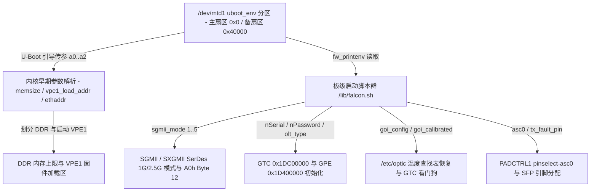

# 10.3 U-Boot 环境变量

MA5671A 将硬件速率模式、GPON 注册凭证、光校准归档数据及 VPE0/VPE1 内存划分参数保存在 SPI NOR Flash 的 `uboot_env` 分区（`/dev/mtd1`）中。系统引导时通过 MIPS o32 寄存器参数（`$a0`/`$a1` 命令行与 `$a2` 环境指针）向内核传递底层硬件参数，用户态初始化脚本通过 `fw_printenv` / `fw_setenv` 读写 `/dev/mtd1` 中的板级配置项。



---

## 1. `uboot_env` 双冗余扇区结构与 `/etc/fw_env.config`

`uboot_env` 分区位于 SPI NOR 物理偏移 `0x040000`–`0x0BFFFF`（总长 `512 KiB`，对应 `/dev/mtd1`），采用主备双扇区冗余格式（每个环境块头部包含 32-bit CRC-32 校验和与 1 字节活动标志位）。`/etc/init.d/fw_env.sh`（`S40`）生成的 `/etc/fw_env.config` 如下：

```text
# MTD device name   Device offset   Env. size   Flash sector size   Number of sectors
/dev/mtd1           0x0             0x10000     0x00010000
/dev/mtd1           0x40000         0x10000     0x00010000
```

| 扇区角色 | `/dev/mtd1` 内部偏移 | SPI NOR 绝对偏移 | 环境数据大小 | 擦除扇区大小 |
| --- | --- | --- | --- | --- |
| 主环境块 (Primary) | `0x00000` | `0x040000` | `0x10000` (64 KiB) | `0x10000` (64 KiB) |
| 备环境块 (Redundant) | `0x40000` | `0x080000` | `0x10000` (64 KiB) | `0x10000` (64 KiB) |

---

## 2. 内核早期引导与 VPE1 硬件划分参数 (`envp` & `cmdline`)

U-Boot 跳转进入内核入口 `0x80002000` 时，通过 `$a2`（`envp` 环境变量数组）与 `/proc/cmdline` 传递以下底层硬件参数：

| 参数名称 | 传递通道 | 缺省值 | 硬件控制作用 |
| --- | --- | --- | --- |
| `memsize` | `$a2` (`envp`) | `16` (MiB) | 指定物理 DDR 总容量（单位 MiB，MA5671A 为 `64`）。内核据此注册系统可用物理内存上限，并在启动 VPE1 时通过 `$a3` 将物理内存总字节数传给 VPE1 固件 |
| `vpe1_mem` | `/proc/cmdline` | `0` | 从物理 DDR 顶部预留给 VPE1 协处理器独占使用的内存字节数（主控 Linux 仅映射 `0` 至 `memsize - vpe1_mem`） |
| `vpe1_load_addr` | `/proc/cmdline` | `memsize - vpe1_mem` | 指定 VPE1 固件 `sfp_i2c_vpe.bin` 的物理加载基址（由 `mod_sfp_i2c.ko` 调用 `vpe1_get_load_addr(0)` 获取并写入 VPE1 `MVPConf0` / `TCBind` / `TCRestart` 启动） |
| `vpe1_wdog_ctr_addr` | `/proc/cmdline` | — | VPE1 硬件心跳计数器物理地址，主控内核周期监控该地址递增状态并在超时未更新时触发 VPE1 软复位 |
| `vpe1_wdog_timeout` | `/proc/cmdline` | — | VPE1 看门狗超时时间阈值 |
| `ethaddr` | `/proc/cmdline` | `ac:9a:96:00:00:00` | 板级基准 MAC 地址，供 `/lib/falcon.sh` 派生 `lct0`、`lan`、`host`（`+2`）与 `wan`（`+3`）接口 MAC |
| `boardname` | `/proc/cmdline` | `"SFP"` | 覆盖设备树板型标识 |

---

## 3. 板级运行期 U-Boot 环境变量全表

用户态启动脚本（`/lib/falcon.sh` 与 `/etc/init.d/`）通过 `fw_printenv` 读取以下 U-Boot 环境变量以配置 SerDes 接口、GPON 认证、OMCI 互通性及光模块校准参数：

| 变量名称 | 读取脚本 / 函数 | 取值范围 / 缺省值 | 硬件与协议栈配置行为 |
| --- | --- | --- | --- |
| `sgmii_mode` | `/lib/falcon.sh`<br/>`S64 lan.sh`<br/>`S62 sfp_eeprom.sh` | `1`..`5`（缺省 `0` -> 按 `5` 处理） | 控制 UNI 端口 0 `SGMII`/`SXGMII` SerDes 硬件速率模式与 `0xA0` Byte 12 标称速率（见下节详表） |
| `asc0` | `/lib/falcon.sh`<br/>`S63 pin_cfg.sh` | `0`, `1`, `2`, `3`（缺省 `0`） | 切换 `PADCTRL1` 的 `pinselect-asc0` 状态（`0`=`asc0` 双向串口，`1`=`func1` 仅 TX，`2`=`func2` 仅 RX，`3`=`func3` 纯 GPIO） |
| `tx_fault_pin` | `S63 pin_cfg.sh` | `0` 或 GPIO 号 | 当 `asc0 == 1` 且 `tx_fault_pin == 0` 时，释放 `TX_Fault` 引脚供串口复用 |
| `nSerial` | `S61 onu.sh` | 8 字节 ASCII/Hex（缺省 `"LTQ00000"`） | 通过 `onu gtcsns` 写入 `GTC` PLOAM 序列号寄存器（4B Vendor-ID + 4B VSSN）并同步至 `0xA0` EEPROM |
| `nPassword` | `S61 onu.sh` | 10 字节 ASCII 或 20 位 Hex（缺省 `"0000000000"`） | 通过 `onu gtccs` 写入 PLOAM 上下文 `+0x6BD` 处的 10 字节 `Password`（响应 O5 `Request_Password`） |
| `nDyingGaspEnable` | `S61 onu.sh` | `0` 或 `1`（缺省 `0`） | 通过 `onu gtc_dying_gasp_cfg_set` 使能或关闭掉电告警硬件自动触发 |
| `olt_type` | `/lib/falcon.sh`<br/>`S61 onu.sh`<br/>`S85 omcid.sh` | 整数编码（缺省 `0`） | 传递给 `onu gpei` 与 `omcid`，配置针对特定 OLT 厂商的 GPE/OMCI 互通参数 |
| `ploam_emergency_stop_state` | `/lib/falcon.sh`<br/>`S61 onu.sh` | `0` 或 `1`（缺省 `0`） | 传递给 `onu gtccs`；为 `1` 时 PLOAM 状态机从 O1 直接锁入 O7 紧急激光关断态 |
| `goi_calibrated` | `S61 onu.sh` | 整数（`>= 1` 表示已校准） | 当 `goi_calibrated >= 1` 时，`onu.sh` 执行 `onu gtc_watchdog_set 1` 开启 GTC 激光器突发看门狗 |
| `goi_config` | `S45 recover_goi.sh`<br/>`goi_store_uboot.sh` | Base64 + `@` 分隔长字符串 | 持久化备份 `/etc/goiupgrade.conf` 指定的 5 个光校准文件（见第 5 节） |
| `mib_file` | `S85 omcid.sh` | 文件名（缺省 `data_1g_8q.ini`） | 指定 `omcid` 启动时从 `/etc/mibs/` 加载的初始 MIB 拓扑配置文件 |
| `omci_iop_mask` | `/lib/falcon.sh`<br/>`S85 omcid.sh` | 32-bit 位掩码（缺省 `0`） | 通过 `-i` 参数传给 `omcid`，控制 OMCI ME 兼容性处理掩码 |
| `sfp_i2c_addr_eeprom_0`<br/>`sfp_i2c_addr_eeprom_1` | `S62 sfp_eeprom.sh` | 8-bit I2C 地址（缺省 `0xA0` / `0xA2`） | 通过 `sfp_i2c` 写入共享内存 `0x9F200200` 配置 VPE1 从机监听地址 |

---

## 4. `sgmii_mode` 与 SerDes 1G / 2.5G 硬件模式映射

`/lib/falcon.sh` 的 `falcon_sgmii_mode()` 读取 `sgmii_mode`，由 `/etc/init.d/lan.sh` 的 `decode_sgmii_mode()` 转换为 `onu lanpcs` 的硬件接口模式参数，并由 `/etc/init.d/sfp_eeprom.sh` 的 `bitrate_config()` 同步更新 SFF-8472 `0xA0` Byte 12（Nominal Bit Rate，单位 100 MBd）：

| `sgmii_mode` 取值 (数字或字符串) | `lan.sh` 转换后的 `onu lanpcs` 模式值 | SerDes 物理层工作模式与速率 | `sfp_eeprom.sh` 写入 `0xA0` Byte 12 的值 |
| --- | --- | --- | --- |
| `1` 或 `sgmii` | `mode = 2` (`TBI_AUTONEG`) | 标准 Cisco SGMII 1 Gbps（1.25 GBd 串行速率，带 SGMII 自协商） | `13` (`0x0D`，表示 1300 MBd / 1.25 Gbps) |
| `2` 或 `sgmii_fast` | `mode = 3` (`SGMII_FAST`) | 高速 HiSGMII 2.5 Gbps（3.125 GBd 串行速率，固定 2.5G 速率） | `31` (`0x1F`，表示 3100 MBd / 2.5 Gbps) |
| `3` 或 `serdes` | `mode = 5` (`SERDES_AUTONEG`) | IEEE 802.3z 1000BASE-X SerDes 1 Gbps（启用 Clause 37 光纤自协商） | `13` (`0x0D`，1300 MBd) |
| `4` 或 `serdes_noaneg` | `mode = 6` (`SERDES_NOAUTONEG`) | 1000BASE-X SerDes 1 Gbps（强制关闭自协商，锁死 1G 全双工） | `13` (`0x0D`，1300 MBd) |
| `5` 或 `sgmii_fast_auto`（及默认未设置时） | `mode = 4` (`SGMII_FAST_AUTONEG`) | 自适应 2.5G HiSGMII / 1G SGMII 模式（根据宿主链路训练自动切换 3.125 GBd 与 1.25 GBd） | `13` (`0x0D`，1300 MBd) |

---

## 5. 光校准参数 U-Boot 归档与恢复机制 (`goi_config`)

为防止 JFFS2 `rootfs_data` 分区格式化或固件重刷导致单板产线光校准数据丢失，系统通过 `/etc/goiupgrade.conf`、`/opt/lantiq/bin/goi_store_uboot.sh` 和 `/etc/init.d/recover_goi.sh` 将校准文件备份在 `uboot_env` 的 `goi_config` 变量中：

1. **归档文件清单 (`/etc/goiupgrade.conf`)**：
   - `etc/optic/goi_table_laser_ref_base.csv`
   - `etc/optic/goi_table_laser_ref.csv`
   - `etc/optic/goi_table_vapd_bd.csv`
   - `etc/optic/goi_age`
   - `etc/config/goi_config`
2. **打包写入流程 (`/opt/lantiq/bin/goi_store_uboot.sh`)**：
   - 执行 `tar cz -C / -T /etc/goiupgrade.conf | uuencode -m goi_config | tr '\n' '@'`，将 5 个文件压缩为 `.tar.gz` 流，转换为 Base64 文本并将换行符替换为 `@` 单行字符串，最后调用 `fw_setenv goi_config "<string>"` 写入 `/dev/mtd1`。
3. **开机自愈流程 (`S45 /etc/init.d/recover_goi.sh`)**：
   - 若检测到标志文件 `/etc/optic/.goi_recovered` 不存在，脚本读取 `fw_printenv -n goi_config`，将 `@` 替换回换行符后通过 `uudecode -o - | tar xz -C /` 解压恢复上述 5 个文件，并创建 `/etc/optic/.goi_recovered`，随后在 `S60`/`S89` 阶段由 `ocal` 加载进 `mod_optic.ko` 硬件表。
